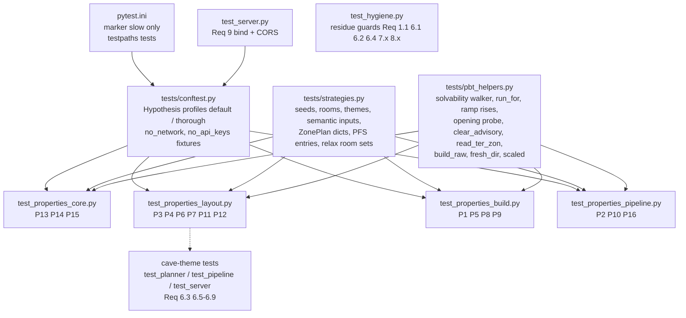

# Design Document — M0: Hygiene + PBT harness

## Overview

M0 is the first milestone of the umbrella spec `zone-generator`
(`.kiro/specs/zone-generator/design.md`, "the umbrella"). This design covers only
M0's slice of the umbrella Delivery Plan and cites the umbrella rather than
restating it. "Pn" means umbrella Correctness Property n; "Req X.Y" means **this
spec's** requirement criterion unless prefixed "umbrella".

M0 is mostly test infrastructure plus three code changes:

| Work item | Kind | Touches |
|-----------|------|---------|
| Hypothesis harness + Property_Suite (P1 dungeon, P2–P16) | tests | `pytest.ini`, `tests/conftest.py`, `tests/strategies.py`, `tests/pbt_helpers.py`, `tests/test_properties_{core,layout,build,pipeline}.py` |
| Cave_Pipeline, `cave` theme and cave-only deps removed | code removal | `generators/field/{cave,features,mesh,sdf,noise}.py`, `generators/{builder,layout,pipeline,zone_spec}.py`, `ai/{schema,rule_planner}.py`, `server/app.py`, `main.py`, `web/index.html`, `requirements.txt`, `tests/{test_cave,test_planner,test_pipeline,test_traversability,test_generators}.py`, new `tests/test_hygiene.py`, `docs/ACCEPTANCE.md`, steering |
| Legacy viewer removed | code removal | `viewer/`, `main.py`, `tests/test_pipeline.py`, `requirements.txt` |
| Loopback bind + explicit CORS | small code change | `server/app.py`, new `tests/test_server.py` |

No geometry change is intended for dungeon, city or outdoor (outdoor is pinned by
TER baseline hashes, Req 6.3). A property that fails is a real bug and is fixed
at its root (umbrella Testing Strategy, "Property-based tests"); that fix may move
geometry for some seeds and then triggers the 3D pass in Exit criteria.

### Research findings that shape the design

All verified against the code on `master` (46c04a6) and the local environment.

1. **Hypothesis is not installed** in the shared Python env. Latest on PyPI is
   **6.170.5** (supports CPython 3.13.1, the project's interpreter). Pin
   `hypothesis==6.170.5`. Its docs confirm: `derandomize=True` seeds from a hash
   of the test function, `database=None` disables example replay, profiles are
   selected with `--hypothesis-profile`, and the built-in `default` profile may be
   replaced with `register_profile` ([Hypothesis API reference](https://hypothesis.readthedocs.io/en/latest/reference/api.html)).
2. **`fastapi.testclient.TestClient` needs `httpx`, which is not installed.**
   Pin `httpx==0.28.1` (latest) as a test-only dependency. The alternative (a
   hand-rolled raw-ASGI caller) saves a dependency but duplicates what TestClient
   does; flagged in [Decisions](#decisions).
3. **Starlette's `CORSMiddleware` leaks `Access-Control-Allow-*` on a disallowed
   preflight.** Probed with an explicit `allow_origins` list: a simple request from
   a disallowed origin carries no ACA-* header (good), but an `OPTIONS` preflight
   from a disallowed origin returns 400 *with* `Access-Control-Allow-Methods`,
   `-Headers` and `-Max-Age`. That violates Req 9.3, so the stock middleware needs
   a thin subclass (see [Server](#server-serverapppy)).
4. **Windows `socket.socketpair()` connects over loopback**, and TestClient's anyio
   portal starts an asyncio loop that creates one. A blanket socket block would
   break TestClient, so the network guard blocks only non-loopback connects.
5. **Hypothesis seeds the global `random` module per test case**, so P10's draws
   within one example still differ (the pipeline's `_fresh_seed(None)` uses the
   module RNG). P10 asserts within-example variation, which is what Req 5.3 asks.
6. **Builds are cheap.** Measured on the Reference_Machine: a 12-room dungeon
   layout ≈ 5 ms, build (`write_glb=False`) ≈ 60–150 ms, `validate` ≈ 80 ms; a
   12-room outdoor build ≈ 0.55 s. The only slow first call is the one-off scipy
   import (~2.4 s).
7. **Hypothesis byte-buffer limit (~8 KiB per test case)** rules out drawing
   24 KiB payloads or 2000 names byte by byte; PFS strategies draw a small
   descriptor and expand it deterministically (see [Strategies](#strategies-testsstrategiespy)).
8. **Cave residue map.** The only importer of `generators/field/{cave,features,mesh,sdf}.py`
   outside the package is `ZoneBuilder._build_organic` (plus `tests/test_cave.py`).
   `field/terrain.py` imports only `_value_noise_3d` from `noise.py`; `noise.py`
   imports `FieldGrid` from `sdf` solely for `fbm_field`'s signature. So deleting
   `fbm_field` and that import leaves terrain code byte-for-byte on the same path.
   `skimage` and `fast_simplification` are imported only in `field/mesh.py`.
9. **Theme handling today.** `ZonePlan.validate` already maps any theme outside
   `VALID_THEMES` to `dungeon`, so dropping `cave` from `VALID_THEMES` normalises
   plans for free. `ZoneSpec.from_dict` copies `theme` verbatim (no
   normalisation). The server's controls path already returns
   `HTTPException(400, f"Unknown theme: {req.theme}")` before building, but the
   message does not list the Defined_Themes. `RulePlanner._match_theme` scores
   each `_THEME_WORDS` bucket by `text.count(word)` and keeps the first bucket
   on a tie (strict `>`, dict order `cave, outdoor, city, dungeon`). `mine` sits
   in both the `cave` theme bucket and the `mine_delve` archetype bucket; the
   archetype is matched only when the theme is `dungeon`.
10. **Cave tests outside `test_cave.py`.** `tests/test_planner.py` asserts
    `theme == "cave"` in `test_roundtrip_dict`, `test_from_dict_ignores_unknown`,
    `test_detects_cave` and two `TestExpand` tests; `tests/test_pipeline.py:182`
    asserts `"cave" not in DEFAULT_GATED_THEMES`. All are retargeted (see
    [Cave pipeline removal](#cave-pipeline-removal)).

## Architecture



Code under test is unchanged except: `server/app.py` (bind + CORS, theme list),
`main.py` (preview removal, `--theme` choices, `main(argv=None)`), the Cave_Pipeline
deletion and theme edits in [Cave pipeline removal](#cave-pipeline-removal), and
any root-cause fix a property forces.

## Components and Interfaces

### Harness configuration

**`pytest.ini`** (new, repo root):

```ini
[pytest]
testpaths = tests
markers =
    slow: build-level property test (runs the Zone_Builder or Pipeline); deselect with -m "not slow"
```

`slow` is the only custom marker and there is no `addopts`, so the Default_Run
selects everything and emits no unknown-marker warning (Req 1.2).

**`tests/conftest.py`** (new) does two things.

1. *Profiles* (Req 1.3, 1.9). Registered at import, before the Hypothesis
   plugin's `pytest_configure` applies `--hypothesis-profile`:

   ```python
   settings.register_profile("default", max_examples=100, derandomize=True,
                             database=None, deadline=200)
   settings.register_profile("thorough", max_examples=500, derandomize=False,
                             deadline=None)          # default DirectoryBasedExampleDatabase
   settings.load_profile("default")
   ```

   `tests/conftest.py` is an initial conftest for both `pytest tests/` and bare
   `pytest` (via `testpaths`), so registration precedes profile selection.
   Per-test budgets go through `scaled(n)` in `pbt_helpers`
   (`n * settings().max_examples // 100`), giving exactly 5× under `thorough` even
   for tests that set their own `max_examples`. `database=None` on the default
   profile keeps two Default_Runs on the same commit evaluating the same examples
   (no replay of a saved failure).

2. *Fixtures* for P16: `no_api_keys` (monkeypatch-deletes `OPENAI_API_KEY`,
   `ANTHROPIC_API_KEY`, `STABILITY_API_KEY`, `EQ_S3D_PLANNER`,
   `EQ_S3D_TEXTURE_PROVIDER`; calls `ai.planner.set_planner(None)` and
   `generators.textures.factory.set_provider(None)`) and `no_network` (see
   helpers). No `load_dotenv` call exists in `ai/`, `generators/` or `server/`
   (verified), so `.env` cannot re-populate the keys mid-test.

### Strategies (`tests/strategies.py`)

| Strategy | Definition | Used by |
|----------|------------|---------|
| `seeds` | `st.integers(0, 2**31 - 1)` | all generated layouts/builds |
| `room_counts(lo, hi)` | `st.integers(lo, hi)` | per criterion range |
| `box_themes` | `st.sampled_from(["dungeon", "city"])` (M0_Box_Themes) | P3–P8, P15 |
| `spec_themes` | `st.sampled_from(["dungeon", "city", "outdoor"])` | P9, P11 |
| `semantic_inputs` | fixed dict of `dungeon_theme ∈ [""] + VALID_DUNGEON_THEMES`, `dungeon_race ∈ [""] + VALID_DUNGEON_RACES`, `elemental_tint ∈ [None, ""] + VALID_ELEMENTAL_TINTS` | P3, P4, P6, P11, P15 |
| `verticality` | `st.sampled_from(["flat", "moderate", "dramatic"])` | P6, P8 (P8 draws `moderate`/`dramatic`) |
| `zone_plan_dicts` | `st.fixed_dictionaries({}, optional={...})` over every `ZonePlan` field with correctly typed values (ints `st.integers()`, bools, vocab fields `st.text()` mixed with `st.sampled_from(vocab)`, `regions` `st.lists(st.text() | st.sampled_from(VALID_REGION_KINDS))`), merged with `st.dictionaries(unknown_keys, st.none() | st.integers() | st.text())` | P12 |
| `pfs_names` | `st.text(alphabet=chr(0x20)..chr(0x7E) minus "/" "\\", min_size=1, max_size=64)` | P13, P14 |
| `pfs_entries` | composite, below | P13 |
| `origins_outside` | `st.text(printable ASCII 0x21–0x7E + space, 1–64)` mixed with near misses (`http://localhost:5174`, `https://localhost:5173`, `http://localhost:5173/`, `http://LOCALHOST:5173`, `null`, `http://[::1]:8000`), filtered `not in WEB_APP_ORIGINS` | Req 9.3 |

`pfs_entries` keeps the Hypothesis buffer small (finding 7):

- *explicit* entries: `st.lists(st.tuples(pfs_names, payload_desc), max_size=20,
  unique_by=lambda e: e[0].lower())`, where `payload_desc = (length, byte_seed)` and
  `length = st.sampled_from([0, 1, 8191, 8192, 8193, 16384, 16385, 24576, 24577])
  | st.integers(0, 24577)`. Bytes are `random.Random(byte_seed).randbytes(length)`.
- *bulk* entries: `bulk_n = st.integers(0, 2000 - len(explicit))` (biased to 0,
  1 and the maximum), `bulk_seed = st.integers(0, 2**32 - 1)`; names come from a
  seeded RNG over the same alphabet, lengths 1–64, deduplicated case-insensitively
  against everything drawn so far; payloads 0–64 bytes. This reaches 2000
  entries without 2000 draws, and shrinking still reduces `bulk_n` and lengths.
- Regression_Example (Req 2.1): 600 bulk names of length 60 → name block
  600 × (4 + 61) = 39,000 B > 35,000 B, which is also multi-chunk (> 8192 B).

### Helpers (`tests/pbt_helpers.py`)

| Helper | Behaviour |
|--------|-----------|
| `scaled(n)` | Per-test budget `n * settings().max_examples // 100` (Req 1.3). |
| `build_settings(n)` | `settings(max_examples=scaled(n), deadline=None, suppress_health_check=[HealthCheck.too_slow, HealthCheck.data_too_large])` for build-level tests (Req 1.5); `n` ∈ [10, 25]. |
| `fresh_dir()` | Context manager over `tempfile.TemporaryDirectory()`. `@given` tests must not take `tmp_path` (Hypothesis `function_scoped_fixture` health check), so each example gets its own directory. |
| `build_raw(spec, out)` | `ZoneBuilder(spec).build(output_dir=out, write_glb=False)`; returns `(BuildResult, ter_bytes, zon_bytes)` read back from the `.eqg` via `PfsArchive` (`ter_<name>.ter`, `<name>.zon`). TER/ZON are compared, never `.eqg` bytes: the PFS footer stamps `time.time()`. |
| `room_graph(spec)` | Adjacency from `corridors[*].from_room/to_room`. |
| `solvable_walk(spec)` | Fixpoint walk for P4: start `{entrance}`; repeatedly cross a corridor from a visited room if it has no Gate, or its Gate's `key_room_id` is visited; returns the visited set. |
| `run_for(spec, theme, room_count, size)` | Builds a `LayoutGenerator(theme)` with `size_multiplier = ai.expand._SIZE_SCALE[size]`, calls `_apply_room_scale(room_count)` (sets `corridor_width`, the only generator state `_route_legs` reads) and returns `gen._elevation_run(a, b)`. Mirrors umbrella Req 5.4 by calling the production function, not a re-implementation. |
| `upward_faces(ter)` | Triangles whose winding normal has `nz ≥ cos 40°` (the agent's walkable cap), as numpy arrays. |
| `ramp_rises(ter)` | Rise (`max z − min z`) of every upward triangle. `_add_ramp_corridor` emits each segment with `add_quad`, split (0,1,2)/(0,2,3); both triangles span the low and the high edge, so per-triangle rise equals per-segment rise and no quad pairing is assumed. |
| `opening_floor_z(ter, x, y, z_ref, band)` | All upward triangles whose XY closure contains `(x, y)` (tolerance 1e-4) and whose barycentric Z at that point lies in `z_ref ± band`; returns their Z values. At a seam both the room floor and the corridor floor qualify, so a step on either side is caught. |
| `clear_advisory(spec)` | Deep copy with `role="standard"`, `graph_depth=0`, `semantic_type=""`, `district=0`, `prop_hints=[]`, `encounter_intent=""`, `boss=False` on every room and `gates=[]`. `room_theme` and the spec-level `dungeon_*` fields are kept (realised content, umbrella P5). |
| `f32(x)` | `struct.unpack("<f", struct.pack("<f", x))[0]`, for bit-equality checks (Req 2.3). |
| `ref_crc(name)` | Independent bitwise MSB-first CRC (poly 0x04C11DB7, init 0, no final XOR) over `name.encode("ascii") + b"\0"`, written without `core.pfs`'s table. |
| `no_network` (fixture) | Monkeypatches `socket.socket.connect`, `connect_ex` and `socket.getaddrinfo`. Loopback (`127.0.0.0/8`, `::1`, `localhost`) and `AF_UNIX` pass through (finding 4); anything else is recorded in `attempts` and raises `OSError`. Tests assert `attempts == []`. Also patches `socket.socket.bind` to record non-loopback binds, so Req 8.3/8.4 can assert no listener opens. |

### Property modules

Each test carries a Property_Docstring (format in [Testing Strategy](#testing-strategy)):
the design property tag, the umbrella Pn, and `Validates: M0 Req X.Y; umbrella
Req A.B`. Budgets are Default_Profile values.

**`tests/test_properties_core.py`**

| Test | Property | Req | Budget | Notes |
|------|----------|-----|--------|-------|
| `test_pfs_roundtrip` | P13 | 2.1 | 100 | `from_bytes(to_bytes(arc))` name→bytes map equal, case-preserved, no extras. `@example` for the 39 KB name block. |
| `test_pfs_crc_matches_reference` | P14 | 2.2 | 100 | `_filename_crc32(n) == ref_crc(n)`. The two "differs" clauses are existence claims: asserted on pinned `@example` names (`"gukbottom.ter"` vs `zlib.crc32`, `"Ab"` vs `"aB"`), plus `event()` counts across generated names. |
| `test_ter_zon_roundtrip` | P15 | 2.3 | 20, slow | Builds with `box_themes`, n 2–12, `semantic_inputs` (so tints yield ZON regions). Reads TER/ZON from the `.eqg`, re-derives the in-memory `TerFile` via `ZoneBuilder._build_geometry` and asserts `ter.to_bytes()` equals the archived bytes, then field-wise equality after `f32`. |

**`tests/test_properties_layout.py`** (layout-only, no builder; default 100 unless noted)

| Test | Property | Req | Inputs |
|------|----------|-----|--------|
| `test_zonespec_json_roundtrip` | P11 | 2.4 | `spec_themes`, n 1–30, locks 0–5, elevation, `semantic_inputs` (so semantic fields are non-default). Asserts `ZoneSpec.from_dict(json.loads(j)).to_dict()` normalised through JSON equals `json.loads(j)`, `j = json.dumps(spec.to_dict())`. |
| `test_connectivity_and_roles` | P3 | 3.1 | `box_themes`, n 1–30, `semantic_inputs`. |
| `test_gating_solvable` | P4 | 3.2, 3.6 | `box_themes`, n 3–30, locks 1–5, `semantic_inputs`, plus the key-room-fallback `@example`. |
| `test_elevation_grade_cap` | P6 | 3.3 | `box_themes`, n 2–30, `verticality`, elevation, `semantic_inputs`, through `ai.expand.plan_to_spec` (the only path that applies verticality); run from `run_for`. |
| `test_relax_conflict_fallback` | P6 | 3.7 | Constructed room set (example test). |
| `test_flush_openings` | P7 | 3.4 | `box_themes`, n 2–12, elevation; `geometry.build_mesh(spec).to_ter(...)` in memory; budget 50. |
| `test_zoneplan_normalisation` | P12 | 3.5 | `zone_plan_dicts`. |
| `test_cave_words_mean_dungeon` | Property 19 (M0-only) | 6.5 | `cave_prompts`: ≥ 1 of `CAVE_WORDS` plus `st.text()` filler and 0–3 words sampled from the other `_THEME_WORDS` buckets, shuffled. |

**`tests/test_properties_build.py`** (all slow, `build_settings`)

| Test | Property | Req | Budget | Inputs |
|------|----------|-----|--------|--------|
| `test_raw_dungeon_navigable` | P1 | 4.1 | 20 | dungeon, n 2–12, elevation; `LayoutGenerator.generate` + `build_raw` + `validate(eqg, spec=spec)`. Exceptions propagate (no `assume`). |
| `test_ramp_subdivision` | P8 | 4.2, 4.6 | 20 | `box_themes`, n 2–12, `plan_to_spec` with elevation on, verticality `moderate`/`dramatic`. |
| `test_locks_do_not_touch_geometry` | P5 | 4.3 | 15 | `box_themes`, n 3–12, locks 1–5 vs 0, same plan and seed. |
| `test_seed_determinism` | P9 | 4.4 | 15 | `spec_themes`, n 2–12, locks 0–5, elevation; two `plan_to_spec` + `build_raw` into two `fresh_dir()`s. |
| `test_advisory_clearing` | P5 | 4.5 | 15 | `box_themes`, n 3–12, locks 1–5, `semantic_inputs` (so there is advisory data to clear). |

**`tests/test_properties_pipeline.py`**

| Test | Property | Req | Budget | Seams used |
|------|----------|-----|--------|------------|
| `test_returned_build_is_validated` | P2 | 5.1 | 15, slow | `spec_factory` spy records seeds and call count; `rng=st.randoms(use_true_random=False)`; `failure_log=None`. A raised `GenerationFailed` → `assume(False)` (outside "calls that return"). |
| `test_forced_failure_reported` | P2 | 5.2, 5.6 | 15, slow | Draws `pinned: bool`. Factory = dungeon for the given seed (n 2–4, so 8-attempt examples stay cheap) plus one isolated room (the `test_pipeline._broken_spec` pattern, keyed on the seed). Pinned: `seed` drawn, expect `pinned=True`, `attempts == 1`, `failures[0].seed == seed`. Unpinned: `max_attempts` 1–8, `timeout_s=1e9`, expect `pinned=False`, `timed_out=False`, `attempts == max_attempts`. |
| `test_fresh_seeds_vary` | P10 | 5.3 | 10, slow | k ∈ 3–10 unpinned calls on a 2-room dungeon, `rng` omitted; spy records seeds. |
| `test_no_api_default_selection` | P16 | 5.4 | example | `no_api_keys`, `no_network`. |
| `test_no_api_prompt_and_cli` | P16 | 5.5 | example, slow | Server: `TestClient(server.app.app)` with `OUTPUT_DIR`/`FAILURE_LOG` monkeypatched to `tmp_path`, POST a prompt, then GET `glb_url`. CLI: `main.main(["generate", "p16", "--rooms", "5", "--output", str(tmp_path)])`. |

### Fallback-path examples

**Key-room fallback (Req 3.6).** In `_apply_gating` the normal path chooses a key
room outside `far ∪ locked_far` and never the entrance. The fallback
(`candidates = [i for i in range(n) if i not in far]`) always contains the entrance
(the BFS root is never inside a child subtree), and `min(..., key=graph_depth)`
picks it, since it is the only depth-0 room. So **the fallback ran ⟺ some
`gate.key_room_id` equals the entrance room's id**, which can be observed from the
output with no hook and no spy.

The 3-room shape in Req 3.6 cannot arise from generation: with 3 rooms the MST's
middle node has the shortest median, so it is never the room farthest from the
centroid (the entrance). A generated shape that does reach the fallback: 4 rooms
with an entrance of degree 2 (one leaf child, one 2-room chain) and locks ≥ 3 —
tiers place keys for the leaf and the chain head outside each other, and the
third (deepest) lock has no non-entrance candidate left. During implementation a one-off scan (`LayoutGenerator.generate` over
seeds, n 4–8, locks 3–5, M0_Box_Themes) finds the first such input. It is pinned
as `@example(...)` with an `expect_fallback=True` argument (generated cases pass
`False`), and the test asserts `key_room_id == entrance_id` for it. If no seed
turns up in ≥ 200k candidates, the worker stops and reports. The fallback is then
a constructed `_apply_gating` call outside criterion 2's generated domain, which
is a deviation the user has to approve.

**Relax conflict fallback (Req 3.7).** Driven directly (generation has no
observable for this branch). Use `gen = LayoutGenerator("dungeon", seed=0)` and
`gen._apply_room_scale(3)`. Rooms are 200×200 on the X axis with 40 u wall gaps,
so each corridor is straight and `cap = run × 0.5 ≈ 20`: E (entrance, z 0),
B (z 0), C (z 200). `adj = {B: [E, C], C: [B], E: [B]}`, inserted B first.

- Precondition (proves the branch runs): before calling `_relax_elevation`, the
  test computes B's bands from the initial Z and `gen._elevation_run`:
  `[0 − cap, 0 + cap]` and `[200 − cap, 200 + cap]` are disjoint. B is the first
  node visited, so the `lo > hi` midpoint branch runs on pass 1.
- Postcondition: after `gen._relax_elevation(rooms, adj, entrance)`, every
  adjacent pair satisfies `|Δz| ≤ run × 0.5 + 0.01`.

Hand-iterating this case, B approaches its cap geometrically (residual halves
each pass) and the loop exits once a pass moves < 0.01, leaving B under the bound
by less than the 0.01 tolerance. That margin is thin on purpose: it is the case
Req 3.7 calls out. If it or a variant fails, the fix goes at the root of the
fallback (see [Root-cause fix policy](#root-cause-fix-policy)).

### Cave pipeline removal

Order inside the M0 branch: (1) capture the outdoor baseline, (2) delete code,
(3) retarget tests, (4) docs/steering. Step 1 must run on fork-point code.

**Outdoor TER baseline (Req 6.3), captured first.** New
`tests/test_hygiene.py::test_outdoor_ter_matches_fork_point`, parametrised over
`OUTDOOR_BASELINE_SEEDS = (7, 1955208177, 2147483647)`, 6 rooms each. Each case
builds `LayoutGenerator("outdoor", seed=s).generate(f"ob{s}", room_count=6)`
through `build_raw` and asserts `sha256(ter_bytes)` equals a literal. Capture
procedure (recorded in the test comment): in the M0 `-Venv` worktree, **before**
any removal commit, a one-off snippet (not committed) runs the three cases on the
fork-point code and prints the hashes; they go in as literals with the fork-point
commit hash. The removal commits must then pass unchanged. Terrain is expected to
be unaffected (finding 8: `terrain.py` uses only `_value_noise_3d`); a mismatch
means the deletion touched a shared path and is a bug, never a recapture.

**Deleted files and symbols (Req 6.1, 6.2, 7.1, 7.2):**

- Delete `generators/field/cave.py`, `features.py`, `mesh.py`, `sdf.py`.
- `generators/field/noise.py`: delete `fbm_field` and `from .sdf import FieldGrid`;
  keep `_value_noise_3d` and its helpers; reword the module docstring from "cave
  surfaces" to "terrain heightfields". `generators/field/__init__.py` comment
  drops "caves".
- `generators/builder.py`: delete `_CAVE_THEMES`, the cave branch of
  `_build_geometry` and `_build_organic`; reword the step-1 comment ("organic
  backend for cave-like themes") and the `'cave_rock'` mention in the material
  colour docstring.
- `generators/layout.py`: delete the `"cave"` entries in the per-theme materials
  table (~line 735) and light-colour table (~line 758) (Req 6.4).
- `generators/pipeline.py`: the `DEFAULT_GATED_THEMES` comment and the module /
  `generate_validated` docstrings drop "cave" ("Outdoor lives in a different
  frame"). The set stays `{"dungeon"}`.
- `requirements.txt`: remove `scikit-image==0.26.0` and
  `fast-simplification==0.1.11` (Req 7.1).

**Theme surface (Req 6.4–6.8):**

- `ai/schema.py` and `server/app.py`: `VALID_THEMES = ["dungeon", "outdoor", "city"]`.
  The server imports nothing new; both lists stay literal and the hygiene guard
  checks they are equal as sets to the Defined_Themes. `ai/llm_planner.py` reads
  `VALID_THEMES`, so its prompt and JSON-schema enum follow with no edit.
- `main.py`: `--theme` `choices=["dungeon", "outdoor", "city"]`; argparse then
  exits 2 on `--theme cave` in `parse_args`, before any build (Req 6.8).
- `web/index.html`: drop `<option value="cave">`; placeholder becomes
  `e.g. a flooded temple with lots of chambers`. Rebuild with
  `cd web; npx vite build` (no `web/package.json` change, so no `-IsolateNode`).
- `ai/rule_planner.py::_THEME_WORDS`: remove the `cave` bucket and append its
  words (`cave`, `cavern`, `grotto`, `tunnel`, `underground`, `mine`) to the
  `dungeon` bucket. `mine` stays in `_ARCHETYPE_WORDS["mine_delve"]` too, so a
  mine prompt now yields theme `dungeon` **and** archetype `mine_delve` (before,
  theme `cave` suppressed the archetype). Dict order and the strict-`>` tie rule
  are unchanged, so a prompt whose outdoor or city words outscore or tie its
  dungeon words keeps that theme (a tie goes to the earlier bucket, `outdoor`
  then `city`). Module docstring example becomes "a big flooded cavern … should
  produce a large dungeon with a water region". Gap flagged to requirements:
  Req 6.5 reads unconditionally; the design satisfies it for every prompt whose
  cave/dungeon words are not tied or outscored by outdoor/city words (Property 19).
- `generators/zone_spec.py::ZoneSpec.from_dict`: `theme = d.get("theme",
  "dungeon")`, then `"dungeon" if theme == "cave" else theme` (Req 6.6). Only
  `cave` is remapped; other unknown spec themes stay as today (out of scope).
  `ZonePlan.validate` needs no change (finding 9).
- `server/app.py` controls path: keep the existing 400 before the factory is
  built; change the detail to `f"Unknown theme: {req.theme!r}; valid themes:
  {', '.join(VALID_THEMES)}"` (Req 6.7).

**Kept (Req 6.11):** `styles/cave.json` and `analyzer/style_builder.py`'s `"cave"`
reference-zone list, untouched. `test_pfs.py` and `test_textures.py` keep their
`cave` texture-name strings (not theme references).

**Tests (Req 6.9, 6.10):**

- Delete `tests/test_cave.py` (whole file: SDF, features, connectivity, routing).
- `tests/test_pipeline.py`: delete the `assert "cave" not in DEFAULT_GATED_THEMES`
  line (~182).
- `tests/test_traversability.py`: docstring "Outdoor/cave" → "Outdoor".
- `tests/test_generators.py::test_rule_planner_open_is_zero`: keep the cave prompt,
  add `assert plan.theme == "dungeon"`.
- `tests/test_planner.py`: `test_roundtrip_dict` and the two `TestExpand` tests use
  `theme="outdoor"` / `"dungeon"` in place of `"cave"`; `test_from_dict_ignores_unknown`
  asserts `{"theme": "cave", ...}` → `p.theme == "dungeon"` (Req 6.6, plan side);
  `test_detects_cave` becomes `test_cave_words_mean_dungeon` (one prompt per
  Cave_Word → `theme == "dungeon"`, Req 6.5).
- New `tests/test_planner.py::test_zonespec_cave_theme_normalised`: a
  `ZoneSpec.to_dict()` with `theme` overwritten to `"cave"` loads back as
  `dungeon` (Req 6.6, spec side).
- New in `tests/test_server.py`: controls POST with `theme="cave"` → 400, detail
  names all three Defined_Themes, and the `OUTPUT_DIR` stays empty (Req 6.7).
- New in `tests/test_pipeline.py::TestCliNoPreview` (renamed `TestCliArgs`):
  `main.main(["generate", "x", "--theme", "cave", "--output", out])` →
  `SystemExit(2)`, `out` not created (Req 6.8).
- New slow example in `tests/test_pipeline.py`:
  `generate_validated` on `plan_to_spec(RulePlanner().plan("a dark underground
  cavern with many tunnels"), seed=s)` for an unpinned call → returns, theme
  `dungeon`, validated (Req 6.9).

### Residue guards (`tests/test_hygiene.py`)

Small and cheap, warranted because Req 6–8 exist to stop reintroduction. Static
checks over tracked `*.py` files (excluding this module, whose forbidden tokens
are built by concatenation):

- the four deleted `generators/field/*.py` files do not exist; no source imports
  `generators.field.{cave,features,mesh,sdf}` or `.field.{…}`/`from .sdf`; no
  `fbm_field`, `_build_organic` or `_CAVE_THEMES` token (Req 6.1); `noise.py`
  still defines `_value_noise_3d` and has no `sdf` import (Req 6.2);
- `set(ai.schema.VALID_THEMES) == set(server.app.VALID_THEMES) == {"dungeon",
  "city", "outdoor"}`; the `main.py` parser's `--theme` choices equal the same set;
  `web/index.html` theme `<option value=…>` set equals it; `LayoutGenerator`'s
  material and light tables have no `"cave"` key (Req 6.4);
- no `import skimage` / `from skimage`, no `fast_simplification`, no
  `simplify_quadric_decimation` (Req 7.2);
- no `import flask` / `from flask`, no `viewer.` import, no `args.preview`;
  `not Path("viewer").exists()` (Req 8.1);
- `requirements.txt` has no `scikit-image`, `fast-simplification` or `flask` line
  and pins `hypothesis==` (Req 1.1, 7.1, 8.2);
- `tests/test_cave.py` does not exist (Req 6.10);
- the outdoor baseline test above (Req 6.3).

Req 7.3 (suite passes without `skimage`/`fast_simplification`) is a manual
`-Venv` check (see Testing Strategy).

### Legacy viewer removal

- Delete `viewer/` (`serve.py`, `index.html`).
- `main.py`: delete `cmd_preview`, `_launch_preview`, the `preview` subparser,
  `g.add_argument("--preview", ...)` and the `if args.preview:` block. Rewrite the
  module docstring so it lists only `generate` (no preview lines). Change
  `def main()` to `def main(argv: list[str] | None = None)` with
  `parser.parse_args(argv)`, so tests drive the CLI in-process.
- argparse already gives the required failures: `preview` → `invalid choice:
  'preview'` (exit 2, from the required subparser); `generate x --preview` →
  `unrecognized arguments: --preview` (exit 2). Both happen in `parse_args`,
  before any build or file write (Req 8.3, 8.4).
- `tests/test_pipeline.py::TestCliEscapeHatch._args`: drop `preview=False` from
  the `Namespace`. `README.md` and `docs/` contain no preview launch instructions
  today (verified), so Req 8.6 needs only the `main.py` docstring change.
- `requirements.txt`: remove `flask==3.1.0` and rename the section comment to
  "API backend".
- CLI tests (in `tests/test_pipeline.py`, class `TestCliNoPreview`):
  `pytest.raises(SystemExit)` with `code == 2` and the stderr message for
  `["preview", "x"]` and `["generate", "x", "--preview", "--output", out]`. Each
  run uses `no_network`, which records binds, and asserts `out` does not exist
  afterwards. A test of `--help` / `generate --help` asserts the captured help has
  no "preview".

### Server (`server/app.py`)

```python
HOST, PORT = "127.0.0.1", 8000
WEB_APP_ORIGINS = (
    "http://127.0.0.1:8000", "http://localhost:8000",     # same-origin (web/dist)
    "http://localhost:5173", "http://127.0.0.1:5173",     # frontend port
)

class LocalCORSMiddleware(CORSMiddleware):
    """Explicit-origin CORS; strips every Access-Control-Allow-* from a
    preflight whose Origin is not allowed (stock Starlette leaks them)."""
    def preflight_response(self, request_headers):
        resp = super().preflight_response(request_headers)
        if not self.is_allowed_origin(request_headers["origin"]):
            for k in [k for k in resp.headers if k.lower().startswith("access-control-allow-")]:
                del resp.headers[k]
        return resp

app.add_middleware(LocalCORSMiddleware, allow_origins=list(WEB_APP_ORIGINS),
                   allow_methods=["GET", "POST"], allow_headers=["Content-Type"])
...
if __name__ == "__main__":
    import uvicorn
    uvicorn.run("server.app:app", host=HOST, port=PORT, reload=False)
```

- Methods and headers: `web/src/api.ts` issues `POST /api/generate` with
  `Content-Type: application/json` and `GET`s for the GLB, sidecar and map;
  nothing else. Starlette adds the CORS-safelisted headers itself.
- No `allow_credentials` and no `expose_headers`, so a simple response carries
  only `Access-Control-Allow-Origin` (echoed, Req 9.2) or nothing (Req 9.3, 9.7).
  An explicit origin list means Starlette never emits `*` (Req 9.4).
- `preflight_response` is the documented sync override point in Starlette's
  `CORSMiddleware`. The worker confirms its signature against the starlette
  version pinned by `fastapi==0.115.6`. The shared env runs fastapi 0.143.1 /
  starlette 1.8.0, not the pins (env drift; the `-Venv` worktree installs the
  pins).
- Frontend: `web/vite.config.ts` already proxies `/api` to
  `http://127.0.0.1:8000`, and `web/dev.mjs` already starts uvicorn with
  `--host 127.0.0.1`. Neither changes. Through the proxy the browser treats calls
  as same-origin; the forwarded `Origin: http://localhost:5173` is in the list.
- `tests/test_server.py` (TestClient, `OUTPUT_DIR`/`FAILURE_LOG` monkeypatched):
  - 9.1: `runpy.run_module("server.app", run_name="__main__")` with `uvicorn.run`
    monkeypatched to capture kwargs; assert `host == "127.0.0.1"` and
    `port == 8000`. No real bind. The loopback-only bind follows from the host
    value; the human smoke pass confirms it live.
  - 9.2: for each of the four origins, `GET /api/health` echoes ACAO
    byte-identically.
  - 9.3: property over `origins_outside`: GET, POST and preflight all carry no
    `access-control-allow-*` header.
  - 9.4: every response in the module goes through `assert_no_wildcard`.
  - 9.5: with `Origin: http://localhost:5173`, POST `/api/generate` (pinned seed,
    3 rooms) → 200 and `validated`; GET `glb_url` and `zone_url` → 200; ACAO
    echoed on each.
  - 9.6: preflight for `POST` + `content-type` from each origin → 200 with ACAO,
    `Allow-Methods ⊇ {POST}`, `Allow-Headers ∋ content-type`.
  - 9.7: no `Origin` → 200 and no ACA-* header.

### Process items (not system behaviour)

Done in the M0 branch except where marked *integration*:

- `.kiro/agents/*.json`. `orchestrator.json`: description, prompt and resources
  move from `tasks/<id>.md` / `tasks/README.md` to `.kiro/specs/<feature>/tasks.md`;
  `fs_write` allow-list gains `.kiro/specs/**`. `task-author.json`: writes
  `.kiro/specs/<feature>/tasks.md` entries (allow-list `tasks/**` →
  `.kiro/specs/**`); the `_TEMPLATE.md` resource is replaced by the spec
  `tasks.md` format. `task-worker.json`, `task-reviewer.json`,
  `task-readiness.json`: description/prompt/welcome text and `file://tasks/_TEMPLATE.md`
  resources re-pointed; the worker's deny list keeps `ROADMAP.md`, `README.md`,
  `tasks/README.md`. The single-writer rule and the "eyeball it in 3D" bar stay
  verbatim. First commit or discard the uncommitted `orchestrator.json` change,
  and delete the gitignored `.kiro/agents/*.json.bak`.
- `.kiro/steering/project.md`: "Task tracking" and "Running a task" describe
  `.kiro/specs/<feature>/tasks.md` as the unit of work for new work, with
  `tasks/` kept as history (umbrella Planning Model); the backend list drops the
  organic cave backend.
- `.kiro/steering/lessons-learned.md`: the cave entries ("Automated structural
  tests can pass…", "Don't decimate cave meshes", "Walkable floors need deliberate
  shaping", "Multi-lobe chambers…", localized feature SDFs, voxel budget) gain a
  lead line: the cave pipeline was removed in M0; cave returns as a dungeon
  archetype (umbrella M3) and the natural geometry style (umbrella M5). The
  hard-won facts stay verbatim as guidance for M5: never decimate walkable floors,
  voxel ≈ 12 u matches Classic–PoP edge length, clamp floors one-sided and
  re-intersect with the floor plane after blends.
- `docs/ACCEPTANCE.md`: remove `cave` from the "Generates without error" theme
  list; mark section D "Caves specifically" and the C "Single connected cave"
  item *Retired: pending the natural geometry style (umbrella M5)*; drop the cave
  seed-sweep snippet (replaced by a one-line dungeon sweep using the same
  pattern); "outdoor/cave still manual" → "outdoor still manual".
- `.gitignore`: add `.hypothesis/` under "Test artifacts" (Req 1.8).
- *Integration*: `tasks/README.md` reconciliation, the ROADMAP `ZoneSpec.districts`
  correction, README "organic caves" line and ROADMAP cave items, absorbed-task
  marking (`cave-backend-refactor` absorbed by M0, `cave-cavify-dungeon` → umbrella
  M5), and retiring `.kiro/specs/content-layer-districts` (requirements "Delivery
  and process").

## Data Models

M0 adds no runtime data model. Test-side data:

### Hypothesis profiles

| Profile | `max_examples` | `derandomize` | `database` | `deadline` | Selected by |
|---------|----------------|---------------|------------|------------|-------------|
| `default` (Default_Profile) | 100 | True | None | 200 ms (build tests: None) | implicit |
| `thorough` (Thorough_Profile) | 500 | False | `.hypothesis/` dir | None | `--hypothesis-profile=thorough` |

Effective per-test count = `scaled(n)` = `n × max_examples / 100`, so the
thorough count is 5× the default count for every test.

### Example budgets (Default_Profile)

| Group | Tests | Examples | Est. time |
|-------|-------|----------|-----------|
| Core (pure) | P13, P14 | 100 each | ~8 s (P13 archives up to 2000 entries) |
| Core (build) | P15 | 20 | ~3 s |
| Layout | P3, P4, P6, P11, P12 | 100 each | ~6 s |
| Layout (mesh) | P7 | 50 | ~3 s |
| Build | P1 20, P8 20, P5-locks 15 ×2, P9 15 ×2 (outdoor ≈ 0.55 s), P5-advisory 15 ×2 | 115 builds | ~25 s |
| Pipeline | P2 ×3, P10 | ≈ 40 calls + ~150 cheap builds | ~8 s |
| Layout (planner) | Property 19 (cave words) | 100 | ~1 s |
| Examples | P16, server, CLI, hygiene, outdoor baseline (3 builds), cave-prompt pipeline | — | ~8 s |
| **Total added** | | | **≈ 60 s** |

Budget levers, in order, if the median of 3 Default_Runs exceeds baseline + 60 s
(Req 1.4): (1) deleting `tests/test_cave.py` removes its cave builds (including
the 5-room connectivity sweeps) from the baseline cost; (2) lower build budgets
toward the floor of 10; (3) cap P13 `bulk_n` per example at 500 with the
2000-entry case kept as an `@example`; (4) P9 draws outdoor at most once per three examples via
`sampled_from` weighting. Builds always use `write_glb=False` (except the P16
server path, which needs a GLB) and `failure_log=None` unless a log is asserted.

### Constants

- `WEB_APP_ORIGINS` (server, imported by `test_server.py`).
- `OUTDOOR_BASELINE = {seed: sha256_hex}` over `OUTDOOR_BASELINE_SEEDS` (in `test_hygiene.py`).
- `DEFINED_THEMES = {"dungeon", "city", "outdoor"}` and `CAVE_WORDS = ("cave", "cavern", "grotto", "underground", "tunnel")` (in `tests/strategies.py`).
- `PINNED_CORRIDOR_SEEDS = (1955208177, 1516796975, 481893615)` (human pass only).

## Correctness Properties

*A property is a characteristic or behavior that should hold true across all valid executions of a system-essentially, a formal statement about what the system should do. Properties serve as the bridge between human-readable specifications and machine-verifiable correctness guarantees.*

These are the M0 scopings of umbrella properties; each implements as one
Hypothesis test (names in [Property modules](#property-modules)). Criteria that
are configuration, process or single examples (Req 1.x, 3.6, 3.7, 4.6, 5.4, 5.5,
6.1–6.4, 6.6–6.11, 7.x, 8.x, 9.1, 9.2, 9.5–9.7) are covered by example and smoke
tests in [Testing Strategy](#testing-strategy).

Reflection: Req 5.2 and 5.6 are the pinned and unpinned branches of one
forced-failure behaviour and merge into Property 15. Req 9.4 is implied for
disallowed origins by Property 18 and checked on every other response by
example tests. The two P5 properties stay separate: locks compares TER **and**
ZON across two generations, while advisory clearing compares TER for one spec
with more fields cleared.

### Property 1: PFS archive round-trip

*For any* list of 0–2000 entries with distinct (case-insensitive) printable-ASCII
names of 1–64 characters and payloads of 0–24,577 bytes, reading back the written
archive yields exactly the input name→bytes map, names case-preserved, no extra
entries. Umbrella P13.

**Validates: Requirements 2.1**

### Property 2: PFS filename CRC matches the reference

*For any* printable-ASCII name of 1–64 characters, `_filename_crc32(name)` equals
an independent bitwise MSB-first CRC (poly 0x04C11DB7, init 0, no final XOR) over
the name bytes plus one NUL. Umbrella P14.

**Validates: Requirements 2.2**

### Property 3: Built TER and ZON round-trip

*For any* M0_Box_Theme, seed and room count 2–12, the TER and ZON the Zone_Builder
writes read back with equal vertices, polygons (indices, material, flags),
materials (name, shader, properties), objects, lights and regions; floats are
bit-equal to their float32 conversion, integers and strings exact. Umbrella P15.

**Validates: Requirements 2.3**

### Property 4: ZoneSpec JSON round-trip

*For any* Zone_Spec the Layout_Generator produces (themes dungeon/city/outdoor,
room counts 1–30, locks 0–5, elevation on/off), `from_dict` of the JSON-loaded
`to_dict` serialises back to a dictionary equal to the JSON-loaded original, field
for field, with exact float equality. Umbrella P11.

**Validates: Requirements 2.4**

### Property 5: Layout connectivity and pacing roles

*For any* seed, room count 1–30, M0_Box_Theme and semantic-labelling input (empty
or from vocabulary), the Room_Graph has exactly the requested rooms and is
connected, exactly one room is the entrance, and for 2+ rooms exactly one room is
the climax and it is not the entrance. Umbrella P3 (single District).

**Validates: Requirements 3.1**

### Property 6: Gating is solvable

*For any* seed, room count 3–30, lock count 1–5, M0_Box_Theme and semantic input,
the layout has between 1 and `locks` Gates, and a player who starts at the
entrance and crosses a gated corridor only after visiting its key room visits
every room. This includes the pinned input where the key-room fallback runs.
Umbrella P4 (single District).

**Validates: Requirements 3.2, 3.6**

### Property 7: Elevation grade cap

*For any* seed, room count 2–30, verticality, elevation flag, M0_Box_Theme and
semantic input, every corridor (tree or loop edge) satisfies
`|from_z − to_z| ≤ run × 0.5 + 0.01`, run being `LayoutGenerator._elevation_run`
for its two rooms. The constructed conflict case checks the relaxation fallback
against the same bound. Umbrella P6.

**Validates: Requirements 3.3, 3.7**

### Property 8: Flush openings

*For any* seed, room count 2–12 and M0_Box_Theme, every corridor's `from_z`/`to_z`
equal its rooms' `floor_z`, and every upward face of the Box_Backend mesh under
each opening point, within the corridor's height of that floor, lies within
0.01 u of `floor_z`. Umbrella P7.

**Validates: Requirements 3.4**

### Property 9: ZonePlan normalisation

*For any* dictionary holding any subset of today's Zone_Plan fields with correctly
typed (possibly out-of-range or off-vocabulary) values plus any unknown keys,
`ZonePlan.from_dict` yields every field inside its umbrella-Req 2.3/2.4/2.8
domain, and a second `validate()` returns an equal plan. Umbrella P12 (no
controls path).

**Validates: Requirements 3.5**

### Property 10: Raw dungeon builds are navigable

*For any* seed, room count 2–12 and elevation flag, a dungeon Raw_Build passes the
Traversal_Validator; a Zone_Builder exception fails the property. Umbrella P1
(dungeon).

**Validates: Requirements 4.1**

### Property 11: Ramp subdivision

*For any* M0_Box_Theme build with elevation on, seed and room count 2–12, every
upward-facing floor triangle in the written TER rises at most 2.51 u. Since each
ramp segment is one quad split along its diagonal, this bounds every sloped
segment. The pinned input has a corridor rising more than 2.5 u in total.
Umbrella P8.

**Validates: Requirements 4.2, 4.6**

### Property 12: Locks never touch geometry

*For any* M0_Box_Theme, seed, room count 3–12 and lock count 1–5, the TER and ZON
built from the Zone_Plan with those locks are byte-identical to those built with
locks 0. Umbrella P5 (locks).

**Validates: Requirements 4.3**

### Property 13: Seed determinism

*For any* theme in {dungeon, city, outdoor}, room count 2–12, lock count 0–5 and
elevation flag, two Raw_Builds with the same Zone_Plan, Pinned_Seed and zone name
into distinct directories produce equal Zone_Spec dictionaries and byte-identical
TER and ZON. Umbrella P9 (no map artifacts).

**Validates: Requirements 4.4**

### Property 14: Advisory clearing leaves the TER unchanged

*For any* Zone_Spec built for an M0_Box_Theme, seed and room count 3–12, the TER is
byte-identical to the TER built from `clear_advisory(spec)`. Umbrella P5 (advisory
clearing).

**Validates: Requirements 4.5**

### Property 15: Returned builds passed the gate

*For any* unpinned dungeon `generate_validated` call with `max_attempts` 1–8 that
returns, the build passed the Traversal_Validator, the factory ran between 1 and
`max_attempts` times, and the returned seed is the seed of the last factory call.
Umbrella P2.

**Validates: Requirements 5.1**

### Property 16: Forced failures are reported, never swapped

*For any* dungeon `generate_validated` call whose every Raw_Build fails the
Traversal_Validator: with a Pinned_Seed it raises `GenerationFailed(pinned=True)`
with one attempt whose failure carries that seed; unpinned, with `max_attempts`
1–8 and a non-binding timeout, it raises `GenerationFailed(pinned=False,
timed_out=False)` with `attempts == max_attempts`. Umbrella P2 (pinned and
exhaustion).

**Validates: Requirements 5.2, 5.6**

### Property 17: Fresh seeds vary

*For any* k in 3–10, k unpinned `generate_validated` calls with identical inputs
and no caller `rng` draw seeds in 0–2,147,483,647 that are not all equal.
Umbrella P10.

**Validates: Requirements 5.3**

### Property 18: Foreign origins get no CORS grant

*For any* `Origin` value outside the Web_App_Origins (random printable strings
and near-misses in scheme, host case, port and trailing slash), simple GET, POST
and preflight responses carry no `Access-Control-Allow-*` header, and in
particular no `Access-Control-Allow-Origin: *`.

**Validates: Requirements 9.3, 9.4**

### Property 19: Cave words never yield a cave theme

*For any* prompt containing one or more Cave_Words (mixed with random filler and,
optionally, outdoor/city/dungeon keywords), `RulePlanner().plan(prompt).theme` is
in the Defined_Themes, and it equals `dungeon` whenever the prompt's dungeon-bucket
score (Cave_Words included, counted with `str.count` as the planner does) is
strictly greater than its outdoor and city scores. Test
`test_properties_layout.py::test_cave_words_mean_dungeon`, budget 100, scores
computed in the test from `_THEME_WORDS` for the `strictly greater` premise.

**Validates: Requirements 6.5**

## Root-cause fix policy

Umbrella rule, applied: a counterexample is a bug. The worker fixes it at the
root, pins the input as a Regression_Example (`@example(...).via("discovered
failure")`), and leaves the assertion as stated (Req 1.7). Known suspects:

| Suspect | Property | Where | Likely fix options (choose only once the property fails) |
|---------|----------|-------|------------------------------------------------------------|
| Semantic `sink` with elevation off | P7 (umbrella P6) | `semantics._apply_shape` adds `sink × race_scale` (−30…+8 u before scaling; `giant` ×2.2 → up to −66 u) to `floor_z`; `LayoutGenerator.generate` runs `_assign_elevation` (and so `_relax_elevation`) only `if elevation`. A sunk room next to a flat one over a short run breaks the cap, and the subdivided ramp then exceeds 40°. | (a) When `themed`, always run `_relax_elevation` over the edges (with elevation off as well), so sinks survive wherever the run carries them. Reuses the proven clamp; recommended. (b) Skip `sink` when elevation is off. Simplest, but drops the content hint on flat layouts. (c) Clamp each room's sink by its minimum neighbour run. Duplicates the relax logic. |
| Relax conflict midpoint | P7 (umbrella P6) | `_relax_elevation` `else: newz = (lo + hi) / 2`, loop exit at `moved < 0.01` | Tighten the exit (e.g. `moved < 1e-4`) or end with a feasibility pass that re-clamps every room toward the entrance-fixed band. Never widen the 0.01 tolerance. |
| Key-room fallback | P6 (umbrella P4) | `_apply_gating` `if not candidates` | Expected to hold: later keys avoid every earlier `far`, so key dependencies only point to later tiers and cannot cycle, and the fallback key is the entrance. If refuted, restrict fallback candidates to rooms reachable without crossing any chosen lock. |
| PFS CRC collision / sentinel clash | P1 (umbrella P13) | `from_bytes` keys data by CRC; a name hashing to `0x61580AC9` reads as the name block | Probability ≈ n²/2³³ per example (≈ 5e-4 at n = 2000). If found, it is a format limit (the client keys by CRC too). Stop and ask the user; don't narrow the strategy silently. |

Secondary finding (no property violation, **not** fixed in M0): with elevation
on, `_assign_elevation`'s BFS overwrites `floor_z` for every non-entrance room, so
semantic `sink` survives only on the entrance. The semantics docstring's "elevation
builds on the sunk/raised floors" doesn't happen. Recorded for the integration
note and the content-layer follow-up.

**3D pass trigger:** any fix that changes layout or geometry for some seeds
(option (a) or (c) above, a relax change, a gating change) triggers the Exit
criteria human pass: the dungeon sections of `docs/ACCEPTANCE.md` on the affected
seeds plus 1955208177, 1516796975, 481893615, noted in `tasks.md`.

## Error Handling

| Scenario | Handling |
|----------|----------|
| Property counterexample | Root fix + Regression_Example (above); suite stays red until fixed. |
| Hypothesis `too_slow` / `data_too_large` on build tests | Suppressed via `build_settings`; `deadline=None`. Other health checks stay on. |
| `function_scoped_fixture` health check | Avoided by design: `@given` tests use `fresh_dir()`, not `tmp_path`/`monkeypatch`; P16 tests are plain example tests and use fixtures normally. |
| Zone_Builder exception inside P1 | Propagates and fails the example (Req 4.1); never `assume`. |
| `GenerationFailed` in Property 15 | `assume(False)`: outside "calls that return"; with real dungeons this is rare and won't trip `filter_too_much`. |
| Outdoor baseline mismatch (Req 6.3) | Fails with seed and both hashes printed. Treated as a deletion bug (a shared terrain path changed). Recapture only on the fork-point code, and only if a dependency version (numpy) explains it. |
| Theme `cave` in controls / CLI | Server 400 listing the Defined_Themes; argparse exit 2. Both before any build (Req 6.7, 6.8). |
| Theme `cave` in a loaded plan or spec dict | Normalised to `dungeon` silently (Req 6.6). |
| CLI `preview` / `--preview` | argparse exit 2 before any build (Req 8.3, 8.4). |
| Disallowed CORS preflight | 400 from Starlette with ACA-* stripped by `LocalCORSMiddleware` (Req 9.3). |
| Outbound socket during P16 | `no_network` raises `OSError` and records it; the test fails on a non-empty record. |

## Testing Strategy

**Library:** Hypothesis 6.170.5 (pinned), via its pytest plugin. No custom PBT
machinery. Each property in [Correctness Properties](#correctness-properties) is
one `@given` test. Its Property_Docstring begins
`Feature: zone-generator-m0-hygiene, Property N: <title>`, then names the umbrella
Pn and the requirement ids (Req 1.6). Non-build properties run ≥ 100 examples
under the Default_Profile (P7/flush: 50, bounded by mesh cost). Build-level
properties run 10–25 by Req 1.5, deliberately below the generic 100 floor. The
`thorough` profile multiplies every count by 5.

**Example and smoke tests** (no PBT, because the behaviour doesn't vary with input
or the input is a fixed set):

- P16 (Req 5.4, 5.5): selection and end-to-end prompt/CLI runs under
  `no_api_keys` + `no_network`.
- Fallbacks (Req 3.6, 3.7): pinned `@example` and constructed relax case.
- Cave removal (Req 6.1–6.4, 6.6–6.11, 7.1, 7.2): residue guards and the outdoor
  TER baseline in `test_hygiene.py`; plan/spec normalisation in `test_planner.py`;
  server 400 in `test_server.py`; CLI exit 2 and the slow cave-prompt pipeline
  example in `test_pipeline.py`. Req 6.5 is Property 19.
- CLI (Req 8.3–8.5) in `test_pipeline.py`; server (Req 9.1, 9.2, 9.5–9.7) in
  `test_server.py`.

**Manual verification by the worker** (recorded in `tasks.md`, not automated):

- Req 6.3: outdoor baseline hashes captured on fork-point code before the first
  removal commit (procedure in [Cave pipeline removal](#cave-pipeline-removal)).
- Req 6.4 (web): `cd web; npx vite build` succeeds after the `index.html` edit.
- Req 6.11: `git diff <fork-point> -- styles/cave.json analyzer/style_builder.py`
  is empty.
- Req 1.2: no `PytestUnknownMarkWarning` in the Default_Run.
- Req 1.4: median of 3 Default_Runs vs the pre-M0 baseline (≈ 85 s) on the
  Reference_Machine, `.hypothesis/` emptied before each.
- Req 1.9: two Default_Runs with `--hypothesis-show-statistics` report the same
  example counts for each property test.
- Req 7.3: run the suite once in the `-Venv` with `fast-simplification` and
  `scikit-image` uninstalled (`pip uninstall -y fast-simplification scikit-image`).
- Exit: one full `--hypothesis-profile=thorough` run, recorded.

**Human pass** (Exit criteria): smoke the Web_App on :5173 and on :8000 after the
CORS change (generate one zone, load it). Walk the 3D section only if a root fix
moved geometry (see [Root-cause fix policy](#root-cause-fix-policy)). Nothing in
M0 has been verified in the live viewer yet.

## Risks

| Risk | Mitigation |
|------|------------|
| Suite exceeds +60 s | Budget table and levers above; cheap builds measured. Deleting `tests/test_cave.py` removes its cave builds from the run. |
| Deleting `test_cave.py` drops the walkable-cave-floor regression tests (floor clamp, one-sided noise, floor faces up) | Accepted: the code they guarded is gone. Their lessons move to `lessons-learned.md` as guidance for umbrella M5, which must re-establish equivalent tests on the natural style. |
| Rule-planner tie behaviour moves for mixed prompts (a cave word tied with an outdoor/city word used to give `cave`, now gives the earlier bucket) | Deliberate: dict order and tie rule unchanged (Decision 5). Property 19 pins the non-tie case; Req 6.5's unconditional wording is flagged for the requirements author. |
| Outdoor baseline hash moves across numpy versions | Captured and compared in the pinned `-Venv` on the Reference_Machine; the test comment says so. |
| Derandomized examples miss rare seeds | The thorough run at exit is randomized with 5× examples; counterexamples get pinned. |
| Starlette override point differs at the pinned version | Worker checks `CORSMiddleware.preflight_response` in the `-Venv` before relying on it. Fallback: a pure ASGI wrapper that drops `access-control-allow-*` from `http.response.start` when the request `Origin` is not allowed. |
| ZON rotation converts degrees on write, so `rotation ≠ 0` may not be float32 bit-equal | The builder writes rotation 0 today. A non-zero case belongs to M1+; if it appears, it is a P15 counterexample handled under the policy. |
| Procedural texture seeds use salted `hash()` (`textures/procedural._seed_from`) | Outside M0: P9 compares TER/ZON only. Noted for the integration note. |
| Shared-env drift (fastapi 0.143.1 installed vs 0.115.6 pinned) | All M0 work happens in a `-Venv` worktree with pinned deps. |

## Decisions

1. **httpx pinned (`httpx==0.28.1`) as a test-only dependency** so tests can use
   FastAPI's `TestClient`. The umbrella Dependencies list names only Hypothesis
   as new, so this is a small addition the user should confirm. The alternative
   is a ~30-line raw-ASGI helper.
2. **Fallback detection without hooks.** Key-room: `key_room_id == entrance`
   (exact, from output). Relax conflict: a precondition computed from the
   constructed initial Z. No production code gains an observability hook.
3. **`main(argv=None)`** is the only CLI signature change. Tests drive the CLI
   in-process (fast, capturable) instead of through subprocesses.
4. **`LocalCORSMiddleware` subclass** instead of stock `CORSMiddleware`, to meet
   Req 9.3 on preflights (finding 3).
5. **Cave words fold into the `dungeon` bucket** of `_THEME_WORDS` rather than
   forcing `dungeon` whenever a cave word appears. This keeps one scoring rule
   and lets "a cave on the forest coast" stay outdoor; the cost is that Req 6.5
   holds only when outdoor/city words do not tie or outscore (Property 19). The
   alternative (a hard override) is a one-line change if the user prefers it.
   `ZoneSpec.from_dict` remaps only `cave`, not every unknown theme.
6. **Default_Profile `database=None`** so derandomized runs are reproducible; the
   thorough profile keeps the database for counterexample replay.
