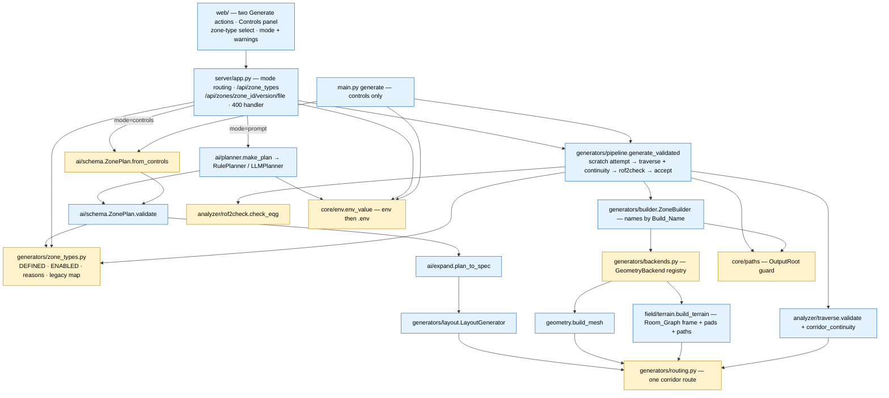

# Design Document — M1: Controls + all-zone-type traversability + format gate

## Overview

M1 is the second milestone of the umbrella spec `zone-generator`
(`.kiro/specs/zone-generator/design.md`, "the umbrella"). This design refines the
umbrella for the M1 slice and cites it rather than restating it. "Pn" means
umbrella Correctness Property n; "M1-Pn" is a property new in this spec; "Req X.Y"
means **this spec's** requirement criterion unless prefixed "umbrella". Umbrella
decision 19 (zone vocabulary) applies: code and text below use `zone_type` /
`wilderness`; the umbrella text's `theme` / `outdoor` / `ENABLED_THEMES` read
through it.

| Wave | Work item | Kind | Touches |
|------|-----------|------|---------|
| 1 | Large-zone connectivity: 30-room properties, corridor-floor continuity, validator speed-up, single routing helper, flat first then elevation, root fixes | tests + geometry/layout fixes | `analyzer/traverse.py`, new `generators/routing.py`, `generators/{geometry,layout}.py`, `tests/{strategies,pbt_helpers,test_properties_build,test_properties_layout}.py` |
| 2 | `theme` → `zone_type`, `outdoor` → `wilderness`, legacy keys on load | mechanical rename | new `generators/zone_types.py`, `ai/*`, `generators/{zone_spec,layout,builder,pipeline}.py`, `core/eqg.py` (sidecar key), `server/app.py`, `main.py`, `web/`, tests |
| 3 | `GeometryBackend` registry; wilderness terrain in the Room_Graph frame with pads and graded paths | backend change | new `generators/backends.py`, `generators/field/terrain.py`, `generators/builder.py`, `generators/layout.py` (wilderness grade) |
| 4 | Gate city + wilderness; availability from one Enabled set; scratch directory per attempt | pipeline | `generators/{zone_types,pipeline}.py`, `server/app.py` |
| 5 | `mode`, `ZonePlan.from_controls`, geometry-slice controls, two Generate actions | surfaces | `ai/schema.py`, `server/app.py`, `main.py`, `web/` |
| 6 | Build naming (`<name>.*` in `<zone id>/v<version>/`), `rof2check` hard gate, file-system confinement | new analyzer + surfaces | new `analyzer/rof2check.py`, new `core/{env,paths}.py`, `core/pfs.py` (raw directory reader), `generators/{builder,pipeline}.py`, `core/eqg.py` (Sidecar writer), `server/app.py`, `main.py`, `web/` |

The Target_Shortname takeover (Known_Zone_List, picker, rename-only Export) is
not in M1: umbrella design decision 20 moves it to M6, where the target is
chosen alongside the SQL. M1 adds no target field anywhere (Req 8.1). The
zone-list research done for M1 is kept in [Handed off to M6
(Export)](#handed-off-to-m6-export).

A property that fails is a real bug and is fixed at its root (umbrella Testing
Strategy). Wave 1 is designed around that: it measures first, then fixes the
layout or Box_Backend, never the property.

### Research findings that shape the design

Verified against `master` at `09aef75` and the local environment
(Reference_Machine, `F:\everquest_rof2`). The probes were throwaway scripts outside
the repo; nothing was committed.

1. **The controls path already matches the plan path.** For 1,440 inputs (zone
   types dungeon/city/outdoor × seeds 0–59 × rooms {1, 5, 12, 30} × elevation
   on/off), `LayoutGenerator(theme, seed).generate(name, room_count, elevation)`
   produced a `to_dict()` equal to `plan_to_spec(ZonePlan(theme, room_count,
   verticality = "moderate" if elevation else "flat", size="medium"), seed)`.
   Reason: `LayoutGenerator`'s defaults (`elevation_chance` 0.5, rise 20–80,
   `size_multiplier` 1.0) equal `_VERTICALITY["moderate"]` and `_SIZE_SCALE["medium"]`.
   So the umbrella's "golden check vs today's controls output" is expected to
   pass and **no one-time seed break is expected from `from_controls`** (the
   golden test still lands, see [Modes](#modes-and-controls-wave-5)).
2. **About 6–8 % of corridors cross a third room.** Over 300 seeds per size
   (dungeon, elevation on), approximating each corridor leg as its
   axis-aligned rectangle (±half-width) and counting penetration > 10 u into a
   room other than its two endpoints: 271 of 3,632 corridors at 12 rooms, 591 of
   10,261 at 30 rooms; 25 / 116 pairs of corridors that share no room cross each
   other; 18 / 49 corridors have a stub that points back into its own room
   (`fx` past `tx`). 72 % of 12-room and 93 % of 30-room zones have at least one
   of these. The validator doesn't model walls, so none of this fails P1 today,
   but in the client a corridor through room C is cut by C's (collidable) walls
   and C is cut by the corridor's. This matches the "disconnected-looking
   corridors" from the M0 human pass better than a floor gap does.
3. **P1 already passes at 30 rooms on the M0 seeds.** 40 builds (seeds
   1949459644, 1510177507 and 1–18; elevation on and off; 30 rooms; dungeon)
   all passed the sound validator. Whole-zone flood reachability is a weak
   oracle here: `_faces_in_room` counts a room reached when *any* standable face
   with its centroid in the footprint is reached, so a corridor floor passing
   through a room marks that room reachable.
4. **The sound validator is slow.** `validate` takes ≈ 2.1 s for a 12-room
   dungeon and ≈ 3.4 s for 30 rooms (M0 design finding 6 measured 80 ms under
   the old unsound adjacency). A 6-room outdoor zone (54,340 triangles) takes
   **118 s**. Most of that is the Python seam-contact pass in
   `build_walk_surface`, which tests every nearby pair even when the two faces
   are already connected through shared vertices. Gating wilderness at all, and
   running 30-room properties in the Default_Run, needs this fixed first.
5. **Wilderness builds miss their own texture.** The terrain backend emits one
   material `ground` → `ground.dds`, but the builder only packs textures for
   `spec.materials` (`floor`, `wall`, `ceiling`). The archive has no
   `ground.dds`, which fails Req 9.1 (diffuse present). The outdoor terrain also
   spans x 0…10,450, y 0…6,500 while its room centres run from −3,485 to +5,784
   (the known frame bug).
6. **Wilderness terrain can't meet Req 6.2's centroid bound at the current grade
   cap.** Req 6.2 (umbrella 6.5) keeps edge-adjacent centroids under a corridor
   within 3 u in Z. On a 50 u grid, edge-adjacent centroids sit up to
   50·√2/3 ≈ 23.6 u apart, so the path grade must be ≤ 3 / 23.6 ≈ 0.127. The
   layout's `max_grade` is 0.5. Wilderness therefore gets its own cap (0.1, see
   [Wilderness terrain](#wilderness-terrain-wave-3)).
7. **`.env` is never loaded.** `python-dotenv` is pinned but unused; the
   planners and texture providers read `os.environ` only, and nothing reads
   `EQ_PATH` at runtime. Req 10.2 (umbrella 31.3) needs a reader that doesn't
   leak `.env` into `os.environ` (that would defeat the `no_api_keys` fixture);
   in M1 `EQ_PATH` is read only for the Output_Directory refusal check.
8. **The Sidecar's `theme` key is not the zone type.** `core/eqg.py::_write_glb_sidecar`
   writes `"theme": {dungeon_theme, dungeon_race, elemental_tint}` (the content
   layer) and no zone-level selector at all. Req 11.1 forbids a `theme` key, so
   the content block moves to `content`.
9. **Files are already named by the Build_Name, except for the folder.**
   `ZoneBuilder.build` names the archive, `ter_<name>.ter`, `<name>.zon` and the
   other artifacts `spec.name.lower()`, and the Server sets `spec.name` to the
   zone id. What Req 8.2/8.3 add is the per-build `<zone id>/v<version>/`
   directory, a Sidecar on every build (not only with `write_glb`), the Sidecar
   `name` check, and a CLI name restricted to the Build_Name alphabet.

(Two findings from the earlier short-name design, arena's loose `arena.zon` and
stat-only install marking, now live in [Handed off to M6
(Export)](#handed-off-to-m6-export).)

### As-built verification

Exact current names (master `09aef75`), the shape M1 starts from:

| Area | As built |
|------|----------|
| Zone-type vocabulary | `ai/schema.py::VALID_THEMES = ["dungeon", "outdoor", "city"]`; duplicate literal `server/app.py::VALID_THEMES`; `main.py` `--theme choices=["dungeon", "outdoor", "city"]`; `web/index.html` `<select id="theme">`; `generators/builder.py::_TERRAIN_THEMES = {"outdoor"}`; `generators/layout.py::_SEMANTIC_THEMES = {"dungeon", "city"}`; per-theme tables in `LayoutGenerator._add_default_materials` / `_add_room_lights`; `styles/{dungeon,city,outdoor,cave}.json` |
| Plan | `ZonePlan(name, theme, room_count, size, elevation, verticality, regions, locks, dungeon_theme, dungeon_race, elemental_tint, mood, prompt)`; `validate()` maps an unknown theme to `dungeon`; `from_dict` drops unknown keys; **no** `from_controls`; `ZONE_PLAN_JSON_SCHEMA` enum `VALID_THEMES` |
| Expansion | `ai/expand.py::plan_to_spec(plan, seed)`; `_SIZE_SCALE`, `_VERTICALITY`; `elevation = plan.elevation and plan.verticality != "flat"`; sets `spec.style_profile = plan.theme` |
| Spec | `ZoneSpec(name, theme, style_profile, seed, dungeon_theme, dungeon_race, elemental_tint, …)`; `from_dict` remaps only `cave` → `dungeon` |
| Layout | `LayoutGenerator(theme, seed)`; `max_grade = 0.5`; `_assign_elevation`, `_relax_elevation` (exit `moved < 1e-4`), `_relax_semantic_floors`, `_route_legs`, `_elevation_run`, `_wall_point` (2 u inset, wall chosen by centre delta), `_open_facing_walls` (removes the **whole** wall quad) |
| Box_Backend | `generators/geometry.py::build_mesh`, `MeshBuilder.add_corridor` (straight / Z / L; L is unreachable for corridors with rooms because the centre-delta test is symmetric), `_emit_route` (carry = longest leg unless stairs), `_add_ramp_corridor` (`MAX_SEG_RISE = 2.5`); flat legs are one quad |
| Terrain | `generators/field/terrain.py::build_terrain(TerrainSpec, name, material_name="ground", texture="ground.dds")`, vertices at `x = i·res`; `ZoneBuilder._build_terrain` sizes 600 u margins from room centres only |
| Builder | `ZoneBuilder(spec).build(output_dir, write_glb, ter_version) -> BuildResult(spec, eqg_path, glb_path, vertex_count, polygon_count, material_count)`; files named `spec.name.lower()`; `.glb`, `.zone.json` and `.map.svg` only when `write_glb=True` |
| Pipeline | `generate_validated(spec_factory, *, theme, zone_id, seed, output_dir, write_glb, ter_version, max_attempts=8, timeout_s=20.0, gated_themes=DEFAULT_GATED_THEMES, validate_enabled, agent, rng, failure_log)`; `DEFAULT_GATED_THEMES = frozenset({"dungeon"})`; every attempt builds straight into `output_dir` (no scratch, rejected files are overwritten, not removed); `ValidatedBuild(result, spec, seed, attempts, validated, gated, report)`; `GenerationFailed(zone_id, theme, failures, pinned, timed_out)`; JSONL key `theme` |
| Validator | `analyzer/traverse.py`: `AgentModel(40°, 3.0, 2.0, 6.0)`, `build_walk_surface` (shared-vertex pass + `_tri_tri_xy_contact` / `_plane_z_at` seam pass, `|nz|` so ceilings count as standable), `flood_reachable`, `_faces_in_room` (centroid-in-footprint, Z band −8…+height+4), `validate(eqg_path, spec, spec_path, agent) -> TraversalReport` |
| Server | `GenerateRequest{prompt?, theme="dungeon", rooms: int ge=1 le=30, elevation=True, seed?}` (out-of-range `rooms` → **422**, not a clamp or 400); non-empty prompt wins; `GenerateResponse{id, theme, rooms, seed, …, source, planner, plan, gates, validated, attempts, build_commit}`; routes `/api/themes` (`{"themes": [...], "reference_zones": {...}}`), `/api/generate`, `/api/zones/{filename}` (flat `output/web/`), `/api/health`, `/api/version`; `OUTPUT_DIR.mkdir` at import; `HOST`/`PORT` loopback; `LocalCORSMiddleware` |
| CLI | `main.py generate name --theme --rooms --seed --output --ter-version --no-validate`; builds via `LayoutGenerator(...).generate(...)`; spec saved as `<output>/<name>.json`; `name` is not validated; no size/verticality/locks options |
| Web | `#prompt`, one `#generate`, `#reset-view`, `#show-map`, `<details id="advanced">` with `#theme`, `#rooms`, `#elevation`, `#seed`; panel `#m-source`, `#m-theme`, `#m-rooms`, …; `doGenerate()` on load; `api.ts::GenerateParams{prompt, theme, rooms, elevation, seed}`; `controls.ts::_typingTarget` suppresses movement keys for INPUT/SELECT/TEXTAREA/contentEditable |
| Format | No `rof2check`; `core/pfs.py::PfsArchive.from_bytes` keys entries by CRC (a wrong CRC surfaces as an `unknown_<crc>` name, never an exception per entry); `core/ter.py::FLAG_PASSABLE = 0x01`, `PROP_DIFFUSE`; no polygon is ever passable today |
| Tests | `tests/conftest.py` profiles `default` (100, derandomize, `database=None`, deadline 200 ms) and `thorough` (500); `tests/pbt_helpers.py::{scaled, build_settings, fresh_dir, build_raw, run_for, upward_faces, ramp_rises, opening_floor_z, clear_advisory, …}`; P1 `test_properties_build.py::test_raw_dungeon_navigable` (n 2–12), P7 `test_properties_layout.py::test_flush_openings` (n 2–12, budget 50), P8 `test_properties_build.py::test_ramp_subdivision` (n 2–12); `tests/test_hygiene.py::test_outdoor_ter_matches_fork_point` pins outdoor TER sha256 for 3 seeds |

**Where the requirements' as-built notes are wrong or incomplete:**

- *"The zone-level selector is the field `theme` … throughout (… the Sidecar)"* —
  the Sidecar has **no** zone-level selector. Its `theme` key holds the
  content-layer dictionary (finding 8).
- *"`GenerateRequest` is the legacy flat shape `{prompt?, theme, rooms, elevation,
  seed}`"* — also `rooms` carries `ge=1, le=30`, so an out-of-range room count is
  a 422 today, neither a clamp (Req 2.4) nor a 400 (Req 2.5).
- *"Req 1.7/1.8 … is therefore new work"* — the code path is new, but the output
  isn't: the golden comparison already matches (finding 1).
- *"The outdoor terrain mesh is generated in a different coordinate frame … so it
  cannot be gated until Req 6 lands"* — true, and two more things block the gate:
  the missing `ground.dds` (finding 5) and a 118 s validation (finding 4).
- *"The `.eqg`/TER/ZON/GLB/map artifacts are named `<zone_id>.*`"* — true for the
  server. The CLI names them by its positional `name`, and the map and sidecar
  are written only when `write_glb` is on. Both are already the Build_Name
  (finding 9); M1 keeps that naming and adds the per-build directory.
- *"`analyzer/traverse.py` is the sound validator"* — sound for adjacency, but
  room reachability is "any face whose centroid lies in the footprint", ceilings
  count as standable, and walls are not modelled (finding 3). Requirement 5's
  continuity property is designed around exactly these gaps.

## Architecture



Dependency direction stays as the umbrella's module seams: `core/` imports
nothing project-level (`core/env.py` and `core/paths.py` are stdlib +
`python-dotenv`), `analyzer/` reads `core/` and `ZoneSpec`, `ai/` may import
`generators.zone_types` (types and lookups only) and `core.env`, and only
`generators/pipeline.py` imports `analyzer.{traverse,rof2check}`.

## Components and Interfaces

### Connectivity (wave 1)

Wave 1 is foundational and partly unknown until it runs (see [What wave 1 can't
know yet](#what-wave-1-cant-know-yet)). Its order is fixed: speed-up and
routing refactor (no geometry change) → measure → fix flat → prove flat in 3D →
widen to elevation → fix → prove elevation in 3D.

#### Validator speed-up without changing reachability (`analyzer/traverse.py`)

The seam pass adds an edge only between faces that are not already connected.
`build_walk_surface` keeps a union-find over standable faces: the shared-vertex
pass unions as it adds edges, and the seam pass skips a candidate pair when
`find(fi) == find(fj)` *before* calling `_tri_tri_xy_contact`, unioning on
every accepted edge. Connected components, and therefore `flood_reachable` from
any face, are identical to the reference; only redundant edges are dropped.
Two further cuts that keep the same components:

- seam candidates come only from faces whose weld component touches another
  component's XY bounding box (a terrain is one weld component, so its seam pass
  is empty);
- `_cells_for` is vectorised with numpy (cell ranges per face), and the
  per-cell pair loop is skipped for cells holding one component.

`WalkSurface` gains `component: np.ndarray` (root per standable face). Nothing
else reads adjacency lists except `flood_reachable`, so the change is internal.
The reference implementation is copied verbatim (fork-point code) into
`tests/reference_traverse.py` for the equivalence property M1-P4; no production
code keeps two versions. Target on the Reference_Machine: ≤ 1.0 s for a 30-room
dungeon and ≤ 15 s for a 12-room wilderness zone. These are design targets, not
assertions; if they aren't met, the worker reports the measured numbers before
widening the Default_Run budgets.

#### One corridor route (`generators/routing.py`, new)

Today the route is decided twice: `MeshBuilder.add_corridor` and
`LayoutGenerator._route_legs` duplicate the straight / Z test. M1 adds a third
and fourth consumer (continuity footprints, terrain paths), so the decision moves
to one function:

```python
@dataclass(frozen=True)
class Route:
    waypoints: tuple[tuple[float, float], ...]   # ≥ 2 points
    axes: tuple[bool, ...]                       # True = leg runs along X
    carry: int                                   # leg that carries the whole rise
    kind: str                                    # "straight" | "z" | "l"

def plan_route(from_xy, to_xy, exit_from_x: bool, exit_to_x: bool,
               hw: float, steps: int) -> Route: ...
def corridor_route(cor: CorridorSpec, rooms: Mapping[str, RoomSpec]) -> Route: ...
def route_footprint(route: Route, hw: float) -> list[Rect]:  # leg rects ± hw, corner squares
    ...
```

`add_corridor` and `_route_legs` call it; `_emit_route` keeps its body. This
refactor must leave TER bytes identical. The worker checks it once, in the
refactor commit, with a throwaway script: TER sha256 for dungeon and city, seeds
7 / 1955208177 / 1516796975 / 481893615, rooms 12 and 30, elevation on and off,
captured on the fork-point code and compared after the refactor (the M0
outdoor-baseline procedure). It is not committed as a test, because the wave-1
root fixes that follow are meant to move geometry; the hashes and the result go
in the task's Deliverables.

#### Corridor floor continuity (`analyzer/traverse.py`)

```python
@dataclass
class CorridorResult:
    corridor_id: str
    from_room: str
    to_room: str
    connected: bool
    reason: str = ""            # "" | "no floor in from_room" | "no floor in to_room" | "gap" | "crosses room <id>"

def corridor_continuity(surf: WalkSurface, spec: ZoneSpec,
                        agent: AgentModel) -> list[CorridorResult]: ...
```

For each corridor `c` joining rooms A and B:

1. `region = route_footprint(corridor_route(c, rooms), hw + agent.adjacency_eps) ∪
   footprint(A) ∪ footprint(B)`, **minus** the footprint of every other room.
2. `faces = {standable f : centroid_xy(f) ∈ region}`.
3. `start = _faces_in_room(surf, A) ∩ faces`, `goal = _faces_in_room(surf, B) ∩ faces`.
4. Flood from `start` across `surf.adjacency` restricted to `faces`;
   `connected ⇔ start ≠ ∅ ∧ goal ≠ ∅ ∧ goal ∩ reached ≠ ∅`.
5. If not connected and some leg rectangle penetrates a third room by more than
   `agent.adjacency_eps`, `reason = "crosses room <id>"`.

**Decision: the continuity path may not enter a third room's footprint.** The
requirements leave this open ("not merely a floor face present at each
opening"); the umbrella requires it for the natural style (umbrella Req 7.9).
It is the right bar for M1 because the validator does not model walls: a
corridor running through room C passes through C's collidable wall quads in the
client and its own walls cut C, so a path through C is not a path a player has
(finding 2). Excluding third-room footprints makes that defect a property
failure instead of a silent pass, and it also stops a corridor from "reaching" a
room the global flood would credit (finding 3). It is checked on the mesh read
back from the `.eqg`, with the same adjacency the gate uses, and works unchanged
for terrain (footprint selection, not mesh provenance).

`validate(..., check_corridors: bool = False)` fills
`TraversalReport.corridors: list[CorridorResult]` and
`TraversalReport.corridors_passed`. `TraversalReport.passed` keeps its umbrella
Req 4.2 meaning (every room reachable). The Pipeline (wave 4) calls
`validate(check_corridors=True)` and treats an attempt as traversable only when
`report.passed and report.corridors_passed`; this is stricter than the gate in
Req 4.2 and rejects only builds Requirement 5 already calls broken.

#### Flat path

The flat build already exists end to end: `verticality = "flat"` in a plan
gives `elevation = False` in `plan_to_spec`, and the Web_App's Elevation checkbox
(unchecked) sends `elevation: false`, which wave 5 maps to verticality `flat`.
Wave 1 needs no new surface to look at flat 30-room zones in 3D; the CLI and
controls options arrive in wave 5 (Req 5.3 is complete only then).

#### Property widening

Strategies (`tests/strategies.py`):

```python
room_counts_wide = st.one_of(st.integers(2, 12), st.integers(13, 30))   # ~half the draws ≥ 13
flat_only        = st.just("flat")
verticality_all  = st.sampled_from(["flat", "moderate", "dramatic"])
```

| Test | Property | Change | Budget (default profile) |
|------|----------|--------|--------------------------|
| `test_properties_build.py::test_raw_navigable` (renamed from `test_raw_dungeon_navigable`) | P1 | box zone types, `room_counts_wide`, `plan_to_spec` with verticality (flat first, then all); `@example`s for the M0 human-pass inputs | 15 |
| `test_properties_build.py::test_corridor_continuity` (new) | M1-P1 | same domain as P1 | 15 |
| `test_properties_layout.py::test_flush_openings` | P7 | `room_counts_wide` | 50 |
| `test_properties_build.py::test_ramp_subdivision` | P8 | `room_counts_wide`, moderate/dramatic | 20 |
| `test_properties_core.py::test_walk_surface_equivalence` (new) | M1-P4 | vs `tests/reference_traverse.py` | 10, slow |

The M0 human-pass inputs are reproduced through the rule planner, the way the
user made them: `RulePlanner().plan("create a dungeon with 30 rooms")` with seed
1949459644, and `"a dungeon with 30 rooms and long halls"` with seed 1510177507,
pinned with `@example(...)` and `.via("M0 human pass")`.

**Flat first, then elevation.** The first wave-1 commit that widens a property
draws `flat_only`. Elevation draws (`verticality_all`) are added in a later
commit, only after the flat properties are green and the flat 3D pass is signed
off. No elevation draw is ever marked `xfail`; the order lives in the commit
sequence, not in a weaker assertion.

#### What wave 1 can't know yet

The design commits to the process, not to a particular fix, because these are
only knowable by running it:

- Whether M1-P1 fails at all, and at which room counts. Finding 2 predicts that
  the third-room exclusion fails on most zones today; finding 3 says the global
  flood does not.
- The root cause of each failure class, and whether the flat and elevated
  failures share one.
- Whether the fix moves geometry for seeds outside the failures (it very likely
  does if it changes edges or wall points), i.e. the size of the one-time seed
  break.
- The validator's real time after the speed-up, which sets the final budgets.

So wave 1 starts with a measurement task: run `scripts/sweep_connectivity.py`
(new; dungeon and city, rooms 12 / 20 / 30, flat and elevation, 200 seeds each)
reporting per failure class (`gap`, `crosses room`, `no floor`, inverted stub,
corridor–corridor crossing) with seeds, written to the task's Deliverables.
Fixes are then chosen per class from the suspects below, each pinned as a
Regression_Example, and each recorded with the seeds it moved.

| Suspect | Seen as | Where | Fix options (choose only after measuring) |
|---------|---------|-------|------------------------------------------|
| Corridor crosses a third room | `crosses room` | `_connect_rooms` keeps Delaunay/MST edges whose route passes through another room | (a) **split** the edge A–B into A–C and C–B when the route enters C (C becomes a waypoint room; recommended, keeps the graph connected and reads as a hand-made through-room); (b) drop the edge when it is a loop (non-tree) edge; (c) re-route around C. (b) alone can't fix tree edges. |
| Inverted stub (`fx` past `tx`) | `gap`, or a ramp inside a room | `_wall_point` picks the wall by centre delta; when the rooms overlap on that axis the facing walls are crossed | choose the wall by the gap between footprints (the axis with positive separation), not by centre delta; one change in `_wall_point`, mirrored by `plan_route` |
| Carry leg inside a room | ramp clipping a room floor (elevation only) | `_emit_route` carries on the longest leg, which can be a stub that lies inside a room after an inversion | expected to vanish with the inverted-stub fix; otherwise carry on the jog (as stairs already do) |
| Two unrelated corridors cross | `corridor conflict` (Decision 12) | same as the first row | fixed in wave 1 with the third-room class; conflict is a Z-clearance test so a future bridge kind is exempt |
| Room reached only through a corridor's centroid | false pass of P1 | `_faces_in_room` | not changed in M1: M1-P1 excludes third-room footprints, so it can't hide behind this |

Every fix keeps Req 5.1–5.6 (flush openings, grade cap, confined rise, three
axis-aligned legs). Splitting an edge (a) changes the Room_Graph, so P3, P4 and
P6 run on it unchanged and must stay green.

### Zone-type vocabulary (wave 2)

`generators/zone_types.py` (new) is the single source the plan, spec, builder,
pipeline, server, CLI and web list read:

```python
DEFINED_ZONE_TYPES: tuple[str, ...] = ("dungeon", "city", "wilderness")
DEFAULT_ZONE_TYPE = "dungeon"
LEGACY_ZONE_TYPE_VALUES = {"outdoor": "wilderness"}
STYLE_PROFILE = {"dungeon": "dungeon", "city": "city", "wilderness": "outdoor"}  # styles/<profile>.json

def canonical_zone_type(value: object) -> str | None:
    """Lower-cased, legacy-mapped member of DEFINED_ZONE_TYPES, or None."""

def read_zone_type(d: Mapping[str, object]) -> object:
    """d["zone_type"] if present, else d["theme"], else DEFAULT_ZONE_TYPE (Req 11.2)."""
```

Wave 4 adds `ENABLED_ZONE_TYPES` and `ZONE_TYPE_REASONS` to the same module (see
[Gate and availability](#gate-and-availability-wave-4)).

Renames (Req 11.1, 11.3, 11.4), content fields untouched (Req 11.6):

| Where | Before | After |
|-------|--------|-------|
| `ai/schema.py` | `VALID_THEMES`, `ZonePlan.theme`, schema key `theme` | `VALID_ZONE_TYPES = list(DEFINED_ZONE_TYPES)`, `ZonePlan.zone_type`, schema key `zone_type` |
| `ai/rule_planner.py` | `_THEME_WORDS` key `outdoor`, `_match_theme` | `_ZONE_TYPE_WORDS` key `wilderness` (the word list, including "outdoor", is unchanged), `_match_zone_type`; same scoring and tie rule |
| `ai/llm_planner.py` | "Choose exactly one theme from" | "Choose exactly one zone_type from", enum `VALID_ZONE_TYPES` |
| `ai/expand.py` | `LayoutGenerator(theme=plan.theme)`, `style_profile = plan.theme` | `LayoutGenerator(zone_type=plan.zone_type)`, `style_profile = STYLE_PROFILE[plan.zone_type]` |
| `generators/zone_spec.py` | `ZoneSpec.theme` | `ZoneSpec.zone_type`; `from_dict` reads `read_zone_type(d)` → `canonical_zone_type` → `dungeon` if undefined (umbrella Req 11.9) |
| `generators/layout.py` | `LayoutGenerator(theme)`, `self.theme`, tables keyed `outdoor` | `LayoutGenerator(zone_type)`, `self.zone_type`, tables keyed `wilderness`; `load_style_profile(STYLE_PROFILE[zone_type])` |
| `generators/builder.py` | `_TERRAIN_THEMES` | replaced by the registry (wave 3) |
| `generators/pipeline.py` | `theme=`, `gated_themes`, `DEFAULT_GATED_THEMES`, JSONL `theme` | `zone_type=`, `gated_zone_types`, (wave 4) `ENABLED_ZONE_TYPES`, JSONL `zone_type` |
| `core/eqg.py` Sidecar | `"theme": {content}` | `"content": {content}`, plus `"zone_type"` |
| `server/app.py` | `VALID_THEMES`, `GenerateResponse.theme`, `GET /api/themes` | `zone_type`, `GET /api/zone_types` + alias `GET /api/themes` (same handler, same body) |
| `main.py` | `--theme` | `--zone-type`, `--theme` deprecated alias (same `dest`, legacy `outdoor` accepted) |
| `web/` | `#theme`, `m-theme`, `result.theme`, `sidecar.theme` | `#zone-type`, `m-zone-type`, `result.zone_type`, `sidecar.content ?? sidecar.theme` (old sidecars) |

The profile **file** stays `styles/outdoor.json`: `style_profile` names a
measured profile, not a Zone_Type, and `analyzer/style_builder.py` keys its
reference zones the same way. Test-side identifiers (`box_themes`, …) are renamed
to `box_zone_types` etc. in the same commit; M0 property docstrings keep their
historical tags.

`tests/test_hygiene.py::test_theme_surface_is_three` becomes
`test_zone_type_surface_is_three` (schema, web `<option>`s, CLI choices, server
listing all equal `DEFINED_ZONE_TYPES`), and a new guard asserts no `"theme"` key
in `ZonePlan.to_dict()`, `ZoneSpec.to_dict()`, the Sidecar, or any
`GenerateResponse` field.

### Wilderness terrain (wave 3)

#### Backend registry (`generators/backends.py`, new)

```python
class GeometryBackend(Protocol):
    name: str
    def build(self, spec: ZoneSpec, ter_name: str, ter_version: int) -> TerFile | None: ...

class BoxBackend:      name = "box"       # build_mesh(spec).to_ter(ter_name, ter_version)
class TerrainBackend:  name = "terrain"   # build_terrain(...); None when it can't run

BACKENDS: dict[str, GeometryBackend] = {
    "dungeon": BoxBackend(), "city": BoxBackend(), "wilderness": TerrainBackend()}

def backend_for(zone_type: str) -> GeometryBackend: ...   # undefined → BACKENDS["dungeon"]
```

`ZoneBuilder._build_geometry` becomes: `ter = backend_for(spec.zone_type).build(...)`;
on `None` it builds with `BoxBackend` and appends
`"backend_fallback: <name> unavailable, built with box"` to
`BuildResult.warnings` (Req 4.3). `TerrainBackend` returns `None` when its
import of `numpy` fails; the test monkeypatches `TerrainBackend.build` to return
`None`. No cave backend exists or is registered (Req 7.1).

#### Terrain in the Room_Graph frame (`generators/field/terrain.py`)

Refines umbrella "Outdoor terrain in the room-graph frame". New signature:

```python
def build_terrain(spec: TerrainSpec, name: str, rooms: Sequence[RoomSpec],
                  corridors: Sequence[CorridorSpec], material: MaterialSpec) -> TerFile | None: ...
```

1. **Bounds.** `x0 = min over rooms and route footprints − margin`, likewise
   `y0, x1, y1`, with `margin = max(600, 2·res)` (Req 6.1 needs ≥ one sample
   spacing). `x0, y0` are snapped down to multiples of `res` so the frame is a
   pure translation of the index grid; vertices are written at
   `(x0 + i·res, y0 + j·res)` and nothing is rotated or scaled.
2. **Base field.** Unchanged noise, erosion and `_enforce_walkable`, evaluated
   at world coordinates `x0 + i·res` (not `i·res`), so the hills belong to the
   world, not the patch.
3. **Paths, then pads.** For each corridor: `route = corridor_route(c, rooms)`;
   path height `h_path(p) = from_z + (to_z − from_z) · s(p) / S` with `s` the
   arc length of `p`'s projection onto the route polyline and `S` its length.
   Weight `w = 1` for grid points within `hw + res` of the polyline (one full
   cell beyond the footprint, so every triangle that touches the corridor lies on
   the path surface), smoothstep to 0 over `L = max(2·res, |Δh| / 0.5)`. Pads:
   `w = 1` inside the room footprint grown by `res`, same falloff; pads are
   applied after paths so a room floor wins over a path at its own opening
   (where they agree, since `from_z = floor_z`).
4. **Re-walkability outside the masks.** `_enforce_walkable` runs again with the
   weight-1 cells frozen.
5. **Material.** The terrain uses the spec's `floor` MaterialSpec (name, texture,
   shader), so its texture is packed like any other (finding 5).

**Grade.** `LayoutGenerator` sets `self.max_grade = 0.1` for `wilderness`
(0.5 otherwise). With a linear profile over `S ≥ run`, the path grade is
≤ 0.1, so edge-adjacent centroids on the path differ by ≤ 0.1 · 23.6 ≈ 2.4 u
(Req 6.2's 3 u) and the slope is ≈ 5.7° (Req 6.2's 40°). A finer grid would also
work but costs O(1/res²) triangles in the builder, the GLB and the validator; the
cap costs nothing and outdoor rises already dwarf what a 0.5 grade allows at
outdoor scale.

**Rooms and corridors unchanged (Req 6.1).** `build_terrain` reads the specs and
never writes them; M1's P18 asserts `spec.to_dict()` is equal before and after
`ZoneBuilder.build`.

**Retired baseline.** `tests/test_hygiene.py::test_outdoor_ter_matches_fork_point`
pinned the origin-anchored terrain on purpose (M0 Req 6.3). Wave 3 changes that
terrain by design, so the test is deleted in the wave-3 commit that moves the
frame, with the commit message saying so; P9 (determinism, now with wilderness)
and P18 replace it.

**Interaction with wave 1.** A corridor path crossing a third room's pad, or two
paths crossing at different heights, can't satisfy Req 6.2 on terrain. The
wave-1 clearance fix removes the first; the second is a corridor conflict (Decision 12), also fixed in wave 1.

### Gate and availability (wave 4)

`generators/zone_types.py` gains:

```python
ENABLED_ZONE_TYPES: frozenset[str] = frozenset({"dungeon", "city", "wilderness"})
ZONE_TYPE_REASONS: dict[str, str] = {
    "dungeon":    "Box backend; every build passes the traversal and format gates.",
    "city":       "Box backend; every build passes the traversal and format gates.",
    "wilderness": "Heightfield terrain under the room graph; every build passes the gates.",
}
DISABLED_REASON = "Not yet offered: its builds don't pass the traversability sweep."

def is_enabled(zone_type: str) -> bool: ...          # reads ENABLED_ZONE_TYPES at call time
def zone_type_listing() -> list[dict]: ...           # [{"name", "enabled", "reason"}] in DEFINED order
```

`wilderness` joins `ENABLED_ZONE_TYPES` only in the commit where the wilderness
P1 / P18 / M1-P2 / P20 properties are green (Req 3.2, 6.3). If they aren't green
by the end of wave 4, it ships disabled with `DISABLED_REASON`, and the Web_App
shows it disabled. Gated_Zone_Types are `ENABLED_ZONE_TYPES` by definition
(Req 3.1): there is no second set.

#### Pipeline (`generators/pipeline.py`)

```python
DEFAULT_TIMEOUT_S = {"dungeon": 20.0, "city": 20.0, "wilderness": 60.0}

def generate_validated(
    spec_factory: SpecFactory, *, zone_type: str, zone_id: str,
    seed: int | None = None, output_dir: str | Path = "output", version: int = 1,
    write_glb: bool = True, ter_version: int = 2,
    max_attempts: int = DEFAULT_MAX_ATTEMPTS, timeout_s: float | None = None,   # None ⇒ per zone type
    gated_zone_types: Collection[str] | None = None,                           # None ⇒ ENABLED_ZONE_TYPES
    validate_enabled: bool = True, agent: AgentModel | None = None,
    rng: random.Random | None = None,
    failure_log: str | Path | None = DEFAULT_FAILURE_LOG,
    warnings: Sequence[str] = (),                                              # carried into the Sidecar
) -> ValidatedBuild: ...
```

Per attempt *k*:

1. `scratch = OutputRoot(output_dir).path(".attempts", zone_id, f"a{k}")`; build
   into it.
2. `report = validate(eqg, spec, agent, check_corridors=True)`;
   `fmt = check_eqg(eqg, spec, sidecar_path=scratch / f"{name}.zone.json")`
   with `name = spec.name` (the Build_Name)
   (wave 6; until then `fmt` is a passing stub so waves 4 and 6 stay separable).
3. Pass ⇔ `report.passed ∧ report.corridors_passed ∧ fmt.passed`.
4. Pass: `final = output_dir / zone_id / f"v{version}"`; `os.replace` every file
   from `scratch` into `final` (same volume, so each move is atomic); merge
   `{"format": fmt.to_dict(), "warnings": [...], "validated": True,
   "attempts": k, "seed": s}` into the Sidecar there; remove `scratch` and the
   empty `.attempts/<zone_id>` parent; return.
5. Fail: log one JSONL line (`ts, zone_id, zone_type, seed, attempt, checks:
   [failed check names], reasons`), `shutil.rmtree(scratch)` (through
   `OutputRoot.remove_tree`), then the existing pinned / attempts / timeout logic.

Ungated builds (`validate_enabled=False`, i.e. `--no-validate`, or a zone type
outside `gated_zone_types`) build once into the scratch directory, still run the
Format_Checker and record it in the Sidecar, and are moved to `final` marked
`validated=False`. A crash inside an attempt (exception from the builder) removes
the scratch directory in a `finally` and re-raises.

`ValidatedBuild` gains `format: FormatReport | None`, `warnings: list[str]`,
`build_dir: Path`, and `zone_type` replaces the old `gated` meaning:
`gated = zone_type in gated_zone_types and validate_enabled`.
`AttemptFailure` gains `checks: list[str]`. `GenerationFailed(zone_id,
zone_type, failures, pinned, timed_out)`; its message lists each rejected seed
with its failed checks (Req 4.2 via umbrella Req 4.7).

### Modes and controls (wave 5)

#### `ZonePlan.from_controls` (`ai/schema.py`)

```python
CONTROL_ALIASES = {"rooms": "room_count", "theme": "zone_type"}   # legacy flat names

@classmethod
def from_controls(cls, controls: Mapping[str, Any],
                  warnings: list[str] | None = None) -> "ZonePlan":
    """Controls dict → ZonePlan through the same validate() as from_dict.
    Aliases map to plan keys (a plan key present wins over its alias);
    legacy `elevation: false` with no `verticality` means verticality 'flat'."""
```

`from_dict` and `from_controls` both end in `cls(**clean).validate(warnings)`,
so on shared keys they agree by construction (P12). `validate()` additionally:
`zone_type = canonical_zone_type(read_zone_type(...)) or "dungeon"` (so `cave`
and junk normalise, Req 2.4); room count and locks `int()`-truncated then clamped
(as today). Content fields keep their names and rules (Req 2.3, 11.6). No
target field exists to normalise (Req 8.1): a stored or controls dictionary
carrying `target_shortname` or `shortname` loses it with the other unknown keys.

`plan_to_spec(plan, seed)` copies `plan.name` to `spec.name`, which is the
Build_Name (the Server and CLI set `plan.name`, see below). Two plans that compare equal (with `name` and `prompt`
excluded as provenance) and the same seed give equal Zone_Specs because
`plan_to_spec` is a pure function of `(plan, seed)` (P9); P12 covers the
round trip that makes a controls request reproduce a prompt plan.

**Golden check (umbrella decision 2).** `tests/test_planner.py::test_controls_golden`
asserts, for dungeon/city/wilderness × seeds {7, 1955208177, 1949459644} × rooms
{1, 5, 12, 30} × elevation on/off, that the legacy controls call
`LayoutGenerator(zone_type, seed).generate(name, room_count, elevation)` and
`plan_to_spec(ZonePlan.from_controls({"zone_type", "rooms", "elevation"}), seed)`
give equal `to_dict()`. It compares the two paths live rather than frozen values,
so wave-1 layout fixes (which move both paths together) don't disturb it. Finding 1
says it passes today, so switching the server and CLI to `from_controls` breaks no
seed. If it ever fails, the difference is the documented one-time seed break and
is recorded in the wave-5 task before the switch lands.

#### Server (`server/app.py`)

```python
class GenerateRequest(BaseModel):
    model_config = ConfigDict(extra="ignore")
    mode: str | None = None                       # "prompt" | "controls"
    prompt: str | None = None
    controls: dict[str, Any] | None = None        # zone_type, room_count, size, verticality, locks, …
    seed: StrictInt | None = None
    # no target field (Req 8.1); an extra key is ignored like any other
    # legacy flat fields (mode absent, Req 1.1 / umbrella 1.6)
    zone_type: str | None = None
    theme: str | None = None
    rooms: StrictInt | None = None
    elevation: bool | None = None

class GenerateResponse(BaseModel):
    id: str; version: int; mode: str; zone_type: str   # id is the Build_Name
    rooms: int; seed: int; vertices: int; polygons: int; materials: int
    glb_url: str; zone_url: str; map_url: str; eqg_url: str
    planner: str | None = None; plan: dict | None = None
    gates: int = 0; validated: bool = False; attempts: int = 1
    warnings: list[str] = []; format_passed: bool = False
    build_commit: str = UNKNOWN
```

`generate(req)` resolves, before any build or file write:

1. `mode = req.mode` if given; else `"prompt"` if `(req.prompt or "").strip()`,
   else `"controls"`. A `mode` other than those two → 400 `"mode must be one of:
   prompt, controls"` (Req 1.3).
2. Integer fields: `seed`, `rooms` and `controls.room_count` / `controls.locks`
   must be JSON integers (bool rejected). Pydantic's `StrictInt` covers the
   top-level fields; `controls` values are checked by `_require_int(controls,
   key)`. A failure → 400 `"<field> must be an integer"`. A seed outside
   0–2,147,483,647 → 400 naming `seed` (the Pinned_Seed domain). An
   `exception_handler(RequestValidationError)` turns any other validation error
   on `/api/generate` into a 400 that names the field (`loc[-1]`), so a malformed
   body is never a 422 (Req 2.5).
3. `prompt` mode: empty/whitespace prompt → 400 `"a description is required for
   mode=prompt"` (Req 1.3). `plan = make_plan(prompt, name=zone_id,
   warnings=w)`; only `seed` is taken from the request (umbrella Req 1.3), and
   `plan.name` is set back to `zone_id` afterwards so no planner output can
   choose the Build_Name. If `plan.zone_type` is not enabled: record
   `planned = plan.zone_type`, set `plan.zone_type = "dungeon"`, append
   `zone_type_substituted:<planned>-><dungeon>` (Req 3.3), and pass
   `planned_zone_type` to the Pipeline for the Sidecar.
4. `controls` mode: `c = dict(req.controls or {})`, then legacy fields fill
   missing keys (`zone_type`/`theme`, `rooms`, `elevation`). The raw zone type is
   checked **before** normalisation: `canonical_zone_type(raw)` not enabled (or
   `None`, e.g. `cave`) → 400 `"zone_type <raw> is not available; enabled:
   dungeon, city, wilderness"` (Req 3.3). `plan = ZonePlan.from_controls(c, w)`
   with `plan.name = zone_id`.

`zone_id = new_zone_id()` (`gen_<ts>_<hex6>`, as today, lowercase) is drawn
first and is both the directory and the Build_Name. The build then runs the
factory `lambda s: plan_to_spec(plan, seed=s)` through `generate_validated(..., zone_type=
plan.zone_type, output_dir=OUTPUT_DIR, version=1, warnings=w)`. URLs become
`/api/zones/{zone_id}/v1/{zone_id}.glb` etc. (directory and file both carry the
Build_Name on the server). A 503 on `GenerationFailed` keeps
today's text and adds the per-seed diagnostics list.

`GET /api/zone_types` and `GET /api/themes` (one handler, two paths) return
`{"zone_types": zone_type_listing(), "default": "dungeon", "reference_zones": REFERENCE_ZONES}`.
`GET /api/zones/{zone_id}/{version}/{filename}` replaces the flat route: every
segment must match `^[A-Za-z0-9_.-]+$` and not be `..`; the extension must be in
the Build_File_Allow_List; the resolved path must lie inside `OUTPUT_DIR`
(`OutputRoot.contains`). The flat route is removed (the web is its only client
and takes URLs from the response).

#### CLI (`main.py`)

```text
python main.py generate <name> [--zone-type {dungeon,city,wilderness}] [--theme …]
    [--rooms 1-30] [--size {small,medium,large,huge}] [--verticality {flat,moderate,dramatic}]
    [--locks 0-5] [--seed 0-2147483647]
    [--output DIR] [--ter-version {2,3}] [--no-validate]
```

- `<name>` is the Build_Name: its `type=` is `_build_name_arg`, which
  lower-cases the value and requires it to match `^[a-z0-9_]+$` (the umbrella
  glossary's Build_Name alphabet), else `argparse.ArgumentTypeError` → exit 2
  before any write. This is a **new rule**: today the positional is unchecked.
  It is kept to the one regex; no length limit or reserved-name list.
- There is no target option (Req 8.1).

- `--zone-type` and `--theme` share `dest="zone_type"`; their `type=` is
  `_zone_type_arg`, which maps legacy `outdoor`, and raises
  `argparse.ArgumentTypeError("… enabled: dungeon, city, wilderness")` for an
  undefined or disabled value, so argparse exits 2 before any write (Req 3.3,
  11.3). `--zone-type` given after `--theme` wins (argparse last-wins; the help
  text says `--theme` is deprecated).
- `--rooms`, `--locks`, `--seed` use range-checked `type=` functions (exit 2,
  Req 2.5).
- The plan is `ZonePlan.from_controls({...the options...})` (Req 2.2) with
  `plan.name = <name>` (the Build_Name), the zone id (the directory) is
  `new_zone_id(prefix=<name>)`, and the build lands in
  `<output>/<zone_id>/v1/` as `<name>.*`, with the spec saved there as
  `<name>.json` (so `python -m analyzer.traverse <dir>/<name>.eqg` finds it).
  Two runs with the same `<name>` land in different directories (Req 8.3).
- The refusal check (`assert_output_allowed`, below) runs right after parsing.

#### Web_App (`web/`)

- Header: `#prompt`, `#generate-description` ("Generate from description"),
  `#generate-controls` ("Generate from controls"), `#seed` (moved out of the
  panel: both modes send it), then the existing Reset View / Map buttons. No
  target input (Req 8.1).
- Controls panel: `#zone-type` (options built from `/api/zone_types`; disabled
  options carry `disabled`, their `reason` in the option text and `title`;
  first enabled preselected), `#rooms` (1–30), `#size`, `#verticality`
  (flat / moderate / dramatic, replaces `#elevation`), `#locks` (0–5). No
  topology, district, purpose, builder, inhabitants, condition or element
  control (Req 2.3).
- `doGenerate(mode: "prompt" | "controls")`; Enter in `#prompt` → prompt mode,
  Enter in a Controls-panel field → controls mode; the on-load generation is
  controls mode. The request is `{mode, prompt}` or `{mode, controls}`, plus
  `seed` when set.
- Panel: `#m-mode` ("description" / "controls", replaces `#m-source`),
  `#m-zone-type`; `#warnings` (`role="status"`) shows `zone_type_substituted`
  and `backend_fallback` in words until the next request. Download links use the
  response URLs, so files arrive as `<name>.*`.
- `api.ts` types follow the new request/response; `fetchZoneTypes`.

### Build naming, format gate and confinement (wave 6)

#### Build_Name artifact naming (`generators/builder.py`, `core/eqg.py`)

The Build_Name is `spec.name`: the zone id on the Server, the lower-cased CLI
positional on the CLI (both set through `plan.name`, see [Server](#server-serverapppy)
and [CLI](#cli-mainpy)). `ZoneBuilder.build` checks it against
`BUILD_NAME_RE = re.compile(r"[a-z0-9_]+")` (`fullmatch`, `ValueError`
otherwise, so a bad name never reaches a file) and names everything by it
(Req 8.2): `<name>.eqg` with entries `ter_<name>.ter` and `<name>.zon`, ZON
`models[0] = f"TER_{name.upper()}.TER"` (the only uppercase form),
`<name>.glb`, `<name>.zone.json`, `<name>.map.svg`, and the CLI's
`<name>.json`, all in `<Output_Directory>/<zone id>/v1/` (Req 8.3, written by
the Pipeline's move step). `EqgZone(name)`. This is today's naming (finding 9)
made explicit and checked; no target name exists to override it (Req 8.1).

The Sidecar is written on every build by a new public
`EqgZone.write_sidecar(path, *, rooms, gates, content, extra)`; `write_glb` no
longer writes it. Its `name` field is the Build_Name. Sidecar additions:
`zone_type`, `content` (was `theme`), `planned_zone_type` (when substituted),
and, from the Pipeline, `format`, `warnings`, `validated`, `attempts`, `seed`,
`mode`. A legacy Sidecar or spec carrying a `shortname` key is read without it
(umbrella Req 11.5); nothing writes one. `maps/<name>.txt` is M2;
`export/<short>/` and the bundle are M6.

**Determinism.** P9 (umbrella 26.1) compares two builds with the same plan,
Pinned_Seed **and** Build_Name. The Build_Name reaches the ZON (model
reference), the archive entry names and CRCs and the file names, so two builds
that differ only in Build_Name are not byte-identical in those places; the TER
geometry does not depend on it.

#### Format_Checker (`analyzer/rof2check.py`, new)

```python
@dataclass
class FormatCheck:
    name: str; passed: bool; messages: list[str]

@dataclass
class FormatReport:
    passed: bool; checks: list[FormatCheck]
    @property
    def messages(self) -> list[str]: ...
    def to_dict(self) -> dict: ...          # {"passed", "checks": [{"name", "passed", "messages"}]}

LIQUID_SURFACE_PREFIXES: tuple[str, ...] = ("liquid_",)   # none emitted in M1

def check_eqg(eqg_path: Path, spec: ZoneSpec, *, sidecar_path: Path | None = None,
              agent: AgentModel | None = None) -> FormatReport: ...
```

Refines umbrella "RoF2 format check" without `normals_resolve` (Req 9.4):

| Check | Req (umbrella) | Depends on |
|-------|----------------|-----------|
| `pfs_reads` — header magic/version; per directory entry: inflates, inflated length = recorded size, CRC = `_filename_crc32(name)` for a name in the name block; every name has an entry | 9.1 | archive bytes |
| `required_files` — `ter_<name>.ter`, `<name>.zon` present | 9.2 | `pfs_reads` entries |
| `ter_roundtrip`, `zon_roundtrip` — `from_bytes(b).to_bytes() == b` | 9.2 | the entry |
| `zon_model_ref` — `models[0] == "TER_<NAME>.TER"` | 9.2 | ZON parse |
| `material_indices` — every polygon's material in `[0, n)` (−1 fails) | 9.3 | TER parse |
| `diffuse_textures` — every material's `e_TextureDiffuse0` names an entry whose bytes start `DDS `, header size 124, width and height powers of two | 9.3 | TER parse + entries |
| `collision_policy` — a passable polygon (`FLAG_PASSABLE`) only on a material whose name starts with a `LIQUID_SURFACE_PREFIXES` entry; every other polygon collidable; ≥ 1 collidable polygon | 9.5 | TER parse |
| `safe_point` — some standable face (normal `|nz| ≥ cos 40°`) whose XY footprint comes within 50 u of the safe point and whose plane Z at the closest point is in `[safe_z − 10, safe_z]` | 9.6 | TER parse |
| `bounds_sane` — every vertex coordinate finite and `|c| < 30000` | 9.6 | TER parse |
| `name_consistent` — archive file stem, TER/ZON entry names, ZON model ref and Sidecar `name` all equal the lower-case Build_Name `spec.name` (`TER_<NAME>.TER` the only uppercase form) | 9.7 (build half) | entries, ZON, Sidecar |

`<name>` in the table is `spec.name`. M1 has no Known_Zone_List membership check:
that is part of the Export checks (umbrella 9.7 second half, M6).
`passed = all(c.passed)` (Req 9.1). Each check function takes the parsed pieces
it needs and returns one `FormatCheck`; the driver wraps every call in
`try/except Exception as e` → `FormatCheck(name, False, [f"{name}: raised
{type(e).__name__}: {e}"])`. When a dependency failed to parse, a dependent check
reports `"<name>: skipped, <dependency> unreadable"` and fails; independent
checks still run (Req 9.3). The archive is read once with a new non-raising
reader:

```python
# core/pfs.py (new, read-only helper; from_bytes is unchanged)
@dataclass
class RawEntry:
    crc: int; offset: int; size: int
    name: str | None; data: bytes | None; error: str | None

def read_directory(data: bytes) -> tuple[list[RawEntry], list[str]]: ...  # entries, archive-level errors
```

Messages always name the check and the entry, material index, polygon index or
value (Req 9.3, umbrella 9.10), e.g. `diffuse_textures: material 2 'wall'
→ 'wall.dds' is 300×256 (not a power of two)`.

#### File-system confinement (`core/paths.py`, `core/env.py`, new)

```python
class OutsideOutputError(RuntimeError): ...

class OutputRoot:
    def __init__(self, root: Path): ...                  # root.resolve(strict=False)
    def contains(self, p: Path) -> bool: ...             # resolved p is root or under it
    def path(self, *parts: str) -> Path: ...             # join + check, raise OutsideOutputError
    def mkdir(self, p: Path) -> Path: ...
    def write_bytes(self, p: Path, data: bytes) -> None: ...
    def write_text(self, p: Path, text: str) -> None: ...
    def replace(self, src: Path, dst: Path) -> None: ...
    def remove_tree(self, p: Path) -> None: ...          # refuses junctions/symlinks (unlink them, never recurse)

def assert_output_allowed(output_dir: Path, eq_path: Path | None) -> None:
    """Raise if output_dir resolves to eq_path or inside it (Req 10.2)."""
```

```python
# core/env.py
DOTENV_PATH: Path = <repo root>/.env
def env_value(name: str, default: str | None = None) -> str | None:
    """os.environ first, then dotenv_values(DOTENV_PATH); never mutates os.environ."""
```

- Every writer in the build path takes an `OutputRoot`: `ZoneBuilder.build`
  (`.eqg`, `.glb`, Sidecar, `.map.svg`), `EqgZone.write` / `write_sidecar`
  receive already-checked paths, the Pipeline's scratch / move / remove and the
  failure log, the CLI's spec save, the server's `OUTPUT_DIR` creation. `trimesh`
  is given a checked path; it creates no temp file for GLB export.
- Dependency temp files: the CLI and the server's startup set
  `tempfile.tempdir = str(output_root.path(".tmp"))` (process-wide). It is not
  set at import, so the test suite's own temp dirs are unaffected.
- Refusal (Req 10.2): `assert_output_allowed(out, env_value("EQ_PATH"))` runs in
  the CLI right after parsing (exit status 2, message names both paths) and in
  `server/app.py` before `OUTPUT_DIR.mkdir`, at import, so uvicorn fails to load
  the app (the server does not start).
- API keys: `ai/llm_planner.py`, `ai/planner.py` (`EQ_S3D_PLANNER`),
  `generators/textures/{ai,factory}.py` read through `env_value`. The
  `no_api_keys` fixture also monkeypatches `core.env.DOTENV_PATH` to a missing
  file. No code path logs, echoes or serialises a key value: responses and the
  Sidecar are built from explicit fields, and `LLMPlanner` error logs print the
  exception type and HTTP status only.
- EQ_Install is untouched by construction: M1 never opens or stats anything
  under it (`EQ_PATH` is only compared as a path in `assert_output_allowed`),
  and nothing writes outside an `OutputRoot`.

## Data Models

### `ZonePlan` (change)

```python
@dataclass
class ZonePlan:
    name: str = "zone"
    zone_type: str = "dungeon"        # was theme; DEFINED_ZONE_TYPES; legacy key/value on load
    room_count: int = 5               # 1..30
    size: str = "medium"
    elevation: bool = True
    verticality: str = "moderate"     # flat ⇒ no elevation
    regions: list[str] = []
    locks: int = 0                    # 0..5
    dungeon_theme: str = ""           # content fields unchanged until M3
    dungeon_race: str = ""
    elemental_tint: str = ""
    mood: str = ""
    prompt: str = ""
```

`to_dict()` writes `zone_type`, never `theme`. No target field (Req 8.1);
`name` carries the Build_Name once the Server or CLI sets it.

### `ZoneSpec` (change)

`theme` → `zone_type` (`wilderness` value); `name` is the Build_Name. No
`shortname` field: a legacy `shortname` key is dropped on load (umbrella
Req 11.5). `from_dict` accepts `theme`, prefers `zone_type`, maps `outdoor` →
`wilderness` and any undefined value → `dungeon`; `to_dict` writes `zone_type`.

### Request and response bodies

`GenerateRequest` / `GenerateResponse` as in [Server](#server-serverapppy).
`/api/zone_types` body as above.

### Sidecar (`<name>.zone.json`)

```json
{
  "name": "gen_1767225600_a1b2c3", "zone_type": "dungeon", "mode": "controls",
  "bounds": {...}, "metrics": {...}, "lights": [...], "regions": [...],
  "rooms": [...], "gates": [...],
  "content": {"dungeon_theme": "", "dungeon_race": "", "elemental_tint": ""},
  "planned_zone_type": "wilderness",
  "seed": 123, "attempts": 1, "validated": true,
  "format": {"passed": true, "checks": [{"name": "pfs_reads", "passed": true, "messages": []}]},
  "warnings": []
}
```

`planned_zone_type` appears only when a substitution happened.

### Build results

```python
class BuildResult:          # gains
    warnings: list[str]     # e.g. "backend_fallback: terrain unavailable, built with box"
    backend: str            # "box" | "terrain"
    sidecar_path: Path
    map_path: Path | None

@dataclass
class ValidatedBuild:       # gains
    zone_type: str
    build_dir: Path
    format: FormatReport | None
    warnings: list[str]

@dataclass
class TraversalReport:      # gains
    corridors: list[CorridorResult] = []
    @property
    def corridors_passed(self) -> bool: ...   # all(c.connected) (True when not checked)
```

### Output layout

```text
output/                                   # Output_Directory (CLI: --output)
├── validation_failures.jsonl
├── .tmp/                                 # dependency temp files (set at CLI/server start)
├── .attempts/<zone_id>/a<k>/             # scratch, removed on accept and on reject
└── <zone_id>/v1/                         # server: output/web/<zone_id>/v1/
    ├── <name>.eqg   (ter_<name>.ter, <name>.zon, *.dds)
    ├── <name>.zone.json
    ├── <name>.glb   <name>.map.svg       # when write_glb
    └── <name>.json                       # CLI only
```

`<name>` is the Build_Name (on the server it equals `<zone_id>`). M1 always
writes `v1`: versions above 1 come from edits (umbrella M4). `export/<short>/`
under a build directory is M6.

### Constants

- `generators/zone_types.py`: `DEFINED_ZONE_TYPES`, `ENABLED_ZONE_TYPES`,
  `ZONE_TYPE_REASONS`, `DEFAULT_ZONE_TYPE`, `LEGACY_ZONE_TYPE_VALUES`,
  `STYLE_PROFILE`.
- `generators/builder.py`: `BUILD_NAME_RE = [a-z0-9_]+` (also used by the CLI).
- `generators/pipeline.py`: `DEFAULT_TIMEOUT_S` per zone type.
- `generators/layout.py`: `max_grade` 0.5, wilderness 0.1.
- `analyzer/rof2check.py`: `LIQUID_SURFACE_PREFIXES`, `MAX_COORD = 30000`,
  `SAFE_POINT_XY = 50`, `SAFE_POINT_DZ = 10`.
- Tests: `M0_HUMAN_PASS = (("create a dungeon with 30 rooms", 1949459644),
  ("a dungeon with 30 rooms and long halls", 1510177507))`.

## Correctness Properties

*A property is a characteristic or behavior that should hold true across all valid executions of a system-essentially, a formal statement about what the system should do. Properties serve as the bridge between human-readable specifications and machine-verifiable correctness guarantees.*

Umbrella properties keep their numbers (P1, P2, P7, P8, P12, P18, P19, P20, P41)
and are restated here only with their M1 scope; P41 takes its Build_Name form
(umbrella decision 20). New guarantees are M1-P1 … M1-P6. Each is one
Hypothesis test. Criteria that are UI layout, configuration or single examples
(Req 1.1, 1.3, 1.4, 2.1–2.3, 2.5, 2.6, 3.2, 4.3, 6.3, 7.1, 8.1, 10.2, 11.3,
11.4, 11.6) are example, smoke or human-pass checks in [Testing
Strategy](#testing-strategy). The two properties the earlier short-name design
had (prompt detection, install marking) moved to M6 with that feature (see
[Handed off to M6](#handed-off-to-m6-export)).

Reflection:
- Req 1.2's "a controls request reproduces the plan" follows from P12 (the two
  entry paths agree on shared keys, and normalising a normalised plan is the
  identity) plus P9 (`plan_to_spec` is a pure function of plan and seed), so no
  separate round-trip property is added; the CLI half is an example test.
- P19 covers Req 3.1, 3.3 and 3.4 in one property: the listing, the 400 /
  substitution rule and "only enabled types are returned" are one function of the
  Enabled set.
- M1-P1 implies P1 for box zones (every corridor connects its rooms inside its
  own region and the Room_Graph is connected, and the start face lies in the
  entrance footprint), but P1 stays as its own cheaper test because it also covers
  wilderness and is the umbrella's named gate.
- Req 6.1's "rooms and corridors unchanged" folds into P18; Req 6.2's room part
  is P18 and its corridor part is M1-P2, since the two draw on different geometry.
- Req 11.1's "no `theme` key written" folds into M1-P3 (asserted on the dict
  before the legacy rename).

### Property 1: Raw builds are navigable (umbrella P1)

*For any* seed in 0–2,147,483,647 and verticality in {flat, moderate, dramatic}
(flat-only until the flat wave-1 pass is signed off), a `dungeon` or `city`
Raw_Build with 2–30 rooms, and a `wilderness` Raw_Build with 2–12 rooms, passes
the Traversal_Validator. The M0 human-pass inputs are pinned examples.

**Validates: Requirements 4.1, 5.1, 5.3, 5.4**

### Property 2: Returned builds passed both gates, and rejected attempts leave nothing (umbrella P2)

*For any* zone type in `ENABLED_ZONE_TYPES` and any `generate_validated` call that
returns, `vb.validated`, `vb.report.passed`, `vb.report.corridors_passed` and
`vb.format.passed` all hold, the Sidecar's `format` block equals
`vb.format.to_dict()`, and the Output_Directory contains only `vb.build_dir`'s
files and the failure log. *For any* call whose every attempt is forced to fail,
a Pinned_Seed raises `GenerationFailed(pinned=True)` after one attempt and an
unpinned call raises after `max_attempts`; in both cases no `.attempts/` entry
and no build directory remain.

**Validates: Requirements 4.2, 9.2**

### Property 3: Flush openings through 30 rooms (umbrella P7)

*For any* seed, box zone type, room count 2–30 and elevation flag, every
corridor's `from_z` / `to_z` equals its rooms' `floor_z`, and every upward face
under each opening point, within the corridor's height of that floor, lies
within 0.01 u of `floor_z`.

**Validates: Requirements 5.1, 5.5**

### Property 4: Ramp subdivision through 30 rooms (umbrella P8)

*For any* seed, box zone type, room count 2–30 and verticality in {moderate,
dramatic}, every upward-facing floor triangle of the written TER rises at most
2.51 u.

**Validates: Requirements 5.1, 5.5**

### Property 5: Plan normalisation, both entry paths (umbrella P12)

*For any* dictionary holding any subset of the Zone_Plan fields (correctly or
wrongly typed, in or out of vocabulary, including `zone_type` values `cave`,
`outdoor`, junk, the legacy key `theme`, and the controls aliases `rooms` /
`elevation`) plus unknown keys, `ZonePlan.from_dict(d)` and
`ZonePlan.from_controls(d)` have every field in its domain (room count 1–30,
locks 0–5, `zone_type` in `DEFINED_ZONE_TYPES`), agree on every key `d` names
directly, and `validate()` of either returns an equal plan.

**Validates: Requirements 1.2, 2.4**

### Property 6: Wilderness terrain sits under the Room_Graph (umbrella P18)

*For any* seed and room count 2–12, the wilderness TER's XY bounds contain every
room footprint and every corridor route footprint grown by one sample spacing,
every terrain vertex inside a room footprint has Z within that room's
`floor_z` ± 1 u, and `spec.to_dict()` is equal before and after
`ZoneBuilder.build`.

**Validates: Requirements 6.1, 6.2**

### Property 7: Availability follows the Enabled set (umbrella P19)

*For any* subset E of `DEFINED_ZONE_TYPES` installed as `ENABLED_ZONE_TYPES` and
any zone type name t (defined, legacy `outdoor`, `cave`, or junk): `/api/zone_types`
and `/api/themes` list each defined type once with `enabled == (type ∈ E)` and a
non-empty reason; a controls request naming t returns 400 iff
`canonical_zone_type(t) ∉ E`; a prompt whose planner (stubbed) picks t is built
with t when t ∈ E and with `dungeon` plus exactly one `zone_type_substituted`
warning and a `planned_zone_type` Sidecar entry otherwise; every 200 response's
`zone_type` is in E.

**Validates: Requirements 3.1, 3.3, 3.4**

### Property 8: Every enabled build passes the Format_Checker (umbrella P20)

*For any* zone type in `ENABLED_ZONE_TYPES`, seed, room count (box 2–30,
wilderness 2–12) and Build_Name, `check_eqg` on the Raw_Build passes
(including `name_consistent`), and its report contains no `normals_resolve`
check.

**Validates: Requirements 9.1, 9.4**

### Property 9: Every artifact carries the Build_Name, one directory per build (umbrella P41, Build_Name form)

*For any* build (any enabled zone type, seed, and Build_Name drawn from
`[a-z0-9_]+`, including server zone ids `gen_<ts>_<hex6>`), every artifact name,
archive entry name, model reference and Sidecar `name` uses that same lowercase
Build_Name: the accepted build lies in `<output>/<zone_id>/v1/`, the archive is
`<name>.eqg` with exactly `ter_<name>.ter` and `<name>.zon` as its TER/ZON
entries, ZON `models[0] == "TER_<NAME>.TER"` (the only uppercase form), the GLB,
Sidecar and SVG are `<name>.*`, and the Sidecar's `name` equals it. A second
build with the same Build_Name writes into a different directory and changes no
file of the first.

**Validates: Requirements 8.2, 8.3, 9.1**

### Property 10: Corridor floor continuity (M1-P1)

*For any* seed, box zone type, room count 2–30 and verticality (flat first, then
all), and for wilderness with 2–12 rooms, every corridor of the Raw_Build is
connected by `corridor_continuity`: some standable face in its `from_room`
footprint reaches some standable face in its `to_room` footprint through
standable faces whose centroids lie in the corridor's route footprint or its two
rooms' footprints, never in a third room's footprint, using the
Traversal_Validator's adjacency.

**Validates: Requirements 5.2, 5.3, 5.4**

### Property 11: Wilderness corridor paths are walkable and continuous (M1-P2)

*For any* wilderness seed and room count 2–12, every terrain triangle that
intersects a corridor's route footprint has slope ≤ 40°, every pair of
edge-adjacent such triangles has centroids within 3 u in Z, and the terrain
height sampled along each corridor's route centreline is continuous (consecutive
samples one grid step apart differ by at most `max_grade · res + 0.01`) and
within ± 1 u of `from_room.floor_z` and `to_room.floor_z` at its two ends.

**Validates: Requirements 6.2**

### Property 12: Legacy vocabulary load round-trip (M1-P3)

*For any* Zone_Plan produced by `from_dict` over the P12 strategy and any
Zone_Spec produced by `plan_to_spec` (all three zone types), `to_dict()` has a
`zone_type` key, no `theme` key and no `outdoor` value; and renaming `zone_type`
to `theme` (and `wilderness` to `outdoor`) in that dictionary, then loading it
with `from_dict`, yields a value equal to the original; when both keys are
present with different values, `zone_type` wins.

**Validates: Requirements 11.1, 11.2, 11.5**

### Property 13: The faster walk surface has the same reachability (M1-P4)

*For any* seed, zone type (box 2–30 rooms, wilderness 2–6 rooms) and verticality,
the optimised `build_walk_surface` and the fork-point reference
(`tests/reference_traverse.py`) put the same standable faces in the same
connected components, so `flood_reachable` from every start face, every
`TraversalReport` room result and every `corridor_continuity` result are equal.

**Validates: Requirements 4.1, 5.2**

### Property 14: The Format_Checker is total and specific (M1-P5)

*For any* valid Raw_Build archive and any corruption drawn from {truncate at an
offset, flip bytes in a range, drop an entry, rename an entry, set a wrong CRC,
replace the TER or ZON entry with random bytes, shrink a DDS dimension to a
non-power of two, set a polygon's material to −1 or past the end}, `check_eqg`
returns a `FormatReport` without raising; the report holds one entry per check
name in the fixed check list; every failed check carries at least one message
that starts with its name; and every check whose inputs the corruption did not
touch reports the same result as on the uncorrupted archive.

**Validates: Requirements 9.3**

### Property 15: Writes stay inside the Output_Directory (M1-P6)

*For any* generate call through the Pipeline (zone type, seed, room count 2–8,
pinned or not, with the factory optionally forced to fail its first k attempts)
run under an audit hook that records `open` in a write mode, `os.rename`,
`os.replace`, `os.remove`, `os.rmdir`, `shutil.rmtree` and `os.mkdir`, every
recorded path resolves inside the Output_Directory, and a fake EQ_Install
directory configured as `EQ_PATH` has the same file list, sizes and SHA-256 before
and after.

**Validates: Requirements 10.1, 4.2**

## Error Handling

| Scenario | Handling |
|----------|----------|
| Property counterexample (any wave) | Root fix + Regression_Example (`@example(...).via("discovered failure")`); the assertion is not weakened; affected seeds go into the task's Deliverables for the 3D pass. |
| Unknown `mode` | 400 `"mode must be one of: prompt, controls"`, before any build or write. |
| Empty / whitespace prompt in prompt mode | 400 `"a description is required for mode=prompt"`. |
| Non-integer `seed`, `rooms`, `room_count`, `locks` | 400 naming the field; also any other `RequestValidationError` on `/api/generate` (no 422). |
| Seed outside 0–2,147,483,647 | 400 naming `seed` (server); exit 2 (CLI). |
| Out-of-range integer room count / locks | Server: clamped by `validate()` (umbrella Req 2.3). CLI: exit 2 (umbrella Req 2.10). |
| Controls zone type undefined or disabled (incl. `cave`) | 400 listing `ENABLED_ZONE_TYPES`; CLI exit 2 with the same list. |
| Stored plan / spec with `cave`, junk or legacy `outdoor` | Loaded as `dungeon` / `wilderness`; no warning (Req 2.4, 11.2). |
| Prompt-planned zone type disabled | Built as `dungeon`, `zone_type_substituted:<planned>->dungeon`, `planned_zone_type` in the Sidecar. |
| CLI name not matching `[a-z0-9_]+` after lower-casing | Exit 2 naming the value and the allowed alphabet, before any write. |
| A request / stored plan carrying a target key (`target_shortname`, `shortname`) | Ignored like any unknown key; files are still `<name>.*` (Req 8.1). |
| `spec.name` not a valid Build_Name inside `ZoneBuilder.build` | `ValueError` before any write (a programming error; the Server and CLI never pass one). |
| Attempt fails traversal, continuity or format | JSONL line with failed checks; scratch removed; retry on a Fresh_Seed or raise (pinned / budget); 503 / exit 1 with per-seed diagnostics. |
| Builder raises inside an attempt | Scratch removed in `finally`; exception propagates (P1 never `assume`s it away). |
| Terrain backend can't run | Box build + `backend_fallback` warning in `BuildResult.warnings`, the response and the Sidecar. |
| Unparseable archive / entry in `check_eqg` | That check fails with a message naming the archive / entry; dependent checks report "skipped"; independent checks run; nothing raises. |
| Write would resolve outside the Output_Directory | `OutsideOutputError` naming the path; nothing written; existing output unchanged. |
| Output_Directory inside `EQ_PATH` | CLI exit 2; server module import raises, so the server does not start. |
| `EQ_PATH` unset | Refusal check has nothing to compare and passes; nothing else in M1 reads it. |
| Path traversal on `/api/zones/...` | 400 for a bad segment or extension; 404 when absent. |

## Testing Strategy

**Library:** Hypothesis (pinned in M0), pytest plugin. Each property above is one
`@given` test whose docstring begins
`Feature: zone-generator-m1-controls-traversability, Property N: <title>` and
names the umbrella Pn (or M1-Pn) and the requirement ids. Non-build properties
run ≥ 100 examples under the Default_Profile; build-level properties use
`build_settings(n)` with n 10–25 (the M0 budget rule, below the generic 100
floor on purpose) and the `slow` marker; the `thorough` profile multiplies every
count by 5. Existing M0 properties keep running, with the zone-type rename
applied (P9 now draws `wilderness` with the new frame).

| Module | Test | Property | Budget |
|--------|------|----------|--------|
| `test_properties_build.py` | `test_raw_navigable` | P1 | 15 (box), 10 (wilderness, separate `@given`) |
| | `test_corridor_continuity` | M1-P1 | 15 (box), 10 (wilderness) |
| | `test_ramp_subdivision` | P8 | 20 |
| | `test_wilderness_frame_and_pads` | P18 | 10 |
| | `test_wilderness_corridor_paths` | M1-P2 | 10 |
| | `test_enabled_builds_pass_format` | P20 | 15 |
| `test_properties_layout.py` | `test_flush_openings` | P7 | 50 |
| | `test_zoneplan_normalisation` | P12 | 100 |
| | `test_legacy_vocabulary_round_trip` | M1-P3 | 100 |
| `test_properties_core.py` | `test_walk_surface_equivalence` | M1-P4 | 10, slow |
| | `test_format_checker_total` | M1-P5 | 25, slow (archives built once per example, mutations cheap) |
| `test_properties_pipeline.py` | `test_returned_build_passed_both_gates` / `test_forced_failure_leaves_nothing` | P2 | 15 / 15, slow |
| | `test_availability_follows_enabled` | P19 | 50 (TestClient, 2–4 room builds) |
| | `test_build_name_and_directories` | P41 | 15, slow |
| | `test_writes_confined` | M1-P6 | 10, slow |

Strategies added to `tests/strategies.py`: `room_counts_wide`, `flat_only`,
`verticality_all`, `zone_types` (all defined), `enabled_subsets`
(`st.sets(st.sampled_from(DEFINED_ZONE_TYPES))`), `zone_type_names` (defined +
`outdoor` + `cave` + `st.text()`), `build_names`
(`st.from_regex(r"[a-z0-9_]{1,24}", fullmatch=True)` plus `gen_<ts>_<hex6>`
shapes), `archive_corruptions` (the M1-P5 list), and `zone_plan_dicts` gains
`zone_type`, `theme`, `rooms`, `elevation`. Helpers added to
`tests/pbt_helpers.py`: `build_raw` returns the build directory too;
`write_audit()` (context manager over one module-level `sys.addaudithook` that
records only while a flag is set, since audit hooks can't be removed);
`fake_install(tmp)` (a populated directory for M1-P6's untouched-install
check); `terrain_samples(ter, route)`.

**Default_Run budget.** M1 adds ≈ 160 build-level examples, about half at 13–30
rooms. With the validator at today's 2–3.4 s that is ≈ 6 minutes, which is why
the speed-up lands first in wave 1. At the targets (≤ 1 s for 30 box rooms,
≤ 15 s for 12 wilderness rooms) the growth is ≈ 120 s. Levers if the median of
three Default_Runs grows by more than 120 s over the M0 exit: (1) share one
build between P1 and M1-P1 via a module-level LRU of `(zone_type, seed, n,
verticality) → (spec, report)` (the two remain separate tests and assertions);
(2) drop wilderness budgets to 5 with the thorough profile covering the rest;
(3) bias `room_counts_wide` to 2:1 small:large. The worker reports the
measured run times in `tasks.md` either way.

**Example and smoke tests (no PBT).**

- Server (`tests/test_server.py`): mode routing table (Req 1.1); 400s for
  unknown mode, empty prompt, each non-integer field and kind (float, string,
  bool, null, list), with `OUTPUT_DIR` asserted empty afterwards (Req 1.3, 2.5);
  `/api/zone_types` body equals `/api/themes` body (Req 11.4); a request that
  also carries `target_shortname: "arena"` returns 200 with files named
  `<id>.*` (Req 8.1); `/api/zones/{zone_id}/v1/{file}` traversal guards.
- Pipeline (`tests/test_pipeline.py`): `backend_fallback` with a monkeypatched
  `TerrainBackend.build` (Req 4.3); ungated (`validate_enabled=False`) builds still
  carry a format block.
- CLI (`tests/test_pipeline.py::TestCliArgs`): every new option; `--theme outdoor`
  ≡ `--zone-type wilderness`; `--zone-type cave`, `--rooms 0`, `--rooms 31`,
  `--locks 6`, `--seed -1`, positional `bad-name` → exit 2 and no output
  directory (Req 2.5, 3.3, 8.2, 11.3); positional `MyZone` builds `myzone.*`;
  the CLI's plan equals the server's controls plan for the same values and seed
  (Req 1.2).
- Planner (`tests/test_planner.py`): `test_controls_golden` (umbrella decision
  2); M0's plan/spec tests retargeted to `zone_type`.
- Hygiene (`tests/test_hygiene.py`): zone-type surface equals
  `DEFINED_ZONE_TYPES` (schema, web options, CLI, listing); `BACKENDS` keys equal
  `DEFINED_ZONE_TYPES` and no `cave` anywhere in them (Req 7.1); no `theme` key in
  responses or the Sidecar; no target field in `ZonePlan` / `ZoneSpec`
  dataclass fields, `GenerateRequest`, CLI options or `web/index.html` ids, and
  no `shortname` key in the Sidecar (Req 8.1); content fields still present
  (Req 11.6); no
  topology / district / purpose / builder / inhabitants / condition / element
  control ids in `web/index.html` or CLI options (Req 2.3); no
  `normals_resolve` in `rof2check` (Req 9.4); every `ENABLED_ZONE_TYPES` member has
  P1, P20 and (wilderness) P18 coverage in the strategies (Req 3.2, 6.3).
- Confinement and keys: CLI and server refusal with `EQ_PATH` set to a temp dir
  that contains the output dir (Req 10.2); `env_value` precedence with a temp
  `.env` (environment wins); sentinel API-key values (`EQ_S3D_PLANNER=rule`,
  procedural textures forced, keys set to `sk-SENTINEL-…`) run one prompt
  generate and one CLI generate; no output file, response body, captured log or
  stdout/stderr contains the sentinel (Req 10.2).

**Manual verification by the worker** (recorded in `tasks.md`):

- Wave 1: the measurement sweep and its per-class counts before any fix; the
  routing-refactor TER hashes (fork-point vs refactor); validator timings before
  and after the speed-up.
- Wave 2: before/after TER hashes on the same matrix (the rename moves no geometry).
- Wave 3: one wilderness zone per room count 2 / 6 / 12, timings for build and
  validate.
- Wave 6: one server build and one CLI build, with their directory listings
  (file names) and `check_eqg` reports recorded.
- Frontend: `cd web; npx vite build` after each web change.
- Exit: one `--hypothesis-profile=thorough` run, recorded.

**Human pass** (`docs/ACCEPTANCE.md`, new section "M1 — Controls, zone types,
connectivity"). Structural tests are necessary, not sufficient:

| Wave | Needs the 3D viewer |
|------|---------------------|
| 1 (flat) | Flat 30-room dungeons (Elevation unchecked): every corridor meets both rooms, no corridor runs through a room, on the M0 seeds 1949459644 / 1510177507 (re-planned flat) and every seed a root fix moved. |
| 1 (elevation) | Same with elevation on, including the M0 seeds as originally planned; ramps land flush. |
| 3 | Wilderness rooms sit on flat pads; corridor paths read as graded trails; nothing floats or is buried. |
| 4 | City zones walk end to end. |
| 5 | Both Generate actions do what they say; the panel shows which one produced the zone; a disabled zone type (forced in a dev build) shows its reason. |
| 6 | The downloaded files carry the build's name consistently (archive, GLB, Sidecar, map); each build sits in its own `<zone_id>/v1/` folder. |

## Delivery waves

Waves follow the requirements' delivery order. Each wave is one branch in its
own worktree (`./scripts/new-worktree.ps1 -Branch agent/m1-<wave>`), merged to
`master` before the next wave starts, because waves 2, 4, 5 and 6 all touch the
cross-branch hotspots.

| Wave | Delivers | Hotspot owner | Depends on | Exit |
|------|----------|---------------|------------|------|
| 1 Connectivity | validator speed-up (M1-P4), `generators/routing.py` (byte-identical), measurement sweep, flat root fixes, P1 / P7 / P8 / M1-P1 at 30 rooms flat, flat 3D pass, then elevation draws, elevation root fixes, elevation 3D pass | none (`analyzer/`, `generators/{geometry,layout,routing}.py`, tests) | M0 | properties green both ways; two 3D passes signed off |
| 2 Rename | `generators/zone_types.py` (Defined only), `theme` → `zone_type`, `outdoor` → `wilderness`, Sidecar `content`, `/api/zone_types` + alias, CLI `--zone-type`, web relabel, M1-P3 | `server/app.py`, `main.py`, `generators/pipeline.py` | 1 | suite green; frontend builds; geometry unchanged (before/after TER hashes by the worker, as for the routing refactor) |
| 3 Wilderness | `generators/backends.py`, terrain frame + paths + pads, wilderness grade 0.1, floor material on terrain, outdoor baseline retired, P18, M1-P2, wilderness P1 / M1-P1 | `generators/builder.py` (not a listed hotspot; still one owner) | 1 (routing, clearance), 2 | properties green; wilderness 3D pass |
| 4 Gate + availability | `ENABLED_ZONE_TYPES` + reasons, gate city + wilderness, continuity in the gate, scratch dirs, per-type timeouts, P2, P19 | `generators/pipeline.py`, `server/app.py` | 3 | properties green; wilderness enabled only if its sweep passed |
| 5 Controls + modes | `from_controls`, `mode`, 400 handler, CLI options, two buttons, Controls panel, golden test, P12 | `server/app.py`, `main.py`, `ai/schema.py` | 4 | suite green; frontend builds; modes 3D/UX pass |
| 6 Build naming + format gate + confinement | `<name>.*` in `<zone_id>/v1/`, Sidecar on every build, CLI Build_Name rule, `analyzer/rof2check.py` (incl. `name_consistent`) in the gate, `core/{env,paths}.py`, P20, P41, M1-P5, M1-P6 | `generators/pipeline.py`, `server/app.py`, `main.py` | 5 | suite green; thorough run; full M1 human pass |

`requirements.txt` gains nothing in M1 (`python-dotenv` is already pinned;
`sys.addaudithook` is standard library), so no
wave needs `-Venv`. No wave changes `web/package.json`, so the shared
`web/node_modules` junction is fine.

Integration note at each merge (single-writer rule): the Done-table row, the
"Pick up here" line, commit hash and count, and for wave 1 the list of seeds whose
geometry moved.

## Risks

| Risk | Mitigation |
|------|------------|
| Wave 1 finds failures whose root fix changes the Room_Graph for most seeds (finding 2) | Expected; it is the defect the user saw. The fix is chosen per class after measuring, P3/P4/P6 guard the graph, the golden values move with the fix commit, and the moved seeds are walked in 3D. The seed break is accepted (Decision 13). |
| Validator speed-up misses its target | M1-P4 proves equivalence regardless of speed; budgets fall back to the levers in Testing Strategy; wilderness gating uses a 60 s timeout per call. |
| Wilderness 30-room / `huge` zones exceed `bounds_sane` (30,000 u) or the time budget | Wilderness properties draw 2–12 rooms as the requirements do; one pinned `huge` 30-room example in P20 shows whether the bound holds. If it doesn't, that is a layout-scale root cause (outdoor footprint per room), fixed in wave 3, not by widening the bound. |
| Paths crossing at different heights on terrain | Removed with corridor conflicts in wave 1 (Decision 12). |
| Audit hooks are process-wide and permanent | One hook installed once, gated by a module flag that only `write_audit()` sets; it records, never blocks. |
| `tempfile.tempdir` set process-wide in the server | Set only in the CLI `main()` and the server's `__main__` / startup path, never at import, so tests are unaffected. |
| Removing the flat `/api/zones/{filename}` route breaks old bookmarked URLs | Only the web app calls it and it uses URLs from the response; old flat files in `output/web/` are left in place. |

## Handed off to M6 (Export)

**Out of M1 scope.** Umbrella design decision 20 moves the Target_Shortname
takeover to M6. The research below was done for M1 and is kept so M6 starts
from it; nothing in this section is built, tested or gated in M1.

- **Known_Zone_List data.** Planned as `analyzer/zonelist.py` reading a
  committed `analyzer/data/rof2_zones.json` (`{"source": {...}, "zones":
  [{"shortname", "long_name", "zoneidnumber", "container"}]}`, sorted by short
  name), built offline by a dev-time `scripts/build_zone_list.py` that joins two
  inputs and makes no network call:
  1. EQEmu's `common/eq_constants.h` (`github.com/EQEmu/EQEmu`), whose
     `namespace Zones` block is generated from the server's `zone` table
     (`constexpr uint16 <SHORT> = <zoneidnumber>; // <long name>`). At commit
     `7ab909ee47e8639b2137a6818bfdff99845c9d39` (2026-04-02) it holds 481 zones
     with unique ids (e.g. `ARENA = 77 // The Arena`, `CRUSHBONE = 58`,
     `HOLE = 39 // The Hole`); one regex parses it from a local copy.
  2. A RoF2 install listing: zones with `<short>.s3d`, `<short>.eqg` or
     `<short>.zon` present (457 of 481 in `F:\everquest_rof2`); `container =
     "eqg"` when an `.eqg` holds a `.zon` or a loose `<short>.zon` exists, else
     `"s3d"`.

  Licence: the EQEmu repository is GPL-3.0; only the parsed factual table
  (names and numbers) would be bundled, no EQEmu code. The zone id is consumed
  only by the M6 SQL export (header comment, `sql_export_skipped` when absent,
  the unchanged-id check); the SQL `UPDATE` is keyed by `short_name`.
- **Stat-only install marking is enough** (research finding 9 of the earlier M1 draft). Because the list
  adds no name absent from the bundled data, `in_install` needs only a `stat`
  of `<short>.s3d` / `<short>.eqg` / `<short>.zon` under `EQ_PATH`; companion
  archives never match a bundled stem, so no archive is opened (the install
  holds 1,057 `.eqg` and 1,010 `.s3d`). Unset or unreadable `EQ_PATH` ⇒ all
  `in_install = false`.
- **Arena has a loose ZON** (research finding 8 of the earlier M1 draft). The install has `arena.s3d`
  (legacy WLD), `arena.eqg` (149 entries, all `obj_*.mod` + DDS, no TER, no
  ZON) and a loose `arena.zon` (235,935 B). A takeover of `arena` must also move
  the loose `arena.zon` aside or the client may keep loading the stock
  placement: an M6 install-step fact.
- **Candidate M6 properties** from the earlier draft: prompt short-name
  detection is moot under decision 20 (the target never comes from a prompt);
  install marking (for any subset of bundled names written as empty files with
  companion and unknown stems, `in_install == (name ∈ S)` and no name added)
  carries over unchanged.
- **The Export re-pack is cheap.** Because M1 names every entry by the
  Build_Name, an Export is a rename-only copy into `export/<short>/`:
  `PfsArchive.add` lower-cases names and `to_bytes` recomputes every entry CRC
  with `_filename_crc32(name)` at write time, so renaming `ter_<name>.ter` /
  `<name>.zon`, rewriting the ZON model reference to `TER_<SHORT>.TER` and
  re-serialising is all it takes; no geometry is rebuilt.

## Open questions for the user

1. ~~Corridor–corridor crossings~~ — **resolved: yes, assert and fix in M1**
   (see Decision 12).
2. ~~One-time seed break from wave-1 fixes~~ — **resolved: accepted** (see
   Decision 13).
3. ~~EQEmu zone data for `rof2_zones.json`~~ — **resolved: EQEmu's
   `common/eq_constants.h` `Zones` block at a pinned commit** (user pointed at
   the EQEmu repo), joined with the RoF2 install file list at authoring time;
   now an M6 input, see [Handed off to M6](#handed-off-to-m6-export).
4. ~~Short names that are ordinary words~~ — **resolved by umbrella decision
   20:** the target is never taken from a prompt, so a prompt mentioning "a big
   arena" can't select `arena`.
5. ~~Arena's loose `arena.zon`~~ — **resolved: not relevant to M1.** The user
   is not validating in the client until the final stage (M6); stock-file
   handling belongs to M6's install steps (kept in [Handed off to
   M6](#handed-off-to-m6-export)).

## Decisions

1. **Continuity excludes third-room footprints** (Property 10), justified in
   [Corridor floor continuity](#corridor-floor-continuity-analyzertraversepy).
2. **Continuity joins the gate.** The Pipeline accepts an attempt only when every
   room is reachable *and* every corridor is continuous; `TraversalReport.passed`
   keeps its umbrella meaning.
3. **Validator equivalence over a second implementation.** The speed-up is
   proved against a test-only copy of the fork-point code (M1-P4), not kept as a
   runtime option.
4. **One routing function** (`generators/routing.py`) for geometry, the
   elevation cap, continuity footprints and terrain paths, landed byte-identical
   before any fix.
5. **Wilderness grade cap 0.1** instead of a finer terrain grid, to meet the
   3 u centroid bound at 50 u resolution.
6. **One Enabled set** in `generators/zone_types.py` drives the listing, the
   gate, the server, the CLI and the web; no separate gated list.
7. **Per-attempt scratch directories** under `output/.attempts/`, moved into
   `<zone_id>/v1/` on acceptance with `os.replace`.
8. **Known_Zone_List handed off to M6.** The design (built offline from EQEmu's
   zone constants joined with the RoF2 file list, install marked by `stat`) is
   kept in [Handed off to M6](#handed-off-to-m6-export); M1 builds none of it.
9. **`.env` read without touching `os.environ`** (`core/env.env_value`), so test
   fixtures keep control of keys.
10. **Profile file stays `styles/outdoor.json`**; `STYLE_PROFILE` maps
    `wilderness` to it.
11. **HTTP integer fields are strict JSON integers**; out-of-range integers are
    clamped by the Planner on the server and rejected by the CLI, as the
    umbrella requirements split them.
12. **No corridor–corridor conflicts (user decision).** Two corridors that share
    no room must not conflict, and wave 1 fixes conflicts at the root alongside
    third-room crossings. A *conflict* is defined in 3D, not XY: the two route
    footprints intersect in XY **and** their walkable floors over the
    intersection are less than a clearance apart in Z (player height plus the
    corridor's ceiling thickness). Every M1 corridor is an enclosed box tube,
    so in M1 any XY intersection is a conflict in practice. Defining it by Z
    clearance keeps the door open for a future **bridge** corridor kind (an
    open span passing over or under another corridor or room at a separated
    height): a bridge is exempt by construction, not by a special case, and
    needs only its own geometry and an exemption from the enclosing walls.
    Bridges are not designed in M1. The check is part of M1-P1 and of the
    pipeline's continuity gate.
13. **One-time seed break accepted (user decision).** Wave-1 root fixes (for
    example splitting an edge that crosses a third room) may change the layout
    for seeds outside the failures. The break is documented once in the wave-1
    task Deliverables with the before/after layouts of the M0 human-pass seeds
    (`1949459644`, `1510177507`) and the fix commit; pinned seeds saved before
    M1 are not expected to reproduce.
14. **M1 adds no target field (user decision, umbrella decision 20).** No
    Target_Shortname on `ZonePlan`, `ZoneSpec`, `GenerateRequest`, the CLI or the
    Web_App; every build file is named by its Build_Name in its own
    `<zone id>/v1/` directory, and `rof2check` checks Build_Name agreement only.
    The target is chosen at Export (M6), which makes a rename-only copy.
