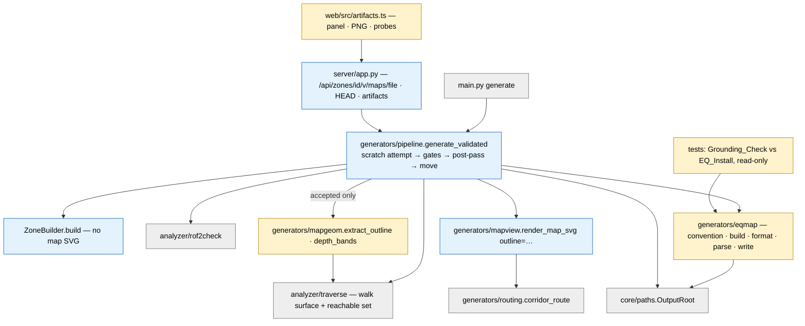

# Design Document — M2: True-layout artifacts

## Overview

M2 is the third milestone of the umbrella spec `zone-generator`
(`.kiro/specs/zone-generator/design.md`, "the umbrella"). This design refines
the umbrella's "Map geometry and artifacts", "Mesh outline extraction", "Depth
bands and layers", "EQ map coordinate convention and writer" and "Web outline
layer" sections for the M2 slice and cites them rather than restating them.
"Pn" means umbrella Correctness Property n; "M2-Pn" is a property new in this
spec; "Req X.Y" means **this spec's** requirement criterion unless prefixed
"umbrella". Umbrella decisions 19 (zone vocabulary) and 20 (Build_Name naming,
Export in M6) apply throughout: files are `<name>.*`, never `<short>.*`.

| Wave | Work item | Kind | Touches | Can start |
|------|-----------|------|---------|-----------|
| 1 | Map_Convention (pinned, grounded), record formatter, parser, writer | new module + tests | new `generators/eqmap.py`, `tests/test_eqmap*.py` | now (no M1 dependency) |
| 2 | Outline extractor + Depth_Bands, synthetic-mesh and box-build properties | new module + tests | new `generators/mapgeom.py`, `tests/{strategies,pbt_helpers}.py`, new `tests/test_properties_mapgeom.py` | code now; doorway and 30-room properties after M1 wave 1 |
| 3 | Outline layer in `render_map_svg` | changed module | `generators/mapview.py`, new `tests/reference_mapview.py` | after wave 2 + M1 wave 1 |
| 4 | Post-pass map artifacts in the Pipeline, Sidecar, CLI | pipeline | `generators/{pipeline,builder}.py`, `core/eqg.py` (Sidecar fields) | after M1 wave 6 |
| 5 | `maps/` route, HEAD, response URLs, Artifacts_Panel, PNG | surfaces | `server/app.py`, new `web/src/artifacts.ts`, `web/src/{main,api}.ts`, `web/index.html`, `web/src/style.css` | after M1 wave 6 |
| 6 | Wilderness coverage, ACCEPTANCE section, human pass | tests + docs | `tests/`, `docs/ACCEPTANCE.md` | after M1 wave 4 (wilderness enabled) |

A failing property is a real bug and is fixed at its root (umbrella Testing
Strategy). M2 adds no geometry change: when the outline shows something wrong
in the mesh (research finding 5), that is reported, not drawn around.

### Research findings that shape the design

Verified against `master` at `5dabd21` and the local RoF2 install
(`F:\everquest_rof2`, read-only). The probes were throwaway scripts in
`%TEMP%`; nothing was written to the repo or the install.

1. **Stock map grammar (143 files, 455,960 records).** A permissive reader
   (`L` = 9 comma-separated numbers, `P` = 7 numbers then text) parsed every
   non-blank line of every file: 453,619 `L`, 2,341 `P`, **0 unparsed**.
   - Spacing: 441,820 `L` lines use two spaces between the three groups
     (`L x, y, z,  x, y, z,  r, g, b`), 11,799 use single spaces throughout.
     `P` lines are `P x, y, z,  r, g, b,  size,  text`.
   - Coordinates: 4 decimals, except 50,536 written as integers. All ASCII.
     132 of 143 files are CR LF, 11 LF. 5 blank lines, 1 line with trailing
     whitespace. Some `L` records have both endpoints equal.
   - Labels: size 3 (1,996), 2 (338), 1 (7). No label text contains a space
     (underscores throughout); 6 contain commas.
   - Layer files: 12 zones ship `_1` and/or `_2` (and empty `_3`) files. They
     hold lines and labels (layer 1: 2,124 `L` + 130 `P`; layer 2: 853 `L` + 71
     `P`), and several are 0 bytes (`crushbone_2.txt`). Stock layers are
     author-chosen overlays; the client accepts empty layer files. Using them
     as depth bands (umbrella) is our convention, not Sony's.
   - Colours: 120 distinct triples; black (0, 0, 0) on 143,095 lines, then
     (64, 64, 64), (127, 64, 0), (0, 0, 240), (100, 50, 0), (0, 127, 0),
     (150, 100, 0).
2. **The Map_Convention is negate + swap: map `(mx, my, mz) = (−y, −x, z)`.**
   Of the 38 map zones with an `.eqg`, 24 have a `.ter`. For each candidate of
   the 8 sign/swap combinations, every stock `L` endpoint was converted back to
   world and its distance taken to the nearest point sampled on the edges of
   the TER's non-Floor_Faces (4 samples per edge, so the medians are upper
   bounds). Z was left unchanged; "3D" uses it, "XY" ignores it.

   | Zone | TER faces | Endpoints | Best (3D / XY median, u) | Runner-up (3D / XY) | Usable reference |
   |------|-----------|-----------|--------------------------|---------------------|------------------|
   | bazaar | 168,722 | 17,588 | **neg+swap 1.21 / 0.84** | 29.10 / 11.78 | yes (ratio 0.04) |
   | harbingers | 91,662 | 9,832 | neg+swap 2.81 / 1.11 | 65.79 / 12.12 | yes |
   | oldkaesoraa | 203,607 | 1,648 | neg+swap 3.47 / 1.79 | 478.27 / 345.79 | yes |
   | tutoriala | 6,610 | 208 | **neg+swap 1.72 / 0.68** | 9.93 / 5.81 | yes (ratio 0.17; fast) |
   | lavastorm | 99,709 | 20,000 of 23,190 | neg+swap 3.73 / 2.31 | 76.38 / 17.75 | yes |
   | guildlobby | 20,185 | 1,338 | neg+swap 2.76 / 2.12 | 3.54 / 3.36 | no (near-symmetric) |
   | freeportmilitia | 1,383 | 1,062 midpoints | neg+swap 87.46 | 98.24 | no (zone is mostly placeables) |
   | arena | 5,819 | 1,780 midpoints | neg+swap 6.30 | 8.75 | no (ambiguous) |

   Every zone picks the same candidate. With "world" meaning TER coordinates,
   the map's first coordinate is −world y and its second is −world x; Z is
   unchanged. The mapping is its own inverse. This matches `docs/RESEARCH.md`
   ("negated and swapped") and **refutes the umbrella design's expectation of a
   pure negation**. Runtime of the throwaway check: bazaar ≈ 30 s, tutoriala
   ≈ 2.5 s (8 candidates, KD-tree via scipy).
3. **Stock maps are in raw TER coordinates.** The stock ZONs place the terrain
   model with non-zero translations (guildlobby (413.7, 0, 61), bazaar
   (−18.4, −20.8, 46.3)) and an `rx` of ±1.1045 as `core/zon.py` decodes them,
   yet the maps match the untransformed TER to 1–4 u. Either the client ignores
   the terrain instance or our ZON object decode is off for these files; for M2
   it doesn't matter, because our ZON registers the terrain as model 0 and
   places no instance, so our TER coordinates are the world coordinates.
4. **Box mesh facts.** Floors face +Z, ceilings −Z (`add_room` winding), so the
   signed Floor_Face rule excludes ceilings. Vertices are not shared between
   quads (seed 1955208177, 12 rooms: 2,232 vertices, 884 distinct positions), so
   the extractor welds first. Corridor floors start 2 u inside the room
   (`LayoutGenerator._wall_point` inset) and overlap the room floor, which
   leaves topologically unshared edges inside the room. That is why the
   requirements use the geometric Floor_Boundary instead of umbrella 12.2's
   "edge not shared by two faces": under the topological reading, Req 12.10
   would demand a wall line 2 u inside every doorway.
5. **Opened room walls are removed whole.** `MeshBuilder.add_room` skips the
   entire wall quad of every side in `room.open_walls`; the corridor is
   narrower than the wall, so beside each doorway the room floor ends at a void.
   A prototype of the extractor on the reachable floor found:

   | Seed (dungeon, 12 rooms) | Floor_Boundary | wall | ledge | ledge share |
   |--------------------------|----------------|------|-------|-------------|
   | 1955208177 | 21,223 u | 9,187 | 12,035 | 57 % |
   | 1516796975 | 14,574 u | 6,540 | 8,035 | 55 % |
   | 678358326 | 19,183 u | 8,538 | 10,645 | 55 % |
   | 7 (flat) | 20,193 u | 7,527 | 12,666 | 63 % |

   The outline will faithfully draw those sides as dashed ledges. In the client
   a player can walk off the floor edge beside a doorway. M2 does not change
   geometry; see Open question 2.
6. **Wilderness outline is the patch perimeter.** The current outdoor build
   (seed 7, 4 rooms) has 48,600 faces, 48,598 of them Floor_Faces; after welding
   only 630 edges are unshared, all on the patch border. Its outline is the
   border as `ledge`, plus any slope break steeper than 40°. The walk surface
   took 138.6 s there before M1's speed-up (M1 targets ≤ 15 s for 12 rooms), so
   extraction must reuse the Pipeline's walk surface and test only welded
   unshared edges geometrically.
7. **Prototype cost.** On 12-room dungeons the naive vectorised prototype took
   0.8–2.3 s beyond the walk surface (1.2–3.2 s pre-speed-up). With welded edge
   cancellation and a grid index the design target is ≤ 1 s for a 30-room
   dungeon given the walk surface (a target, not an assertion).
8. **The web is same-origin.** `web/vite.config.ts` proxies `/api` to the
   backend, so `<a download>` links name files as given. There is no frontend
   test framework; M1 verifies the web by build + human pass and M2 does the
   same (no framework is added for M2).

### As-built verification

| Area | As built (`master` 5dabd21) | After M1 (designed) | M2 change |
|------|-----------------------------|---------------------|-----------|
| Map SVG | `mapview.render_map_svg(spec, size, padding)`; schematic only; written by `ZoneBuilder.build` on every attempt when `write_glb` | same function; written into the scratch attempt, moved on acceptance | `outline=` parameter; written only by the Pipeline post-pass |
| EQ map | none | none ("`maps/<name>.txt` is M2") | `generators/eqmap.py`, `maps/<name>*.txt` |
| Outline | none | none | `generators/mapgeom.py` |
| Walk surface | `traverse.build_walk_surface(ter, agent)`; `|n_z|` standable; `flood_reachable`; `_nearest_standable_face(surf, point, 400)` | union-find speed-up, `WalkSurface.component` | reused; Floor_Faces = signed `n_z` subset |
| Routing | inside `MeshBuilder.add_corridor` and `LayoutGenerator._route_legs` | `generators/routing.py` | read by tests and the SVG |
| Pipeline | builds into `output_dir`; no scratch | scratch attempt → gates → move to `<zone_id>/v<version>/` | outline + Map_Artifacts after the gates, before the move |
| Sidecar | written with the GLB | written on every build; `name`, `zone_type`, `format`, `warnings` | `map_files`, `outline` block, `outline_unavailable` / `eqmap_unavailable` warnings |
| Server route | `/api/zones/{filename}`, flat, no `/` | `/api/zones/{zone_id}/{version}/{filename}`, segment regex, allow-list | `+ /maps/{filename}`, HEAD, `artifacts` in the response |
| Web | Map modal, "Download SVG" | header + Controls panel rebuilt; download links from response URLs | Artifacts_Panel, PNG, `.txt`, `.eqg` |

**Where the umbrella design is superseded** (the requirements, which win, or
the grounding data disagree with it):

- *Convention:* the umbrella scores 4 candidates against an 8 u threshold and
  "0.25 × second-best"; Req 4.1–4.2 (umbrella Req 13.5) score all 8 against
  5 u. Measured result: negate + swap, not the umbrella's expected pure negation.
- *Simplification:* the umbrella's Douglas–Peucker at 0.5 u would break the
  0.05 u fidelity of Req 1.2. M2 merges only collinear runs (0.02 u) and keeps
  short pieces (dropping pieces under 2 u would eat into Req 1.4's 99 %).
- *Single-layer colouring:* the umbrella colours a non-stacked zone in
  main/above/below bands at ±24 u; Req 2.2 (umbrella 12.8) puts everything in
  the Main_Band, and Req 5.7 gives one colour per band, so ledges are not
  lightened in the `.txt` (they are dashed in the SVG).
- *Names:* `MapFile.shortname` becomes `MapFile.name` (Build_Name); the bundle
  and `<short>` files are M6.
- *Topological boundary:* see finding 4.

## Depends on M1

The requirements list D1–D7. This table adds what M2 does if a dependency is
late.

| Dep | M1 wave | M2 work blocked | Interim if M1 is late |
|-----|---------|-----------------|-----------------------|
| D1 `routing.corridor_route`, `route_footprint` | 1 | Doorway_Span oracle (M2-P2, P22), routed SVG corridors (Req 7.4) | none: wave 2 doorway properties and wave 3 wait for M1 wave 1 |
| D2 walk-surface speed-up; no third-room crossings | 1 | 30-room box properties within budget; doorway reasoning on crossing-free layouts | wave 2 synthetic-mesh properties and ≤ 12-room box properties run on master's validator |
| D3 `zone_type` vocabulary | 2 | none functionally | write tests against `zone_type`; rebase after M1 wave 2 |
| D4 wilderness in the Room_Graph frame, enabled | 3, 4 | wave 6 wilderness properties | the extractor accepts any TER; wave 6 waits |
| D5 scratch attempts | 4 | wave 4 | none: wave 4 waits |
| D6 response shape (`mode`, `version`, `eqg_url`, `warnings`) | 5 | wave 5 | none: wave 5 waits |
| D7 Build_Name dirs, Sidecar on every build, `OutputRoot`, build-file route | 6 | waves 4 and 5 | none: waves 4–5 wait |

So waves 1–2 (most of the new code) can run in parallel with M1; wave 3 needs
M1 wave 1 merged; waves 4–5 need M1 wave 6 merged (M1 done but for its exit);
wave 6 needs wilderness enabled.

## Architecture



Dependency direction follows the umbrella module seams: `generators/mapgeom.py`
imports `core.ter` and `analyzer.traverse` (walk surface and Agent_Model only —
the same direction `analyzer` already has towards `core`, and `generators`
importing `analyzer` is limited today to `pipeline.py`; M2 extends that to
`mapgeom.py`, Decision 3); `generators/eqmap.py` imports `mapgeom` data types
and `zone_spec` only; `mapview.py` imports `mapgeom` types and `routing`.
Nothing in `core/` imports M2 code.

## Components and Interfaces

### Outline extractor (`generators/mapgeom.py`, new — wave 2)

```python
FLOOR_COS = math.cos(math.radians(40.0))      # = AgentModel().min_up_normal
WELD = 0.01                                   # vertex weld grid (u)
PROBE = 0.05                                  # outward probe distance (≤ 0.1 by definition)
COLLINEAR_EPS = 0.02                          # max deviation when merging collinear runs
STACK_GAP = 12.0                              # 2 × player height
MAX_BANDS = 4

def floor_faces(ter: TerFile) -> np.ndarray: ...                 # bool mask, signed n_z ≥ FLOOR_COS
def extract_outline(ter: TerFile, safe_point: tuple[float, float, float],
                    agent: AgentModel | None = None, *,
                    reachable_only: bool = True,
                    surface: WalkSurface | None = None) -> OutlineSet: ...
def depth_bands(floor: FloorSet, safe_z: float,
                max_bands: int = MAX_BANDS) -> list[DepthBand]: ...
def outline_summary(outline: OutlineSet) -> dict: ...          # the Sidecar "outline" block
```

`surface` lets the Pipeline pass the walk surface its validator already built
for the same TER and agent; when `None`, `extract_outline` builds it. Both give
the same reachable set, so the output is the same (Req 1.1, M2-P1 checks it).
The seed face is `traverse._nearest_standable_face(surf, safe_point, 400.0)`,
the validator's own choice, made public as `traverse.seed_face_for(surf,
safe_point)` (a one-line wrapper). With `TraversalReport.surface` (see
[Pipeline post-pass](#pipeline-post-pass-generatorspipelinepy-generatorsbuilderpy--wave-4))
these are the only `traverse.py` edits M2 makes, both additive.

Steps (pseudocode in [Algorithms](#algorithms)):

1. **Floor_Region.** Floor_Faces by signed normal; in reachable-only mode,
   intersect with `flood_reachable(surf, seed_face)` (Req 1.6). Empty → raise
   `EmptyFloorRegion` (the Pipeline maps it to Req 3.1).
2. **Weld** all vertices on the 0.01 u grid; candidate edges are Floor_Region
   face edges whose welded endpoint pair is not used by exactly one other
   Floor_Region face lying on the other side of it. Interior welded edges are
   dropped here without a geometric test; on terrain that leaves only the
   perimeter (finding 6).
3. **Geometric coverage.** Group candidate edges by supporting line (direction,
   offset, z-plane within `WELD`). For each candidate, the outward side is
   probed at `PROBE` against Floor_Region faces found through an XY grid index,
   with "covered" meaning point-in-triangle and plane height within
   `agent.max_step_up`. Coverage along an edge is exact interval arithmetic:
   each covering face contributes the interval of the edge whose outward probe
   falls inside it (a triangle cut by a line gives one interval). Boundary
   pieces = edge − ⋃ covered intervals. This is the Floor_Boundary definition
   applied, so T-junctions and the 2 u corridor overlap disappear (finding 4).
4. **Classify** each piece: `wall` when a non-Floor_Face has an edge collinear
   with the piece within `WELD`, overlapping it, and a vertex more than
   `WELD` above the piece's Z (rising); split at the ends of that overlap;
   everything else `ledge` (Req 1.5).
5. **Chain** pieces into polylines: maximal paths through welded endpoints of
   degree 2 with the same kind and band; break at junctions (degree ≠ 2), class
   changes and band changes (Req 1.5, 2.5). Merge consecutive collinear
   segments when the dropped vertex is within `COLLINEAR_EPS` of the merged
   segment; drop segments shorter than 0.01 u (Req 1.8).
6. **Bands** from `depth_bands` (below); split polylines that cross a band cut
   (Req 2.5); assign each piece the band containing its mean Z.
7. **Canonical order.** Each polyline starts at its lexicographically smaller
   end (x, y, z rounded to 1e-4); polylines are sorted by (band, kind, first
   point, length). The output depends only on coordinates (Req 1.8, P9).

### Depth bands (`mapgeom.depth_bands` — wave 2)

Built to satisfy Req 2 by construction rather than by the umbrella's 1-D gap
clustering (a continuous ramp between two stacked levels leaves no Z gap, so gap
clustering can merge levels that overlap in XY):

1. Rasterise the Floor_Region onto an 8 u XY grid; per cell, collect the floor
   heights (plane Z at the cell centre of every Floor_Region face covering it).
2. Every pair of consecutive heights in a cell more than `STACK_GAP` apart is a
   **stack interval** `(z_lo, z_hi)`; any horizontal cut strictly inside it
   separates the pair. Faces too small to cover a cell centre are sampled at
   their centroid, so no Stacked_Floors pair is missed by the raster.
3. No stack intervals → one band, the Main_Band (Req 2.2).
4. Otherwise choose cut heights by greedy interval stabbing: sort intervals by
   `z_hi`; for each interval not yet stabbed, cut at the midpoint of the
   intersection of it and every interval sharing its earliest `z_hi`. This uses
   the fewest cuts, so `k` cuts give `k + 1` bands and every stacked pair is
   split (Req 2.3).
5. While bands > 4, merge the adjacent pair with the smallest vertical gap
   (`min floor Z of the upper band − max floor Z of the lower band`), ties to
   the lower pair (Req 2.4).
6. The Main_Band is the band containing the Z of the Floor_Region face the walk
   seeds from (Req 2.1). Role: `main`, `above`, `below` relative to it.

### EQ map writer and parser (`generators/eqmap.py`, new — wave 1)

```python
CANDIDATES: dict[str, tuple[bool, int, int]]    # 8 entries: (swap, sx, sy)
MAP_CONVENTION = "swap_neg_neg"                 # pinned by the Grounding_Check test
REFERENCE_ZONES = ("tutoriala", "bazaar")       # fast default-run zone, slow thorough zone

def world_to_map(x: float, y: float, z: float) -> tuple[float, float, float]: ...   # (−y, −x, z)
def map_to_world(mx: float, my: float, mz: float) -> tuple[float, float, float]: ... # (−my, −mx, mz)
def candidate_to_world(name: str, mx: float, my: float) -> tuple[float, float]: ...
def ground_convention(ter: TerFile, layer: MapLayer) -> GroundingResult: ...
def load_reference(eq_path: Path, zone: str) -> tuple[TerFile, MapLayer]: ...       # read-only

BAND_COLOURS = {0: (0, 0, 0), +1: (150, 100, 0), +2: (127, 64, 0), +3: (100, 50, 0),
                -1: (0, 0, 240), -2: (0, 0, 127), -3: (0, 127, 0)}   # offset from Main_Band
ENTRANCE_COLOUR = (0, 160, 0); BOSS_COLOUR = (200, 0, 0); LABEL_SIZE = 2

def build_map_file(outline: OutlineSet, spec: ZoneSpec, name: str) -> MapFile: ...
def format_map_layer(layer: MapLayer) -> str: ...
def parse_map_layer(text: str) -> ParseResult: ...
def write_map_files(mf: MapFile, maps_dir: Path, root: OutputRoot) -> list[Path]: ...
```

- **Convention (Req 4).** `world_to_map` is the pinned candidate; it is an
  involution, so `map_to_world` is the same formula (Req 4.4). Z untouched
  (Req 4.3). `ground_convention` implements the Grounding_Check exactly as
  finding 2 measured it (8 candidates, endpoints, 3D distance to sampled
  non-Floor_Face edges at ≤ 1 u spacing, scipy `cKDTree`, which is already a
  pinned dependency) and returns every candidate's median, the chosen name and
  the best/runner-up ratio (Req 4.1–4.2). `load_reference` opens
  `<eq>/<zone>.eqg` and `<eq>/maps/<zone>.txt` with read-only file handles
  (Req 4.6).
- **Build (Req 5.3–5.7).** For each band in the Outline, one `MapLayer`; for
  each polyline in it, one `MapLine` per consecutive point pair, converted with
  `world_to_map`, coloured `BAND_COLOURS[band offset]` (walls and ledges
  alike). Labels: the entrance room (Pacing_Role `entrance`) and every `climax`
  room get a label at `(center_x, center_y, floor_z + 2)` converted to map
  coordinates, text `Entrance` / `Boss`, size 2, in the layer of the band whose
  height range holds `floor_z` (the Main_Band if none does). `RoomSpec.boss` is
  a boolean, so the text is always `Boss` in M2; a name field (M3 content) would
  replace it.
- **Layer order (Req 5.1).** Layer index 0 = Main_Band → `<name>.txt`; the
  other bands sorted by ascending median floor Z → `<name>_1.txt` …
  `<name>_3.txt`. No file for a missing band.
- **Format (Req 5.2).** Exactly the requirement's single-space form (the 11,799
  stock lines that use it show the client reads it):
  `f"L {x1:.4f}, {y1:.4f}, {z1:.4f}, {x2:.4f}, {y2:.4f}, {z2:.4f}, {r}, {g}, {b}"`
  and `f"P {x:.4f}, {y:.4f}, {z:.4f}, {r}, {g}, {b}, {size}, {text}"` with
  `text.replace(" ", "_")`; `-0.0000` is written as `0.0000` so equal inputs
  give equal bytes; lines joined and terminated by `\r\n` (the stock majority,
  finding 1). Labels are written after lines within a layer. ASCII-only: a
  label with a non-ASCII character raises `ValueError` (never reached by M2's
  two fixed texts).
- **Parse (Req 6).** Line-oriented; `str.splitlines()` (CR LF or LF); blank
  lines skipped. `L`: the text after `L` split on `,` into exactly 9 fields,
  each stripped; 6 floats then 3 ints in 0–255. `P`: split on the first 7
  commas; 3 floats, 3 ints in 0–255, size int in {1, 2, 3}; the remainder
  stripped is the text, which must be non-empty. Anything else (unknown first
  letter, wrong field count, non-numeric, out-of-range colour or size) is
  skipped and its 1-based line number recorded (Req 6.3). The parser is
  permissive about spacing because the stock files are (finding 1).
- **Write.** `write_map_files` writes each layer through `OutputRoot.write_bytes`
  (M1 D7) as ASCII bytes into `<build dir>/maps/`, returning the paths in layer
  order.

### Map viewer outline layer (`generators/mapview.py`, change — wave 3)

```python
def render_map_svg(spec: ZoneSpec, size: int = 720, padding: int = 40,
                   outline: OutlineSet | None = None) -> str: ...
```

- `outline is None`: the existing code path runs unchanged, byte for byte
  (Req 7.2). A frozen copy of today's function goes into
  `tests/reference_mapview.py` (header naming the fork commit, test-only, never
  edited), the same pattern M1 uses for the validator.
- With an outline (Req 7.1, 7.3–7.5), in document order: background `<rect>`;
  one `<g id="outline">` holding one `<path>` per polyline (`stroke` by band:
  Main `#d7dee2`, other bands the `BAND_COLOURS` triple; walls `stroke-width
  2`, ledges `stroke-width 1.5 stroke-dasharray="6 4"`; `fill="none"`); then the
  schematic: corridors as `<polyline>` along `corridor_route(c, rooms).waypoints`
  (D1), stroke-opacity 0.45, width `max(1, c.width·scale·0.25)`; rooms with
  fill-opacity 0.3; then depth numbers, ids, semantic labels, role labels, boss
  stars, gates, legend (+ `wall` solid swatch and `ledge` dashed swatch) and
  scale bar. The frame is the union of room extents, corridor endpoints and
  `outline.bounds` XY, still north-up.
- Coordinates in the outline are formatted `:.1f` like the rest of the file, so
  the SVG is a pure function of `(spec, size, padding, outline)` (P9).
- District hulls (M3) will be emitted after rooms and before the legend; the
  outline group stays first.

### Pipeline post-pass (`generators/pipeline.py`, `generators/builder.py` — wave 4)

On top of M1's scratch-attempt loop (D5), per accepted attempt, after both gates
pass and **before** the move into `<zone_id>/v<version>/`:

```python
try:
    outline = extract_outline(ter, spec.safe_point, agent, surface=report_surface)
except Exception as e:                                   # EmptyFloorRegion or a bug: Req 3.1
    outline = None; warnings.append(f"outline_unavailable:{_cause(e)}")
svg = render_map_svg(spec, outline=outline)              # schematic-only when None
root.write_text(scratch / f"{name}.map.svg", svg)
map_files = []
if outline is not None:
    try:
        map_files = write_map_files(build_map_file(outline, spec, name), scratch / "maps", root)
    except Exception as e:                               # Req 3.2
        root.remove_tree(scratch / "maps"); map_files = []
        warnings.append(f"eqmap_unavailable:{_cause(e)}")
sidecar.update(map_files=[...relative...], outline=outline_summary(outline) if outline else None)
```

- `ZoneBuilder.build` stops writing `<name>.map.svg` (finding: today it writes
  it on every attempt). Rejected attempts therefore never produce one, and the
  scratch removal of M1 covers anything else (Req 8.2).
- `ter` is the in-process TER of the attempt (`BuildResult.ter`, umbrella
  "BuildResult gains ter"); `report_surface` is the walk surface the validator
  built, exposed as `TraversalReport.surface` (not serialised). Ungated builds
  (`--no-validate`) pass `surface=None` and the extractor builds its own.
- `_cause(e)` is `type(e).__name__` plus the first line of the message,
  `[A-Za-z0-9_ .:-]` only, at most 120 characters, so a warning never carries a
  path outside the Output_Directory or a key.
- Sidecar fields (Req 8.4) are written by M1's `EqgZone.write_sidecar(extra=…)`.
- The CLI uses the same `generate_validated`, so its build directory holds the
  same files (Req 8.5).

### Server (`server/app.py`, change — wave 5)

```python
@app.api_route("/api/zones/{zone_id}/{version}/{filename}", methods=["GET", "HEAD"])
@app.api_route("/api/zones/{zone_id}/{version}/maps/{filename}", methods=["GET", "HEAD"])
def get_build_file(zone_id: str, version: str, filename: str, request: Request): ...
```

- One handler for both routes; the `maps` route passes `("maps", filename)` as
  the relative parts. Every segment (`zone_id`, `version`, `maps`, `filename`)
  must match `^[A-Za-z0-9_.-]+$` and not contain `..`; the extension (the
  `.zone.json` and `.map.svg` double suffixes included) must be in the
  Build_File_Allow_List; the resolved path must satisfy
  `OutputRoot(OUTPUT_DIR).contains(path)` and lie under
  `OUTPUT_DIR/zone_id/version` (Req 9.3). Missing → 404 (Req 9.2). FastAPI's
  `FileResponse` serves the bytes as stored (Req 9.1) and handles HEAD with the
  same headers and no body (Req 9.4).
- Media types: `.txt` `text/plain; charset=us-ascii`, `.eqg`
  `application/octet-stream`, `.svg` `image/svg+xml`, `.png` `image/png`,
  `.glb` `model/gltf-binary`, `.json` `application/json`.
- `GenerateResponse` gains `artifacts: list[ArtifactRef]` (Req 9.5):

```python
class ArtifactRef(BaseModel):
    kind: str          # "map_svg" | "eqmap" | "eqg" | "glb" | "sidecar"
    filename: str      # "gen_..._a1b2c3.map.svg", "maps/gen_..._a1b2c3_1.txt"
    url: str           # "/api/zones/<zone_id>/v1/maps/<file>"
    layer: int | None = None   # eqmap only: 0 = main, 1..3
```

  `map_url` and `eqg_url` (M1) stay for the existing callers.

### Artifacts_Panel (`web/`, change — wave 5)

- `web/index.html`: a `<section id="artifacts" aria-labelledby="artifacts-h">`
  in the side panel with a heading, a list `#artifact-list`, and the map modal
  header gaining `#map-download-png` next to `#map-download` (relabelled
  "Download SVG"). Each entry is an `<a download="<file>">` with a text label
  ("Map (SVG)", "Map (PNG)", "EQ map layer 0 (.txt)", "Zone archive (.eqg)")
  (Req 10.2, 10.5).
- `web/src/artifacts.ts` (new):

```ts
export interface ArtifactRef { kind: string; filename: string; url: string; layer?: number | null; }
export function showArtifacts(refs: ArtifactRef[], name: string): void;  // rebuilds the list
export async function loadMapSvg(url: string): Promise<string>;         // fetch + cache per build
export async function svgToPng(svgText: string, scale = 2): Promise<Blob>;
export function markUnavailable(kind: string, filename: string, why: string): void;
```

  On every accepted response, `main.ts` calls `showArtifacts(resp.artifacts,
  resp.id)`, which clears the cached SVG and the modal body, rebuilds the list,
  and probes each URL with `fetch(url, {method: "HEAD"})`; a non-2xx or network
  error marks that entry unavailable (`aria-disabled="true"`, struck through,
  `title` with the reason, link removed) and leaves the others alone (Req 10.4).
  The modal shows the latest SVG, replacing any earlier one (Req 10.1).
- **PNG (Req 10.3).** `svgToPng` reads the `viewBox` of the fetched SVG text,
  creates a `Blob([svg], {type: "image/svg+xml"})` object URL, draws it into a
  `<canvas>` of `2·vbW × 2·vbH` and calls `canvas.toBlob("image/png")`; the
  "Map (PNG)" link gets the blob's object URL and `download="<name>.map.png"`.
  The SVG has no external references, so the canvas is not tainted. The PNG is
  made lazily on first request and revoked on the next build.
- The map modal keeps inlining the SVG (it is our own output with every text
  run escaped by `mapview._esc`).
- Movement keys: the panel uses links and buttons only; `controls.ts::_typingTarget`
  and the modal's existing keydown guard keep covering them (Req 10.6).

## Data Models

```python
@dataclass(frozen=True)
class Polyline:
    points: tuple[tuple[float, float, float], ...]   # world coords, ≥ 2, consecutive ≥ 0.01 u apart
    kind: str                                        # "wall" | "ledge"
    band: int                                        # DepthBand.index

@dataclass(frozen=True)
class DepthBand:
    index: int            # 0 = Main_Band; others in ascending median floor Z order (file suffix)
    z_lo: float; z_hi: float   # band height range (−inf/+inf at the ends)
    median_z: float       # area-weighted median floor Z of the band
    role: str             # "main" | "above" | "below"
    offset: int           # signed rank from the Main_Band (colour key)

@dataclass(frozen=True)
class OutlineSet:
    polylines: tuple[Polyline, ...]
    bands: tuple[DepthBand, ...]          # 1..4
    bounds: tuple[float, float, float, float, float, float]   # Floor_Region bbox
    seed_face: int
    reachable_only: bool

@dataclass(frozen=True)
class MapLine:  x1: float; y1: float; z1: float; x2: float; y2: float; z2: float; r: int; g: int; b: int
@dataclass(frozen=True)
class MapLabel: x: float; y: float; z: float; r: int; g: int; b: int; size: int; text: str
@dataclass
class MapLayer:
    index: int                    # 0 = <name>.txt, 1..3 = <name>_N.txt
    lines: list[MapLine]; labels: list[MapLabel]
@dataclass
class MapFile:
    name: str                     # Build_Name (umbrella's `shortname`, renamed per decision 20)
    layers: list[MapLayer]        # 1..4, coordinates already in map convention
@dataclass
class ParseResult:
    layer: MapLayer
    skipped: list[int]            # 1-based line numbers of malformed lines
    @property
    def skipped_count(self) -> int: ...
@dataclass
class GroundingResult:
    medians_3d: dict[str, float]; medians_xy: dict[str, float]
    chosen: str; ratio: float     # chosen / runner-up (3D)
    endpoints: int
```

Validation (constructors raise `ValueError`): colour channels int 0–255; `size
∈ {1, 2, 3}`; label text non-empty, no newline, ASCII; `len(layers) ≤ 4`;
layer indices distinct and `0` present; `Polyline` kind and length rules.

### Sidecar additions (`<name>.zone.json`)

```json
{
  "map_files": ["gen_1767225600_a1b2c3.map.svg", "maps/gen_1767225600_a1b2c3.txt"],
  "outline": {
    "reachable_only": true,
    "bounds": [-512.0, -300.0, 0.0, 640.0, 410.0, 80.0],
    "bands": [{"index": 0, "role": "main", "z_lo": null, "z_hi": null,
               "median_z": 0.0, "file": "maps/gen_1767225600_a1b2c3.txt",
               "walls": 41, "ledges": 37}]
  },
  "warnings": []
}
```

`outline` is `null` with `outline_unavailable:<cause>` in `warnings` when the
fallback ran (Req 3.1). `z_lo`/`z_hi` are `null` for an unbounded end.

### Output layout (on top of M1)

```text
output/<zone_id>/v1/                      # server: output/web/<zone_id>/v1/
├── <name>.eqg  <name>.glb  <name>.zone.json  <name>.json (CLI)
├── <name>.map.svg                        # outline + schematic (schematic only on fallback)
└── maps/
    ├── <name>.txt                        # Main_Band
    └── <name>_1.txt … <name>_3.txt       # other bands, only when Stacked_Floors exist
```

## Algorithms

### `extract_outline`

```python
def extract_outline(ter, safe_point, agent=None, *, reachable_only=True, surface=None):
    agent = agent or AgentModel()
    V, F = arrays(ter); n = unit_normals(V, F)
    floor = n[:, 2] >= FLOOR_COS                                   # signed: ceilings excluded
    surf = surface or build_walk_surface(ter, agent)
    seed = seed_face_for(surf, safe_point)
    region = floor & mask(flood_reachable(surf, seed)) if reachable_only else floor
    if not region.any(): raise EmptyFloorRegion("no floor face reachable from the safe point")
    W = weld(V, WELD)                                              # welded vertex ids
    cand = []                                                      # (face, p, q) edges
    for each region face f, edge (a, b):                           # vectorised over faces
        if count_other_side(W[a], W[b], f) == 1: continue          # welded interior edge
        cand.append((f, a, b))
    grid = XYGrid(region faces, cell=32u)
    pieces = []
    for (f, a, b) in cand:                                         # few: ~400 box, ~600 terrain
        out = outward_unit_normal_xy(f, a, b)
        covered = []
        for g in grid.near(segment(a, b)):                          # region faces only, g ≠ f
            iv = interval_where(probe(t) = lerp(a, b, t) + PROBE·out ∈ tri_xy(g)
                                and |plane_z(g, probe(t)) − lerp_z(a, b, t)| ≤ agent.max_step_up)
            if iv: covered.append(iv)
        for (t0, t1) in [0, 1] − union(covered):
            pieces.append(Piece(lerp(a, b, t0), lerp(a, b, t1), out))
    walls = index non-floor face edges by supporting line
    pieces = split_and_classify(pieces, walls)                     # wall iff collinear overlap + rising vertex
    bands = depth_bands(region faces, z(seed))
    pieces = split_at_band_cuts(pieces, bands)
    polylines = chain(pieces)                                      # degree-2 walks, same kind+band
    polylines = merge_collinear(polylines, COLLINEAR_EPS); drop_short(polylines, 0.01)
    return OutlineSet(canonical_order(polylines), bands, bbox(region), seed, reachable_only)
```

`interval_where` for one triangle is closed-form: the probe line
`lerp(a, b, t) + PROBE·out` crosses the triangle's XY interior in one `t`
interval (Liang–Barsky against its 3 half-planes); the plane-height condition
is linear in `t`, so it trims that interval to another interval. Coverage is
therefore exact, not sampled.

**Loop invariant (coverage):** `covered` only grows; a piece is emitted only
where no covering face contributes. **Postconditions:** every emitted point is
on a Floor_Region edge whose outward probe is uncovered (Req 1.2); a Doorway_Span
is covered by the corridor floor (it overlaps the room by the 2 u inset), so no
piece lies on it (Req 1.3); every uncovered point of a candidate edge is emitted
(Req 1.4 — the only loss is the 0.01 u drop and collinear merging within
0.02 u).

### `depth_bands`

See [Depth bands](#depth-bands-mapgeomdepth_bands--wave-2). Stabbing:

```python
ivs = sorted(stack_intervals(raster(region)), key=lambda iv: (iv.hi, iv.lo))
cuts = []
i = 0
while i < len(ivs):
    group = [iv for iv in ivs[i:] if iv.lo < ivs[i].hi]            # all intervals containing hi − ε
    cut = (max(iv.lo for iv in group) + ivs[i].hi) / 2
    cuts.append(cut)
    i = next index whose interval does not contain cut
bands = slabs(cuts)                                                # k cuts → k + 1 bands
while len(bands) > MAX_BANDS: merge adjacent pair with smallest (min_z(upper) − max_z(lower))
```

### `build_map_file` / `format_map_layer` / `parse_map_layer`

As specified under [EQ map writer and parser](#eq-map-writer-and-parser-generatorseqmappy-new--wave-1).
Round-trip reasoning: formatting rounds to 4 dp (error ≤ 0.00005) and the parser
reads the decimal back exactly; colours and sizes are integers; label text is
written with `_` for spaces and read verbatim (Req 6.2).

### Grounding_Check

```python
def ground_convention(ter, layer):
    walls = sample_edges(non_floor_faces(ter), spacing=1.0)       # 3D points
    tree = cKDTree(walls)
    ends = [(l.x1, l.y1, l.z1) for l in layer.lines] + [(l.x2, l.y2, l.z2) for l in layer.lines]
    ends = [e for e, l in pairs if not degenerate(l)]
    for name in CANDIDATES:
        pts = [(*candidate_to_world(name, mx, my), mz) for (mx, my, mz) in ends]
        med3[name] = median(tree.query(pts)); medxy[name] = median(xy tree query)
    best, runner = two smallest of med3
    return GroundingResult(med3, medxy, best, med3[best] / med3[runner], len(ends))
```

## Correctness Properties

*A property is a characteristic or behavior that should hold true across all valid executions of a system-essentially, a formal statement about what the system should do. Properties serve as the bridge between human-readable specifications and machine-verifiable correctness guarantees.*

Each property below is one Hypothesis test. "Synthetic worlds" are TERs drawn
by the `slab_worlds` strategy (see [Testing Strategy](#testing-strategy)): cheap,
exact, run at the full example budget. "Builds" are Raw_Builds through
`plan_to_spec` + `ZoneBuilder`, budgeted like M1's build-level properties.
Umbrella property numbers are given where the property refines one.

### Property 1: The outline is a function of the TER and the safe point (umbrella P21)

*For any* box build (seed, room count 2–30, verticality), extracting the outline
from the built TER, from `TerFile.from_bytes(ter.to_bytes())`, with or without
the validator's walk surface passed in, and after clearing every Advisory_Data
field of the Zone_Spec (roles, depths, room types, suggestion fields, gates)
gives equal `OutlineSet`s, and the outline drawn into a Pipeline-written
`<name>.map.svg` equals `extract_outline` of the archive's TER.

**Validates: Requirements 1.1, 7.1, 8.1**

### Property 2: Outline fidelity — sound and clear of doorways (umbrella P22)

*For any* synthetic world or box build, every point of every emitted segment
lies within 0.05 u of the Floor_Boundary (checked by the definition: a
Floor_Region edge point whose 0.05 u outward probe is covered by no Floor_Region
face within 3 u in height), and, for builds, no emitted segment meets the
interior of any Doorway_Span computed from `routing.corridor_route`.

**Validates: Requirements 1.2, 1.3, 1.7**

### Property 3: Outline completeness (M2-P1)

*For any* synthetic world or build (box, and wilderness once enabled), of the
Floor_Boundary length outside Doorway_Spans — sampled every 0.5 u along every
Floor_Region edge by the same definition as Property 2 — at least 99 % lies
within 0.05 u of an emitted segment.

**Validates: Requirements 1.4, 1.7**

### Property 4: Wall and ledge classification (M2-P2)

*For any* synthetic world in which each slab side independently has a rising
wall quad or not, every emitted polyline lying on a slab side has kind `wall`
exactly when that side carries a wall quad over the polyline's span, and
`ledge` otherwise.

**Validates: Requirements 1.5**

### Property 5: Reachable-only selects the walked floor (M2-P3)

*For any* synthetic world with a reachable part and one disconnected island
slab, the default outline has no point within 0.05 u of the island's edges,
the `reachable_only=False` outline covers the island's Floor_Boundary by the
completeness rule of Property 3, and both agree exactly on the reachable part.

**Validates: Requirements 1.6**

### Property 6: Canonical outline (M2-P4)

*For any* synthetic world, shuffling the TER's face order, rotating each face's
vertex order and renumbering vertices leaves `extract_outline` unchanged, and
every polyline has at least 2 points with consecutive points at least 0.01 u
apart.

**Validates: Requirements 1.8**

### Property 7: Depth bands separate stacked floors (M2-P5)

*For any* synthetic world of 1–7 stacked levels (XY-overlapping slabs at
heights separated by 12–60 u, optionally joined by a ramp, plus non-overlapping
slabs at arbitrary heights), the outline has `min(levels', 4)` bands where
`levels'` is the reference model's level count (1 when nothing is stacked);
every polyline's points lie inside its band's height range; the polylines of
every stacked pair lie in different bands unless the reference model's
smallest-gap merge joined their levels; and the safe point's floor is in the
band marked `main`. Box builds (never stacked in M2) have exactly one band.

**Validates: Requirements 2.1, 2.2, 2.3, 2.4, 2.5**

### Property 8: Map coordinate convention (umbrella P24)

*For any* finite `(x, y, z)`, `map_to_world(*world_to_map(x, y, z)) == (x, y, z)`
exactly and the map Z equals `z`; for any point with `x ≠ y`, both non-zero and
of opposite sign, `world_to_map` differs from each of the other 7 candidates, so
a missed negate or swap fails.

**Validates: Requirements 4.3, 4.4**

### Property 9: The Grounding_Check recovers a known convention (M2-P6)

*For any* of the 8 candidates and any synthetic asymmetric wall mesh, a map
layer made by converting the mesh's wall edges to map coordinates with that
candidate makes `ground_convention` choose that candidate with median ≤ 0.5 u
and ratio ≤ 0.25.

**Validates: Requirements 4.1, 4.2**

### Property 10: Map format round-trip (umbrella P23)

*For any* valid `MapLayer` (lines and labels, label text with commas and
spaces, coordinates in ±30,000), every line of `format_map_layer(l)` matches the
strict writer grammar (4 dp, single spaces, integer colours 0–255, size 1–3, no
space in label text), the text is ASCII and every line ends in CR LF, and
`parse_map_layer` of it returns no skipped lines and a layer equal to `l` with
coordinates within 0.00005 and spaces in label text replaced by `_`. The reader
vectors `L 2881.0, -2022.0, -295.0, 2885.0, -2027.0, -295.0, 128, 255, 0` and
`P 5531.2642, -168.7061, -299.5485, 128, 255, 0, 2, Gargoyle_Island` parse to
their fields and re-emit equal values.

**Validates: Requirements 5.2, 6.2**

### Property 11: The parser tolerates stock spelling and skips only garbage (M2-P7)

*For any* valid `MapLayer` printed with a stock-style variant printer (zero, one
or two spaces after each comma, integer coordinates where integral, CR LF or LF,
blank lines between records, leading spaces before label text) with malformed
lines inserted at random positions (unknown record letter, wrong field count,
non-numeric field, colour 256, size 4, empty label), `parse_map_layer` returns
the original layer and `skipped` equal to exactly the inserted lines' 1-based
numbers.

**Validates: Requirements 6.1, 6.3**

### Property 12: The map files mirror the outline (M2-P8)

*For any* outline with 1–4 bands (synthetic) and any box build, the written
files are `maps/<name>.txt` for the Main_Band and `maps/<name>_1.txt` …
`_k.txt` for the other bands in ascending median floor Z, and no others; each
file's `L` count equals the sum of `len(points) − 1` over its band's polylines,
no `L` is degenerate, and `map_to_world` of each `L` reproduces a polyline
segment within 0.00005; every `L` in a band has the band's colour (black for the
Main_Band, the other bands distinct and non-black); across all files there is
exactly one `Entrance` label and one `Boss` label per `climax` room, all size 2,
each in the file of the band holding its room's floor.

**Validates: Requirements 5.1, 5.3, 5.5, 5.7**

### Property 13: Map records lie on the walkable floor (umbrella P25)

*For any* box build (and wilderness once enabled), every `L` endpoint mapped back
to world lies inside the Floor_Region's XY bounding box plus 0.5 u with Z in
`[min floor Z, max floor Z + 6]`, and every `P` label lies inside its room's
footprint with Z in `[floor_z, floor_z + 6]`.

**Validates: Requirements 5.4, 5.6**

### Property 14: The schematic is unchanged without an outline (M2-P9)

*For any* Zone_Spec from the layout strategies (zone type, seed, room count,
locks, verticality) and any size and padding, `render_map_svg(spec, size,
padding)` is byte-identical to the frozen `tests/reference_mapview.py` rendering.

**Validates: Requirements 7.2**

### Property 15: The outline sits under the annotations (M2-P10)

*For any* Zone_Spec and synthetic outline over it, the SVG contains one outline
`<path>` per polyline inside the first element after the background, before the
first corridor, room or annotation element; a path is dashed exactly when its
polyline is a ledge; every outline point projects inside the canvas with larger
world Y giving smaller SVG Y; every room `<rect>` has fill-opacity ≤ 0.35; each
corridor is a `<polyline>` through its projected `corridor_route` waypoints; and
the legend holds `wall` and `ledge` entries.

**Validates: Requirements 7.1, 7.3, 7.4, 7.5**

### Property 16: Map artifacts exist exactly for the accepted build (M2-P11, extends umbrella P2)

*For any* Pipeline call (enabled zone type, seed, room count 2–8, the first k
attempts forced to fail, k ∈ 0–3), afterwards the Output_Directory holds
`<name>.map.svg` and `maps/*.txt` files only in the accepted build's directory;
those files equal `render_map_svg(spec, outline=extract_outline(...))` and
`format_map_layer` of `build_map_file(...)` for the accepted TER; and the
Sidecar's `map_files` lists exactly them with per-band counts equal to the
outline's.

**Validates: Requirements 8.1, 8.2, 8.4**

### Property 17: Map artifacts are deterministic (umbrella P9, artifact slice)

*For any* enabled zone type, seed, room count and Build_Name, two independent
Pipeline runs into different Output_Directories with the same plan, Pinned_Seed
and Build_Name write byte-identical `<name>.map.svg` and `maps/*.txt` files.

**Validates: Requirements 8.3**

### Property 18: Build-file paths are served or refused by the rules (M2-P12)

*For any* path below `/api/zones/` drawn from valid and invalid segments
(`..`, `/`-free junk, unicode, bad or missing extensions, `maps/` with valid and
invalid file names, other subdirectories), over one pre-built build directory,
the GET status is 400 exactly when Req 9.3 rejects the path, else 200 with the
file's exact bytes when the file exists, else 404 with no file content; and HEAD
returns the same status and headers with an empty body.

**Validates: Requirements 9.1, 9.2, 9.3, 9.4**

## Error Handling

| Scenario | Handling |
|----------|----------|
| Property counterexample | Root fix + `@example(...)` regression; the assertion is not weakened. A geometry defect the outline exposes (finding 5) is reported to the user, not masked in `mapgeom`. |
| Floor_Region empty (seed face unreachable, no Floor_Face) | `EmptyFloorRegion`; Pipeline writes the schematic-only SVG, no `maps/`, warning `outline_unavailable:EmptyFloorRegion: …` in Sidecar and response; the build is still returned (Req 3.1). |
| Extractor raises anything else | Same fallback with the exception's class in the cause (Req 3.1). The traceback goes to the server log, not the response. |
| `build_map_file` / `write_map_files` raises | `maps/` removed through `OutputRoot.remove_tree`; outline SVG kept; warning `eqmap_unavailable:…` (Req 3.2). |
| Outline would need > 4 bands | Smallest-gap merge (Req 2.4); not an error. |
| Non-ASCII or empty label text | `ValueError` in `MapLabel` (programming error; M2 writes two fixed texts). |
| Malformed line in a parsed file | Skipped, line number in `ParseResult.skipped` (Req 6.3); never raises. |
| EQ_Install absent / Reference_Zone missing | Grounding and stock-parse tests `pytest.skip` with the reason; the pinned constant stands (Req 4.5). |
| Grounding picks a different candidate or misses 5 u / 0.25 | The grounding test fails; the convention is re-examined, never loosened to pass. |
| Build-file path invalid | 400 before touching the file system beyond `resolve` (Req 9.3). |
| Build file missing (e.g. no `_1.txt` on a single-band build) | 404, no content (Req 9.2). |
| HEAD probe or SVG fetch fails in the Web_App | That artifact is marked unavailable with the reason; others stay usable (Req 10.4). |
| PNG rendering fails (canvas or image decode) | "Map (PNG)" marked unavailable; SVG download unaffected. |
| Write outside the Output_Directory | `OutsideOutputError` from M1's `OutputRoot`; nothing written. |

## Testing Strategy

**Library:** Hypothesis (pinned in M0) with the pytest plugin. Each property is
one `@given` test whose docstring begins
`Feature: zone-generator-m2-true-layout-artifacts, Property N: <title>` and names
the umbrella Pn (or M2-Pn) and the requirement ids. Non-build properties run
≥ 100 examples under the Default_Profile; build-level properties use M1's
`build_settings(n)` with n 10–25 and the `slow` marker (the M0/M1 budget rule,
below the generic 100 floor on purpose); the `thorough` profile multiplies every
count by 5.

| Module | Test | Property | Budget |
|--------|------|----------|--------|
| `test_properties_mapgeom.py` | `test_outline_function_of_ter` | 1 | 15, slow |
| | `test_outline_fidelity` | 2 | 100 synthetic + 15 builds (one test, see note) |
| | `test_outline_completeness` | 3 | 100 synthetic; builds 15 box, 5 wilderness |
| | `test_wall_ledge_classification` | 4 | 100 |
| | `test_reachable_only` | 5 | 100 |
| | `test_canonical_outline` | 6 | 100 |
| | `test_depth_bands` | 7 | 100 synthetic; box single-band check folded into Property 2's build examples |
| `test_eqmap.py` | `test_convention_round_trip` | 8 | 200 |
| | `test_grounding_recovers_candidate` | 9 | 100 |
| | `test_format_round_trip` | 10 | 200 |
| | `test_parser_tolerance` | 11 | 200 |
| | `test_map_files_mirror_outline` | 12 | 100 synthetic + 10 builds, slow part |
| | `test_map_records_on_floor` | 13 | 15, slow |
| `test_properties_mapview.py` | `test_schematic_unchanged` | 14 | 100 (specs only, no builds) |
| | `test_outline_under_annotations` | 15 | 100 |
| `test_properties_pipeline.py` | `test_map_artifacts_only_for_accepted` | 16 | 15, slow |
| | `test_map_artifacts_deterministic` | 17 | 10, slow |
| `test_server.py` | `test_build_file_paths` | 18 | 200 (TestClient, one pre-built directory) |

Note: a property that mixes synthetic worlds and builds draws from
`st.one_of(slab_worlds(), built_dungeons())` in a single `@given`, with the
build branch weighted so its count stays inside the build budget; it remains
one test per property.

**Strategies** (`tests/strategies.py`):

- `slab_worlds()` — 1–8 axis-aligned rectangular floor slabs (two triangles
  each, random winding and vertex order) on a 1 u grid, some edge-adjacent at
  equal height (welded or with duplicated vertices), some abutting partway
  (T-junctions), some overlapping by 0.5–4 u (the corridor inset), some at
  heights 1–3 u apart (steps the walker crosses), some > 3 u apart (ledges);
  each side optionally carries a rising wall quad; optional disconnected
  island; optional stacked levels for Property 7 (`stacked_worlds(levels)`).
  The safe point is the centre of slab 0. Every world records its ground truth
  (wall flags, island, levels) for the oracles.
- `asymmetric_wall_meshes()` — 20–200 random wall quads in a box with no
  mirror or swap symmetry (rejection-sampled), for Property 9.
- `map_layers()` — lines and labels with coordinates `st.floats(-30000, 30000)`
  rounded to 4 dp where needed, colours 0–255, sizes 1–3, label text from
  printable ASCII with commas and spaces, non-empty after stripping.
- `garbage_lines()` — the malformed-line kinds of Property 11.
- `build_paths()` — segments from valid names, the Build_File_Allow_List
  extensions, `..`, `%2e%2e`, unicode, empty-extension and bad-extension names.

Helpers (`tests/pbt_helpers.py`): `floor_boundary_samples(ter, region, step)`
(the definitional oracle shared by Properties 2, 3, 5), `doorway_spans(spec)`
(from `routing.corridor_route`, D1), `reference_bands(levels)` (the Property 7
model).

**Example and smoke tests (no PBT).**

- `test_eqmap.py::test_grounding_reference` — `REFERENCE_ZONES[0]`
  (`tutoriala`, ≈ 2.5 s) against the install named by
  `core.env.env_value("EQ_PATH")` (M1), skipping when it is unset or the zone's
  files are missing (no default path is assumed); asserts the pinned `MAP_CONVENTION` is chosen, median ≤ 5 u,
  ratio ≤ 0.25 (Req 4.2). `test_grounding_bazaar` does the same on `bazaar`
  (≈ 30 s), marked `slow`. Both snapshot the install's file list, sizes and
  mtimes of the two files read before and after and assert them unchanged
  (Req 4.6).
- `test_eqmap.py::test_stock_maps_parse` — every `maps/*.txt` under `EQ_PATH`
  parses with zero skipped lines (Req 6.4); skips without the install; `slow`
  (≈ 456 k records).
- `test_pipeline.py` — outline fallback with `extract_outline` monkeypatched to
  raise and with a safe point moved off the floor (Req 3.1); writer failure
  (Req 3.2); CLI vs Server map files byte-identical for one plan, seed and name
  (Req 8.5); `ZoneBuilder.build` writes no `.map.svg` (Req 8.2).
- `test_server.py` — a generate response lists `map_svg`, `eqg` and every
  `eqmap` file with URLs that GET 200 (Req 9.5); `maps/` GET of an existing
  `.txt` returns the exact bytes with `text/plain` (Req 9.1).
- `test_generators.py::TestMapView` — existing tests stay green unchanged.

**Frontend.** `cd web; npx vite build` after each web change. No frontend test
framework is added (finding 8); Requirement 10 is verified in the human pass.

**Manual verification by the worker** (recorded in `tasks.md`): the grounding
table re-run with the committed `ground_convention` on the 5 usable reference
zones; extraction times for 12- and 30-room dungeons and a 12-room wilderness
zone (against the ≤ 1 s target); one Server and one CLI build directory listing
with its `maps/` files.

**Human pass** (`docs/ACCEPTANCE.md`, new section "M2 — True-layout map"):

| Check | What to look at |
|-------|-----------------|
| Walls match | Web map vs 3D view on seeds 1955208177, 1516796975, 678358326 (dungeon, 12 rooms, elevation) and seed 7 flat: every wall line sits where the 3D shows a wall; dashed ledges exactly where floor ends without a wall; doorways open. |
| Annotations | Room roles, ids, depth numbers, boss star and gate links still readable over the outline. |
| Downloads | SVG, PNG (twice the SVG's pixel size), each `.txt` and the `.eqg` arrive named `<name>.*`; removing one file on disk and regenerating the panel marks only that file unavailable. |
| `.txt` overlay | `maps/<name>.txt` drawn back through `map_to_world` (Open question 1) lands on the 3D walls, north-up. |
| In-client (deferred) | `.txt` from a client `maps/` subfolder shows lines on walls with correct orientation — needs a takeover install (M6). |

Seeds 1955208177, 1516796975 and 678358326 come from the umbrella exit
criterion; their layouts may move under M1's one-time seed break (M1 Decision
13), which is fine — the check is "map matches 3D" on whatever they build.

## Delivery waves

Each wave is one branch in its own worktree
(`./scripts/new-worktree.ps1 -Branch agent/m2-<wave>`), merged to `master`
before a later wave that depends on it starts.

| Wave | Delivers | Hotspot owner | Depends on | Exit |
|------|----------|---------------|------------|------|
| 1 EQ map core | `generators/eqmap.py` (convention, `ground_convention`, `load_reference`, data types, format, parse, `write_map_files` taking a root writer), Properties 8–11, grounding + stock-parse tests | none | M0 only — **can start now**, in parallel with M1 | properties green; grounding test passes on the install |
| 2 Outline | `generators/mapgeom.py`, `traverse.seed_face_for`, strategies + helpers, Properties 2–7 on synthetic worlds; then Properties 1–3 on box builds; Property 12/13 build parts | `analyzer/traverse.py` (additive, coordinate with M1 wave 1) | synthetic part: now; build part: **M1 wave 1 merged** (D1 doorway spans, D2 speed-up and no crossings) | properties green; extraction timings recorded |
| 3 SVG layer | `render_map_svg(outline=)`, `tests/reference_mapview.py`, Properties 14–15 | none | wave 2; **M1 wave 1** (D1 routing); prefer after M1 wave 2 (D3 names) | properties green; worker eyeballs one SVG per test seed |
| 4 Post-pass | builder stops writing the SVG; pipeline outline + Map_Artifacts + fallbacks; `TraversalReport.surface`; Sidecar fields; Properties 16–17; pipeline examples | `generators/pipeline.py`, `generators/builder.py` | waves 1–3; **M1 wave 6 merged** (D5, D7) | suite green |
| 5 Surfaces | `maps/` route + HEAD + media types + `artifacts` in the response; Artifacts_Panel, PNG, probes; Property 18; server examples | `server/app.py`, `web/` | wave 4; **M1 wave 6 merged** (D6, D7) | suite green; frontend builds |
| 6 Wilderness + pass | wilderness branches of Properties 3 and 13; `docs/ACCEPTANCE.md` M2 section; thorough run; human pass | none | wave 5; **M1 wave 4** (D4, wilderness enabled) | M2 exit criteria |

`requirements.txt` gains nothing (scipy and numpy are already pinned), so no
wave needs `-Venv`; no wave changes `web/package.json`.

Integration note at each merge (single-writer rule): the Done-table row, the
"Pick up here" line, commit hash and count; for wave 1 the grounding numbers;
for wave 2 the measured ledge share on the test seeds (finding 5).

## Risks

| Risk | Mitigation |
|------|------------|
| The outline shows rooms with whole open sides (finding 5) and the human pass reads it as an M2 bug | Finding 5 is recorded with numbers; Open question 2 asks where the geometry fix lands. The outline stays faithful either way (Req 1.5). |
| Exact interval coverage is fiddly on slanted ramp floors (non-axis-aligned triangles, T-junctions along a ramp edge) | The probe/plane test is closed-form per triangle; Properties 2–3 draw ramps in the box builds and slanted slabs can be added to `slab_worlds`; a sampled fallback is not allowed to replace it (it would break the 0.05 u bound). |
| Extraction on large wilderness zones is slow | Welded-edge cancellation leaves only the perimeter for the geometric test (finding 6); the walk surface is reused from the gate; the target is measured in wave 2/6. |
| A wilderness map that is only a border is unhelpful in the client | Expected and correct under Req 1.5; labels still mark Entrance and Boss. Open question 4. |
| The client rejects a detail of our files (single-space form, CR LF, label size 2) | Each choice appears in stock files (finding 1); the in-client check is the final word and is deferred with the takeover (Open question 1). |
| Stock reference zones change in a future client patch | The grounding test pins two zones and skips without the install; a different choice fails loudly. |
| `analyzer/traverse.py` is an M1 wave-1 hotspot | M2's edits are two additive members; wave 2 coordinates with the M1 wave-1 owner or lands after its merge. |
| Same-origin assumption for `download` breaks under another deployment | Only the local proxy setup is supported (umbrella Req 30); links fall back to opening the file. |

## Open questions for the user

1. **In-client `.txt` check without a takeover.** A generated zone can only be
   entered in the client by taking over an existing short name, which is the
   M6 Export. Proposal: M2 closes its exit criteria with the `.txt` overlay
   check (a small dev script, `scripts/eqmap_preview.py`, that renders
   `maps/<name>.txt` back through `map_to_world` over the outline SVG) plus the
   Grounding_Check test, and the in-client half of the umbrella exit criterion
   moves to M6's in-engine smoke load. Alternative: keep it in M2 and hand-make
   a takeover for one zone outside the tool.
2. **Open room walls (finding 5).** Every room side with a corridor has no wall
   at all, so 55–63 % of the floor boundary is a drop into the void and a
   player can walk off the floor beside a doorway. M2 will draw that faithfully.
   Where should the fix (wall pieces either side of, and above, each opening)
   land? Options: (a) an M1 wave-1 root fix, since it's a walkability defect
   the gate can't see; (b) a geometry wave in M2 before wave 6's human pass;
   (c) a follow-on task after M2. Recommendation: (a). It changes TER bytes for
   every seed with a corridor but not the layout.
3. **Umbrella wording.** M2 refines umbrella Req 12.2/12.10's "boundary edge"
   into the geometric Floor_Boundary (finding 4) and supersedes four details of
   the umbrella design (convention candidates and threshold, Douglas–Peucker
   0.5 u, single-layer colour bands, ledge colour; see
   [As-built verification](#as-built-verification)). Approve recording these in
   the umbrella at the M2 integration step?
4. **Wilderness map content.** Under Req 12, a wilderness map is the terrain
   border plus any slope break over 40°, which is little to navigate by. Accept
   for M2, or add a later requirement for contour or path lines?
5. **Boss label text.** The Zone_Spec has no boss name (`RoomSpec.boss` is a
   boolean), so every climax label reads `Boss`. Fine until M3 content adds a
   name field?

## Decisions

1. **Floor_Face is the signed rule** (`n_z ≥ cos 40°`), not the validator's
   `|n_z|`; the reachable set is intersected with it, so ceilings never enter
   the outline even with `reachable_only=False`.
2. **Geometric Floor_Boundary with exact interval coverage** (finding 4):
   welded-edge cancellation first, then a closed-form probe/plane test per
   covering triangle. No raster, no sampling in production code.
3. **`generators/mapgeom.py` imports `analyzer.traverse`** for the walk surface
   and Agent_Model, so the outline and the gate share one reachability. The
   alternative (moving the walk surface to `core/`) is a larger refactor of an
   M1 hotspot for no behavioural gain.
4. **Map_Convention pinned to negate + swap**, `(mx, my) = (−y, −x)`, from the
   Grounding_Check on five usable Reference_Zones (finding 2); `tutoriala` in the
   default run, `bazaar` in the slow run.
5. **Writer spelling:** single spaces, 4 dp, CR LF, labels after lines, `-0`
   normalised; all observed in stock files. The parser accepts every stock
   variant.
6. **One colour per band in the `.txt`**, walls and ledges alike (Req 5.7);
   ledges are distinguished by dashing in the SVG only.
7. **Depth_Bands by interval stabbing over stacked pairs**, not 1-D gap
   clustering, so Req 2.3 holds by construction even when ramps join levels.
8. **Map artifacts are written by the Pipeline post-pass only**, after both
   gates and before M1's move; `ZoneBuilder.build` no longer writes the SVG.
9. **Outline failure never fails a build** (Req 3): fallback SVG, no `maps/`,
   a sanitised warning.
10. **`render_map_svg(outline=None)` is frozen** by a test-only copy of today's
    function (Property 14), the same pattern M1 uses for the validator.
11. **The SVG draws routed corridors only when an outline exists**, so the
    no-outline output stays byte-identical.
12. **HEAD on build files** for the panel's availability probe, with the same
    handler and checks as GET.
13. **No frontend test framework in M2**; the Artifacts_Panel is verified by
    build + human pass, as in M1.
