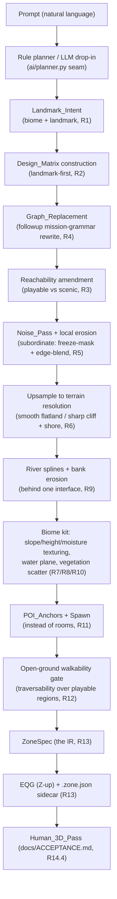

# Design Document: zone-generator-wilderness

## Overview

This design makes **wilderness real**: an open, scenic EverQuest outdoor
landscape built around a central landmark (an oasis in the desert, a river fork
in the plains), driven by a natural-language prompt and rendered in the browser
preview. It is the post-M1, post-`zone-generator-followup` milestone that
replaces the rejected "heightfield draped under a TinyKeep room graph" approach
with a genuinely different layout architecture: **landmark-first,
landscape-around-a-landmark**.

The core idea — and the thing that keeps this from being "a room graph in a
grass skin" — is a 2D governing IR, the **Design_Matrix**. Intent resolves to a
matrix of typed cells; graph-replacement rules refine it; a noise/erosion pass
synthesizes a heightfield that is *subordinate* to the matrix (frozen cells
masked, edges blended); the result upsamples to terrain, gets biome texturing +
a water plane + vegetation, and flows through the existing `ZoneSpec` to EQG +
sidecar. Playability, not full connectivity, is the invariant — cliffs, deep
water, and invisible walls are first-class scenery barriers, the way real EQ
outdoor zones are.

This design **reuses** `zone-generator-followup` and does not invent a parallel
layout architecture:

- The generator is a `LayoutEngine` implementation (followup Req F1) selected by
  `zone_type` through the existing `GeometryBackend` registry
  (`generators/backends.py`).
- The Design_Matrix is a biome/intent-tagged **specialization of followup's
  `Envelope`** (followup Req F2).
- Graph-replacement reuses followup's **dimension-free mission-grammar /
  graph-rewrite layer** (followup "Mission grammar"), not a fresh rewrite engine.
- Where wilderness diverges — the reachability amendment (Requirement 3) — it
  says so explicitly and shows how it interacts with followup's connector-aware
  gate (F4).

It is a **geometry-producing** spec. Per the standing project rule, a passing
structural and property suite is **necessary but not sufficient**: every
geometry-producing change takes a Human_3D_Pass per `docs/ACCEPTANCE.md`
(Requirement 14.4).

## Research: what existing work does

The design borrows four established techniques and cites them where they
genuinely shape a decision. Content from these sources was rephrased for
compliance with licensing restrictions.

### Graph grammars own the "refine a layout by rules" layer (Dormans / Boris the Brave)

Joris Dormans' mission/space split — reused wholesale by `zone-generator-followup`
— separates a **dimension-free** rewrite of an abstract graph (the mission
grammar) from the geometry that embeds it (the space grammar). Boris the Brave's
deconstruction of Unexplored confirms the rewrite rules operate on a
coordinate-free graph; geometry is assigned afterward. See [Joris Dormans,
"Engineering Emergence" / generative grammars for game
content](http://www.jorisdormans.nl/) and [Boris the Brave, "Unexplored's
Secret: 'Cyclic' Dungeon
Generation"](https://www.boristhebrave.com/2021/04/10/dungeon-generation-in-unexplored/).

**Consequence for wilderness:** the Graph_Replacement pass (Requirement 4) is a
*specialization of followup's mission-grammar rewrite* over a terrain vocabulary
(`river`, `cliff`, `oasis`, …) rather than a dungeon vocabulary (`lock`, `key`,
`boss`). The dimension-free rewrite machinery, the termination bound, and the
"preserve an invariant at every step" discipline all transfer. We do **not**
reuse Dormans' 2D space grammar (it is the tile-grid embedding; wilderness
embeds continuously via noise synthesis).

### Terrain is a heightfield shaped by FBM noise + erosion (Musgrave / Olsen)

The project already uses fractional-Brownian-motion value noise plus thermal
erosion for outdoor terrain (`generators/field/terrain.py`). This matches the
classic procedural-terrain recipe: layered noise for the base relief, then an
erosion relaxation so slopes slump to a natural angle of repose. See [Musgrave,
Kolb & Mace, "The synthesis and rendering of eroded fractal
terrains" (SIGGRAPH 1989)](https://dl.acm.org/doi/10.1145/74333.74337) and
[Jacob Olsen, "Realtime Procedural Terrain Generation"
(2004)](https://web.mit.edu/cesium/Public/terrain.pdf). The project's own
performance lesson stands: noise must stay **vectorised numpy value-noise**, never
a per-voxel Python loop (`generators/field/noise.py`; lessons-learned).

**Consequence:** the Noise_Pass (Requirement 5) reuses the existing FBM +
thermal-erosion + `_enforce_walkable` core, but subordinated to the matrix via a
freeze mask (new) and edge blend (new). No new noise primitive is introduced.

### Rivers are drainage features; a spline approximates them before full hydrology (Mei / St'ava)

Real hydraulic erosion carves valleys by simulating water flow and sediment
transport — expensive, and overkill for v1. The cheap, well-understood
approximation is to treat a river as a **drainage spline** that governs a carved
channel and locally eroded banks. See [Xing Mei et al., "Fast Hydraulic Erosion
Simulation and Visualization on GPU" (Pacific Graphics
2007)](https://hal.inria.fr/inria-00402079/document) for the full simulation we
defer, and the spline-channel approximation as the standard first cut.

**Consequence:** rivers are splines with local bank erosion behind **one
interface** (Requirement 9.4) so full hydraulic erosion drops in later without
changing callers — the same "replaceable backend behind a stable seam" shape the
project uses for textures and geometry.

### Biome identity is mostly texture splatting over one terrain core (Bloom / slope-height splat)

Distinct-looking biomes rarely need distinct terrain generators; they need
distinct **splat maps** — ground textures blended by slope, height, and moisture
over one shared heightfield. This is the standard terrain-texturing approach in
engines and is how EQ outdoor zones read as distinct (sand vs grass) over similar
relief. See the general technique in [Charles Bloom, "Texture
Splatting"](https://cbloomrants.blogspot.com/) and common engine terrain-material
documentation.

**Consequence:** Biomes are data-driven **kits** (Requirement 7) — ground-texture
set, water flag, skybox/fog tint, vegetation kit — applied over one
terrain+hydrology core, with texturing routed through the existing AI-texture
drop-in seam (`generators/textures/factory.py`).

## Architecture

(Architecture & where it plugs in.)

Wilderness is a `LayoutEngine` (followup F1) that produces the Design_Matrix and
derives POI anchors + a heightfield plan from it, selected by `zone_type ==
"wilderness"` through the existing `GeometryBackend` registry. The downstream
ZoneSpec → EQG + sidecar flow (Requirement 13) is the same pipeline every zone
uses.



The seam placement, concretely:

- **`WildernessLayoutEngine` implements followup's `LayoutEngine` protocol**
  (followup "The engine seam"). It owns the Design_Matrix, Graph_Replacement,
  the reachability amendment, and the derivation of POI anchors. It does **not**
  return `(rooms, edges)` the way TinyKeep does — wilderness has no rooms
  (Requirement 11.2). This is the one place the contract bends: see *Open
  decisions* on whether wilderness is a full `LayoutEngine` or a **sibling layout
  stage** behind the same `zone_type` routing. The deciding constraint is that
  followup's `(rooms, edges)` contract is dungeon-shaped; wilderness emits a
  Design_Matrix + POI anchors instead, so it most likely lands as a sibling
  stage selected by the same registry rather than a literal `LayoutEngine`
  return. Either way it sits **behind the F1 seam**, not beside a reinvented one.
- **Geometry routing is unchanged:** `backend_for("wilderness")` already resolves
  to `TerrainBackend` (`generators/backends.py`). This design *extends*
  `TerrainBackend.build` so that, when the spec carries a Design_Matrix, it
  synthesizes from the matrix instead of the current "FBM over the room
  footprint" path. With no matrix (a plain terrain spec) it behaves exactly as
  today — additive, no regression.
- **Textures route through the existing factory** (`generate_texture` /
  `generators/textures/factory.py`), so the AI drop-in seam is preserved with
  zero code change on the texture side (Requirement 10.3).

## Components and Interfaces

The generator is a pipeline of components, each a seam that can be tested and
replaced on its own: **intent resolution** (prompt → Landmark_Intent), the
**Design_Matrix IR** (the governing 2D layout), **Graph_Replacement** (rule
refinement), the **reachability amendment** (playable-vs-scenic + POI anchors),
the **Noise_Pass + upsample** (matrix → heightfield), and the **biome kit /
water / river (`DrainageModel`) / texturing** stage. Each is specified below
with its data model and interface.

### Component: the Design_Matrix IR (R2)

#### What it is

The Design_Matrix is a **2D grid of cells**, each carrying exactly one
`Node_Type` and exactly one `Intent_Tag`:

```python
# generators/wilderness/matrix.py  (new module)

NodeType = Literal["river", "cliff", "flatland", "oasis",
                   "landmark_pad", "water", "backdrop"]   # R2.2 v1 set
IntentTag = Literal["playable", "scenic"]                 # R2.3

@dataclass
class MatrixCell:
    node_type: NodeType
    intent: IntentTag
    # Height constraint for Frozen_Cells (landmark_pad, river, water):
    #   frozen=True means the Noise_Pass is masked out of this cell (R5.2).
    frozen: bool = False
    frozen_z: Optional[float] = None     # constraint height when frozen
    biome: str = ""                      # "desert" | "plains" (kit selection)

@dataclass
class DesignMatrix:
    cells: np.ndarray            # shape (nx, ny), dtype=object -> MatrixCell
    cell_size: float             # world units per matrix cell
    origin: Tuple[float, float]  # world XY of cell (0,0)
    water_level: float           # R8 Water_Level
    biome: str
    landmark: str                # "oasis" | "river_fork"
    intent_overrides: Dict[Tuple[int, int], IntentTag] = field(default_factory=dict)
```

### Why a 2D grid and how it specializes followup's `Envelope`

Followup's `Envelope` is a bounded 3D volume with a `contains(x, y, z)` predicate
and left the "continuous predicate vs discrete cell grid" question **open**
(followup "Open decisions": *continuous preferred… revisit if the connector
router needs cells*). Wilderness is the case that needs cells: Graph_Replacement
rewrites discrete typed nodes, the freeze mask is per-cell, and the matrix must
be **inspectable and property-testable before any geometry exists**
(Requirement 2.5). A pure continuous predicate cannot carry a per-cell
`Node_Type`/`Intent_Tag` or be asserted "oasis ringed by desert" without
geometry.

So wilderness realizes the `Envelope` as **an Envelope with a 2D authoring
face** — a thin 3D volume (ground is a surface, Z is up) whose authoring
representation is this 2D cell grid:

- The matrix is the **authoring face**: the grid of typed cells the designer and
  property tests reason about.
- The `Envelope.contains(x, y, z)` predicate is **derived** from the matrix after
  synthesis (a point is inside the volume if it is within XY bounds and below the
  synthesized surface + headroom). This keeps wilderness honestly *behind*
  followup's `Envelope` concept rather than beside a parallel one, and it answers
  followup's open question concretely for this consumer: **wilderness needs
  cells; it exposes them as the authoring face of a thin Envelope.**

This is the justified choice over the two alternatives: a bare 2D grid (would not
be an `Envelope` at all, violating Requirement 2.1's "specialization of the
followup `Envelope`") and a full dense 3D Envelope (wasteful — ground is a
surface, not a volume; verticality here is height, not stacked floors).

### Grid resolution and world-frame mapping

- `cell_size` is coarse (**matrix resolution ≪ terrain resolution**): the matrix
  governs *layout* (where the oasis is, where the cliff runs), not surface
  detail. A starting point is ~1 matrix cell per 150–250 world units over a
  ~2000–3000u zone (so ~12–20 cells per side); the exact value is tuned in the
  tasks phase (see *Open decisions*, and adversarial risk #2 below). The coarse
  matrix is *why* the upsample (Requirement 6) must preserve sharp edges.
- World mapping: cell `(i, j)` covers world XY `[origin_x + i*cell_size,
  origin_x + (i+1)*cell_size) × [origin_y + j*cell_size, …)`. Z is up
  (Requirement 13.3); the matrix is the XY authoring face and carries only the
  frozen-Z constraints, never a per-cell surface height — that is the Noise_Pass's
  job.

### Landmark-first construction order (R2.4)

Construction places the **Landmark node first**, then derives supporting geography
around it:

1. Place the landmark at/near matrix center: `oasis` + a ring of `water`, or a
   `river` seed node. Mark its `landmark_pad` cells frozen (Requirement 5.4).
2. Derive biome backdrop outward: desert+oasis rings the oasis with
   `flatland`/`backdrop` desert cells so **no oasis cell touches the matrix
   boundary** (Requirement 2.6).
3. Place supporting features (a `cliff` edge, a `backdrop` horizon band) as
   scenic framing.
4. Assign a default `Intent_Tag` to every region (Requirement 3.4): the landmark
   and the ground around it `playable`; distant backdrop / far cliffs / deep
   water `scenic`.
5. Enforce the single-connected-`water`-region invariant (Requirement 2.7) as a
   construction post-condition.

### Why inspectable / property-testable before geometry (R2.5/2.6/2.7)

The matrix is plain data (`numpy` object array of dataclasses), serializable and
assertable **with no heightfield built**. Property tests (below) assert
"oasis ringed by desert," "water is one connected region," "every region has an
intent tag," "landmark placed first" directly on the matrix. This is the design's
central guard against the rejected approach: the *layout* is validated as an open
landscape before a single triangle exists. `DesignMatrix` is exposed on the
engine output for inspection before the Noise_Pass runs (Requirement 2.5).

### Component: landmark-first intent resolution (R1)

Prompt → `Landmark_Intent` reuses the existing planner seam
(`ai/planner.py`, `ai/rule_planner.py`) rather than a new parser:

- **Rule planner (default, zero-key — R1.2):** extends the existing keyword maps
  in `ai/rule_planner.py`. It already routes `desert`, `plains`, `oasis`-ish and
  `river` words toward `wilderness`. We add a **landmark lexicon** that resolves
  the biome+landmark pairing: desert words + "oasis" → `desert`+`oasis`; plains
  words + "river"/"fork" → `plains`+`river_fork`. The result is a
  `LandmarkIntent(biome, landmark)` carried on the `ZonePlan`.
- **LLM drop-in (R1.3):** the LLM planner proposes the same `LandmarkIntent`
  through the existing `get_planner()` / `make_plan()` drop-in seam
  (`ai/planner.py`), with the rule planner as the automatic fallback on any
  failure — identical to how planning already degrades. No new provider plumbing.
- **Fallback + substitution record (R1.4):** a biome or landmark outside the v1
  set resolves to the **nearest supported** `LandmarkIntent` (e.g. "jungle" →
  nearest of {desert, plains}), and the substitution (`requested` vs `resolved`)
  is written to the `.zone.json` sidecar so the user sees what was swapped.
- **Recorded on ZoneSpec (R1.5):** the resolved biome and landmark are stored on
  the ZoneSpec (new defaulted fields — see Data Models) so downstream stages and
  the sidecar read a single source of truth.

```python
@dataclass
class LandmarkIntent:
    biome: str       # "desert" | "plains"
    landmark: str    # "oasis" | "river_fork"
    requested_biome: str = ""     # for the sidecar substitution record (R1.4)
    requested_landmark: str = ""
    substituted: bool = False
```

### Component: graph-replacement (R4)

Graph_Replacement refines the Design_Matrix by **reusing followup's
dimension-free mission-grammar / graph-rewrite layer** (Requirement 4.1), applied
over a terrain vocabulary rather than a dungeon one. It is not a new rewrite
engine — it is the followup rewrite machinery parameterized with wilderness
rules.

#### Node / edge vocabulary

- **Nodes:** the `Node_Type` set attached to matrix regions
  (`river | cliff | flatland | oasis | landmark_pad | water | backdrop`).
  A graph node is a *region* (a connected set of same-type cells), so the
  rewrite reasons about "the cliff region," "the river," not individual cells.
- **Edges:** adjacency + a small typed relation set reused from followup's typed
  edges (followup F2) adapted to terrain: `borders` (regions touch),
  `approaches` (a ramp/pass provides a playable approach from one region to
  another), `flows_into` (river → junction). This keeps the edge vocabulary a
  specialization of followup's, not a parallel invention.

#### Example rules

- **`cliff → ramp/pass approach` (R4.4):** when a `cliff` region would strand a
  `playable` region (cut its only reachable approach), the rule spawns a
  ramp/pass node (a graded `flatland` corridor of cells through/around the cliff)
  carrying an `approaches` edge, restoring a playable approach. Mirrors the
  dungeon corridor-routing lesson that a slope must be *graded* (and later
  subdivided at mesh time) to stay climbable.
- **`river → fork` (R4.5):** in a `plains`+`river_fork` zone, the rule grows the
  single `river` node into two branches meeting at a junction node
  (`flows_into` edges), realized downstream as two river splines (Requirement 9.3).

#### Termination bound (R4.2)

Each rule is **monotone-bounded**: every rule either (a) consumes a trigger node
and marks it resolved, or (b) adds at most a bounded number of nodes keyed to the
v1 feature count. The rewrite runs to a fixed-point with a hard iteration cap
(e.g. `max_iters = C · region_count`); exceeding the cap is a construction error,
never a silent loop. This is the followup termination discipline applied to
terrain rules and directly closes **adversarial risk #3** (rules looping).

#### Reachability-preservation by construction (R4.3 / R4.6)

This is the heart of adversarial risk #3. We adopt the **solvability-invariant
discipline the dungeon gating already uses**: the dungeon `GateSpec` guarantees
"the key is always reachable before the lock" by *construction* — a gate is only
placed where the invariant provably still holds. Wilderness uses the identical
pattern for the playable-reachability invariant:

- Before applying a rule, compute the playable-reachability relation on the
  current matrix (connected `playable` regions reachable from Spawn via
  non-barrier cells).
- **Apply-then-check-then-commit:** apply the rule to a candidate matrix, recheck
  the invariant; if any `playable` region became stranded, **reject the rule
  application and keep the prior matrix** (Requirement 4.6). The invariant holds
  at *every* committed step (Requirement 4.3).
- The `cliff → ramp` rule (R4.4) is the *repair* counterpart: cliffs that would
  strand a playable region are only committed together with the approach node
  that keeps it reachable, so a cliff never lands as a stranding barrier for
  playable ground.

This makes reachability-preservation a construction property (checked each step),
not a post-hoc hope — exactly the dungeon gating stance.

### Component: reachability amendment (R3) + open-ground walkability (R11/R12)

#### Playable vs scenic, and how it amends followup

Followup's gate (F4) assumes **full walkable connectivity** — every room
reachable. Wilderness **amends** that: mutual reachability from Spawn is required
for **Playable_Regions only** (Requirement 3.1). Scenic regions MAY be
unreachable (Requirement 3.2). This is represented by the per-cell `Intent_Tag`
and enforced in two places:

1. **On the matrix (pre-geometry):** the reachability relation used by
   Graph_Replacement (above) is computed over `playable` cells only; `scenic`
   cells are excluded. A `playable` region unreachable from Spawn on the matrix is
   a **reachability failure naming the stranded region** (Requirement 3.6); a
   `playable` landmark unreachable from Spawn is likewise a failure
   (Requirement 3.7).
2. **On the built mesh (post-geometry):** the project traversability agent
   (`analyzer/traverse.py`) is run with Scenic_Regions **excluded** from the
   reachability requirement (Requirement 12.3).

#### Interaction with followup's F4 connector-aware gate

Followup F4 taught `analyzer/traverse.py` to understand vertical connectors
(staircase/bridge) and to be *connector-aware*. Wilderness **narrows the gate's
scope** rather than changing its connector logic:

- The gate still proves reachability on the real mesh per-triangle (unchanged).
- Wilderness passes the gate a **playable mask** (the set of POI anchors + ground
  in Playable_Regions) and tells it to prove reachability **among those anchors
  only**, excluding scenic ground. Concretely this is a new, defaulted parameter
  to the traverse entry point (a set of "required-reachable" seed points +
  "excluded" regions); with the parameter absent it behaves exactly as the
  dungeon full-connectivity gate (no regression to F4's behavior for dungeons).
- The connector vocabulary F4 added (bridge/ramp walkability by rise/run/headroom)
  is exactly what the `cliff → ramp` approach relies on at mesh time, so the two
  compose: the matrix guarantees a *graded approach exists*; the F4-aware gate
  proves that approach is *actually walkable on the mesh*.

#### POI anchors instead of rooms (R11)

Wilderness represents points of interest as named **POI_Anchors** (the landmark
plus a few camps / spawn clearings), **not rooms**, and **does not use the
TinyKeep room-and-corridor layout** (Requirement 11.1/11.2). One anchor is
designated **Spawn** (Requirement 11.3). Navigability is **open-ground
walkability among the POI anchors in Playable_Regions** (Requirement 11.4) —
the traversability agent walks the real ground mesh between anchor footprints,
not room-to-room corridors.

```python
@dataclass
class POIAnchor:
    name: str                 # "oasis", "north_camp", "spawn_clearing"
    x: float; y: float        # world XY; z sampled from the built surface
    is_spawn: bool = False
    intent: IntentTag = "playable"
```

#### Barriers as first-class scenery (R3.3)

Deliberate unreachability of a Scenic_Region is realized by **cliffs, deep water,
or Invisible_Wall barriers** (Requirement 3.3). Cliffs and deep water are
geometry the agent already rejects (slope too steep / below water). Invisible
walls are **authored barrier records** (an EQ convention) carried in the sidecar
(Requirement 13.5) — no visible geometry — suitable for later export as region
records (fast-follow, umbrella M6). User intent overrides (Requirement 3.5) are
honored by `DesignMatrix.intent_overrides` feeding both the matrix check and the
mesh gate.

#### Walkable slopes (R12.4)

Playable ground stays within the traversability agent's slope cap
(`AgentModel.walkable_slope_deg`, ~40°). The Noise_Pass's existing
`_enforce_walkable` relaxation (`generators/field/terrain.py`) is applied **to
playable cells only** (scenic cliffs are deliberately left steep). A Playable
anchor unreachable on the built mesh is a **walkability failure naming that
anchor** (Requirement 12.2).

### Component: noise/erosion subordinate to the matrix (R5) + upsample (R6)

#### Freeze/mask discipline (R5) — closes adversarial risk #1

The Noise_Pass reuses the existing FBM + thermal-erosion + `_enforce_walkable`
core (`generators/field/terrain.py`) but is made **subordinate to the matrix** so
hills never push through a river or tilt the landmark pad:

- **Mask (R5.2):** `Frozen_Cell`s (landmark pad, river channel, water) are masked
  out of the noise write — their terrain is set by their constraint
  (`frozen_z`), not by noise. This reuses the project's existing frozen-cell /
  `_enforce_walkable` masking pattern (the `np.where(too_steep, …)` idiom in
  `terrain.py`) rather than a new mechanism.
- **Edge blend (R5.3):** where noise terrain abuts a frozen cell, the noise value
  is blended toward the frozen value across a short falloff band (a distance-field
  weighted lerp near the shared edge), so there is no step discontinuity at the
  frozen boundary.
- **Flatness guarantee (R5.4):** `landmark_pad` cells are held flat to a stated
  tolerance *after* the noise pass completes (asserted by property test).
- **River below bank (R5.5):** `river` channel cells are clamped at/below adjacent
  bank height after the pass, so terrain cannot rise through the river.
- **Vectorised (performance):** all masking/blending is numpy array ops over the
  grid — no per-cell Python loop (lessons-learned performance rule).

The local erosion pass (thermal erosion already in `terrain.py`) runs **after**
masking so it smooths only non-frozen terrain; river bank erosion is the
spline-driven local carve (Requirement 9).

#### Upsample preserving sharp transitions (R6) — closes adversarial risk #2

The coarse matrix upsamples to terrain resolution with a **type-aware**
interpolation, so flatland reads smooth but cliffs and shorelines stay sharp:

- **Smooth across flatland↔flatland (R6.1):** bilinear/bicubic interpolation of
  the synthesized height — rolling hills, no facets.
- **Sharp across cliff↔non-cliff (R6.2):** the boundary is treated as a
  **discontinuity**: the two sides are interpolated independently and the height
  step is preserved (no smoothing across the edge). Implemented by not sampling
  neighbors across a cliff boundary during upsample (a per-edge mask).
- **Sharp across water↔non-water shoreline (R6.3):** same discontinuity treatment
  at the Water_Level boundary so the shoreline is crisp.
- **No axis-aligned stair-steps (R6.4):** cliff/shore boundaries are traced as a
  **polyline through the coarse grid and jittered/smoothed along the edge
  direction** before the height step is applied, so the sharp edge follows a
  natural contour instead of the matrix's axis-aligned cell walls. This is the
  specific fix for "blocky grid artifacts": sharpness is preserved *across* the
  edge while the edge *itself* is de-gridded along its length.

Adversarial risks #1 and #2 are thus both addressed by construction: #1 by the
freeze/mask + edge blend (noise cannot fight the matrix), #2 by the type-aware
upsample with edge de-gridding (coarse matrix, sharp features, no stair-steps).

### Component: biome kits, water, rivers, texturing (R7–R10)

#### Biome kit data model (R7)

```python
@dataclass
class BiomeKit:
    name: str                          # "desert" | "plains"
    ground_textures: List[str]         # splat set: e.g. ["sand", "sand_rocky", "dune"]
    water_present: bool                # R7.5 -> place the water plane
    sky_fog_tint: Tuple[int, int, int] # skybox / fog colour
    vegetation_kit: List[str]          # scatter palette: e.g. ["palm", "cactus"]
```

Kits are **data** (a small JSON table under `styles/` or a new `biomes/` table),
applied over **one shared terrain+hydrology core** (Requirement 7.2) — not a
generator per biome. `desert` and `plains` select their texture set, tint, and
vegetation kit from this table (Requirement 7.3/7.4). A kit with `water_present`
triggers the water plane (Requirement 7.5).

#### Visual-only water plane (R8)

A zone with `water`/`oasis` cells gets a **flat visual water plane at
Water_Level** (Requirement 8.1) with the biome water material (8.2). Terrain
meeting Water_Level gets a **shoreline texture blend** across the land-water
boundary (8.3). Real walkable-shallows / swimmable-deep **volumes are explicitly
out of scope for v1** (8.4) — the plane is visual, keeping cost down. The water
plane rides the ZoneSpec (as a `RegionSpec(kind="water")` plus the plane geometry)
so it renders in the browser preview like any other zone.

#### Rivers as splines with local erosion, behind one interface (R9)

```python
class DrainageModel(Protocol):
    """R9.4: the replaceable river/drainage interface. v1 = SplineDrainage;
    full hydraulic erosion drops in later behind this same seam, callers
    unchanged."""
    def carve(self, matrix: DesignMatrix, heights: np.ndarray) -> np.ndarray: ...

class SplineDrainage:   # v1 implementation
    # R9.1 define river as a drainage spline governing the valley
    # R9.2 carve the channel along the spline + locally erode banks
    # R9.3 river_fork -> two spline branches meeting at a junction
    ...
```

The spline governs the valley; the channel is carved along it and banks locally
eroded so the valley reads **water-made** (Requirement 9.2); a fork is two
branches meeting at a junction (9.3). Because carving is behind `DrainageModel`,
a full hydraulic-erosion drainage-network simulation replaces `SplineDrainage`
later **without changing callers** (9.4).

#### Procedural-only texturing with the AI seam preserved (R10)

Texturing is **procedural by default, zero-key** (Requirement 10.1), blending
ground textures by **slope, height, and moisture** (10.2) — the standard splat
approach. It routes through the **existing AI-texture drop-in seam**
(`generators/textures/factory.py` `generate` / `generate_texture`), so an AI
provider can be supplied without changing the generator (10.3) — no texture-side
code change needed. Moisture is **raised near Water_Level** so water-adjacent
surfaces read as damp ground / shoreline (10.4). Vegetation/feature scatter is
keyed to **biome + moisture** (sparse cactus on dry desert flat, denser growth
near the oasis / river), carried as placement data.

## Data Models

New, **additive and defaulted** fields on `ZoneSpec` so dungeon/city are
unaffected (Requirement 13.1; follows followup F2's "tolerated-and-defaulted on
load" rule and the existing `from_dict` legacy tolerance in `zone_spec.py`):

```python
# ZoneSpec additions (all defaulted; absent on load -> degenerate/empty):
biome: str = ""                       # R1.5 resolved biome
landmark: str = ""                    # R1.5 resolved landmark
water_level: Optional[float] = None   # R8 Water_Level (None = no water plane)
poi_anchors: List[POIAnchor] = field(default_factory=list)   # R11
# The Design_Matrix is engine-internal; what persists to the sidecar:
#   intent tags per region, POI names, biome kit identity, invisible-wall regions
```

Existing structures reused unchanged: `RegionSpec(kind="water")` for the water
plane; `MaterialSpec` for biome ground/water/shoreline textures; `seed` for
reproducibility (Requirement 14.1/14.2). The Design_Matrix, POI anchors, and
heightfield plan flow **through** the ZoneSpec to the backend (Requirement 13.1).

### Sidecar (`.zone.json`) additions (R13.4/13.5)

Advisory data rides the sidecar, never the binary geometry
(project convention):

- `intent` tags per region (Requirement 13.4),
- `poi_anchors` names (13.4),
- `biome` kit identity (13.4),
- `invisible_walls`: barrier region metadata suitable for later export as region
  records (13.5) — `{min_xy, max_xy, kind: "invisible_wall"}`.

## Correctness Properties

*A property is a characteristic or behavior that should hold true across all
valid executions of a system — essentially, a formal statement about what the
system should do. Properties serve as the bridge between human-readable
specifications and machine-verifiable correctness guarantees.*

The high-value guarantees here are **on the Design_Matrix** (pure data,
testable before geometry) and **on the synthesized heightfield** (invariants the
noise/upsample must preserve). These are the project's PBT sweet spot: pure
functions over a large structured input space (seeds, prompts), where 100+
iterations find edge cases a handful of examples miss.

### Property 1: Oasis is ringed by desert, never on the boundary

*For any* resolved `desert`+`oasis` Landmark_Intent and seed, the constructed
Design_Matrix SHALL surround every `oasis` cell with `desert`-appropriate
`flatland`/`backdrop` cells such that no `oasis` cell lies on the matrix boundary.

**Validates: Requirements 2.6**

### Property 2: Water forms a single connected region

*For any* constructed Design_Matrix, the set of `water` cells SHALL form exactly
one connected region (4-connectivity).

**Validates: Requirements 2.7**

### Property 3: Every cell has exactly one Node_Type and one Intent_Tag

*For any* constructed Design_Matrix, every cell SHALL carry exactly one
`Node_Type` from the v1 set and exactly one `Intent_Tag`, and every region SHALL
have a proposed default Intent_Tag.

**Validates: Requirements 2.2, 2.3, 3.4**

### Property 4: Landmark is placed first and is central

*For any* resolved Landmark_Intent and seed, the Design_Matrix SHALL contain the
landmark node and derive supporting geography around it (the landmark node exists
and no supporting feature displaces it from its central placement).

**Validates: Requirements 2.4**

### Property 5: Playable regions are mutually reachable from Spawn on the matrix

*For any* constructed Design_Matrix, every `playable` region (and a `playable`
landmark) SHALL be reachable from Spawn through non-barrier cells; an unreachable
`playable` region SHALL be reported as a failure naming that region.

**Validates: Requirements 3.1, 3.6, 3.7**

### Property 6: Scenic regions may be unreachable without breaking the invariant

*For any* Design_Matrix containing `scenic` regions, the reachability check SHALL
pass even when those scenic regions are unreachable from Spawn.

**Validates: Requirements 3.2, 12.3**

### Property 7: Intent override is honored

*For any* Design_Matrix and any user override of a region's Intent_Tag, the
reachability invariant SHALL be enforced using the overridden tag.

**Validates: Requirements 3.5**

### Property 8: Graph_Replacement terminates

*For any* starting Design_Matrix and seed, Graph_Replacement SHALL reach a
fixed-point within the bounded iteration cap (never looping).

**Validates: Requirements 4.2**

### Property 9: Graph_Replacement preserves playable reachability at every step

*For any* starting Design_Matrix and any sequence of applicable rules, mutual
reachability among `playable` regions SHALL hold after every committed rewrite
step; a rule application that would strand a `playable` region SHALL be rejected
and the prior matrix preserved.

**Validates: Requirements 4.3, 4.6**

### Property 10: Cliffs never strand playable regions

*For any* Design_Matrix containing a `cliff` that would strand a `playable`
region, Graph_Replacement SHALL spawn a ramp/pass approach so that region remains
reachable.

**Validates: Requirements 4.4**

### Property 11: Noise is masked out of frozen cells

*For any* finalized Design_Matrix and seed, the Noise_Pass SHALL leave every
`Frozen_Cell`'s terrain equal to its constraint height (noise does not alter
constraint-governed terrain).

**Validates: Requirements 5.2**

### Property 12: Landmark pad stays flat after noise

*For any* synthesized heightfield, every `landmark_pad` cell SHALL be flat to
within the stated flatness tolerance after the Noise_Pass completes.

**Validates: Requirements 5.4**

### Property 13: River stays at or below its banks

*For any* synthesized heightfield containing a `river`, every river-channel cell
SHALL be at or below its adjacent bank height after the Noise_Pass completes.

**Validates: Requirements 5.5**

### Property 14: Upsample smooths flatland and preserves sharp cliff/shore edges

*For any* Design_Matrix upsampled to terrain resolution: height SHALL interpolate
smoothly across `flatland`↔`flatland` boundaries, AND the height discontinuity
across a `cliff`↔non-`cliff` boundary and the `water`↔non-`water` shoreline SHALL
be preserved as a sharp transition (not smoothed away).

**Validates: Requirements 6.1, 6.2, 6.3**

### Property 15: Open-ground walkability — playable POIs reachable, slopes within cap

*For any* built wilderness mesh, every Playable_Region POI_Anchor SHALL be
reachable from Spawn by the traversability agent with Scenic_Regions excluded,
and walkable playable slopes SHALL stay within the agent's slope cap; an
unreachable playable anchor SHALL be reported as a walkability failure naming it.

**Validates: Requirements 12.1, 12.2, 12.3, 12.4**

### Property 16: Seeded reproducibility

*For any* prompt, generating with the same pinned seed SHALL reproduce the same
landscape, and generating without a pinned seed SHALL draw a fresh seed (repeated
generation differs).

**Validates: Requirements 14.1, 14.2**

### Property 17: Fallback substitution is recorded

*For any* prompt naming a biome or landmark outside the v1 set, the resolved
Landmark_Intent SHALL be the nearest supported one AND the substitution SHALL be
recorded in the sidecar.

**Validates: Requirements 1.4**

## Error Handling

- **Stranded playable region (matrix, R3.6/3.7):** construction reports a
  reachability failure identifying the stranded region / landmark; it does not
  emit geometry for a matrix that fails the playable invariant.
- **Rewrite would strand a region (R4.6):** the offending rule application is
  rejected and the prior matrix state is kept; the rewrite continues with other
  applicable rules.
- **Rewrite exceeds the iteration cap (R4.2):** a construction error is raised
  (bounded-loop guarantee) rather than looping silently.
- **Walkability failure on the built mesh (R12.2):** reported with the stranded
  POI anchor named, surfaced for the Human_3D_Pass.
- **No numpy (`TerrainBackend` dependency):** the existing registry already
  degrades `TerrainBackend.build` to `None` → box backend; wilderness inherits
  this guard unchanged (`generators/backends.py`).
- **Planner / LLM failure (R1.3):** falls back to the rule planner via the
  existing `make_plan` seam; planning never breaks.
- **Unsupported biome/landmark (R1.4):** nearest-supported fallback + sidecar
  record, never a hard failure.

## Testing Strategy

**Dual approach.** Property tests carry the correctness load (pure Design_Matrix
and heightfield functions over a large seed/prompt space); example and
integration tests cover specific scenarios, wiring, and the things only a human
can confirm.

**Property-based testing applies here** and is the right tool: the
Design_Matrix construction, Graph_Replacement, the freeze/mask + upsample, and
reachability are **pure functions over structured inputs** (seed, prompt,
intent) with clear invariants (round-trip-like reachability preservation,
masking identity, connectivity, flatness). These are exactly the "for all inputs
X, property P(X) holds" cases PBT is built for.

- **Library:** Hypothesis (already in use — `.hypothesis/` is present in the
  repo), Python.
- **Configuration:** each property test runs **≥100 iterations**.
- **Tagging:** each property test carries a comment
  **`Feature: zone-generator-wilderness, Property {n}: {property text}`** and
  references the design property it implements.
- **Coverage:** one property-based test per correctness property (Properties
  1–17). Matrix properties (1–10, 16, 17) run with **no geometry built** —
  the central guard that layout is validated as an open landscape first.
  Heightfield properties (11–14) run on the synthesized field. Mesh property
  (15) runs the real traversability agent on the built mesh.

**Example / integration tests (not PBT):**

- Biome kit selection (desert vs plains picks the right texture set / tint /
  vegetation) — example-based, config-driven.
- Water plane placement and material (an oasis zone has a water plane at
  Water_Level with the biome water material) — example-based.
- Texturing routes through the AI-texture seam (forcing a provider via the
  existing `set_provider` seam produces the expected call path) — mock-based,
  since the *wiring* doesn't vary with input.
- Sidecar contents (intent tags, POI names, biome identity, invisible-wall
  regions present) — example-based assertion on the emitted `.zone.json`.
- EQG output loads and is Z-up — example/integration smoke on a built zone.
- Performance budget: one timed integration test asserting a full generate of
  each v1 pair completes **well within five minutes** (Requirement 14.3).

**Structural tests are necessary but NOT sufficient (R14.4).** Per the standing
project rule, no geometry-producing change is accepted on a green suite alone.
Every such change walks `docs/ACCEPTANCE.md` for a **Human_3D_Pass**, with new
wilderness rows the suite cannot verify:

- the desert+oasis zone reads as an open desert with a central oasis (not a
  room-graph in a grass skin);
- the plains+river-fork zone reads as an open plain with a forking river valley;
- cliffs/shorelines are sharp, not blocky/stair-stepped (eyeballs Property 14);
- the landmark pad is flat and the water reads as water with a clean shoreline;
- scenic backdrops are visibly out of reach while every playable POI is walkable.

## Open decisions / risks left for the tasks phase

- **`LayoutEngine` vs sibling stage.** Followup's `LayoutEngine` returns
  `(rooms, edges)`, which is dungeon-shaped; wilderness emits a Design_Matrix +
  POI anchors. The likely resolution is a **sibling layout stage** selected by
  the same `zone_type` registry (behind the F1 seam, not beside a reinvented
  one), but the exact contract — and whether a thin `rooms=[], edges=[]` adapter
  satisfies the protocol — is settled when the code lands.
- **Matrix resolution (adversarial risk #2).** The ~150–250 u/cell starting
  point is a guess; the real value trades matrix inspectability against feature
  sharpness and is tuned against the upsample and the 3D pass.
- **Envelope: continuous predicate vs cell grid.** This design commits
  wilderness to the **cell-grid authoring face** of a thin Envelope (answering
  followup's open question for this consumer). If F2 lands the Envelope as a
  pure continuous predicate, wilderness supplies the cell-grid specialization;
  confirm the shared type when F2 lands.
- **How much of followup F2/F4 must land first.** Wilderness depends on F2 (the
  `Envelope` type, typed edges) and F4 (the connector-aware, now
  scope-narrowable, traversability gate). The tasks phase sequences wilderness
  behind whichever of F2/F4 it actually consumes, and specifies the defaulted
  `required-reachable / excluded-regions` parameter the gate needs for the
  reachability amendment.
- **Erosion parameters.** Thermal-erosion iterations, talus angle, and river
  bank-erosion falloff are tuned for "reads water-made / weathered" against the
  3D pass, not fixed here.
- **River spline representation.** Exact spline type (Catmull-Rom vs Bézier) and
  junction blending for the fork are an implementation choice behind
  `DrainageModel`.
- **Vegetation realization.** v1 carries vegetation as placement data (scatter
  points keyed to biome+moisture); whether v1 emits placed vegetation MODs or
  defers actual mesh placement to a fast-follow is a scope call for the tasks
  phase.

## Sources

- `.kiro/specs/zone-generator-followup/requirements.md` and `design.md` — the
  reused `LayoutEngine` seam (F1), typed edges + 3D `Envelope` (F2), the
  side-by-side harness (F3), the gate-learns-connectors discipline (F4), and the
  dimension-free mission-grammar / graph-rewrite layer. This design AMENDS
  followup's full-connectivity assumption (Requirement 3).
- `ROADMAP.md` / `.kiro/steering/lessons-learned.md` — M1 ships wilderness
  present-but-disabled; the `GeometryBackend` registry seam; "structural tests
  pass is necessary but NOT sufficient — eyeball it in 3D"; Z is up; EQG
  collision is per-triangle; value-noise over opensimplex for performance.
- `docs/ACCEPTANCE.md` — the Human_3D_Pass manual UAT checklist.
- [Joris Dormans — generative grammars / mission-space split](http://www.jorisdormans.nl/)
  and [Boris the Brave — "Unexplored's Secret: Cyclic Dungeon Generation"](https://www.boristhebrave.com/2021/04/10/dungeon-generation-in-unexplored/)
  — the dimension-free graph-rewrite layer reused for Graph_Replacement.
- [Musgrave, Kolb & Mace — "The synthesis and rendering of eroded fractal terrains" (SIGGRAPH 1989)](https://dl.acm.org/doi/10.1145/74333.74337)
  and [Olsen — "Realtime Procedural Terrain Generation" (2004)](https://web.mit.edu/cesium/Public/terrain.pdf)
  — FBM-noise + erosion terrain synthesis.
- [Mei et al. — "Fast Hydraulic Erosion Simulation and Visualization on GPU" (2007)](https://hal.inria.fr/inria-00402079/document)
  — the full hydraulic erosion deferred behind the `DrainageModel` interface.
- [Charles Bloom — "Texture Splatting"](https://cbloomrants.blogspot.com/)
  — slope/height/moisture splat biome texturing.

Content from external sources was rephrased for compliance with licensing
restrictions.
