# Design Document: zone-generator-wilderness

## Overview

This design makes **wilderness real** as **roadmap step 1**: a believable,
walkable, **sealed, eroded open Karana** — a procedural plains heightfield for
the RoF2 client, driven by a natural-language prompt and rendered in the browser
preview. It is **terrain-first**: the deliverable is **the land itself** — a
heightfield carved by erosion, ringed by an impassable **Rim** (the bowl),
broken only at declared **zoneline** exits. The lead (and only v1) biome is
**plains (the Karanas)**.

The core idea — and the thing that keeps this from being "a room graph in a
grass skin" — is a 2D governing IR, the **Design_Matrix**. Intent resolves to a
matrix of typed **terrain** cells; graph-replacement rules refine it; a
value-noise FBM pass synthesizes a base heightfield that is *subordinate* to the
matrix (frozen cells masked, edges blended); a **first-class erosion pass**
(hydraulic flow-accumulation + thermal talus, vectorised) carves it so valleys
and ridgelines read water-and-weather-made; the coarse field upsamples with
sharp cliff/rim/shore edges; the **bowl assembly** builds the Rim per declared
Edge_Connection and seals it; biome texturing + a visual water plane finish it;
and the whole thing flows through the existing `ZoneSpec` to EQG + sidecar. The
**bowl invariant** — interior fully reachable from Spawn, no path crossing a
non-`zoneline` Rim segment — is proved on the built mesh by the project
traversability agent.

This step deliberately **reuses the existing terrain core and backend
registry** and does **not** stand up the dispersed architecture runway. Per
`ROADMAP.md`, the pluggable `LayoutEngine` seam lands with **step 6**, and the
3D `Envelope` + gate-learns-connectors land with **steps 5/7** — step 1 must not
invent or depend on them. Concretely, what this design reuses, verified against
the code:

- Geometry routing is unchanged: `backend_for("wilderness")` already resolves to
  `TerrainBackend` (`generators/backends.py`). Wilderness is a
  **`TerrainBackend`-hosted path**, not a new engine seam.
- Terrain synthesis extends the existing vectorised FBM + thermal-erosion +
  `_enforce_walkable` core (`generators/field/terrain.py`).
- Rim / lava / Invisible_Wall / zoneline records ride the existing `RegionSpec`
  machinery and its `kind → ZON-prefix` map (`generators/builder.py`:
  `water→AWT`, `lava→ALV`, `zoneline→ATP`, generic→`APV`) and the `.zone.json`
  sidecar writer.
- The bowl gate **extends** the per-triangle walk surface and reachability in
  `analyzer/traverse.py` (the `AgentModel` with `walkable_slope_deg` / `max_step_up`
  and `build_walk_surface` / flood); it does not invent a new agent.
- Biome resolution reuses the existing planner drop-in seam
  (`ai/planner.py`: `make_plan` / `get_planner`, rule planner default, LLM
  optional with automatic fallback).

It is a **geometry-producing** spec. Per the standing project rule, a passing
structural and property suite is **necessary but not sufficient**: every
geometry-producing change takes a **Human_3D_Pass** per `docs/ACCEPTANCE.md`
(Requirement 13.4).

## Research: what existing work does

The design borrows established techniques and cites them where they genuinely
shape a decision. Content from these sources was rephrased for compliance with
licensing restrictions.

### Terrain is a heightfield shaped by FBM noise + erosion (Musgrave / Olsen)

The project already uses fractional-Brownian-motion value noise plus thermal
erosion for outdoor terrain (`generators/field/terrain.py`:
`_generate_heightfield`, `_thermal_erosion`). This matches the classic
procedural-terrain recipe: layered noise for base relief, then an erosion
relaxation so slopes slump to a natural angle of repose and ridgelines/valleys
read weathered rather than blobby. See [Musgrave, Kolb & Mace, "The synthesis
and rendering of eroded fractal terrains" (SIGGRAPH
1989)](https://dl.acm.org/doi/10.1145/74333.74337) and [Jacob Olsen, "Realtime
Procedural Terrain Generation" (2004)](https://web.mit.edu/cesium/Public/terrain.pdf).
The project's own performance lesson stands: noise and erosion must stay
**vectorised numpy**, never a per-voxel Python loop (`generators/field/noise.py`;
lessons-learned).

**Consequence:** the Noise_Pass (Requirement 8) reuses the existing FBM core,
subordinated to the matrix by a freeze mask + edge blend. The Erosion pass
(Requirement 5) builds **on** the existing thermal-erosion relaxation and adds a
vectorised **hydraulic flow-accumulation** pass. No per-voxel loop is introduced.

### Hydraulic erosion is flow accumulation now, full droplet simulation later (Musgrave / Mei)

Real per-droplet hydraulic erosion simulates water and sediment transport —
expensive, and more than v1 needs. The cheap, well-understood approximation that
still reads water-made is **flow accumulation**: estimate how much upslope area
drains through each cell (steepest-descent routing), then lower high-flow cells
to incise channels and valleys. See [Musgrave et al.
(1989)](https://dl.acm.org/doi/10.1145/74333.74337) for the eroded-terrain
model and [Xing Mei et al., "Fast Hydraulic Erosion Simulation and Visualization
on GPU" (Pacific Graphics
2007)](https://hal.inria.fr/inria-00402079/document) for the full simulation we
defer behind the same seam.

**Consequence:** v1 hydraulic erosion is **vectorised flow-accumulation incision**
layered with the existing thermal talus pass; full droplet simulation is a named
fast-follow that drops in behind the same erosion entry point without changing
callers.

### Graph grammars own the "refine a layout by rules" layer (Dormans / Boris the Brave)

Joris Dormans' mission/space split separates a **dimension-free** rewrite of an
abstract graph from the geometry that embeds it. Boris the Brave's deconstruction
of Unexplored confirms the rewrite rules operate on a coordinate-free graph;
geometry is assigned afterward. See [Joris Dormans, "Engineering Emergence" /
generative grammars for game content](http://www.jorisdormans.nl/) and [Boris
the Brave, "Unexplored's Secret: 'Cyclic' Dungeon
Generation"](https://www.boristhebrave.com/2021/04/10/dungeon-generation-in-unexplored/).

**Consequence for wilderness:** the Graph_Replacement pass (Requirement 7) is a
rewrite over a **terrain** vocabulary (`plains`, `river`, `cliff`,
`mountain_rim`, `lava`, `zoneline_gap`, `water`) rather than a dungeon one
(`lock`, `key`, `boss`). The "preserve an invariant at every step" discipline
transfers directly: here the preserved invariants are **playable-reachability**
and **the sealed Rim**. v1 implements this rewrite layer in the wilderness
module; the shared dungeon `LayoutEngine` seam is **step 6**, so step 1 does not
reuse or depend on it.

### Biome identity is mostly texture splatting over one terrain core (Bloom / slope-height splat)

Distinct-looking biomes rarely need distinct terrain generators; they need
distinct **splat maps** — ground textures blended by slope, height, and moisture
over one shared heightfield. This is how EQ outdoor zones read as distinct over
similar relief. See [Charles Bloom, "Texture
Splatting"](https://cbloomrants.blogspot.com/) and common engine terrain-material
documentation.

**Consequence:** biomes are data-driven **kits** (Requirement 11) — ground-texture
set, water flag, skybox/fog tint, vegetation-kit identity — applied over one
terrain core, routed through the existing texture seam. v1 ships one kit:
`plains`.

## Architecture

Wilderness is a **`TerrainBackend`-hosted path** (`generators/backends.py`): the
generator constructs the Design_Matrix and synthesizes a heightfield from it,
and `TerrainBackend.build` is extended so that **when the spec carries a
wilderness Design_Matrix it synthesizes from the matrix** instead of the current
"FBM over the room footprint" path. With no matrix (a plain terrain spec) it
behaves exactly as today — additive, no regression. There is **no new
`LayoutEngine` seam** here (that is roadmap step 6).

```mermaid
flowchart TD
    P["Prompt (natural language)"] --> RP["Rule planner / LLM drop-in<br/>(ai/planner.py seam)"]
    RP --> BI["Biome resolution → plains<br/>(R1)"]
    BI --> DM["Design_Matrix construction<br/>(plains interior + typed terrain regions<br/>+ perimeter Rim cells per Edge_Connection, R2/R3)"]
    DM --> GR["Graph_Replacement over terrain regions<br/>(terminate; preserve reachability + sealed Rim, R7)"]
    GR --> NP["Noise_Pass: vectorised FBM<br/>(matrix-subordinate: freeze-mask + edge-blend, R8)"]
    NP --> ER["Erosion: hydraulic flow-accumulation<br/>+ thermal talus (vectorised, rim-respecting, R5)"]
    ER --> RC["Re-assert / re-clamp non-zoneline Rim impassable<br/>(after every pass, R5.4/5.5)"]
    RC --> US["Upsample to terrain resolution<br/>(smooth plains / sharp cliff + rim + shore, de-gridded, R9)"]
    US --> BA["Bowl assembly: Rim per Edge_Connection<br/>(mountain seals by slope; river = water edge + Invisible_Wall;<br/>zoneline = flat walkable gap off-map), R3/R6"]
    BA --> LV["Lava regions: impassable interior + damaging flag<br/>(RegionSpec ALV, never a rim type, R10)"]
    LV --> BK["Biome kit: plains splat texturing (slope/height/moisture),<br/>visual water plane, veg-kit identity (R11/R13.1)"]
    BK --> ZS["ZoneSpec (the IR, R14.1)"]
    ZS --> MESH["TerrainBackend builds the ground mesh (TER)"]
    MESH --> WG["Bowl gate: traversability agent on the built mesh<br/>(interior reachable from Spawn; Rim sealed except zonelines, R4/R12)"]
    WG --> OUT["EQG (Z-up) + .zone.json sidecar<br/>(intent, edge types, invisible walls, lava-damaging, R14)"]
    OUT --> H3D["Human_3D_Pass (docs/ACCEPTANCE.md, R13.4)"]
```



The seam placement, concretely:

- **Backend routing is unchanged.** `BACKENDS["wilderness"] = TerrainBackend()`
  already exists (`generators/backends.py`); `backend_for("wilderness")` resolves
  to it. This design extends `TerrainBackend.build` to detect a wilderness
  Design_Matrix on the spec and synthesize from it. The `numpy`-absent degrade
  (returns `None` → box backend) is inherited unchanged.
- **Terrain synthesis extends the existing core.** The Noise_Pass reuses
  `_generate_heightfield` (vectorised FBM) and `_thermal_erosion`; the hydraulic
  pass is a new vectorised function alongside them; `_enforce_walkable` is reused
  for the playable interior. The matrix-subordination (freeze mask, edge blend)
  and Rim re-clamp are new wrappers around these existing calls.
- **Region records reuse `RegionSpec` + the prefix map.** The Rim's river edges,
  lava regions, zoneline gaps, and Invisible_Wall barriers are emitted as
  `RegionSpec` entries whose `kind` routes through the existing `_REGION_PREFIX`
  in `generators/builder.py` (`water→AWT`, `lava→ALV`, `zoneline→ATP`,
  generic→`APV`), and the `.zone.json` sidecar is written by the existing
  `write_sidecar` path on every build.
- **The gate extends `analyzer/traverse.py`.** The bowl gate runs the existing
  `AgentModel` + `build_walk_surface` + flood on the real TER, with a new,
  defaulted parameter set (required-reachable seeds, excluded scenic regions,
  and off-map Rim markers) so that absent the parameters it behaves exactly as
  the dungeon full-connectivity gate (no regression).

## Components and Interfaces

The generator is a pipeline of seams, each testable and replaceable on its own:
**biome resolution** (prompt → biome), the **Design_Matrix IR** (the governing
2D terrain layout + Rim), **Graph_Replacement** (rule refinement), the
**Noise_Pass + Erosion + upsample** (matrix → heightfield), **bowl assembly**
(Rim realized per Edge_Connection), **lava**, the **biome kit / visual water**,
and the **bowl gate** on the built mesh.

### Component: biome resolution (R1)

Prompt → resolved biome reuses the existing planner seam (`ai/planner.py`,
`ai/rule_planner.py`), not a new parser:

- **Rule planner (default, zero-key — R1.2):** the existing rule planner routes
  plains/Karana wording toward `wilderness`; wilderness resolves the biome to
  `plains` (the only v1 biome). No external service required.
- **LLM drop-in (R1.3):** an LLM planner may propose the biome through the
  existing `make_plan` / `get_planner` seam, with the rule planner as the
  automatic fallback on any failure — identical to how planning already
  degrades. No new provider plumbing.
- **Fallback + substitution record (R1.4):** a biome outside the v1 set resolves
  to `plains`, and the substitution (`requested` vs `resolved`) is written to the
  `.zone.json` sidecar so the user sees what was swapped.
- **Recorded on ZoneSpec (R1.5):** the resolved biome is stored on the ZoneSpec
  (new defaulted `biome` field — see Data Models) so downstream stages and the
  sidecar read one source of truth.

### Component: the Design_Matrix IR (R2)

#### What it is

The Design_Matrix is a **2D grid of cells**, each carrying exactly one terrain
`Node_Type` and exactly one `Intent_Tag`:

```python
# generators/wilderness/matrix.py  (new module)

NodeType = Literal["plains", "river", "cliff", "mountain_rim",
                   "lava", "zoneline_gap", "water"]   # R2.2 v1 set
IntentTag = Literal["playable", "scenic"]             # R2.3

@dataclass
class MatrixCell:
    node_type: NodeType
    intent: IntentTag
    # Frozen cells (river channel, zoneline_gap floor, mountain_rim ridge target)
    # are masked out of the Noise_Pass (R8.2); their terrain is set by frozen_z.
    frozen: bool = False
    frozen_z: Optional[float] = None
    # For perimeter cells only: which Edge_Connection segment they belong to.
    edge_segment: Optional[int] = None

EdgeType = Literal["mountain", "river", "zoneline"]   # R3, v1 connection types

@dataclass
class EdgeConnection:
    """One user-declared Rim segment (R3.1). N segments supported; the 4-side
    N/E/S/W default (R3.2) is just N=4 with one segment per side."""
    side: str                 # "N" | "E" | "S" | "W" (or a segment span)
    edge_type: EdgeType       # undeclared perimeter -> "mountain" (R3.3)

@dataclass
class DesignMatrix:
    cells: np.ndarray            # shape (nx, ny), dtype=object -> MatrixCell
    cell_size: float             # world units per matrix cell
    origin: Tuple[float, float]  # world XY of cell (0,0)
    water_level: float           # R13 Water_Level
    biome: str                   # v1: "plains"
    edges: List[EdgeConnection]  # the Rim, as N perimeter segments (R3.1)
    spawn: Tuple[int, int]       # matrix cell holding Spawn (reachability root)
    intent_overrides: Dict[Tuple[int, int], IntentTag] = field(default_factory=dict)
```

### Why a 2D cell grid, and why inspectable before geometry (R2.5)

The matrix governs **layout** — where the river runs, where a cliff is, which
perimeter edges are mountain vs zoneline — not surface detail. Graph_Replacement
rewrites discrete typed regions, the freeze mask is per-cell, and the layout must
be **inspectable and property-testable before any geometry exists** (R2.5). A
coarse cell grid is the natural representation; it is plain data (a `numpy`
object array of dataclasses), serializable and assertable with no heightfield
built. The matrix is exposed on the generator output for inspection before the
Noise_Pass runs. This is the design's central guard against the rejected
room-graph-drape approach: the *layout* is validated as an open, sealed landscape
before a single triangle exists.

### Grid resolution and world-frame mapping

- `cell_size` is coarse (**matrix resolution ≪ terrain resolution**): a starting
  point is ~1 matrix cell per 150–250 world units over a ~2000–3000 u zone
  (~12–20 cells per side). The TER resolution stays ~40–50 u/cell (as in
  `TerrainBackend` today). The coarse matrix is *why* the upsample (R9) must
  preserve sharp edges. Exact value is tuned in the tasks phase (see *Open
  decisions*).
- World mapping: cell `(i, j)` covers world XY
  `[origin_x + i*cell_size, origin_x + (i+1)*cell_size) × [origin_y + j*cell_size, …)`.
  **Z is up** (R14.3); the matrix is the XY authoring face and carries only
  frozen-Z constraints, never a per-cell surface height — that is the
  Noise_Pass/Erosion job.

### Terrain-first construction order (R2.4 / R2.6 / R2.7)

Construction leads with the **interior plains**, derives terrain regions within
it, then tags the perimeter as Rim:

1. Fill the interior with `plains` cells and place **Spawn** near interior
   center (R2.4).
2. Derive terrain regions *within* the plains interior: optionally a `river`
   (boundary-hugging in v1), `cliff` scenic framing, `lava` hazard region(s),
   and `water` cells (R2.4).
3. Tag every **perimeter** cell as Rim according to its Edge_Connection (R2.6):
   `mountain` → `mountain_rim`; `river` → boundary `water` + the sealing edge;
   `zoneline` → `zoneline_gap`. Undeclared perimeter edges default to `mountain`
   (R3.3).
4. Assign a default `Intent_Tag` to every region (R2.3): the plains interior and
   the ground around Spawn `playable`; the Rim / distant mountains / deep water
   `scenic`.
5. Enforce the single-connected-`water`-region invariant (R2.7) as a
   construction post-condition.

### Component: the Bowl via declared Edge Connections (R3)

The Rim is the impassable perimeter boundary, modeled as **N user-declared
Edge_Connection segments** (R3.1). The four-side N/E/S/W layout is the simple
default (R3.2, `N=4`). Each segment has a typed behavior; an undeclared perimeter
edge defaults to `mountain` (R3.3). How each type is **realized** on the
heightfield/regions:

- **`mountain` (R3.4):** the perimeter cells are `mountain_rim`, frozen to a
  ridge target height, and the **upsampled edge is raised to a slope steeper
  than `AgentModel.walkable_slope_deg`** (~40°, `min_up_normal` threshold in
  `traverse.py`) so the geometry itself seals the edge — the agent classifies
  those faces as non-standable. No barrier record needed; collision truth is the
  slope.
- **`river` (R3.5):** a **boundary-hugging visual water edge** at Water_Level,
  backed by an **Invisible_Wall `RegionSpec`** that seals the edge. Because v1
  water is visual-only (no collision volume, R13.1), the Invisible_Wall is what
  actually stops the player; the water is scenery. The Invisible_Wall is recorded
  in the sidecar (R3.7) as region metadata.
- **`zoneline` (R3.6):** a **flat walkable gap** in the Rim leading off-map — the
  deliberate leak where an adjacent zone connects. Realized as `zoneline_gap`
  cells held flat (R8.4), walkable, and reachable from Spawn (R4.5), emitted as a
  `RegionSpec(kind="zoneline")` (→ `ATP` prefix).

Every Edge_Connection type and every Invisible_Wall barrier is recorded in the
`.zone.json` sidecar as region metadata suitable for later export as region
records (R3.7).

```python
@dataclass
class POIAnchor:
    name: str                 # v1: "spawn", optional spawn clearings (R-glossary)
    x: float; y: float        # world XY; z sampled from the built surface
    is_spawn: bool = False
    intent: IntentTag = "playable"
```

### Component: the Bowl Invariant and how the gate proves it (R4, R12)

This is the heart of the revision. The bowl gate **extends** the existing
per-triangle reachability in `analyzer/traverse.py` — it does not invent a new
engine. Two guarantees, proved on the **built mesh**:

1. **Interior reachable (R4.2, R4.6, R12.1):** every `playable` cell / POI anchor
   is reachable from Spawn by the traversability agent. The gate floods walkable
   adjacency from the Spawn face (`build_walk_surface` + the existing flood). A
   `playable` cell/anchor not in the reachable set is a **reachability /
   walkability failure naming the stranded region or anchor** (R4.6 / R12.2).
2. **Rim sealed except zonelines (R4.3, R4.4):** **no path from Spawn crosses a
   non-`zoneline` Rim segment.** 

How "the rim is sealed" is tested against the per-triangle walk surface,
precisely:

- Place an **off-map marker** just outside each non-`zoneline` Rim segment — a
  reference point in the exterior band beyond the rim ridge. (Representation is
  an open decision; a candidate is a thin strip of sentinel faces, or an
  exterior XY band the flood is checked against.)
- Flood walkable faces from the Spawn face across the built mesh.
- **The flood must not reach any exterior/off-map marker except through a
  `zoneline_gap` segment.** For a `mountain` segment the rim faces are
  non-standable by slope, so the flood stops at the ridge; for a `river` segment
  the Invisible_Wall excludes the beyond-edge faces from adjacency. If the flood
  reaches the exterior through a non-`zoneline` segment, that segment's ridge was
  breached → a **bowl-leak failure naming the breached Rim segment** (R4.4).
- For each `zoneline` segment the gate asserts the gap **is** reachable from
  Spawn and **does** lead off-map (R4.5) — the intended leak, not a failure.

Scenic regions (the Rim, distant mountains) are **excluded** from the reachability
requirement (R4.1, R12.3): the gate is given the `playable` mask (Spawn + the set
of playable anchors/ground) and proves reachability among those only. This is the
new, defaulted gate parameter — required-reachable seeds + excluded scenic
regions + off-map markers; absent them, `traverse.py` behaves exactly as the
dungeon full-connectivity gate (no regression). Playable interior slopes stay
within the agent's slope cap via `_enforce_walkable` applied **to playable cells
only** (R12.4); scenic cliffs/rim are deliberately left steep.

### Component: Erosion — first-class, vectorised, rim-respecting (R5)

The erosion stage carves the base heightfield so valleys and ridgelines read
water-and-weather-made, building **on** the existing `_thermal_erosion` in
`generators/field/terrain.py`:

- **Hydraulic (flow-accumulation) pass (R5.1):** a new **vectorised** function
  estimates drainage — for each cell, route a unit of "water+area" to its
  steepest-descent neighbour and accumulate flow across the grid (an iterative
  numpy scatter, not a per-cell Python loop), then **incise** high-flow cells
  (lower them proportional to accumulated flow) so channels and valleys cut in.
  The accumulation iterates a bounded number of times; each iteration is whole-grid
  array ops (`np.roll`/masked adds), matching the style of `_thermal_erosion`'s
  four-neighbour `np.roll` relaxation and `_enforce_walkable`'s `np.where` idiom.
- **Thermal (talus) pass (R5.1):** the existing `_thermal_erosion` relaxation —
  slopes above the talus angle slump to neighbours — reused directly.
- **Vectorised, no per-voxel loop (R5.2):** every pass is whole-grid numpy array
  operations. This is the hard lessons-learned rule (opensimplex per-voxel loop
  was the historical bottleneck; value-noise vectorisation fixed it).

**Order and the re-clamp discipline (R5.4, R5.5):** the pipeline is **noise →
hydraulic erosion → thermal erosion → re-assert the Rim**. After **each** pass,
every non-`zoneline` Rim cell is **re-clamped to its impassable ridge target**
(frozen_z), so no pass can carve a passable gully through the Rim. This mirrors
M1's "re-clamp to the floor half-space after every lobe/noise blend" discipline
(lessons-learned): an erosion pass that would incise a channel through a
`mountain_rim` segment is undone for that segment on the clamp step, preserving
the bowl (R5.5). Frozen cells (river channel, zoneline_gap) are likewise
re-asserted so erosion smooths only non-frozen interior terrain.

**Budget (R5.3 / R13.3):** the whole generate stays under five minutes. The
levers are **grid size** (TER resolution; coarser = fewer cells = faster) and
**iteration count** (flow-accumulation passes and thermal iterations). Because
every pass is vectorised, cost scales with grid cells × iterations, not with a
Python loop over cells — a 2000–3000 u zone at ~40–50 u/cell is ~40–75 cells per
side, well inside budget for tens of iterations. The exact iteration/grid tuning
is an open decision for the tasks phase; the constraint is "stays vectorised and
under budget."

### Component: Noise subordinate to the matrix (R8)

The Noise_Pass synthesizes the base heightfield with the existing vectorised
value-noise FBM (`_generate_heightfield`) **before** erosion (R8.1), made
**subordinate to the matrix**:

- **Mask (R8.2):** `Frozen_Cell`s (river channel, `zoneline_gap`, `mountain_rim`
  ridge target) are masked out of the noise write — their terrain is set by
  `frozen_z`, not noise. Reuses the project's frozen-cell / `np.where` masking
  idiom from `terrain.py`, not a new mechanism.
- **Edge blend (R8.3):** where noise terrain abuts a frozen cell, the noise value
  is blended toward the frozen value across a short falloff band (distance-field
  weighted lerp near the shared edge), so there is no step discontinuity at the
  frozen boundary.
- **Flat zoneline gaps (R8.4):** `zoneline_gap` cells are held flat to a stated
  tolerance after the pass (asserted by property test).
- **River below bank (R8.5):** `river` channel cells are clamped at/below adjacent
  bank height after the pass, so terrain cannot rise through the river.
- **Vectorised:** all masking/blending is whole-grid numpy ops (no per-cell loop).

### Component: matrix-to-terrain upsample preserving sharp transitions (R9)

The coarse matrix upsamples to TER resolution with a **type-aware** interpolation:

- **Smooth across `plains`↔`plains` (R9.1):** bilinear/bicubic interpolation of
  the synthesized height — rolling hills, no facets.
- **Sharp across `cliff`/`mountain_rim`↔non-cliff/rim (R9.2):** the boundary is
  treated as a **discontinuity** — the two sides interpolate independently and
  the height step is preserved (no smoothing across the edge; a per-edge mask
  prevents sampling neighbours across the boundary).
- **Sharp across `water`↔non-`water` shoreline (R9.3):** same discontinuity
  treatment at the Water_Level boundary so the shoreline is crisp.
- **No axis-aligned stair-steps (R9.4):** cliff/rim/shore boundaries are traced as
  a **polyline through the coarse grid and jittered/smoothed along the edge
  direction** before the height step is applied, so the sharp edge follows a
  natural contour instead of the matrix's axis-aligned cell walls. Sharpness is
  preserved *across* the edge while the edge *itself* is de-gridded along its
  length.

### Component: visual softness — open interior, rim set back (R6)

The generator keeps the bowl a **collision truth, not a crater wall at the play
edge**. Concretely:

- **Interior basin vs rim band.** The playable interior is a generous flat-enough
  basin occupying the bulk of the footprint; the Rim is a **band** around the
  perimeter, **set back from the interior by a stated margin** (R6.2) so the
  mountain/river/zoneline edge is beyond the normal roaming area (R6.1). For a
  ~2000–3000 u zone a candidate split is an interior basin of most of the
  footprint with a rim band of a few hundred units and an additional set-back
  margin of flat playable plains between the roaming area and the rim rise —
  exact widths tuned in tasks (*Open decisions*).
- **Interior slopes within cap (R6.3):** `_enforce_walkable` runs over the
  playable interior so interior undulation stays within the agent's slope cap
  (R12.4); the steepness is confined to the scenic rim band.

### Component: interior lava (R10)

Lava is an **interior** impassable + damaging hazard (Lavastorm/Nagafen), never a
Rim/Edge_Connection type:

- `lava` cells are **impassable interior terrain** (R10.1): realized as a
  `RegionSpec(kind="lava")` (→ `ALV` prefix) plus terrain the agent rejects
  (treated as a barrier, not walkable floor), so the flood does not cross it.
- Every `lava` region is recorded in the sidecar **flagged damaging** for later
  runtime use (R10.2).
- `lava` is **not offered as an Edge_Connection type in v1** (R10.3).
- Graph_Replacement preserves a **playable approach around lava** so no
  `playable` region is stranded by a lava region (R10.4) — the same
  apply-check-commit discipline used for cliffs.

### Component: Graph_Replacement over terrain regions (R7)

Graph_Replacement refines the Design_Matrix by applying rewrite rules over the
terrain `Node_Type` vocabulary (R7.1). It preserves two invariants at **every
committed step**: playable-reachability (R7.3) and the sealed Rim on every
non-`zoneline` segment (R7.4). v1 implements this rewrite layer inside the
wilderness module (the shared `LayoutEngine` seam is step 6 and is **not** used
here).

#### Node / edge vocabulary

- **Nodes:** `plains | river | cliff | mountain_rim | lava | zoneline_gap | water`,
  attached to **regions** (connected sets of same-type cells), so rules reason
  about "the cliff region," "the river," not individual cells.
- **Edges:** adjacency + a small typed relation set: `borders` (regions touch),
  `approaches` (a graded ramp/pass provides a playable approach between regions),
  `flows_into` (river → off-map/junction).

#### Termination bound (R7.2)

Each rule is **monotone-bounded**: it either consumes a trigger node and marks it
resolved, or adds at most a bounded number of nodes keyed to the v1 feature count.
The rewrite runs to a fixed point with a hard iteration cap
(`max_iters = C · region_count`); exceeding the cap is a construction error, never
a silent loop.

#### Reachability + sealed-Rim preservation by construction (R7.3–R7.6)

**Apply-then-check-then-commit:** apply a rule to a candidate matrix, recheck both
invariants (playable-reachability over `playable` cells from Spawn; every
non-`zoneline` Rim segment still impassable); if a `playable` region became
stranded **or** a non-`zoneline` Rim segment was breached, **reject the rule and
keep the prior matrix** (R7.6). The invariants hold at every committed step
(R7.3/R7.4).

- **`cliff → graded approach` (R7.5):** when a `cliff` region would strand a
  `playable` region, the rule spawns a graded approach (a `plains` corridor of
  cells through/around the cliff) carrying an `approaches` edge, restoring a
  playable approach. (The grade must stay within the slope cap; at mesh time the
  terrain path is naturally subdivided by the TER grid — the M1 lesson that a
  ramp must be subdivided to stay climbable applies to the dungeon box backend,
  not to the already-fine heightfield, but the *grade cap* still binds.)

This makes reachability-and-seal preservation a construction property checked
each step, not a post-hoc hope.

## Data Models

New, **additive and defaulted** fields on `ZoneSpec` so dungeon/city are
unaffected (R14.1; the existing `from_dict` legacy tolerance in `zone_spec.py`
already tolerates absent keys). The resolved biome rides a new `biome` field;
the matrix, edges, Water_Level, and POI anchors flow **through** the spec to the
backend:

```python
# ZoneSpec additions (all defaulted; absent on load -> degenerate/empty):
biome: str = ""                       # R1.5 resolved biome ("plains")
water_level: Optional[float] = None   # R13 Water_Level (None = no water plane)
poi_anchors: List[POIAnchor] = field(default_factory=list)   # R-glossary (Spawn)
# The Design_Matrix + EdgeConnections are the wilderness generator's working IR,
# carried to TerrainBackend (engine-internal); what persists to the sidecar:
#   intent tags per region, POI names, biome kit identity, edge-connection types,
#   invisible-wall regions, lava-damaging flags (R14.4).
```

Existing structures reused unchanged:

- `RegionSpec(kind=...)` for the Rim's `river` water edges (`water`→`AWT`), lava
  (`lava`→`ALV`), zoneline gaps (`zoneline`→`ATP`), and Invisible_Wall barriers
  (`generic`→`APV`, flagged in the sidecar) — all through the existing
  `_REGION_PREFIX` map in `generators/builder.py`.
- `seed` on `ZoneSpec` for reproducibility (R13.2/13.3); `TerrainBackend` already
  threads `spec.seed` into `TerrainSpec.seed`.
- `MaterialSpec` for the plains ground/water/shoreline textures.

The visual water plane is a `RegionSpec(kind="water")` at Water_Level plus the
plane geometry, so it renders in the browser preview like any other zone region.

### Sidecar (`.zone.json`) additions (R14.4)

Advisory data rides the sidecar, never the binary geometry (project convention;
written by the existing `write_sidecar` path):

- `intent` tags per region (R14.4),
- `poi_anchors` names incl. Spawn (R14.4),
- `biome` kit identity (R14.4),
- `edge_connections`: the per-segment Rim types (`mountain | river | zoneline`)
  (R3.7),
- `invisible_walls`: barrier region metadata for later export as region records
  (R3.7) — `{min_xy, max_xy, kind: "invisible_wall"}`,
- `lava`: per-region metadata flagged `damaging` (R10.2),
- biome substitution record (`requested` vs `resolved`) when a fallback fired
  (R1.4).

## Correctness Properties

*A property is a characteristic or behavior that should hold true across all
valid executions of a system — essentially, a formal statement about what the
system should do. Properties serve as the bridge between human-readable
specifications and machine-verifiable correctness guarantees.*

The high-value guarantees here are **on the Design_Matrix** (pure data, testable
before geometry), **on the synthesized/eroded heightfield** (invariants the
noise/erosion/upsample must preserve), and **the one built-mesh bowl property**
(reachability + seal on the real triangles). These are the project's PBT sweet
spot: pure functions over a large structured input space (seeds, prompts, edge
declarations), where 100+ iterations find edge cases a handful of examples miss.

### Property 1: Every cell has exactly one Node_Type and one Intent_Tag

*For any* resolved biome and seed, every cell of the constructed Design_Matrix
SHALL carry exactly one `Node_Type` from the v1 set and exactly one `Intent_Tag`.

**Validates: Requirements 2.2, 2.3**

### Property 2: Plains-led interior with terrain regions derived within it

*For any* constructed Design_Matrix, the interior SHALL be led by `plains` cells
with the other terrain regions (`river` / `cliff` / `lava` / `water`) derived
inside that plains interior (no non-plains region replaces the whole interior).

**Validates: Requirements 2.4**

### Property 3: Water forms a single connected region

*For any* constructed Design_Matrix containing `water` cells, the set of `water`
cells SHALL form exactly one connected region (4-connectivity).

**Validates: Requirements 2.7**

### Property 4: Every perimeter cell is Rim, typed by its Edge_Connection

*For any* constructed Design_Matrix, every perimeter cell SHALL be tagged as Rim
according to its Edge_Connection, and any perimeter edge with no declared
Edge_Connection SHALL default to an impassable `mountain` Rim.

**Validates: Requirements 2.6, 3.1, 3.2, 3.3**

### Property 5: Playable regions are mutually reachable from Spawn on the matrix

*For any* constructed Design_Matrix, every `playable` region SHALL be reachable
from Spawn through non-barrier cells; an unreachable `playable` region SHALL be
reported as a failure naming that region. Scenic regions MAY be unreachable
without failing the check.

**Validates: Requirements 4.1, 4.6, 12.3**

### Property 6: Intent override is honored

*For any* Design_Matrix and any user override of a region's Intent_Tag, the
reachability invariant SHALL be enforced using the overridden tag.

**Validates: Requirements 4.1**

### Property 7: Graph_Replacement terminates

*For any* starting Design_Matrix and seed, Graph_Replacement SHALL reach a
fixed point within the bounded iteration cap (never looping).

**Validates: Requirements 7.2**

### Property 8: Graph_Replacement preserves reachability and the sealed Rim at every step

*For any* starting Design_Matrix and any sequence of applicable rules, mutual
reachability among `playable` regions AND the impassability of every
non-`zoneline` Rim segment SHALL hold after every committed rewrite step; a rule
application that would strand a `playable` region or breach a non-`zoneline` Rim
segment SHALL be rejected and the prior matrix preserved.

**Validates: Requirements 7.3, 7.4, 7.6**

### Property 9: Cliffs and lava never strand playable regions

*For any* Design_Matrix containing a `cliff` or `lava` region that would strand a
`playable` region, Graph_Replacement SHALL spawn a graded approach so that region
remains reachable.

**Validates: Requirements 7.5, 10.4**

### Property 10: Noise is masked out of frozen cells and blended at their edges

*For any* finalized Design_Matrix and seed, the Noise_Pass SHALL leave every
`Frozen_Cell`'s terrain equal to its constraint height, and terrain adjacent to a
frozen cell SHALL be blended toward the frozen value (no step discontinuity).

**Validates: Requirements 8.2, 8.3**

### Property 11: Zoneline gaps stay flat, rivers stay at or below banks

*For any* synthesized heightfield, every `zoneline_gap` cell SHALL be flat to
within the stated tolerance AND every `river` channel cell SHALL be at or below
its adjacent bank height after the Noise_Pass completes.

**Validates: Requirements 8.4, 8.5**

### Property 12: Erosion never breaches the Rim

*For any* synthesized heightfield and seed, after every noise, hydraulic-erosion,
and thermal-erosion pass, every non-`zoneline` Rim cell SHALL remain impassable
(re-clamped to its ridge target); no pass SHALL leave a passable gully through a
non-`zoneline` Rim segment.

**Validates: Requirements 5.4, 5.5**

### Property 13: Upsample smooths plains and preserves sharp cliff/rim/shore edges

*For any* Design_Matrix upsampled to terrain resolution: height SHALL interpolate
smoothly across `plains`↔`plains` boundaries, AND the height discontinuity across
a `cliff`/`mountain_rim`↔non-cliff/rim boundary and the `water`↔non-`water`
shoreline SHALL be preserved as a sharp transition (not smoothed away).

**Validates: Requirements 9.1, 9.2, 9.3**

### Property 14: Interior slopes stay within the agent's cap

*For any* built wilderness heightfield, every walkable playable-interior cell's
local slope SHALL stay within the traversability agent's slope cap.

**Validates: Requirements 6.3, 12.4**

### Property 15: The bowl holds on the built mesh — reachable interior, sealed Rim

*For any* built wilderness mesh, every Playable_Region cell / POI anchor SHALL be
reachable from Spawn by the traversability agent (Scenic_Regions excluded), AND
no path from Spawn SHALL reach an off-map marker except through a `zoneline`
segment; a path crossing a non-`zoneline` Rim segment SHALL be reported as a
bowl-leak failure naming that segment, and an unreachable playable cell/anchor as
a reachability/walkability failure naming it; every `zoneline` gap SHALL be
reachable from Spawn and lead off-map.

**Validates: Requirements 4.2, 4.3, 4.4, 4.5, 4.6, 12.1, 12.2**

### Property 16: Seeded reproducibility

*For any* prompt, generating with the same pinned seed SHALL reproduce the same
landscape, and generating without a pinned seed SHALL draw a fresh seed (repeated
generation differs).

**Validates: Requirements 13.2, 13.3**

### Property 17: Biome fallback substitution is recorded

*For any* prompt naming a biome outside the v1 set, the resolved biome SHALL be
`plains` AND the substitution SHALL be recorded in the sidecar.

**Validates: Requirements 1.4**

## Error Handling

- **Stranded playable region (matrix, R4.6):** construction reports a reachability
  failure identifying the stranded region; it does not emit geometry for a matrix
  that fails the playable invariant.
- **Rewrite would strand a region or breach the Rim (R7.6):** the offending rule
  application is rejected and the prior matrix state is kept; the rewrite
  continues with other applicable rules.
- **Rewrite exceeds the iteration cap (R7.2):** a construction error is raised
  (bounded-loop guarantee) rather than looping silently.
- **Erosion/noise would breach the Rim (R5.5):** the Rim re-clamp after each pass
  restores the segment; a breach that persists post-clamp is a construction error.
- **Bowl-leak on the built mesh (R4.4):** reported with the breached Rim segment
  named, surfaced for the Human_3D_Pass; the zone fails the gate.
- **Walkability failure on the built mesh (R12.2):** reported with the stranded
  POI anchor / region named.
- **No numpy (`TerrainBackend` dependency):** the existing registry already
  degrades `TerrainBackend.build` to `None` → box backend; wilderness inherits
  this guard unchanged (`generators/backends.py`).
- **Planner / LLM failure (R1.3):** falls back to the rule planner via the
  existing `make_plan` seam; planning never breaks.
- **Unsupported biome (R1.4):** resolves to `plains` + sidecar record, never a
  hard failure.

## Testing Strategy

**Dual approach.** Property tests carry the correctness load (pure Design_Matrix,
heightfield, and erosion functions over a large seed/prompt/edge-declaration
space); example and integration tests cover specific scenarios, wiring, and the
things only a human can confirm.

**Property-based testing applies here** and is the right tool: Design_Matrix
construction, Graph_Replacement, the freeze/mask + erosion + upsample, and
reachability are **pure functions over structured inputs** (seed, prompt, edge
declarations) with clear invariants (connectivity, masking identity, flatness,
reachability preservation, rim seal). These are exactly the "for all inputs X,
property P(X) holds" cases PBT is built for.

- **Library:** Hypothesis (already in use — `.hypothesis/` is present in the
  repo), Python.
- **Configuration:** each property test runs **≥100 iterations**.
- **Tagging:** each property test carries a comment
  **`Feature: zone-generator-wilderness, Property {n}: {property text}`** and
  references the design property it implements.
- **Coverage:** one property-based test per correctness property (Properties
  1–17). Matrix properties (1–9, 16, 17) run with **no geometry built** — the
  central guard that layout is validated as a sealed open landscape first.
  Heightfield/erosion properties (10–14) run on the synthesized field. The bowl
  property (15) runs the real traversability agent on the built mesh.

**Example / integration tests (not PBT):**

- Biome kit selection (`plains` picks the right texture set / tint / vegetation
  identity) — example-based, config-driven.
- Water plane placement and material (a zone with `water` cells has a water plane
  at Water_Level with the biome water material) — example-based.
- Texturing routes through the existing texture seam — mock-based, since the
  *wiring* doesn't vary with input.
- Sidecar contents (intent tags, POI names, biome identity, edge-connection
  types, invisible-wall regions, lava-damaging flags present) — example-based
  assertion on the emitted `.zone.json`.
- EQG output loads and is Z-up — example/integration smoke on a built zone.
- Performance budget: one timed integration test asserting a full wilderness
  generate completes **well within five minutes** (R13.3), including the erosion
  passes.

**Structural tests are necessary but NOT sufficient (R13.4).** Per the standing
project rule, no geometry-producing change is accepted on a green suite alone.
Every such change walks `docs/ACCEPTANCE.md` for a **Human_3D_Pass**, with new
wilderness rows the suite cannot verify:

- the Karana reads **open** — a wide, flat-enough plains interior you roam
  without bumping the rim (not a claustrophobic crater, not a room-graph in a
  grass skin);
- eroded valleys and ridgelines read **natural / water-and-weather-made**, not
  noise-blobby;
- the **Rim is a distant backdrop** — mountains/river edge set back beyond the
  roaming area;
- **zoneline gaps** read as flat walkable openings that lead off-map;
- **no visible leak** — you cannot walk out over the mountains or across a river
  edge anywhere except a zoneline;
- cliffs/shorelines are **sharp, not blocky/stair-stepped** (eyeballs Property 13);
- water reads as water with a clean shoreline; lava reads as an impassable hazard.

## Open decisions / risks left for the tasks phase

- **Erosion iteration / grid tuning vs budget (R5.3).** The flow-accumulation
  iteration count, thermal-erosion iterations, talus angle, and the incision
  strength are tuned for "reads water-made / weathered" against the 3D pass while
  staying under five minutes; the grid resolution (TER cell size) is the other
  lever. Fixed in tasks, not here. Constraint: stays vectorised, no per-voxel loop.
- **Rim-band width / interior set-back margin (R6.1, R6.2).** The split between
  interior basin, set-back margin, and rim band is a guess (most-of-footprint
  basin, few-hundred-unit rim band) tuned against the 3D "open Karana, distant
  rim" pass.
- **Off-map / zoneline marker representation for the gate (R4.3, R4.4).** How the
  exterior/off-map marker is represented on the mesh for the flood (sentinel
  faces beyond each non-`zoneline` segment vs an exterior XY band the reachable
  set is checked against) is settled when the gate extension lands.
- **Matrix resolution (R2.1).** The ~150–250 u/cell starting point trades matrix
  inspectability against feature sharpness; tuned against the upsample and the 3D
  pass.
- **Graph_Replacement rule set.** The exact v1 terrain rules beyond
  `cliff/lava → graded approach` (e.g. whether `river` grows interior tributaries
  — deferred as out-of-scope v1, boundary-hugging only) and the fixed-point order
  are an implementation choice.
- **Hydraulic-erosion backend seam.** v1 flow-accumulation lives behind the same
  erosion entry point so full per-droplet simulation (the named fast-follow) can
  replace it without changing callers; the exact function signature is settled
  when the code lands.
- **Vegetation realization.** v1 carries the plains vegetation-kit *identity*
  (R11.1/11.3); whether v1 emits placed vegetation or defers mesh placement to
  roadmap step 2 (trees for wilderness) is a scope call for the tasks phase.

## Scope note — what v1 bounds (fast-follows named)

v1 is deliberately bounded (from `requirements.md` *Out of scope*): **plains
biome only**; **boundary-hugging rivers** (interior-crossing South-Karana rivers
are a named fast-follow); **visual-only water** (no collision volumes — edges seal
via the Invisible_Wall pattern); **approximated-but-real erosion**
(flow-accumulation + thermal; full per-droplet simulation is a fast-follow behind
the same seam); **named POIs/landmarks are roadmap step 10**; and the **dispersed
architecture runway** (the `LayoutEngine` seam at step 6, the 3D `Envelope` +
gate-learns-connectors at steps 5/7) is **not** stood up here — step 1 reuses the
existing terrain core and backend registry. Region-record export of
Invisible_Wall / lava barriers rides the later SQL-export capstone; v1 records
them in the sidecar.

## Sources

- `.kiro/specs/zone-generator-wilderness/requirements.md` — the 14 requirements
  this design realizes (terrain-first Karana, the bowl via Edge_Connections,
  first-class rim-respecting erosion, matrix-subordinate noise, sharp-edge
  upsample, interior lava, plains biome kit, visual-only water).
- `ROADMAP.md` — this is **step 1 (Wilderness/Karanas)**; the `LayoutEngine` seam
  is step 6 and the 3D `Envelope` + gate-learns-connectors are steps 5/7
  (dispersed runway), so step 1 does not stand them up; M1 ships wilderness
  present-but-disabled; the `GeometryBackend` registry seam kept on master.
- `.kiro/steering/lessons-learned.md` — "structural tests pass is necessary but
  NOT sufficient — eyeball it in 3D"; Z is up; EQG written, EQG collision is
  per-triangle; value-noise over opensimplex and **no per-voxel Python loops**;
  the "re-clamp / re-assert the invariant after every blend/pass" discipline
  (M1's floor re-clamp).
- `generators/field/terrain.py` — the existing vectorised FBM
  (`_generate_heightfield`), thermal erosion (`_thermal_erosion`), and
  `_enforce_walkable` core this step reuses; the hydraulic flow-accumulation pass
  is added alongside in the same vectorised style.
- `generators/backends.py` — `TerrainBackend` (wilderness routes here via
  `backend_for("wilderness")`); the numpy-absent degrade to box backend.
- `generators/zone_spec.py`, `generators/builder.py` — `RegionSpec` and the
  `kind → ZON prefix` map (`water→AWT`, `lava→ALV`, `zoneline→ATP`,
  generic→`APV`); the `.zone.json` sidecar writer; `ZoneSpec` additive/defaulted
  load tolerance.
- `analyzer/traverse.py` — the `AgentModel` (`walkable_slope_deg` / `max_step_up`
  / `min_up_normal`), `build_walk_surface`, and the flood/reachability the bowl
  gate extends with the required-reachable / excluded-scenic / off-map-marker
  parameters.
- `ai/planner.py`, `ai/rule_planner.py` — the planner drop-in seam (`make_plan` /
  `get_planner`, rule planner default, LLM optional with automatic fallback) used
  for biome resolution.
- `docs/ACCEPTANCE.md` — the Human_3D_Pass manual UAT checklist.
- [Musgrave, Kolb & Mace — "The synthesis and rendering of eroded fractal terrains" (SIGGRAPH 1989)](https://dl.acm.org/doi/10.1145/74333.74337)
  and [Olsen — "Realtime Procedural Terrain Generation" (2004)](https://web.mit.edu/cesium/Public/terrain.pdf)
  — FBM-noise + erosion terrain synthesis.
- [Mei et al. — "Fast Hydraulic Erosion Simulation and Visualization on GPU" (2007)](https://hal.inria.fr/inria-00402079/document)
  — the full per-droplet hydraulic simulation deferred behind the v1
  flow-accumulation approximation.
- [Joris Dormans — generative grammars / mission-space split](http://www.jorisdormans.nl/)
  and [Boris the Brave — "Unexplored's Secret: Cyclic Dungeon Generation"](https://www.boristhebrave.com/2021/04/10/dungeon-generation-in-unexplored/)
  — the dimension-free graph-rewrite layer the terrain Graph_Replacement reuses.
- [Charles Bloom — "Texture Splatting"](https://cbloomrants.blogspot.com/)
  — slope/height/moisture splat biome texturing.

Content from external sources was rephrased for compliance with licensing
restrictions.
