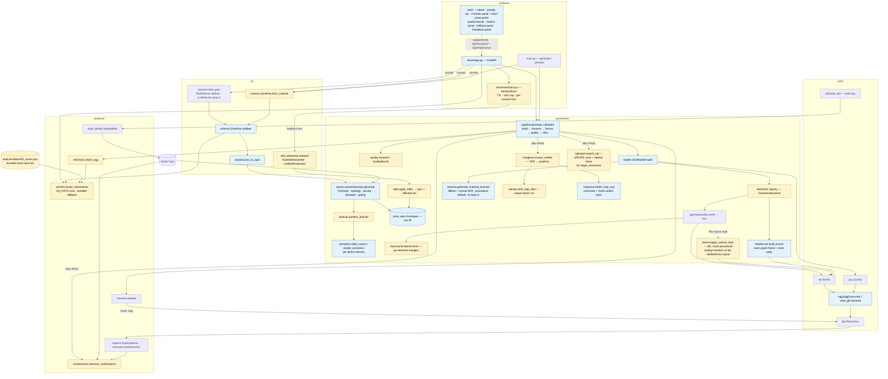
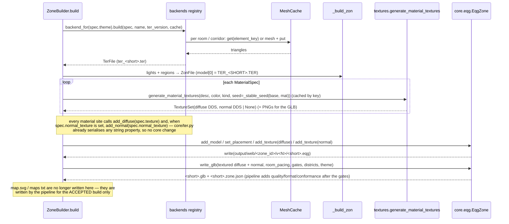
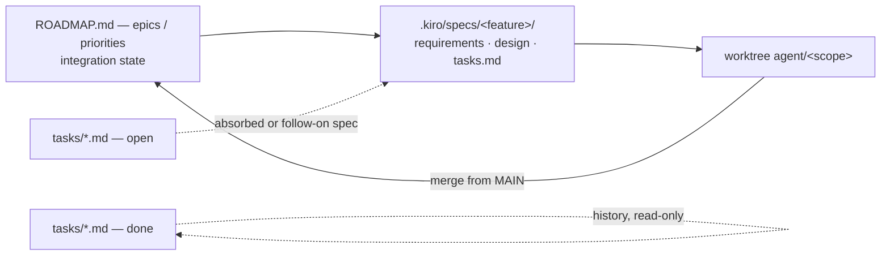

# Design Document: Zone Generator — Target Design

## Overview

### The idea

A **web app** where a user describes or dials in an EverQuest zone and gets back
a map they can actually use:

- **Input controls** — a natural-language prompt *or* an explicit controls panel
  (theme, size, rooms, verticality, locks, topology, archetype, seed …), each with
  its own Generate action.
- **Traversable** — every generated zone is walkable end to end by an EQ-scale
  player. A zone that strands a room is never handed to the user.
- **RoF2-usable** — output is a `.eqg` the RoF2 client can load, with collision,
  safe point and textures (diffuse + normal maps) that resolve, plus the server
  rows needed to enter it. Because RoF2's zone list is client-side, a zone is
  installed by taking over an existing short name: the user picks the target
  short name and every artifact is named for it (installing is a manual copy;
  the tool never writes into the EQ install).
- **True-layout artifacts** — alongside the 3D preview, the web UI offers an
  in-client EQ map file (`maps/<shortname>.txt`) and a top-down image traced from
  the real mesh, both viewable and downloadable.
- **EverQuest look and feel** — scale, triangle resolution, palette and room
  vocabulary measured from real Classic–PoP zones, with conformance *measured*,
  not asserted.
- **Iterative feedback** — the user says "make the boss room bigger", "add a
  lava pool near the entrance", "undo that"; the generator applies it as a
  structured edit, rebuilds only what changed, re-validates, and keeps history.
- **Engaging every time** — grounded in established PCG practice (TinyKeep
  layout, loops, pacing, solvable lock-and-key, themed districts) and enforced by
  a quality gate with measurable metrics, so a dull zone is retried like an
  unwalkable one — and when the best walkable zone still misses a band, the UI
  says so plainly, listing the metrics that fell short.

### What this document is

This is the **full target design** for eq_s3d, and this spec builds all of it.
It keeps the verified as-built description of the existing system (it is the
foundation and largely correct) and adds the missing pieces as designed
components, data models, algorithms and correctness properties. Each pillar
below states what exists today (verified against the code, not only the docs)
and the delta. The [Delivery plan](#delivery-plan) sequences the deltas into
milestones that each land something usable.

Status legend: **built** = works and is trusted; **partial** = exists but
incomplete or untrusted; **missing** = not in the code.

### Pillars

| ID | Pillar | Intent | Target design | As-built (verified) | Delta to build |
|----|--------|--------|---------------|---------------------|----------------|
| P-A | Web app with input controls | The browser is the primary way to make a zone; prompt and controls are two explicit, independent modes | Prompt bar with "Generate from description"; Controls panel with its own "Generate from controls"; controls expose every parameter the plan understands; both paths produce a `ZonePlan` and go through one expansion; seed pin + reproduce; CLI secondary | **partial** — `web/index.html` has `#prompt`, one `#generate`, a `#advanced` panel with `#theme`, `#rooms`, `#elevation`, `#seed`; `server/app.py::GenerateRequest` takes `prompt, theme, rooms, elevation, seed`; when a prompt is non-empty it silently wins over the controls (`web/src/main.ts::doGenerate`). Seed input + reproduce button built | Explicit `mode` on generate; second button; controls for `size, verticality, locks, topology, multi_district, dungeon_theme, dungeon_race, elemental_tint`; controls → `ZonePlan` (one expansion path); theme availability from the server (absorbs `tasks/web-controls-generate.md`) |
| P-B | Traversable | Every zone the UI can produce is walkable by the EQ agent (slope ≤ 40°, step ≤ 3u) | `generate_validated` gates **every enabled theme**; outdoor terrain is generated in the room-graph frame with walkable room pads; the defined themes are `dungeon`, `city`, `outdoor` (each gated) — there is **no cave backend or cave theme**: a cave is a dungeon *archetype* built by the box backend (M3), and an optional **natural geometry style** (M5) reshapes any dungeon's validated box layout under the same gate; a theme stays hidden in the UI until it passes | **partial** — gate exists for `dungeon` only (`DEFAULT_GATED_THEMES`); `city` uses the box backend but is ungated; outdoor mesh starts at the origin (`terrain._heightfield_to_ter` writes `x = i·res, y = j·res`) while rooms are centred near the origin, and rooms aren't flattened into the terrain; cave (`builder._build_organic`) is shelved — renders as disconnected blobs | **Delete the separate cave pipeline and the `cave` theme (M0)**; gate `city`; outdoor frame fix + room pads; `GeometryBackend` seam (Box + Terrain); natural geometry style for dungeons (M5); theme availability tied to the gate (absorbs `tasks/cave-backend-refactor.md` → M0 deletion, `tasks/cave-cavify-dungeon.md` → M5 natural style) |
| P-C | RoF2-usable format | A generated zone loads and is enterable in RoF2 | Tier 1 (automated): format-valid `.eqg` — PFS CRC/names, TER/ZON re-read by our own reader, collision policy, materials/textures (diffuse **and normal**) resolve, safe point on standable floor, short name ∈ the known RoF2 list. **Install model = short-name takeover:** RoF2's zone list is client-side, so a generated zone is installed by replacing an existing zone's files; the user picks a `target_shortname` (validated against the known list, low-traffic placeholder by default) and every artifact is named for it. Tier 2: EQEmu SQL that **updates** that short name's existing `zone` row and replaces its `doors`, plus a manual in-engine smoke load. The tool only ever writes to `output/`; copying over client files is a manual step | **partial** — `.eqg` writer built (`core/pfs.py`, `core/ter.py`, `core/zon.py`, `core/eqg.py`); round-trips exist as example tests; no explicit "usable" checklist, no short-name concept (`zone_id` is `gen_<ts>_<hex>` and names every output file), no known-zone list, no SQL | `analyzer/rof2check.py` (Tier 1 validator, run in the pipeline); `analyzer/zonelist.py` (known RoF2 short names, from `EQ_PATH` or a bundled list); `target_shortname` on plan/controls/spec + UI picker; `generators/sqlexport.py` (Tier 2, UPDATE-not-INSERT); in-engine checklist in `docs/ACCEPTANCE.md` |
| P-D | True-layout artifacts in the web UI | A map that matches the walls the player walks | One mesh-outline extractor (`generators/mapgeom.py`) feeds (a) the EQ map writer (`generators/eqmap.py` → `<shortname>.txt` + `_1.._3` layers) and (b) a mesh-traced outline layer under the existing annotations in `mapview.render_map_svg`; both viewable and downloadable (SVG, PNG via browser canvas, `.txt`, bundle zip) | **partial** — `mapview.render_map_svg(spec)` draws a *spec-derived schematic* (rooms as rects, corridors as straight sticks); web modal `#map-modal` + "Download SVG"; no EQ map file, no mesh-derived outline | Extractor, EQ map writer, outline layer, artifact endpoints, Artifacts panel (absorbs `tasks/eq-map-export.md`, `tasks/web-svg-mesh-outline.md`) |
| P-E | EverQuest look and feel | Indistinguishable from a hand-crafted Classic–PoP zone | Style profiles from real zones drive scale; era fidelity (~12–14u median edge); content layer archetype × race × tint, including a **`cave` dungeon archetype** (M3) whose rooms take their scale and conformance bands from the measured `styles/cave.json` profile; procedural diffuse textures **plus a procedural normal map per material** (derived from the same tileable height field, a separate DDS in the `.eqg`, referenced via the material's `e_TextureNormal0` slot next to `e_TextureDiffuse0`; AI provider either returns one or it is derived from the diffuse luminance); a **ConformanceReport** measures each generated zone against its theme profile; textured GLB preview (diffuse + normal) so the look can be judged in the browser | **partial** — `styles/*.json` (e.g. dungeon from befallen, soldunga/b, najena, sebilis, chardok, velketor, paw, guktop, gukbottom) with `geometry` + `fidelity.edge_median` ranges; `analyzer/inspect.py::ZoneInspector` already prints ✓/⚠ vs profile ranges but only for display; content layer Step 1 built (`generators/semantics.py`); `styles/cave.json` is measured but only feeds the shelved cave theme; textures are diffuse-only (`geometry.py`, `field/mesh.py` (deleted in M0), `field/terrain.py` call only `Material.add_diffuse`; `core/ter.py` already defines `PROP_NORMAL = "e_TextureNormal0"` and `Material.add_normal`, and its writer/reader handle any string property generically); GLB preview uses per-material base colours only | `analyzer/conformance.py` (metric-vs-band report against the spec's `style_profile`, in sidecar + UI + PBT sweep); `cave` archetype keyed to `styles/cave.json` (M3); normal-map generation in `textures/` + `MaterialSpec.normal_texture` + `add_normal` at every material site; textured GLB; race-scale measurement stays a known gap |
| P-F | Iterative feedback | Follow-up instructions refine the current zone instead of starting over | Server-side `ZoneSession` (plan + spec + seed + history); `EditInterpreter` (rule default, LLM optional) turns text into `EditOp`s; `apply_edits` + element-cached partial rebuild; re-validation through the same gates; undo/redo; feedback panel | **missing** — every `/api/generate` is stateless; ROADMAP lists "Iterative chat loop + partial regeneration" as ⏳ | `server/sessions.py`, `ai/edit_interpreter.py`, `generators/edits.py`, `generators/meshcache.py`, session endpoints, feedback panel |
| P-G | Engaging and interesting every time | Each zone is composed, varied and paced, not a random scatter | TinyKeep + loops + pacing + solvable gating + content layer (built) plus topology control, **districts** (content layer Step 2), and a **QualityReport** gate with target metric bands enforced in `generate_validated` (retry on fresh seed); when the soft gate falls back to the best walkable candidate, `quality_degraded` and the out-of-band metrics (value vs band) travel on the response and sidecar and are **shown in the web UI** (persistent banner + metrics-panel list), after generate and after every edit | **partial** — layout/pacing/gating/semantics built (`generators/layout.py`, `generators/semantics.py`); loop fraction fixed at 12% (`_connect_rooms`); `RoomSpec.district` placeholder only; no quality metrics | `generators/quality.py`, quality gate, quality-degraded surfacing (response + sidecar + UI banner), `topology` lever, district partitioner + per-district themes/climaxes/thresholds, `cave` as the 12th archetype (M3) (absorbs `tasks/content-layer-districts.md`, `tasks/layout-topology-control.md`; supersedes `.kiro/specs/content-layer-districts`) |

The pipeline shape stays: a prompt or a control set becomes a `ZonePlan`,
`ai.expand.plan_to_spec` drives `LayoutGenerator` to a `ZoneSpec` (the IR),
`ZoneBuilder` selects a geometry backend by theme and writes TER/ZON/DDS into a
PFS `.eqg` plus preview and sidecars, and `generators.pipeline.generate_validated`
wraps the build in gates that retry on fresh seeds. The target adds a quality
gate and a format gate to that loop, mesh-derived map artifacts after a pass,
and a session layer on top so edits re-enter the same loop.

## Architecture



Yellow = new component, blue = existing component that changes, plain = existing
and unchanged.

### Module seams

| Seam | Owns | Consumes | Notes |
|------|------|----------|-------|
| `core/` | Binary formats: PFS, TER, ZON, EQG assembly (+ textured GLB), WLD read | nothing project-level | Pure I/O; no generator imports |
| `analyzer/` | Style extraction, inspector, traversability, **RoF2 format check**, **conformance**, **known short-name list** | `core/`, `ZoneSpec`, `styles/`, `EQ_PATH` (read-only, optional) | `traverse` reads the *mesh* and uses the spec only as the oracle of which rooms should be reachable |
| `generators/` | IR, layout, **districts**, semantics, **edits**, backends (**registry**: Box + Terrain), **natural style** (M5, `generators/natural.py`, name provisional), **mesh cache**, textures, **map geometry**, **EQ map**, SVG map, **quality**, **SQL export**, pipeline | `core/`, `styles/`, `analyzer.{traverse,rof2check,conformance}` (pipeline only) | `pipeline.py` stays a cross-branch hotspot; `layout.py` (818 lines) splits gating/pacing helpers out as districts land; after M0 `field/` holds only `terrain.py` + `noise.py` (`_value_noise_3d`) — the cave pipeline (`cave.py`, `features.py`, `mesh.py`, `sdf.py`, `noise.fbm_field`) is deleted, git history keeps it |
| `ai/` | Prompt → `ZonePlan`; controls → `ZonePlan`; **feedback text → `EditOp`s** | `generators.layout`, `generators.edits` (types only) | Never produces geometry; always works with zero API keys |
| `server/` | HTTP surface, **session store** | `ai/`, `generators/` | Unauthenticated, local-only (see Security) |
| `web/` | Viewer UI (`main.ts`, `scene.ts`, `controls.ts`, `api.ts`; new `artifacts.ts`, `feedback.ts`, `quality.ts`) | `/api/*` | Textured preview (diffuse + normal) once `write_glb` embeds textures; quality banner + metrics list rendered from the response, never console-only |
| `viewer/` | Legacy Flask GLB preview (`serve.py`) | — | Removed in M0 (user decision); was reached only via `main.py preview` / `generate --preview` |

### Backend selection

| Theme | As-built backend | Gated today | Target backend | Gated (target) | Enabled in UI |
|-------|------------------|-------------|----------------|----------------|---------------|
| `dungeon` | box (`geometry.build_mesh`) | yes | box | yes | yes |
| `city` | box | no | box | **yes** (M1) | yes |
| `outdoor` | heightfield, origin-anchored | no | heightfield in room-graph frame + room pads | **yes** (M1) | from M1, once the sweep passes |
| ~~`cave`~~ | SDF from rooms→spheres (`_build_organic`) — broken | no | **retired in M0** — not a theme; deleted with its pipeline | — | no (not a defined theme) |

Caves are a **dungeon archetype**, not a theme or backend: a `dungeon` zone with
archetype `cave` (M3) is built by the box backend like any other archetype. The
**natural geometry style** (M5) is not a registry entry selected by theme; it is
a styling transform applied on top of the Box_Backend output for any dungeon
whose spec asks for it (`ZoneSpec.geometry_style = "natural"`, provisional; the
`cave` archetype defaults to it once M5 lands), under the same traversal gate.

Backends register as `GeometryBackend` implementations (Box, Terrain);
`ZoneBuilder._build_geometry` becomes a registry lookup. A backend returning `None` (missing optional deps)
still falls back to box, but the fallback is now reported in `BuildResult.warnings`
instead of being silent. All backends consume the same layout output unchanged.

## Sequence Diagrams

### Generate (prompt or controls) — target

```mermaid
sequenceDiagram
    participant U as Browser (api.ts)
    participant S as server/app.py
    participant SS as SessionStore
    participant P as planner / ZonePlan.from_controls
    participant G as pipeline.generate_validated
    participant B as ZoneBuilder
    participant T as traverse.validate
    participant F as rof2check.check_eqg
    participant Q as quality.measure
    participant A as artifacts (mapgeom · eqmap · mapview · conformance · sqlexport)

    U->>S: POST /api/generate {mode: prompt|controls, prompt?, controls?, seed?, target_shortname?}
    alt mode = prompt
        S->>P: make_plan(prompt) (rule; LLM if key, falls back to rule)
    else mode = controls
        S->>P: ZonePlan.from_controls(controls)
    end
    P-->>S: ZonePlan (validated; theme ∈ enabled themes or substituted + warning)
    S->>G: generate_validated(λs: plan_to_spec(plan, s), theme, seed, bands)
    loop attempt ≤ max_attempts and elapsed < timeout_s
        G->>B: build(spec_factory(seed_k))
        B-->>G: BuildResult (.eqg, .glb, .zone.json)
        G->>T: validate(eqg, spec)
        G->>F: check_eqg(eqg, spec)
        G->>Q: measure(spec, plan) vs bands
        alt traversable ∧ format ok ∧ quality ok
            G-->>G: accept
        else traversable ∧ format ok ∧ quality fails
            G-->>G: keep as best-so-far candidate; retry (unless pinned)
        else not traversable or format fails
            G-->>G: log JSONL; pinned ⇒ raise; else retry
        end
    end
    G->>A: on the accepted build: outline → map.svg, maps/<short>.txt, conformance, sql
    G-->>S: ValidatedBuild (+ quality, conformance, artifacts, warnings)
    Note over G,S: soft-gate fallback ⇒ quality.degraded = true and quality.out_of_band =<br/>[{metric, value, lo, hi}] — also written into <short>.zone.json
    S->>SS: create_session(plan, spec, seed, artifacts) → session_id, version 0
    S-->>U: 200 GenerateResponse {session_id, version, shortname, urls…, quality{degraded, out_of_band, metrics}, warnings} | 503
    Note over U: quality.degraded ⇒ persistent warning banner on the viewer +<br/>out-of-band rows (value vs band) in the metrics panel; cleared only by<br/>a later response whose quality.degraded is false
```

### Feedback edit — target

```mermaid
sequenceDiagram
    participant U as Browser (feedback.ts)
    participant S as server/app.py
    participant SS as SessionStore (lock per session)
    participant I as edit_interpreter.interpret
    participant E as edits.apply_edits
    participant B as ZoneBuilder (MeshCache)
    participant G as gates (traverse · rof2check · quality)

    U->>S: POST /api/sessions/{id}/edit {feedback: "make the boss room bigger"}
    S->>SS: acquire(id) → session (404 if unknown/expired)
    S->>I: interpret(text, session.current_spec, session.plan)
    I-->>S: [EditOp(widen_room, target=role:climax, factor=1.3)] or [] + message
    alt no ops
        S-->>U: 200 {applied: false, message: "didn't understand… try …"}
    else ops
        loop salt_attempt in 0..edit_retries
            S->>E: apply_edits(spec, ops, base_seed, version, salt_attempt)
            E-->>S: EditResult(new_spec, affected, notes)
            S->>B: build(new_spec, cache=session.mesh_cache)
            B-->>S: BuildResult (only affected elements re-meshed)
            S->>G: validate + check + measure
            alt pass
                S->>SS: push HistoryEntry(version+1); truncate redo tail
                S-->>U: 200 {applied: true, version, urls, affected, quality{degraded, out_of_band, metrics}, warnings}
            else fail and op is randomised
                S-->>S: next salt
            end
        end
        S-->>U: 200 {applied: false, reason, diagnostics} — state unchanged
    end
    Note over S,U: an accepted edit may leave the zone walkable but outside a band<br/>(edits are not quality-retried) ⇒ quality.degraded = true, same banner + list
    U->>S: POST /api/sessions/{id}/undo | /redo
    S->>SS: move cursor; restore snapshot (spec + artifact dir + stored quality)
    S-->>U: 200 {version, urls, quality{degraded, out_of_band, metrics}, warnings}
```

### Build internals — target



## Components and Interfaces

Existing interfaces are kept as built unless marked **(change)**; new ones are
marked **(new)**.

### Planner (`ai/`)

```python
class RulePlanner:            # ai/rule_planner.py — default, no network
    name = "rule"
    def available(self) -> bool: ...          # always True
    def plan(self, prompt: str, name: str = "zone") -> ZonePlan: ...

class LLMPlanner:             # ai/llm_planner.py — optional drop-in
    name = "llm"
    def available(self) -> bool: ...          # OPENAI_API_KEY or ANTHROPIC_API_KEY set
    def plan(self, prompt: str, name: str, style_hint: str = "") -> ZonePlan: ...

def get_planner(prefer_llm: bool = True): ...  # EQ_S3D_PLANNER=rule|llm overrides
def make_plan(prompt: str, name: str = "zone") -> ZonePlan: ...  # LLM failure ⇒ RulePlanner
def plan_to_spec(plan: ZonePlan, seed: int | None = None) -> ZoneSpec: ...  # ai/expand.py (change: threads topology, districts, target_shortname → spec.shortname)

# (new) ai/schema.py
@classmethod
def ZonePlan.from_controls(cls, controls: dict) -> ZonePlan: ...  # same validate() domain as from_dict
```

Responsibilities: map free text or controls to a small declarative `ZonePlan`;
never emit geometry; always succeed with zero API keys. The rule planner gains
keyword buckets for topology ("winding / interconnected" → `looped`,
"straightforward / linear" → `linear`) and districts ("living and dead", "two
factions", "upper and lower" → `multi_district` + relationship).

Cave keywords: the rule planner's `cave` theme bucket goes away with the theme.
From **M3**, cave words ("cave", "cavern", "grotto", "underground", "tunnel")
map to theme `dungeon` + archetype `cave` (scored in `_ARCHETYPE_WORDS` like
the other archetypes; "mine", "delve", "quarry" stay with `mine_delve`).
**Interim (M0 → M3):** the same words map to theme `dungeon` with no forced
archetype, so the default archetype applies; this is a deliberate stopgap until
the `cave` archetype exists. The LLM planner's theme enum is `VALID_THEMES`, so
it can no longer emit `cave` as a theme; from M3 its archetype enum includes it.

### Edit interpreter (`ai/edit_interpreter.py`) (new)

```python
class EditInterpreter(Protocol):
    name: str
    def available(self) -> bool: ...
    def interpret(self, text: str, spec: ZoneSpec, plan: ZonePlan | None) -> InterpretResult: ...

class RuleEditInterpreter:    # default; verb × target × modifier grammar, no network
    name = "rule"
class LLMEditInterpreter:     # optional; JSON output validated against EDIT_OP_JSON_SCHEMA
    name = "llm"              # any error / invalid JSON ⇒ RuleEditInterpreter

def interpret(text: str, spec: ZoneSpec, plan: ZonePlan | None) -> InterpretResult: ...
```

Responsibilities: resolve references ("the boss room", "room 3", "the
entrance", "the hub", "the lava room", "the second district", "everywhere") to
`RoomRef`s against the *current* spec; emit only ops from the vocabulary;
return an empty op list with a helpful message rather than guessing.

### Layout (`generators/layout.py::LayoutGenerator`) (change)

```python
class LayoutGenerator:
    def __init__(self, theme: str = "dungeon", seed: int | None = None): ...
    size_multiplier: float; elevation_chance: float
    step_rise_min: float; step_rise_max: float; max_grade: float = 0.5

    def generate(self, name: str, room_count: int = 5, add_lights: bool = True,
                 elevation: bool = True, locks: int = 0,
                 dungeon_theme: str = "", dungeon_race: str = "",
                 elemental_tint: str | None = None,
                 room_type_overrides: dict | None = None,
                 topology: str = "branching",            # (new) linear|branching|looped
                 multi_district: bool = True,            # (new) auto-split on, off switch
                 district_plan: list[dict] | None = None # (new) planner proposals
                 ) -> ZoneSpec: ...
```

Responsibilities (as built): theme-accurate room scale from `styles/<theme>.json`
`floor_area` (change, M3: keyed by the style profile, which is `cave` when the
archetype is `cave`), TinyKeep layout, pacing roles + depth, semantic labelling (box
themes), grade-capped elevation, wall-to-wall corridors, safe point in the
entrance room, solvability-guaranteed gating. New: the `topology` lever inside
`_connect_rooms`, the district partition after pacing. All randomness flows from
one `random.Random(seed)`; new draws are taken only when the new feature is
active so `topology="branching"` and sub-threshold rooms reproduce today's stream.

### Districts (`generators/districts.py`) (new)

```python
def district_count(n_rooms: int, multi_district: bool) -> int: ...   # 1 | 2 | 3
def partition_districts(rooms, edges, entrance: int, k: int,
                        rng: random.Random) -> DistrictPartition: ...
def assign_district_themes(spec: ZoneSpec, partition: DistrictPartition,
                           proposals: list[dict] | None, rng) -> list[DistrictSpec]: ...
```

### Semantics (`generators/semantics.py`) (change)

```python
ARCHETYPES: dict[str, Archetype]   # 12: fortress … ice_keep + cave (M3); DEFAULT_ARCHETYPE = "fortress"
RACE_SCALE: dict[str, float]       # relative placeholders, e.g. giant 2.2, froglok 0.9
def race_scale(race: str) -> float: ...
def label_rooms(spec, rooms, rng, *, archetype, race, tint, overrides,
                districts: list[DistrictSpec] | None = None) -> None: ...   # (change) per-district arc
def realize_semantics(spec: ZoneSpec, rng: random.Random) -> None: ...      # (change) per-district palette/light
```

Responsibilities: per district, assign `semantic_type` from that district's
archetype arc by in-district depth; one climax per district; shape/proportion and
race scale; palette variants, `AWT_`/`ALV_` regions and light mood (flipped at
thresholds); suggestion-only fields (`prop_hints`, `encounter_intent`, `boss`).
With one district the output equals today's.

`cave` archetype (new, M3) — a natural-cave room vocabulary, every type a
`RoomType` the box backend can realise today (footprint, aspect, ceiling, sink,
light, region), so it works before and independent of the M5 natural style:

| Slot | Room types |
|------|-----------|
| entrance | `cave_mouth` (new; wide, low ceiling, daylight-to-cold light falloff) |
| hub | `cavern` (new; large footprint, tall ceiling) |
| climax | `crystal_grotto` (new; tall, cold/arcane glow) |
| arc | `passage`, `grotto` (new; small, low, irregular aspect), `flooded_gallery` (water region), `sump` (sunk floor), `collapsed_gallery`, `warren` |

Palette: damp rock / wet stone / mineral (the materials and light colours the
removed `"cave"` theme entries in `layout.py` used move here as the archetype
palette); light mood: cool blue-grey, low intensity, accent glow in crystal
rooms; regions: `water` on flooded rooms. When the archetype is `cave`
(single-district zone, or district 0 of a multi-district one), `plan_to_spec`
sets `spec.style_profile = "cave"`, so room scale (`floor_area`) and
conformance bands come from the measured `styles/cave.json` (kept, with the
analyzer's cave reference-zone list); `spec.theme` stays `dungeon`.

### Edits (`generators/edits.py`) (new)

```python
def apply_edits(spec: ZoneSpec, ops: list[EditOp], *, base_seed: int,
                version: int, salt_attempt: int = 0) -> EditResult: ...
def affected_elements(before: ZoneSpec, after: ZoneSpec) -> AffectedSet: ...
```

### Geometry backends (change: registry seam)

```python
class GeometryBackend(Protocol):                         # (new) generators/backends.py
    name: str
    def build(self, spec: ZoneSpec, name: str, ter_version: int,
              cache: MeshCache | None = None) -> TerFile | None: ...

BACKENDS: dict[str, GeometryBackend]  # dungeon/city → BoxBackend, outdoor → TerrainBackend
                                      # (no cave backend: the cave pipeline is deleted in M0)

def build_mesh(spec: ZoneSpec, cache: MeshCache | None = None) -> MeshBuilder: ...  # generators/geometry.py
class MeshBuilder:
    def add_room(self, room: RoomSpec, spec: ZoneSpec) -> None: ...
    def add_corridor(self, cor: CorridorSpec, spec: ZoneSpec) -> None: ...
    def to_ter(self, name: str, version: int = 2) -> TerFile: ...
MAX_SEG_RISE = 2.5

class MeshCache:                                         # (new) generators/meshcache.py
    def key_room(self, room: RoomSpec, spec: ZoneSpec) -> str: ...      # hash of geometry-bearing fields
    def key_corridor(self, cor: CorridorSpec, spec: ZoneSpec) -> str: ...
    def get(self, key: str) -> ElementMesh | None: ...
    def put(self, key: str, mesh: ElementMesh) -> None: ...

def build_terrain(spec: TerrainSpec, name: str, ...) -> TerFile | None: ...       # (change) origin + pads
def apply_natural_style(ter: TerFile, spec: ZoneSpec,
                        params: NaturalStyleParams) -> TerFile: ...   # (new, M5) generators/natural.py,
                                                                      # name + signature provisional
```

Every material site (`MeshBuilder._material` in `geometry.py`,
`field/terrain.py`, and the natural style in M5) calls `Material.add_diffuse(spec.texture)` and,
when `spec.normal_texture` is non-empty, `Material.add_normal(spec.normal_texture)`.
Verified in `core/ter.py`: `PROP_NORMAL = "e_TextureNormal0"` and
`Material.add_normal` already exist; `to_bytes` interns every string property
value into the string table and writes `(name_off, PROP_TYPE_STRING, value_off)`,
and `from_bytes` reads any property generically. So emitting the slot needs **no
`core/` change** — only the call sites and `MaterialSpec`.

### Textures (`generators/textures/`) (change: normal-map output)

```python
@dataclass
class TextureSet:                                        # (new) base.py
    diffuse: bytes                 # DDS A8R8G8B8 (dds.rgba_to_dds, as today)
    normal: bytes | None           # DDS, same width/height as diffuse; None ⇔ normals disabled
    diffuse_rgb: np.ndarray        # (H, W, 3) uint8 — for the textured GLB
    normal_rgb: np.ndarray | None  # (H, W, 3) uint8 tangent-space normal, for the GLB

class TextureProvider:                                   # base.py (change)
    name: str
    def available(self) -> bool: ...
    def generate(self, spec: TextureSpec) -> bytes: ...          # diffuse DDS — kept for back-compat
    def generate_set(self, spec: TextureSpec,
                     normals: bool = True) -> TextureSet: ...    # (new) default impl:
                                                                 # diffuse via generate() + normal_from_luminance

class ProceduralProvider(TextureProvider):               # procedural.py (change)
    def generate_set(self, spec, normals=True) -> TextureSet: ...
    # height = _layered_tileable_noise(size, rng, kind) → make tileable ONCE on the height field
    # diffuse = _colourise(height, ...)                  # same field ⇒ diffuse and normal stay registered
    # normal  = height_to_normal(height, strength=NORMAL_STRENGTH[kind])

class AIProvider(TextureProvider):                       # ai.py (change)
    def generate_set(self, spec, normals=True) -> TextureSet: ...
    # provider returns a normal map ⇒ use it (resized to the diffuse dims);
    # otherwise normal = normal_from_luminance(diffuse); any failure ⇒ ProceduralProvider.generate_set

def height_to_normal(h: np.ndarray, strength: float) -> np.ndarray: ...   # (new) normals.py
    # wrap-around central differences (np.roll) ⇒ the normal map tiles seamlessly;
    # n = normalise(−strength·∂h/∂x, −strength·∂h/∂y, 1); encode rgb = round((n·0.5 + 0.5)·255)
def normal_from_luminance(rgb: np.ndarray, strength: float,
                          blur_px: float = 1.0) -> np.ndarray: ...       # (new) h = blur(luma(rgb)) → height_to_normal

def generate_material_textures(description: str, color: tuple[int, int, int], *,
                               name: str, seed: int, size: int = 256,
                               normals: bool = True) -> TextureSet: ...   # (new) factory.py; cached like generate()
def generate_texture(...) -> bytes: ...                  # kept: returns generate_material_textures(...).diffuse
```

Responsibilities: produce a diffuse and a matching normal map per material from
one tileable height field (procedural) or from the diffuse luminance (AI path
without a native normal map); stay deterministic per `(spec, seed)`; never need
a network. `ZoneBuilder.build` packs both DDS files into the `.eqg` and the
textured GLB gets `normalTexture` per material. Moving `make_tileable` from the
RGB image to the height field changes procedural diffuse bytes once for a given
seed (P9 determinism is unaffected; it's a one-time texture change, noted at M3).

Grounding (M3, against `F:\everquest_rof2`, read-only): survey real EQG
materials that carry `e_TextureNormal0` to pin (a) the shader(s) those materials
use — keep `Opaque_MaxCB1.fx` unless the survey shows the slot is only honoured
by a different shader, (b) the tangent-space convention (green channel Y+ vs Y−,
whether the alpha/blue channel is repurposed), and (c) typical normal-map
dimensions relative to the diffuse. The pinned results become constants in
`normals.py` with a skip-if-no-install grounding test, the same pattern as the
map-convention grounding.

### Known short names (`analyzer/zonelist.py`) (new)

```python
@dataclass(frozen=True)
class KnownZone:
    shortname: str                 # e.g. "arena"
    long_name: str
    zoneidnumber: int              # EQEmu zone id — needed by the SQL UPDATE
    container: str                 # "s3d" | "eqg" (client format of the stock zone)
    in_install: bool               # found under EQ_PATH (False when no install is configured)

DEFAULT_TARGET: str = "arena"      # low-traffic placeholder (decided)
def known_shortnames(eq_path: Path | None = None) -> dict[str, KnownZone]: ...
def is_known(shortname: str, eq_path: Path | None = None) -> bool: ...
```

Source of truth: a bundled `analyzer/data/rof2_zones.json` (short name, long
name, zone id, container) curated from the EQEmu `zone` table for the RoF2
client — it carries the ids the SQL export needs, which the install can't
supply. When `EQ_PATH` (from `.env`, as `ZoneInspector`/`StyleBuilder` already
use) points at an install, `known_shortnames` scans it the way
`StyleBuilder._find_zone` locates zones (`<stem>.eqg` / `<stem>.s3d`), keeping a
stem only when the archive looks like a zone (`.s3d` holding `<stem>.wld`;
`.eqg` holding a `.zon` or a `ter_*.ter`, or a loose `<stem>.zon` beside it) and
dropping companion archives (`*_obj*`, `*_chr*`, `*_lit`, `*_assets`, `gequip*`,
`global*`). The scan only sets `in_install`; it never adds names absent from the
bundled list (so every name has a zone id). Read-only: nothing under `EQ_PATH`
is ever written. Cached per process.

`DEFAULT_TARGET` criteria: a small, rarely visited zone with no progression,
flag or key dependency, so taking it over costs a player nothing. The default
is `arena` (decided by the user). Because the stock zone may be an `.s3d`, the
install steps tell the user to move the stock `<short>.s3d`/`.eqg` (and its
companion archives) aside before copying ours in; the M6 in-engine smoke load
confirms the client picks up our `.eqg` under `arena`. The end user may also
manually rename the generated files to install over a different short name;
whether the client and server accept such a manual rename is a follow-up for
the same M6 smoke load, not something this design guarantees. This is a
grounding check on the install procedure, not a question about whether taking
over a short name is the right model — it is.

### Map geometry and artifacts (new)

```python
# generators/mapgeom.py — reusable core, no EQ-.txt assumptions
def extract_outline(ter: TerFile, agent: AgentModel | None = None,
                    reachable_only: bool = True) -> OutlineSet: ...
def depth_bands(outline: OutlineSet, ter: TerFile, max_layers: int = 4) -> list[DepthBand]: ...

# generators/eqmap.py
def world_to_map(x: float, y: float, z: float) -> tuple[float, float, float]: ...
def map_to_world(mx: float, my: float, mz: float) -> tuple[float, float, float]: ...
def build_map_file(outline: OutlineSet, spec: ZoneSpec, bands: list[DepthBand]) -> MapFile: ...
def format_map_layer(layer: MapLayer) -> str: ...
def parse_map_layer(text: str) -> MapLayer: ...
def write_map_files(mf: MapFile, out_dir: Path) -> list[Path]: ...  # <short>.txt, <short>_1..3.txt

# generators/mapview.py (change)
def render_map_svg(spec: ZoneSpec, size: int = 720, padding: int = 40,
                   outline: OutlineSet | None = None) -> str: ...   # outline drawn UNDER annotations
```

### Quality and conformance (new)

```python
# generators/quality.py
def measure(spec: ZoneSpec, plan: ZonePlan | None = None) -> QualityReport: ...
def bands_for(theme: str, topology: str, n_rooms: int, verticality: str) -> QualityBands: ...
def quality_summary(report: QualityReport) -> dict: ...   # (new) the one JSON shape used by the
    # GenerateResponse, edit/undo/redo responses and the .zone.json sidecar:
    # {"degraded": bool, "reason": str, "score": float, "metrics": {...},
    #  "out_of_band": [{"metric", "value", "lo", "hi"}, ...]}

# analyzer/conformance.py
def measure_conformance(eqg_path: Path, theme: str,
                        profile: dict | None = None) -> ConformanceReport: ...

# analyzer/rof2check.py
def check_eqg(eqg_path: Path, spec: ZoneSpec, agent: AgentModel | None = None) -> FormatReport: ...
```

### Builder and pipeline (change)

```python
class ZoneBuilder:
    def __init__(self, spec: ZoneSpec, cache: MeshCache | None = None): ...
    def build(self, output_dir="output", write_glb=True, ter_version=2) -> BuildResult: ...
    # BuildResult gains: warnings: list[str], ter: TerFile (in-process, for mapgeom)

def generate_validated(spec_factory: Callable[[int], ZoneSpec], *, theme: str,
                       zone_id: str, seed: int | None = None, output_dir="output",
                       write_glb=True, ter_version=2,
                       max_attempts=8, timeout_s=20.0,
                       gated_themes=ENABLED_THEMES,             # (change) every enabled theme
                       validate_enabled=True, agent: AgentModel | None = None,
                       quality_bands: QualityBands | None = None,  # (new) None ⇒ bands_for(...)
                       plan: ZonePlan | None = None,             # (new) intent for bands
                       write_artifacts: bool = True,             # (new) outline/map/conformance/sql
                       rng: random.Random | None = None,
                       failure_log=Path("output/validation_failures.jsonl")
                       ) -> ValidatedBuild: ...
# ValidatedBuild gains: quality: QualityReport, conformance: ConformanceReport | None,
#                       format: FormatReport, artifacts: ArtifactSet, warnings: list[str]
# On the soft-gate fallback the pipeline sets quality.degraded = True and
# quality.reason ∈ {"quality_degraded", "quality_outside_bands_pinned"}, mirrors the
# reason into warnings, and rewrites <short>.zone.json with quality_summary(quality)
# (plus format/conformance) for the RETURNED build only — the sidecar and the response
# are produced from the same QualityReport object, so they cannot disagree.
# Builds land in output_dir/<zone_id>/v<N>/ and every file is named for spec.shortname.
class GenerationFailed(Exception):  # .failures, .attempts, .pinned, .timed_out
    ...
```

### Traversability validator (`analyzer/traverse.py`) (as built)

```python
@dataclass
class AgentModel:
    walkable_slope_deg: float = 40.0
    max_step_up: float = 3.0
    adjacency_eps: float = 2.0
    player_height: float = 6.0
    @property
    def min_up_normal(self) -> float: ...   # cos(walkable_slope_deg)

def validate(eqg_path, spec: ZoneSpec | None = None, spec_path=None,
             agent: AgentModel | None = None) -> TraversalReport: ...
# TraversalReport.passed ⇔ total_rooms > 0 ∧ reachable_rooms == total_rooms
```

### SQL export (`generators/sqlexport.py`) (new)

```python
def export_sql(spec: ZoneSpec, *, known: dict[str, KnownZone] | None = None,
               schema: str = "eqemu-pinned", clear_spawns: bool = False) -> str: ...
# Targets the EXISTING row for spec.shortname (zone id from analyzer.zonelist):
#   UPDATE zone SET safe_x/y/z, min/max clip, fog … WHERE short_name = '<short>' AND version = 0;
#   DELETE FROM doors WHERE zone = '<short>' AND version = 0;  INSERT one doors row per GateSpec.
# clear_spawns=True additionally emits DELETEs for that zone's spawn2 / grid / ground-spawn rows
# (the stock NPCs would otherwise stand at the old zone's coordinates); off by default.
# Never INSERTs a zone row; raises if spec.shortname is not a known short name.
# The script is a text artifact for the user to review and apply — the tool never executes it.
```

### Session store (`server/sessions.py`) (new)

```python
class SessionStore:
    def __init__(self, root: Path, ttl_s: int = 86_400, max_sessions: int = 32,
                 max_history: int = 50): ...
    def create(self, plan, spec, seed, artifacts, quality) -> ZoneSession: ...
    def get(self, session_id: str) -> ZoneSession: ...          # KeyError ⇒ 404
    def lock(self, session_id: str) -> ContextManager[ZoneSession]: ...
    def push(self, session_id: str, entry: HistoryEntry) -> None: ...
    def undo(self, session_id: str) -> HistoryEntry: ...
    def redo(self, session_id: str) -> HistoryEntry: ...
    def sweep(self) -> int: ...                                  # TTL + LRU eviction
```

### Surfaces (change)

| Surface | Entry | Behaviour |
|---------|-------|-----------|
| HTTP | `POST /api/generate` (`GenerateRequest{mode, prompt?, controls?, seed?, target_shortname?}`) | `mode` explicit (`prompt` ⇒ planner, `controls` ⇒ `ZonePlan.from_controls`); legacy flat fields accepted and mapped to `controls`; `target_shortname` (either mode; default `DEFAULT_TARGET`) must be a known short name, else 400 with a hint; always via `generate_validated`; creates a session; `GenerateResponse` gains `shortname`, `quality` (= `quality_summary`), `warnings`; 503 on `GenerationFailed` |
| HTTP | `POST /api/sessions/{id}/edit` `{feedback?: str, ops?: [EditOp]}` | interpret → apply → rebuild → gates; state unchanged on failure; response carries `quality` + `warnings` like generate |
| HTTP | `POST /api/sessions/{id}/undo`, `/redo`; `GET /api/sessions/{id}` | history navigation / summary; responses carry the restored version's stored `quality` + `warnings` |
| HTTP | `GET /api/shortnames` (new) | known short names `{shortname, long_name, container, in_install}` + `default`; feeds the UI picker |
| HTTP | `GET /api/zones/{zone_id}/{version}/{filename}` (change) | serves `<short>.glb`, `.zone.json`, `.map.svg`, `maps/<short>*.txt`, `.eqg`, `.sql`, `.bundle.zip` from `output/web/<zone_id>/v<N>/` (per-build dirs, since every build of a given target uses the same filenames); each segment matches `^[A-Za-z0-9_.-]+$`, rejects `/`, `\`, `..`; allow-listed extensions |
| HTTP | `GET /api/themes` (change) | each theme with `enabled: bool` and `reason`; UI disables the rest |
| HTTP | `GET /api/health` | metadata |
| CLI | `main.py generate <name> --theme {dungeon,city,outdoor} --rooms --seed --size --verticality --locks --topology --no-districts --target-shortname --output --ter-version --no-validate` (change; `--preview` removed in M0 (user decision)) | controls → `ZonePlan.from_controls` → same pipeline; writes the same artifacts, named for the target short name; prints the quality-degraded line and out-of-band metrics when set |
| CLI | `python -m analyzer.zonelist [--eq-path]` (new) | list known short names, marking those present in the install |
| CLI | `main.py preview <name>` | legacy Flask viewer — removed in M0 (user decision) |
| CLI | `python -m analyzer.{inspect,style_builder,traverse,rof2check,conformance}` | analysis |

### Web UI (`web/`) (change)

- **Prompt bar** (`#prompt`, `#generate` relabelled "Generate from description").
- **Controls panel** (`#advanced`) with its own `#generate-controls` and fields
  `#theme` (dungeon / city / outdoor — the `cave` option is removed in M0; options disabled per `/api/themes`), `#rooms`, `#size`,
  `#verticality`, `#locks`, `#topology`, `#districts`, `#archetype`, `#race`,
  `#tint`, `#seed` (blank = random). `doGenerate(mode)` takes an explicit mode.
  All inputs stay excluded from movement keys (`controls.ts::_typingTarget`).
- **Target short name** (`#target-shortname`, shown next to both Generate
  buttons because it applies to either mode): a searchable list from
  `/api/shortnames` (`long name (short)`, install-present names first), defaulting
  to the server's `default`. A fixed note under it: "Installing replaces this
  zone's client files and server rows. This tool only writes to `output/`; copy
  the files into your EQ install yourself, after backing up the originals."
- **Quality status** (new `web/src/quality.ts`, called from `main.ts` for every
  generate / edit / undo / redo response): when `quality.degraded` is true, a
  persistent amber banner over the viewport ("Walkable, but outside quality
  targets: N metrics" + the reason) with a link that opens the metrics panel's
  new `#m-quality` section, which lists each out-of-band metric as
  `metric — value (band lo–hi)`; in-band metrics are listed below it. The banner
  has no close button; it is replaced only by the next response's status (a
  non-degraded response shows a quiet "quality ✓" chip instead). Also shown as
  a ⚠ on that version's row in the Feedback history. `updatePanel` reads the
  same `quality` block from the sidecar when a zone is re-opened, so the
  sidecar alone is enough to restore the warning.
- **Artifacts panel** (`web/src/artifacts.ts`): true-layout map (mesh outline +
  annotations) in the existing modal, download SVG / PNG (canvas render of the
  SVG, no server dependency) / EQ map `.txt` / `.eqg` / `.sql` / bundle `.zip`;
  quality and conformance readouts.
- **Feedback panel** (`web/src/feedback.ts`): text box + "Apply", history list
  (version, ops, ✓/✗), undo/redo, affected-room highlight in the 3D view.

## Data Models

### `ZonePlan` (`ai/schema.py`) — planner/controls contract (change)

```python
@dataclass
class ZonePlan:
    name: str = "zone"
    theme: str = "dungeon"        # VALID_THEMES = dungeon|outdoor|city (cave removed in M0)
    room_count: int = 5           # clamped 1..30
    size: str = "medium"          # small|medium|large|huge → 0.7/1.0/1.5/2.2
    elevation: bool = True
    verticality: str = "moderate" # flat|moderate|dramatic → (chance, rise_min, rise_max)
    regions: list[str]            # ⊆ VALID_REGION_KINDS
    locks: int = 0                # clamped 0..5
    dungeon_theme: str = ""       # ⊆ VALID_DUNGEON_THEMES or ""
    dungeon_race: str = ""        # ⊆ VALID_DUNGEON_RACES or ""
    elemental_tint: str = ""      # lava|ice|water or ""
    topology: str = "branching"   # (new) linear|branching|looped
    multi_district: bool = True   # (new) auto-split by room count; False forces 1
    districts: list[dict] = []    # (new) ≤3 proposals {archetype, race?, tint?}
    district_relationship: str = ""  # (new) sequential|factional|abandoned_vs_active or ""
    target_shortname: str = ""    # (new) EQ zone to take over; "" ⇒ zonelist.DEFAULT_TARGET
    mood: str = ""; prompt: str = ""
```

Validation rules: `validate()` clamps/normalises every field to its domain and
returns `self`; `from_dict` and `from_controls` drop unknown keys then validate;
`districts` is truncated to 3 and each entry's archetype is coerced into
`ARCHETYPES` or dropped; `target_shortname` is lower-cased and must satisfy
`zonelist.is_known` — `validate()` replaces an unknown value with
`DEFAULT_TARGET` and records a `shortname_defaulted` warning, while the HTTP
controls path and the CLI reject it (400 / exit 2) so a typo is never silently
redirected. The rule planner never invents a short name; it only passes through
an explicit one ("install it as `arena`").

Retired theme `cave` (M0): `VALID_THEMES` in `ai/schema.py` and `server/app.py`,
the CLI `--theme` choices and the web theme list all become
`dungeon|outdoor|city`. A value of `cave` is then just an undefined theme and
takes the normal theme path: a stored or dictionary `ZonePlan` normalises it to
`dungeon` in `validate()` (Req 2.8, no warning beyond today's); a controls-mode
HTTP request naming it gets 400 with the enabled list (Req 3.4); the CLI rejects
it with exit 2 (Req 3.6); the planners can no longer emit it (prompt path, so
Req 3.5's substitution never fires for it). The archetype is not inferred from
the old theme — `dungeon_theme` is kept as stored.

### `ZoneSpec` (`generators/zone_spec.py`) — the IR (change)

```python
@dataclass
class ZoneSpec:
    name: str; theme: str = "dungeon"             # dungeon|city|outdoor; from_dict maps any other
                                                  # value (incl. retired "cave") to "dungeon"
    style_profile: str = "dungeon"                # styles/<profile>.json; "cave" for the cave archetype (M3)
    geometry_style: str = "built"                 # (new, M5, provisional) built|natural; natural ⇒
                                                  # natural-style transform on the box output
    shortname: str = ""                           # (new) target EQ short name (∈ known list);
                                                  # "" ⇒ DEFAULT_TARGET; names every artifact. `name`
                                                  # stays the human label / long name
    seed: int | None = None
    dungeon_theme: str = ""; dungeon_race: str = ""; elemental_tint: str = ""
    topology: str = "branching"                   # (new) recorded intent
    ambient_light: tuple[float, float, float]; safe_point: tuple[float, float, float]
    materials: dict[str, MaterialSpec]; rooms: list[RoomSpec]
    corridors: list[CorridorSpec]; lights: list[LightSpec]
    regions: list[RegionSpec]; gates: list[GateSpec]
    districts: list[DistrictSpec]                 # (new) [] ⇔ single district
    def to_dict(self) -> dict: ...; @classmethod
    def from_dict(cls, d: dict) -> "ZoneSpec": ...   # missing new fields ⇒ defaults
```

| Model | Key fields | Geometry-bearing? |
|-------|-----------|-------------------|
| `RoomSpec` | `id, center_x/y, floor_z, width, depth, height, *_material, open_walls` | yes |
| `RoomSpec` (pacing) | `role ∈ {entrance,hub,deadend,climax,standard}, graph_depth` | label only (role size bias applied during layout) |
| `RoomSpec` (content) | `semantic_type, room_theme, district, district_theme` (new) | label only |
| `RoomSpec` (suggestions) | `prop_hints, encounter_intent, boss` | **never** |
| `CorridorSpec` | `id` (new, stable), `from/to_x/y/z, width, height, steps, from_room, to_room, threshold: bool` (new) | yes (except `threshold`) |
| `LightSpec` | `x,y,z, r,g,b, radius` | ZON only |
| `RegionSpec` | `kind ∈ water|lava|pvp|zoneline|ice|generic, center, extent, room_id` (new, optional) | ZON only |
| `GateSpec` | `corridor_id, lock_x/y/z, key_room_id, key_x/y/z, tier, threshold: bool` (new) | **never** (EQEmu `doors` row) |
| `MaterialSpec` | `name, texture, normal_texture` (new; default `<texture stem>_n.dds`, `""` disables), `shader, description, color` | texture + normal map + material table (`e_TextureDiffuse0`, `e_TextureNormal0`) |
| `DistrictSpec` (new) | see below | **never** (realised through rooms' palette/light) |

Validation rules (made explicit and checked by properties):
- `theme ∈ {dungeon, city, outdoor}`; a stored spec carrying the retired `cave` (or any undefined theme) loads as `dungeon` with its rooms, corridors and `style_profile` unchanged, and builds with the Box_Backend;
- every `CorridorSpec.from_room`/`to_room` names a room in `rooms`; corridor `id`s are unique and stable across edits;
- every `GateSpec.corridor_id` names a corridor; `key_room_id` names a room;
- `shortname ∈ zonelist.known_shortnames()` (which also implies the syntactic form `^[a-z][a-z0-9_]{0,31}$`); output files are `<shortname>.*`, the TER is `ter_<shortname>.ter`, the ZON is `<shortname>.zon` and ZON `model[0] == "TER_<SHORTNAME>.TER"`;
- every `MaterialSpec.normal_texture` that is non-empty differs from every diffuse `texture` name and ends in `.dds`;
- `districts == []` ⇔ every `room.district == 0`; otherwise district ids are `0..k-1`, contiguous, and each district has exactly one climax.
- Doc drift kept on record: as built, `RoomSpec.district` exists but **`ZoneSpec.districts` does not** (ROADMAP claims a placeholder — it doesn't). This design adds it.

### `DistrictSpec` (new)

```python
@dataclass
class DistrictSpec:
    id: int                      # 0 = district containing the zone entrance
    archetype: str               # ∈ ARCHETYPES
    race: str = ""; tint: str = ""
    entrance_room: int           # zone entrance (id 0) or the child-side room of the threshold
    climax_room: int
    room_ids: list[int]
    threshold_corridor: str | None   # corridor id into this district; None for district 0
    relationship: str = ""       # tag shared across the zone
    palette: str = ""; light_mood: str = ""
```

Validation: `room_ids` partition all rooms across districts; the induced subgraph
of each district is connected; `entrance_room, climax_room ∈ room_ids`.

### `QualityReport` and bands (new)

```python
@dataclass
class MetricBand:
    lo: float | None; hi: float | None      # inclusive; None = unbounded
@dataclass
class QualityBands:
    bands: dict[str, MetricBand]            # keyed by metric name
@dataclass
class OutOfBand:                            # (new) one row of the UI list
    metric: str; value: float
    lo: float | None; hi: float | None      # the band it missed
@dataclass
class QualityReport:
    metrics: dict[str, float]
    failures: list[str]                     # metric names outside their band
    out_of_band: list[OutOfBand]            # (new) same metrics as `failures`, with value vs band
    passed: bool                            # failures == []
    score: float                            # Σ normalised distance outside bands (0 = perfect)
    degraded: bool = False                  # (new) set by the pipeline / edit path when a build is
                                            # RETURNED despite ¬passed (soft-gate fallback, pinned seed,
                                            # or an accepted edit); measure() itself never sets it
    reason: str = ""                        # (new) "quality_degraded" | "quality_outside_bands_pinned"
                                            # | "edit_outside_bands" | ""
```

Invariants: `[o.metric for o in out_of_band] == failures`; `degraded ⇒ ¬passed ∧
reason ≠ ""`; `quality_summary(report)` is the only serialisation, used for the
HTTP responses and the sidecar's `quality` key.

Metric definitions (pure functions of the spec graph and labels; N rooms, E corridors):

| Metric | Definition | Initial band (calibrate in M3) |
|--------|------------|-------------------------------|
| `cyclomatic` | μ = E − N + 1 | linear: 0; branching (N ≥ 6): ≥ 1; looped: ≥ ⌈N/4⌉ |
| `max_degree` | max room degree | linear ≤ 3; others ≤ 5 (no starfish hubs) |
| `dead_end_ratio` | rooms with degree 1 / N | branching 0.10–0.45; looped ≤ 0.30; linear: n/a |
| `critical_path_ratio` | graph_depth(climax) / (N − 1) | 0.35–0.85 (linear 0.9–1.0) |
| `branching_factor` | mean degree of non-leaf rooms | 2.0–3.5 (linear ≤ 2.2) |
| `elevation_range` | max floor_z − min floor_z (u) | flat: ≤ 4; moderate: ≥ 16 when N ≥ 5; dramatic: ≥ 48 when N ≥ 5 |
| `elevation_levels` | count of distinct floor_z after 8u binning | moderate/dramatic: ≥ 2 when N ≥ 4 |
| `role_diversity` | distinct roles present | ≥ min(4, N) when N ≥ 4 |
| `semantic_diversity` | distinct `semantic_type` / N (themed zones) | ≥ 0.4 |
| `size_cv` | coefficient of variation of floor area | 0.25–0.90 |
| `district_balance` | min district size / max district size (k ≥ 2) | ≥ 0.33 |

Bands for N < 4 are all unbounded (tiny zones are whatever they are). Bands are
the generator's own design targets — real EQ zones don't carry a room graph, so
they can't be measured from the install — calibrated from a seed sweep plus the
human acceptance pass, and stored in `generators/quality.py` as data.

### `ConformanceReport` and `FormatReport` (new)

```python
@dataclass
class ConformanceItem:
    metric: str                  # width_x, width_y, ceiling_height, floor_area, poly_density,
                                 # edge_median, material_count, light_density
    value: float; lo: float; hi: float; within: bool
@dataclass
class ConformanceReport:
    theme: str; profile_zones: list[str]
    items: list[ConformanceItem]
    within_ratio: float          # fraction of items within [lo, hi]

@dataclass
class FormatReport:
    checks: dict[str, bool]      # see "RoF2 format check" algorithm (incl. normals_resolve, shortname_consistent)
    passed: bool
    messages: list[str]
```

`lo/hi` come from the style profile (`min/max`, widened by `std` for small
samples). Conformance is reported (sidecar, UI, PBT sweep) but is **not** a
per-generation retry gate: it is driven by parameters (scale, voxel, resolution),
not by the seed, so retrying wouldn't move it.

### Map artifact models (new)

```python
@dataclass
class Polyline:
    points: list[tuple[float, float, float]]   # world coords, ≥ 2 points
    kind: str                                  # "wall" | "ledge"
    band: int                                  # index into depth bands
@dataclass
class OutlineSet:
    polylines: list[Polyline]
    bounds: tuple[float, float, float, float, float, float]   # standable-face bbox
    main_z: float                                              # area-weighted median floor Z
@dataclass
class DepthBand:
    index: int; z_lo: float; z_hi: float; role: str            # main | above | below

@dataclass
class MapLine:   x1: float; y1: float; z1: float; x2: float; y2: float; z2: float; r: int; g: int; b: int
@dataclass
class MapLabel:  x: float; y: float; z: float; r: int; g: int; b: int; size: int; text: str
@dataclass
class MapLayer:
    index: int                   # 0 = base <short>.txt, 1..3 = <short>_N.txt
    lines: list[MapLine]; labels: list[MapLabel]
@dataclass
class MapFile:
    shortname: str
    layers: list[MapLayer]       # 1..4; coordinates already in map convention
```

Validation: colour channels are integers 0–255; `size ∈ {1, 2, 3}`; label text
has no newline (commas allowed; spaces written as `_` per client convention);
`len(layers) ≤ 4`.

### Session models (new)

```python
@dataclass
class RoomRef:
    kind: str        # "id" | "role" | "semantic" | "district" | "region" | "all"
    value: str       # e.g. "3", "climax", "forge", "1", "lava"

@dataclass
class EditOp:
    op: str          # see vocabulary
    target: RoomRef | None
    params: dict     # op-specific, validated
@dataclass
class EditResult:
    spec: ZoneSpec
    affected: AffectedSet        # room ids + corridor ids whose geometry may change
    notes: list[str]             # e.g. "widen clamped to 1.18× (neighbour gap)"
@dataclass
class HistoryEntry:
    version: int
    ops: list[EditOp]; feedback: str; interpreter: str
    spec: dict                   # full ZoneSpec.to_dict() snapshot (specs are small)
    seed: int
    artifact_dir: str            # e.g. "<zone_id>/v3" → <short>.glb/.zone.json/.map.svg/maps/…
    quality: dict                # quality_summary(...) — degraded flag + out_of_band, replayed on undo/redo
    validated: bool
    created_at: float
@dataclass
class ZoneSession:
    session_id: str              # secrets.token_urlsafe(16)
    zone_id: str; theme: str
    plan: dict | None            # ZonePlan.to_dict()
    base_seed: int
    history: list[HistoryEntry]  # history[0] = the generated zone
    cursor: int                  # index of the current version
    created_at: float; last_access: float
```

Edit vocabulary (`EditOp.op`) and parameters:

| op | target | params (validated range) | Affected set | Randomised |
|----|--------|--------------------------|--------------|-----------|
| `widen_room` / `narrow_room` | room ref | `factor` 1.05–2.0 / 0.5–0.95 (default 1.25 / 0.8) | target + incident corridors | no |
| `taller_room` / `lower_room` | room ref | `factor` 0.6–2.0 | target | no |
| `add_room` | anchor room ref | `count` 1–3, optional `semantic_type` | new rooms + new corridors + anchor | yes |
| `remove_room` | room ref (≠ entrance) | — | removed room, its corridors, neighbours' walls | no |
| `add_region` / `remove_region` | room ref | `kind ∈ {water, lava, ice}` | none (ZON + palette/light only) | no |
| `set_archetype` | room ref or district | `archetype ∈ ARCHETYPES` | none for geometry unless shape bias changes ⇒ target | no |
| `set_verticality` | `all` | `level ∈ {flat, moderate, dramatic}` or `delta ±1` | all rooms + corridors (global, honest) | yes |
| `add_lock` / `remove_lock` | optional corridor/room ref | `count` 1–3 | none (gates are advisory) | no |
| `reroll_room` | room ref | — | target + incident corridors | yes |
| `set_topology` | `all` | `linear|branching|looped` | all (relayout) | yes |
| `regenerate` | `all` | optional `seed` | all | yes |

Stability guarantees: rooms outside the affected set keep position, size,
`floor_z` and geometry; corridor ids persist; pacing roles and depths are
recomputed (labels) but never feed back into unaffected rooms' size; a widen
that would overlap a neighbour is clamped to the available gap (reported in
`notes`) rather than pushing the neighbour.

### Output artifacts (change)

`<short>` is `spec.shortname`, the target short name the zone will take over.
Every build writes into its own directory (`output/web/<zone_id>/v<N>/` for the
server, `--output` for the CLI) because successive builds for the same target
share filenames. Nothing is ever written outside `output/`; in particular the
tool never writes into `EQ_PATH`. Installing = the user backs up the stock
`<short>.*` client files, copies `<short>.eqg` (and `maps/<short>*.txt`) into
the client folder, and applies `<short>.sql` to their server — a manual step,
listed in the bundle's `INSTALL.txt` and `docs/ACCEPTANCE.md` (M6).

| File | Producer | When | Content |
|------|----------|------|---------|
| `<short>.eqg` | `EqgZone.write` | every build | PFS: `ter_<short>.ter`, `<short>.zon` (model[0] `TER_<SHORT>.TER`), diffuse `*.dds`, normal `*_n.dds` |
| `<short>.glb` | `EqgZone.write_glb` | every build | preview; per-material diffuse + normal textures (target) |
| `<short>.zone.json` | `EqgZone._write_glb_sidecar`, then rewritten by the pipeline for the returned build | every build | bounds, metrics, lights, regions, rooms (pacing + content + districts + suggestions), gates, theme, `shortname`, **`quality` (= `quality_summary`: degraded, reason, out_of_band, metrics), conformance, format, warnings** — advisory channel |
| `<short>.map.svg` | `mapview.render_map_svg(spec, outline=…)` | accepted build | true layout (mesh outline) under schematic annotations |
| `maps/<short>.txt`, `_1.._3.txt` | `eqmap.write_map_files` | accepted build | EQ in-client map |
| `<short>.sql` | `sqlexport.export_sql` | accepted build | `UPDATE` of the existing `zone` row for `<short>` + replacement `doors` rows (optional spawn cleanup) |
| `<short>.bundle.zip` | server on request | accepted build | `.eqg` + `maps/` + `.sql` + `.zone.json` + `INSTALL.txt` (manual install + backup steps) |
| `<zone>.json` | `ZoneSpec.save` (CLI) | CLI | editable IR |
| `sessions/<id>.json` | `SessionStore` | per session | history snapshots |
| `validation_failures.jsonl` | `pipeline.log_validation_failure` | rejected attempts | one line per rejection (traverse / format / quality) |

## Algorithmic Pseudocode

Existing algorithms are recorded as built (they are the foundation and are
correct unless a property says otherwise); new ones follow.

### TinyKeep layout (`LayoutGenerator.generate`) — as built + target hooks

```python
def generate(name, room_count, elevation, locks, topology="branching",
             multi_district=True, district_plan=None, **theme) -> ZoneSpec:
    spec = ZoneSpec(name, theme=self.theme, seed=self.seed)
    self._apply_room_scale(room_count)          # side ≈ sqrt(0.55·floor_area/n)·size_mult
    rooms = self._scatter_rooms(room_count)     # gaussian sizes, uniform-ish in an ellipse
    self._separate_rooms(rooms)                 # ≤60 passes, least-penetration AABB push + gap
    edges = self._connect_rooms(rooms, topology)        # (change) topology lever
    entrance = self._apply_pacing(rooms, edges) # roles + graph_depth + role size bias
    k = district_count(len(rooms), multi_district)      # (new)
    part = partition_districts(rooms, edges, entrance, k, self.rng)   # (new) no rng if k == 1
    edges = part.edges                          # non-tree cross-district edges dropped
    if themed: semantics.label_rooms(..., districts=assign_district_themes(...))
    self._separate_rooms(rooms)                 # re-resolve overlaps after resizing
    if elevation: self._assign_elevation(rooms, edges, entrance)
    spec.rooms += rooms; add lights
    if themed: semantics.realize_semantics(spec, rng)   # per-district palette/light
    self._build_corridors(spec, rooms, edges)   # wall points, steps=0 (ramps), open walls, stable ids
    spec.safe_point = entrance centre, floor_z + 5
    if locks > 0: self._apply_gating(spec, rooms, edges, entrance, locks,
                                     prefer=part.threshold_edges)    # no rng use
    return spec
```

**Preconditions:** `room_count ≥ 1`; `styles/<theme>.json` loadable (defaults otherwise).
**Postconditions:** `len(spec.rooms) == room_count`; for `n ≥ 2`, `edges` spans all
rooms; exactly one `entrance`; exactly one `climax` per district (for `n ≥ 2`);
every corridor records `from_room`/`to_room` and a unique `id`; `spec.seed == self.seed`;
`topology == "branching" ∧ k == 1` reproduces the pre-change spec for the same seed.
**Loop invariants:** `_connect_rooms` — union-find components only merge; the
spanning edge set stays acyclic. `_separate_rooms` — each pass never increases any
pair's overlap on the resolved axis.

### Topology lever (`_connect_rooms`) (new)

```python
def _connect_rooms(rooms, topology):
    cand = delaunay_edges(centres) or chain_fallback(centres)
    if topology == "linear":
        tree = degree_capped_path(cand, cap=3, rng)   # greedy NN chain from a peripheral room,
                                                      # Delaunay-restricted; Kruskal fill if stuck
        extra_frac = 0.0
    else:
        tree = kruskal_mst(cand)                      # today
        extra_frac = 0.12 if topology == "branching" else rng.uniform(0.6, 1.0)
    extra = shuffled(cand − tree, rng)                # today's shuffle, same rng order
    return tree + extra[: int(len(extra) * extra_frac)]
```

Postconditions: spanning; `linear` ⇒ max degree ≤ 3 and ≥ n − 3 rooms of degree
≤ 2; `branching` ⇒ identical edge set to today for the same seed.

### Elevation with grade cap (`_assign_elevation` + `_relax_elevation`) — as built

```python
def _assign_elevation(rooms, edges, entrance):
    bfs from entrance over adj:
        for unvisited nxt of cur:
            z = rooms[cur].floor_z
            if rng.random() < elevation_chance:
                rise = rng.uniform(step_rise_min, step_rise_max)
                run  = _elevation_run(cur, nxt)   # Z-jog leg, or the single straight leg
                rise = min(rise, run * max_grade) # max_grade = 0.5 ≈ 26.6° < 40° agent cap
                if rise >= 1.0: z += rise * rng.choice([+1, -1])
            rooms[nxt].floor_z = z
    _relax_elevation(rooms, adj, entrance)        # covers loop (non-tree) edges

def _relax_elevation(rooms, adj, entrance, iterations=200):
    repeat ≤ iterations:
        for i ≠ entrance:
            lo = max(z_m - run(i,m)·max_grade), hi = min(z_m + run(i,m)·max_grade)
            z_i = clamp(z_i, lo, hi) if lo ≤ hi else (lo + hi) / 2   # conflict fallback
        stop when max |Δz| < 0.01
```

**Postcondition (intended):** for every edge `(i, j)`,
`|z_i − z_j| ≤ run(i, j) · max_grade` (+ tolerance). The conflict fallback and the
iteration cap are the only escape hatches; a counterexample there is a real bug.
**Loop invariant:** the entrance's `floor_z` is never modified.

### Pacing roles (`_apply_pacing`) — as built

```python
entrance = argmax_i |centre_i − centroid|²          # peripheral
graph_depth = BFS hops from entrance
climax   = argmax_i (graph_depth_i, −i)              # if n > 1 (per district once k ≥ 2)
role_i   = entrance | climax | hub (deg ≥ 3) | deadend (deg == 1) | standard
size bias: climax ×1.6/×1.5 ceiling, hub ×1.3/×1.15, entrance ×1.1, deadend ×0.7/×0.85
```

### District partition (`districts.partition_districts`) (new)

Tree-cut variant of the multi-source/graph-cut model in `docs/RESEARCH.md`:
cutting BFS-tree edges gives contiguity and a single threshold per district pair
by construction, and reuses the subtree reasoning `_apply_gating` already uses.

```python
def district_count(n, multi_district):
    if not multi_district or n < 8: return 1
    return 2 if n < 14 else 3

def partition_districts(rooms, edges, entrance, k, rng):
    if k == 1: return Partition(assign = {i: 0}, edges = edges, thresholds = [])
    T = bfs_tree(entrance, adj sorted by index)          # deterministic, as in _apply_gating
    size = subtree_sizes(T)
    min_size = max(3, n // (k + 1))
    cuts = []
    repeat k − 1 times:
        cand = [c for c ≠ entrance
                if min_size ≤ remaining_size(c, cuts) ≤ n − min_size·(k − 1)]
        score(c) = |remaining_size(c, cuts) − n/k| − bonus(parent(c) is hub)   # chokepoint preference
        c* = argmin score, ties broken by rng.random()
        cuts.append(c*)
    assign each room to the deepest cut ancestor (or 0)      # district ids by cut depth order
    thresholds = [(parent(c), c) for c in cuts]
    edges' = [e ∈ edges if e is a tree edge or assign[e.a] == assign[e.b]]
    return Partition(assign, edges', thresholds)
```

**Postconditions:** `k` districts; each induced subgraph connected (a subtree
minus disjoint sub-subtrees is connected in `T`); between any two adjacent
districts exactly one edge (the cut); `min district size ≥ min_size` when a valid
cut exists, otherwise `k` is reduced and a note recorded. **Invariant:** cuts
are pairwise non-nested-equal; `remaining_size` never goes below `min_size`.

Per-district themes and climaxes (`assign_district_themes`, `label_rooms`):
district entrance = zone entrance (district 0) or the child-side room of its
threshold; climax = deepest room by in-district BFS from the district entrance
(ties → lowest id). Archetypes come from planner proposals, else defaults by
relationship: `sequential` → two/three archetypes from a compatible chain
(e.g. `fortress → war_city → temple`); `factional` → two contrasting
archetypes; `abandoned_vs_active` → the same archetype, one variant
desaturated with dimmer, colder light. Adjacent districts always differ in
palette and light mood. With `locks > 0`, threshold corridors are the first gate
candidates (`threshold=True` on the `GateSpec`); keys go on the parent side.

### Solvability-guaranteed gating (`_apply_gating`) — as built + threshold preference

```python
def _apply_gating(spec, rooms, edges, entrance, n_locks, prefer=()):
    if n < 3 or not edges: return
    BFS tree from entrance → parent, children
    candidates = prefer-edges first, then tree edges (child, parent) by child depth desc
    chosen = first n_locks whose far = subtree(child) has 1 ≤ |far| < n − 1
    for tier, (child, par, far) in sorted(chosen, by child depth asc):
        forbidden = far ∪ locked_far
        key_room  = argmin depth over rooms ∉ forbidden, ≠ entrance
                    (fallback: rooms ∉ far)                       # ⚠ see P4
        gate at corridor midpoint; key at key_room centre
        locked_far ∪= far
```

**Postcondition:** every key is reachable from the entrance without crossing any
lock it (transitively) depends on. The fallback branch can, in principle, pick a
room inside an *earlier* tier's `far` set — P4 exists to prove or refute that.

### Corridor routing (`MeshBuilder.add_corridor` → `_emit_route`) — as built

```python
exit_from_x = |Δcx| ≥ |Δcy| (from A's view); exit_to_x likewise from B
same_axis = exit_from_x == exit_to_x
if same_axis and cross_off ≤ max(2, hw/2):  route = STRAIGHT (1 leg)
elif same_axis:                              route = Z (stub, jog, stub); stairs carry on jog
else:                                        route = L (2 legs)
_emit_route(waypoints, axes, carry = longest leg unless stairs):
    z[k] = from_z for k ≤ carry else to_z     # whole rise on ONE leg
    emit each leg; ramp legs subdivided so each segment rises ≤ MAX_SEG_RISE (2.5u)
    corner fills at the shared height
```

**Postconditions:** floor flush at both openings; every sloped segment rises ≤
2.5u so adjacent walkable centroids differ by < `max_step_up` (3u).

### Outdoor terrain in the room-graph frame (`build_terrain`) (change)

Root cause (verified): `_build_terrain` sizes the patch to the room spread, but
`_heightfield_to_ter` writes vertices at `x = i·res, y = j·res` from the origin,
and nothing conforms the heightfield to room floors — so room footprints don't
land on the mesh the validator walks.

```python
def build_terrain(spec: TerrainSpec, rooms, corridors, name):
    x0 = min(r.center_x − r.width/2) − margin;  y0 = min(r.center_y − r.depth/2) − margin
    nx, ny = grid over [x0, x1] × [y0, y1] at spec.resolution
    h = fbm(nx, ny, seed); h = thermal_erode(h, cap = max_walkable_grad)
    h += base_offset so that h(entrance centre) == entrance.floor_z
    for r in rooms:                                   # walkable pads honour the spec
        L = max(2·res, |r.floor_z − h_edge(r)| / max_grade)
        w = 1 inside footprint, smoothstep → 0 over distance L
        h = h + w · (r.floor_z − h)
    for c in corridors:                               # graded paths between pads
        same blend along the corridor polyline, width c.width, z linear from from_z to to_z
    h = thermal_erode(h, cap, mask = outside pads and paths)
    vertices at (x0 + i·res, y0 + j·res, h[i, j])     # the frame fix
```

**Postconditions:** every room centre is inside the terrain XY bounds; terrain Z
over each room's interior is `floor_z ± 1u`; slope on pads and paths ≤ the agent
cap; the room graph is unchanged (backends still consume the layout as is).

### Natural geometry style (`generators/natural.py`, name provisional) (new, M5 — sketch)

A styling transform of the **validated Box_Backend layout** for any dungeon
whose `geometry_style == "natural"` (the `cave` archetype is the main user):
rounded rooms, winding tunnels, rough walls. It is never a separate pipeline or
theme, and it goes through the same traversal and format gates as the box build.

**Open design question (M5):** re-voxelise the layout's air volume (SDF +
marching cubes — would reintroduce an SDF/marching-cubes dependency such as
`scikit-image` at that point) versus deforming the box mesh directly
(subdivide + displace walls/ceilings, no new dependency). Recorded, not decided.

```python
def apply_natural_style(box_ter, spec, params):            # either strategy fits this shape
    walls, ceilings, floors = classify(box_ter faces by normal)
    shape  = round room corners / bow walls; wander corridor walls laterally within their width margin
    rough  = value_noise(...) · taper(height above local floor)       # ≈ 0 at the floor
    displace walls/ceilings by max(rough, 0) inward-or-outward per strategy, one-sided at the floor
    floors = re-clamp every walkable face to its room's floor_z / corridor ramp profile
    optional local features (pillars, stalactites) outside walk paths
    return styled_ter
```

**Invariants it must preserve** (checked by P1/P9/P20 scoped to natural style):
- the room graph and connectivity of the box layout — every room the box build
  reaches is still reachable (single connected walkable surface);
- walkability — slopes ≤ 40°, steps ≤ 3u, ramps still subdivided ≤ 2.5u rise;
- the floor never sinks below `floor_z` (noise tapered to ≈ 0 at the floor and
  clamped one-sided; re-clamp after any blend);
- **no decimation** of walkable floors;
- era fidelity: median triangle edge ≈ 12u (12–14u Classic–PoP band);
- deterministic per seed; advisory fields still never touch geometry.

### Mesh outline extraction (`mapgeom.extract_outline`) (new)

```python
def extract_outline(ter, agent, reachable_only=True):
    weld vertices on a 0.01u grid; compute face normals, centroids
    floor   = {f : n_z(f) ≥ agent.min_up_normal}                 # same rule as traverse
    if reachable_only: floor ∩= flood_reachable(build_walk_surface(ter, agent), seed_face)
    wall    = {f : |n_z(f)| < agent.min_up_normal}
    # 1. candidate boundary edges: every edge of every floor face
    # 2. cancel shared edges with interval arithmetic (handles T-junctions where a
    #    corridor floor meets a long room-floor edge at an opening):
    group floor edges by supporting line (direction ±, offset, z) within eps
    for each group: covered = ⋃ intervals contributed by floor faces on the OTHER side
                    boundary_pieces = each edge interval − covered
    # 3. classify each boundary piece
    kind = "wall" if a wall face's bottom edge lies within eps of the piece, else "ledge"
    # 4. chain + simplify
    build endpoint graph; walk maximal degree-2 chains → polylines
    Douglas–Peucker in 3D, eps = 0.5u; keep vertices where kind or band changes
    drop polylines shorter than 2u; dedupe identical chains
    bands  = depth_bands(...); tag each polyline with its band by mean z
    return OutlineSet(polylines, bounds(floor), main_z = area-weighted median z(floor))
```

**Preconditions:** `ter` is in world coordinates (box backend today; outdoor
after M1; natural-styled dungeons after M5). **Postconditions:** pure function of `ter` (+ agent);
every output segment lies on a boundary of the standable floor; no segment spans
a corridor opening (the opening's floor edge is cancelled by the corridor floor).
**Loop invariant (step 2):** `covered` only grows; a piece is emitted only where
no opposite-side floor covers it.

### Depth bands and layers (`mapgeom.depth_bands`) (new)

```python
def depth_bands(outline, ter, max_layers=4):
    raster standable faces into an 8u XY grid, keeping the floor-Z set per cell
    stacked = any cell with two floors separated by > 2·player_height
    if not stacked:                                   # single layer, colour bands only
        return [main: |z − main_z| ≤ 24u, above: z > main_z + 24u, below: z < main_z − 24u]
    clusters = 1-D gap clustering of floor Z (area-weighted), gap ≥ 2·player_height, ≤ max_layers
    return one DepthBand per cluster (index 0 = cluster containing main_z)
```

Layer files: single layer ⇒ `<short>.txt` only; stacked ⇒ base + `_1.._3` in
cluster order. Today's planar dungeons are never stacked, so v1 output is one
file; multi-level (follow-on spec) makes layers meaningful with no change here.

### EQ map coordinate convention and writer (`eqmap`) (new)

`docs/RESEARCH.md` records the map's first two coordinates as negated *and*
swapped relative to `/loc`. `/loc` itself prints `Y, X`, so relative to world
`(x, y)` this is expected to be a **pure negation**. The convention is pinned by
a grounding test, not by reading prose:

```python
CANDIDATES = {"neg": (−x, −y), "neg_swap": (−y, −x), "id": (x, y), "swap": (y, x)}
def ground_convention(eqg_zone, map_txt):           # e.g. abysmal.eqg + maps/abysmal.txt
    walls = wall edges of the zone's TER (via core.eqg / core.pfs — same reader as our output)
    for name, T in CANDIDATES:
        pts = [T⁻¹(line midpoint) for L lines]
        d[name] = median nearest-wall XY distance(pts, walls)
    chosen = argmin d;  assert d[chosen] ≤ 8u and d[chosen] ≤ 0.25 · second-best
WORLD_TO_MAP = CANDIDATES[chosen]                   # constant in eqmap.py, pinned by the test
```

`F:\everquest_rof2\maps` holds 143 real `.txt` maps (verified), including EQG-era
zones, so the grounding runs against the same EQG reader path our output uses;
the test skips when the install is absent and the pinned constant stands.

```python
def build_map_file(outline, spec, bands):
    for each band b → layer (or colour within the single layer):
        colour = {main: (0,0,0), above: (150,120,90), below: (90,60,150)}[b.role]
        ledge lines use the band colour lightened 40%
        for polyline in band: for consecutive (p, q): L(world_to_map(p), world_to_map(q), colour)
    labels (base layer): entrance room centre → P(..., (0,160,0), 2, "Entrance")
                         each climax room / boss → P(..., (200,0,0), 2, boss or "Boss")
    return MapFile(spec.shortname, layers)

format: "L {x1:.4f}, {y1:.4f}, {z1:.4f}, {x2:.4f}, {y2:.4f}, {z2:.4f}, {r}, {g}, {b}"
        "P {x:.4f}, {y:.4f}, {z:.4f}, {r}, {g}, {b}, {size}, {text}"     # text: spaces → "_"
parse : split on first 8 commas for P (text keeps the rest), 9 fields for L
```

### Web outline layer (`mapview.render_map_svg`) (change)

```python
def render_map_svg(spec, size, padding, outline=None):
    frame = union(spec room bounds, outline.bounds if outline) → scale, Y-flip (as today)
    if outline: draw each polyline as <path> (wall: solid 2px, ledge: dashed) — FIRST
    then today's schematic exactly: role-coloured rooms, corridors (thin, translucent
    when an outline exists), depth labels, boss stars, gate links, district hulls (new),
    legend, scale bar
```

With `outline=None` (non-traced themes) the output is byte-identical to today.

### Quality measurement and gate (`quality.measure`, `generate_validated`) (new / change)

`measure` is a pure function of the spec (graph from `corridors.from_room/to_room`,
roles, floor_z, sizes, semantic types, districts), so the gate checks it **before
building** — a dull layout is rejected in milliseconds, not after a mesh build.

```python
def generate_validated(spec_factory, *, theme, seed, plan, quality_bands, ...):
    gated  = validate_enabled and theme in gated_themes
    bands  = quality_bands or bands_for(theme, plan.topology, plan.room_count, plan.verticality)
    pinned = seed is not None
    best   = None; attempt = 0; start = monotonic()
    loop:
        attempt += 1; s = seed if pinned else fresh_seed(rng)
        spec = spec_factory(s); q = measure(spec, plan)
        if not q.passed and not pinned:
            log(quality, s, q.failures); best_q = min_by_score(best_q, (s, q))
            if budget_left(): continue                # cheap rejection, no build
            s, q = best_q; spec = spec_factory(s)     # fall through with the best layout
        result = ZoneBuilder(spec).build(...)
        fmt = check_eqg(result.eqg_path, spec)
        trav = validate(result.eqg_path, spec) if gated else None
        if fmt.passed and (not gated or trav.passed):
            if not q.passed:
                q.degraded = True
                q.reason   = "quality_degraded" if not pinned else "quality_outside_bands_pinned"
            warnings = [] if q.passed else [q.reason]
            artifacts = write_artifacts(result, spec) if write_artifacts else None   # outline, map.svg, txt, conformance, sql
            update_sidecar(result.sidecar_path, quality=quality_summary(q),       # same object the
                           format=fmt, conformance=artifacts.conformance,          # response serialises
                           warnings=warnings, shortname=spec.shortname)
            return ValidatedBuild(validated=gated, quality=q, format=fmt, artifacts, warnings, seed=s, attempts=attempt)
        log(trav/format failure)
        if pinned: raise GenerationFailed(pinned=True)
        if attempt ≥ max_attempts or monotonic() − start ≥ timeout_s: raise GenerationFailed(...)
```

`max_attempts` counts builds; quality-only rejections draw from a separate cheap
budget (`max_quality_draws = 32`). **Loop invariants:** no returned build has
`validated ∧ ¬trav.passed`; no returned build has `¬fmt.passed`; a pinned seed is
never swapped; artifacts are written only for the returned build; a returned
build with `¬q.passed` always has `q.degraded ∧ q.reason ∈ warnings`, and its
sidecar `quality` equals `quality_summary(q)`.

The server maps `vb.quality` straight into `GenerateResponse.quality` via
`quality_summary`, and the edit path does the same after its gates. Quality is
soft for edits too: a randomised op first retries its salts for an in-band
result; a deterministic op (the user asked for exactly that change) is not
retried. Either way, an edit that leaves the zone walkable and format-valid but
outside a band is **accepted** with `degraded = True, reason =
"edit_outside_bands"` (best score among the salts tried), stored in its
`HistoryEntry`, and replayed verbatim on undo/redo. Only traversal or format
failures reject an edit. The web client renders the banner and list
from that block (see Web UI); the CLI prints it.

### RoF2 format check (`rof2check.check_eqg`) (new)

```python
checks = {
  "pfs_reads":        PfsArchive.from_bytes succeeds; every entry's CRC == _filename_crc32(name),
  "required_files":   {"ter_<short>.ter", "<short>.zon"} ⊆ names,
  "ter_roundtrip":    TerFile.from_bytes(bytes).to_bytes() == bytes,
  "zon_roundtrip":    likewise for ZonFile,
  "zon_model_ref":    zon.models[0] == "TER_<SHORT>.TER",
  "materials_resolve": every polygon.material ∈ [0, len(materials)) and every material's
                       diffuse texture is present in the archive as a valid DDS (power-of-two dims),
  "normals_resolve":  every material carrying e_TextureNormal0 names a file present in the archive
                      that decodes as a valid DDS with the SAME width/height as that material's
                      diffuse; a referenced-but-missing normal map fails (the client would show
                      a missing texture); no normal reference at all is allowed (normals off),
  "collision_policy": no floor/wall/ceiling polygon has FLAG_PASSABLE (0x01 = non-collidable);
                      passable only on materials flagged as liquid surfaces; ≥ 1 collidable polygon,
  "safe_point":       a standable face lies within 10u below spec.safe_point (XY radius 50u),
  "bounds_sane":      all |coord| < 30000,
  "shortname":        zonelist.is_known(spec.shortname),
  "shortname_consistent": the archive file is <short>.eqg; its TER/ZON entries are exactly
                      ter_<short>.ter / <short>.zon; zon.models[0] == "TER_<SHORT>.TER";
                      the sidecar's "shortname" == spec.shortname,
}
passed = all(checks.values())
```

Tier 2 (enterable on a server) is the SQL export plus a manual in-engine check —
see the P-C decision under [Delivery plan](#delivery-plan).

### Procedural normal maps (`textures.normals`, `ProceduralProvider.generate_set`) (new, M3)

```python
def generate_set(spec, normals=True):
    rng    = default_rng(spec.seed or _seed_from(spec))
    height = _layered_tileable_noise(spec.size, rng, kind=spec.kind)     # [0, 1], periodic lattice
    height = make_tileable(height[..., None], blend=0.18)[..., 0]        # ONE field for both maps
    rgb    = clip(_colourise(height, spec.base_color, spec.kind, rng))   # as today, on the shared field
    if not normals: return TextureSet(rgba_to_dds(rgb), None, rgb, None)
    n_rgb  = height_to_normal(height, NORMAL_STRENGTH[spec.kind])         # rock > stone > dirt > grass; flat ≈ 0
    return TextureSet(rgba_to_dds(rgb), rgba_to_dds(n_rgb), rgb, n_rgb)

def height_to_normal(h, strength):
    dx = (roll(h, −1, axis=1) − roll(h, 1, axis=1)) / 2                  # wrap-around ⇒ seamless tiling
    dy = (roll(h, −1, axis=0) − roll(h, 1, axis=0)) / 2
    n  = stack(−strength·dx, GREEN_SIGN·(−strength·dy), ones) / ‖·‖      # GREEN_SIGN pinned by grounding
    return round((n · 0.5 + 0.5) · 255).astype(uint8)                   # tangent space, +Z = "up" (bluish)

def normal_from_luminance(rgb, strength, blur_px=1.0):                  # AI path without a native normal
    h = gaussian_blur(0.299·R + 0.587·G + 0.114·B, blur_px, wrap=True) / 255
    return height_to_normal(h, strength)
```

**Postconditions:** normal and diffuse have identical `(H, W)`; every decoded
normal `n = rgb/127.5 − 1` has `|‖n‖ − 1| ≤ 0.02` (8-bit quantisation) and
`n_z > 0`; opposite edges match (tileable); a constant height field yields
`(128, 128, 255)` everywhere. The builder adds the normal DDS to the archive
under `MaterialSpec.normal_texture` and the material gains `e_TextureNormal0`.
Normals are uncompressed A8R8G8B8 like the diffuse (`dds.rgba_to_dds`), which
sidesteps DXT block artefacts on normal data.

### Conformance measurement (`conformance.measure_conformance`) (new)

```python
m = ZoneExtractor(eqg_path).extract()             # same extractor that built the profiles
p = profile or load styles/<theme>.json
for metric in [width_x, width_y, ceiling_height, floor_area, poly_density,
               fidelity.edge_median, materials.count, lights.density]:
    lo, hi = p[metric].min − slack·std, p[metric].max + slack·std   # slack = 0.5 when zone_count < 8
    items.append(ConformanceItem(metric, m[metric], lo, hi, lo ≤ m[metric] ≤ hi))
within_ratio = mean(item.within)
```

### Feedback edit loop (`interpret` → `apply_edits` → partial rebuild) (new)

```python
def interpret_rule(text, spec, plan):
    t = normalise(text)[:2000]
    clauses = split on ";", ".", " and then ", " also "
    for clause:
        verb   = match VERB_TABLE (bigger|wider|enlarge → widen_room; smaller → narrow_room;
                 taller|higher ceiling → taller_room; add a room|another chamber → add_room;
                 remove|delete → remove_room; flood|water → add_region(water); lava → add_region(lava);
                 make it a <archetype> → set_archetype; flatter|less vertical → set_verticality(−1);
                 more vertical|hillier → set_verticality(+1); add a lock|locked door → add_lock;
                 remove the lock → remove_lock; reroll|redo|different → reroll_room;
                 more loops|interconnected → set_topology(looped); start over → regenerate)
        target = resolve_ref(clause, spec)   # "boss"/"climax" → role:climax; "entrance"; "hub";
                                             # "room 3"; "<semantic type> room"; "lava room";
                                             # "district 2"/"lower half"; default per op
        params = numeric modifiers ("much", "a bit", "twice", "50%") → factor, clamped
        if verb and (target or op is global): ops.append(EditOp(verb, target, params))
    return InterpretResult(ops, message = "" if ops else HELP_TEXT)

def apply_edits(spec, ops, base_seed, version, salt_attempt):
    rng = Random(int(sha256(f"{base_seed}|{version}|{canonical(ops)}|{salt_attempt}")[:16], 16))
    s = deepcopy(spec); affected = ∅
    for op in ops:
        rooms_t = resolve(op.target, s)                  # ∅ ⇒ op rejected with note
        match op.op:
          widen/narrow/taller/lower: scale dims; clamp to free gap vs neighbours (no neighbour moves)
                                     affected ∪= rooms_t ∪ incident corridors
          add_room:   place in free space by ring search around the anchor (rng);
                      connect to anchor (+ optional loop edge to a near room if in topology band);
                      floor_z within anchor ± run·max_grade; new stable ids
          remove_room: reject if entrance or if removal disconnects the graph
          add/remove_region: RegionSpec(room_id, kind); palette/light variant on the room
          set_archetype: relabel semantic types for the target (district) from the archetype arc
          set_verticality / set_topology / regenerate: re-run layout stages with rng (global)
          add/remove_lock: re-run _apply_gating on the current graph (no geometry change)
          reroll_room: resample size/shape/semantic with rng, keep centre and floor_z
    recompute pacing roles/depths, open_walls and corridor endpoints for affected rooms only
    return EditResult(s, affected, notes)
```

Partial rebuild: `MeshBuilder` records, per element (room id / corridor id), the
polygon range it emitted and keys it by a hash of its geometry-bearing inputs
(room: centre, `floor_z`, dims, materials, `open_walls` with opening positions;
corridor: endpoints, width, height, steps, both rooms' wall geometry at the
openings; plus a backend version tag). On rebuild, unchanged keys reuse cached
triangles; changed keys re-mesh. Textures are cached by
`(description, colour, _stable_seed)`. Validation always runs on the full mesh.
Outdoor rebuilds fully (its heightfield is a global field), and so do
natural-styled dungeons (M5) unless that milestone's design gives the transform
element locality; the locality guarantee is scoped to box-built themes.

Acceptance of an edit: if the hard gates (traversal, format) pass, push
`HistoryEntry(version + 1)` (snapshot `spec.to_dict()` and `quality_summary(q)`,
which may be `degraded` — see the quality gate above), drop any redo tail, and
write artifacts under `output/web/<zone_id>/v<version+1>/` (still named
`<short>.*`). Randomised ops retry with `salt_attempt + 1` up to
`edit_retries = 4` on a hard-gate failure or an out-of-band result, keeping the
best walkable candidate; deterministic ops are not retried. If no candidate
passes the hard gates, the edit is rejected with the traversal/format
diagnostics and session state is unchanged. Undo/redo
move `cursor` and serve the stored artifacts (rebuilt from the snapshot by P9 if
they were pruned). Because the rng is derived from `(base_seed, version, ops,
salt_attempt)`, replaying a session's ops from its first entry reproduces every
version exactly.

### Session store (`server/sessions.py`) (new)

```python
create: id = secrets.token_urlsafe(16); persist JSON to output/web/sessions/<id>.json
get:    sweep(); KeyError if absent or now − last_access > ttl_s; touch last_access
lock:   per-session threading.Lock acquired with timeout 0 ⇒ busy ⇒ HTTP 429
push:   history = history[:cursor + 1] + [entry]; trim to max_history (oldest first, never history[0])
sweep:  evict expired; while len > max_sessions evict least-recently-used;
        delete evicted sessions' artifact files under output/web
```

### Traversability (`analyzer.traverse.validate`) — as built

```python
surf  = build_walk_surface(ter, agent)        # standable ⇔ normal.z ≥ cos(40°)
seed  = nearest standable face to spec.safe_point (xy radius 400)
reach = flood_reachable(surf, seed)           # neighbours: adjacent (shared edge or
                                              # footprint within adjacency_eps) and
                                              # |Δz| ≤ max_step_up
room reachable ⇔ some standable face inside its footprint ∈ reach
passed ⇔ all rooms reachable (and ≥ 1 room)
```

### PFS filename CRC (`core.pfs._filename_crc32`) — as built

```python
crc = 0
for b in name.encode("ascii") + b"\x00":
    crc = ((crc << 8) ^ TABLE[((crc >> 24) ^ b) & 0xFF]) & 0xFFFFFFFF
# TABLE: MSB-first, poly 0x04C11DB7 — NOT zlib.crc32 (reflected)
```

### SQL export (`sqlexport.export_sql`) (new, M6)

```python
kz = known_shortnames()[spec.shortname]            # KeyError ⇒ refuse to export
header comment: target short name, zone id kz.zoneidnumber, "review before applying; back up
                your zone/doors rows first; this script modifies an EXISTING zone"
UPDATE zone SET safe_x/y/z = spec.safe_point, min/max clip and fog from theme defaults
       WHERE short_name = '<short>' AND version = 0;            # never INSERT a zone row
DELETE FROM doors WHERE zone = '<short>' AND version = 0;        # stock doors would float in our geometry
for g in spec.gates:
    INSERT doors: zone = shortname, doorid = tier-ordered index, name = theme door model,
                  pos_x/y/z = lock_x/y/z, heading = corridor axis → EQ heading units,
                  opentype = swinging default, keyitem = placeholder id per tier
if clear_spawns: DELETE spawn2 / grid / grid_entries / ground_spawns rows for '<short>' version 0
values: numbers formatted, short name from the known list, strings regex-validated and quoted;
        no string interpolation of user text
```

Target schema: one pinned EQEmu schema version, recorded in the module and in
`docs/RESEARCH.md` during M6 grounding.

## Key Functions with Formal Specifications

| Function | Preconditions | Postconditions |
|----------|---------------|----------------|
| `ZonePlan.validate()` | any field values | every field in its domain; idempotent; returns `self` |
| `ZonePlan.from_controls(c)` | any dict | equals `from_dict(c)` on the shared keys; unknown keys dropped |
| `plan_to_spec(plan, seed)` | `plan` valid | `spec.seed == seed` (fresh if `None`); theme = `plan.theme`; `len(rooms) == plan.room_count`; topology/districts threaded; `spec.shortname == (plan.target_shortname or DEFAULT_TARGET)` |
| `known_shortnames(eq_path)` | `eq_path` absent or readable | keys ⊆ bundled list; `in_install` set only from the scan; never writes under `eq_path` |
| `generate_material_textures(...)` | `size` a power of two | deterministic per `(name, desc, color, kind, size, seed)`; `normals ⇒ normal dims == diffuse dims`; unit normals within 0.02 |
| `LayoutGenerator(theme, seed).generate(...)` | `room_count ≥ 1` | TinyKeep postconditions; deterministic in `(theme, seed, args)` |
| `partition_districts(...)` | spanning `edges`, valid `entrance` | contiguous districts, one threshold per adjacent pair, `k == 1` ⇒ no-op |
| `ZoneBuilder(spec, cache).build(...)` | spec references defined materials | writes `.eqg` (+ `.glb`, `.zone.json`); TER/ZON derive only from geometry-bearing fields; cache hits ⇒ identical element triangles |
| `MeshBuilder.add_corridor(cor, spec)` | rooms resolve, or none set | flush at both ends; slope segments ≤ `MAX_SEG_RISE` |
| `build_terrain(...)` (change) | rooms non-empty | room-frame vertices; pads at `floor_z ± 1u`; walkable slopes |
| `extract_outline(ter, agent)` | world-frame TER | pure in `ter`; segments on standable-floor boundary; openings not crossed |
| `world_to_map` / `map_to_world` | finite floats | mutual inverses; convention = grounded constant |
| `format_map_layer` / `parse_map_layer` | valid `MapLayer` / well-formed text | `parse(format(l)) == l` (4-dp float tolerance) |
| `measure(spec, plan)` | spec with ≥ 1 room | pure, deterministic; `passed ⇔ failures == []`; `out_of_band` lists exactly `failures` with value and band; `degraded == False` |
| `check_eqg(eqg, spec)` | file exists | pure; `passed ⇔` all checks true |
| `measure_conformance(eqg, theme)` | profile exists | `within_ratio ∈ [0, 1]`; reads mesh only |
| `validate(eqg, spec)` | `.eqg` contains a `.ter`; spec available | pure; `passed ⇔ reachable_rooms == total_rooms > 0` |
| `generate_validated(...)` | `spec_factory` deterministic per seed | returned ⇒ format passed ∧ (gated ⇒ traversable); pinned seed never swapped; quality failure ⇒ `quality.degraded` + reason in `warnings` + sidecar `quality` block, never a silent pass |
| `interpret(text, spec, plan)` | `len(text) ≤ 2000` | never raises; ops ⊆ vocabulary with params in range; no network unless LLM key set |
| `apply_edits(spec, ops, base_seed, version, salt)` | ops valid for spec | deterministic; rooms ∉ affected keep geometry-bearing fields; input spec not mutated |
| `SessionStore.undo/redo` | session exists, cursor in range | restores the snapshot exactly; other sessions untouched |
| `export_sql(spec, …)` | `spec.shortname` known | exactly one `UPDATE zone … WHERE short_name = <short>`, no `INSERT INTO zone`; one `DELETE FROM doors` for `<short>`; `len(doors inserts) == len(spec.gates)`; positions equal gate locks |
| `PfsArchive.to_bytes / from_bytes` | ASCII filenames | `from_bytes(to_bytes(a))` yields the same name→bytes map |
| `ZoneSpec.to_dict / from_dict` | — | JSON round-trip identity; older dicts without new fields load with defaults |

## Example Usage

```python
# 1. Controls-driven, validated, with quality gate and artifacts (what the Controls button does)
from ai.schema import ZonePlan
from ai.expand import plan_to_spec
from generators.pipeline import generate_validated

plan = ZonePlan.from_controls({"theme": "dungeon", "room_count": 10, "topology": "looped",
                               "locks": 1, "dungeon_theme": "sunken_ruin",
                               "target_shortname": "arena"})
vb = generate_validated(lambda s: plan_to_spec(plan, s), theme=plan.theme,
                        zone_id="sunk", plan=plan, output_dir="output")
assert vb.validated and vb.format.passed and vb.spec.shortname == "arena"
print(vb.artifacts.map_txt)                     # output/sunk/v0/maps/arena.txt
if vb.quality.degraded:                         # same block the UI banner renders
    for o in vb.quality.out_of_band:
        print(f"{o.metric}: {o.value} (band {o.lo}–{o.hi})")

# 2. Prompt-driven, zero API keys
from ai.planner import plan_zone
plan, spec = plan_zone("a froglok city, living above and undead below, two locked doors", seed=42)
assert spec.seed == 42 and len(spec.districts) in (1, 2, 3)

# 3. Feedback loop (what the Feedback panel does via /api/sessions/{id}/edit)
from ai.edit_interpreter import interpret
from generators.edits import apply_edits
ops = interpret("make the boss room bigger and flood the entrance", vb.spec, plan).ops
er  = apply_edits(vb.spec, ops, base_seed=vb.seed, version=0)
assert {op.op for op in ops} == {"widen_room", "add_region"}
climax_id = next(r.id for r in vb.spec.rooms if r.role == "climax")
assert er.affected.rooms == {climax_id}          # the region add touches no geometry

# 4. Mesh-true artifacts for any build
from generators.mapgeom import extract_outline, depth_bands
from generators.eqmap import build_map_file, write_map_files
outline = extract_outline(vb.result.ter)
bands = depth_bands(outline, vb.result.ter)
write_map_files(build_map_file(outline, vb.spec, bands), Path("output/maps"))
```

## Correctness Properties

Each property is a universally-quantified statement for a Hypothesis test
(`@given` over seeds, room counts, flags, ops). Build-level properties carry a
`slow` marker and a small `max_examples`. "Holds today" records belief, not
proof; the PBT suite is the proof. "Pn" below means Property n. Properties 1–17
are the as-built invariants (scopes updated for the target); 18–41 cover the new
pillars.

### Property 1: Navigability (all gated themes)

*For all* themes in `ENABLED_THEMES`, seeds, room counts n ∈ [2, 12] and elevation
∈ {on, off}, the **raw** build (no pipeline retries) passes `validate`. Scope:
dungeon (today, every archetype incl. `cave` from M3), city (M1), outdoor (M1,
after the frame fix), natural-styled dungeons (M5). slow.
Holds today: dungeon believed (160-zone corridor sweep); others no.

**Validates: Requirements 4.2, 4.3, 6.3, 7.6**

### Property 2: Gate guarantee

*For all* `generate_validated` calls that return, `vb.format.passed`, and for gated
themes `vb.validated ⇒ vb.report.passed`; a pinned seed that fails traversal or
format raises `GenerationFailed(pinned=True)` and is never swapped;
`vb.attempts ≤ max_attempts`. Holds today: yes for traversal (example tests).

**Validates: Requirements 3.2, 4.4, 4.5, 4.6, 26.4**

### Property 3: Layout connectivity

*For all* seeds, n ≥ 1, topologies and district settings, the room graph is
connected; exactly one room has role `entrance`; for n ≥ 2 each district has
exactly one `climax` (so k districts ⇒ k climaxes). Holds today: believed (k = 1).

**Validates: Requirements 21.1, 21.2, 21.3, 23.4**

### Property 4: Gating solvability (including threshold gates)

*For all* seeds, n ≥ 3, locks ∈ [1, 5] and k ∈ {1, 2, 3}, a simulated player
starting at the entrance, who may cross a gated corridor only after visiting its
`key_room_id`, visits every room; every threshold gate's key lies on the parent
side of its threshold. Holds today: believed; the key-room fallback is unproven.

**Validates: Requirements 21.5, 23.7**

### Property 5: Advisory isolation

*For all* enabled themes, seeds and n, TER bytes with `locks = k` equal those with `locks = 0`;
clearing `gates`, `prop_hints`, `encounter_intent`, `boss`, `role`,
`semantic_type`, `district`, `district_theme`, `threshold` flags,
`districts` metadata, quality/conformance reports leaves the TER unchanged
(`room_theme` is a realised content-layer field, not advisory, and is kept).
Scope: every theme in `ENABLED_THEMES`, TER only. Districts *do* shape layout (dropped cross-district
loop edges, palette, light) the way pacing does — that is layout, not advisory
leakage. Holds today: believed.

**Validates: Requirements 27.1, 27.2**

### Property 6: Elevation grade cap

*For all* seeds, n, topologies and verticality, every corridor satisfies
`|from_z − to_z| ≤ run · max_grade + ε`. Holds today: believed; relax fallback unproven.

**Validates: Requirements 5.4**

### Property 7: Flush openings

*For all* corridors, `from_z == floor_z(from_room)`, `to_z == floor_z(to_room)`,
and the built floor at each endpoint sits at that Z. Box backend. Holds today: believed.

**Validates: Requirements 5.1, 5.2**

### Property 8: Ramp subdivision

*For all* built corridors, every sloped floor segment rises ≤ `MAX_SEG_RISE`.
Box backend. Holds today: believed.

**Validates: Requirements 5.3**

### Property 9: Seed determinism

*For all* enabled themes, seeds, names and arguments, two independent
generate + build runs produce equal `spec.to_dict()`, byte-identical TER and ZON,
and byte-identical map artifacts (`.map.svg`, `maps/*.txt`); from M5 this
includes natural-styled dungeons. Holds today:
believed for dungeon/city/outdoor specs and TER/ZON.

**Validates: Requirements 13.1, 16.9, 26.1**

### Property 10: Fresh-seed randomness

Unpinned `generate_validated` (and `/api/generate`) draws a fresh seed per call;
across k ≥ 3 calls the seeds are not all equal. Holds today: yes by construction.

**Validates: Requirements 26.2**

### Property 11: ZoneSpec round-trip

*For all* generated specs, `from_dict(json(to_dict(s))).to_dict() == json(to_dict(s))`;
a dict missing every new field (`shortname`, `topology`, `districts`, corridor
`id`/`threshold`, `district_theme`) loads with defaults. Holds today: believed (old fields).

**Validates: Requirements 11.4, 11.5**

### Property 12: ZonePlan normalisation

*For all* dicts d, `ZonePlan.from_dict(d)` and `from_controls(d)` have every field
in its domain, agree on shared keys, and `validate()` is idempotent. Holds today: believed.

**Validates: Requirements 2.3, 2.4, 2.5, 2.6, 2.8**

### Property 13: PFS round-trip

*For all* lists of (ASCII name, bytes), `from_bytes(to_bytes(a))` returns the same
name→bytes map, including payloads > 8192 B. Holds today: yes (examples).

**Validates: Requirements 11.1**

### Property 14: EQ filename CRC

*For all* ASCII names, `_filename_crc32(name)` equals an independent MSB-first CRC
(poly 0x04C11DB7, init 0) over `name + NUL`, and is not `zlib.crc32`. Holds today: yes.

**Validates: Requirements 11.2**

### Property 15: TER / ZON round-trip

*For all* generated `TerFile`/`ZonFile`, `from_bytes(to_bytes(x))` preserves
vertices, polygons (incl. `FLAG_PASSABLE`), materials, lights and regions. Holds today: believed.

**Validates: Requirements 11.3**

### Property 16: No-API default

With `OPENAI_API_KEY`, `ANTHROPIC_API_KEY` and AI texture keys unset,
`get_planner().name == "rule"`, the edit interpreter is `"rule"`, textures are
procedural, and prompt → validated zone → edit → undo all succeed with network
disabled. Holds today: yes for prompt → zone.

**Validates: Requirements 28.1, 28.2, 28.3, 28.4, 28.5**

### Property 17: Time budgets

Full validated generation for n ≤ 30 completes in < 300 s on every enabled theme;
p95 for dungeon/city n ≤ 12 stays within `timeout_s`; a local edit (box, n ≤ 12)
completes in < 5 s p95. Benchmark, not a PBT. Holds today: generation believed;
edits n/a.

**Validates: Requirements 29.1, 29.2, 29.3, 29.4, 29.5**

### Property 18: Outdoor frame alignment

*For all* outdoor seeds and n, every room centre lies inside the terrain's XY
bounds, and the terrain height at every interior sample of each room footprint is
`floor_z ± 1u`. slow. Holds today: **no** (origin-anchored mesh, no pads).

**Validates: Requirements 6.1, 6.2**

### Property 19: Theme availability

*For all* themes t ∉ `ENABLED_THEMES`, `/api/generate` never returns a zone built
with t: the controls path returns 400, and a prompt-planned t is substituted with
`dungeon` plus a `theme_substituted` warning. `/api/themes` reports
`enabled == (t ∈ ENABLED_THEMES)`. After M0 the retired `cave` is an undefined
theme and falls under the same rule (400 on the controls path; never planned).
Holds today: no (all four offered).

**Validates: Requirements 3.1, 3.4, 3.5, 3.8**

### Property 20: RoF2 format validity

*For all* enabled themes and seeds, `check_eqg(build(spec).eqg_path, spec).passed`.
This includes `normals_resolve`, `shortname` (membership in the known list) and
`shortname_consistent`; from M5 it covers natural-styled dungeons too. slow. Holds today: believed except the short-name and
normal-map checks (neither concept exists yet).

**Validates: Requirements 9.1, 9.2, 9.3, 9.4, 9.5, 9.6, 9.7, 9.9**

### Property 21: Outline derives from the TER, not the spec

*For all* seeds, `extract_outline` is a function of the TER bytes alone: two specs
that differ only in advisory/label fields yield identical outlines, and the
outline in the written `.map.svg` equals `extract_outline(result.ter)`. slow.

**Validates: Requirements 12.1, 14.1**

### Property 22: Outline fidelity

*For all* dungeon seeds, every outline segment lies within 0.05u (nearest-edge
probe, not a window) of a boundary edge of a standable floor face, and no
segment intersects the interior of any corridor opening. slow.

**Validates: Requirements 12.2, 12.3**

### Property 23: Map format round-trip

*For all* `MapLayer`s (generated lines and labels, label text with commas and
spaces), `parse_map_layer(format_map_layer(l)) == l` within 4-dp tolerance;
colours stay integer 0–255; the reader vectors
`L 2881.0, -2022.0, -295.0, 2885.0, -2027.0, -295.0, 128, 255, 0` and
`P 5531.2642, -168.7061, -299.5485, 128, 255, 0, 2, Gargoyle_Island` parse to the
expected fields and re-emit equal values.

**Validates: Requirements 13.2, 13.3, 13.4**

### Property 24: Map coordinate convention

*For all* finite (x, y, z), `map_to_world(world_to_map(p)) == p` and Z is
unchanged; on an asymmetric point (x ≠ y, both non-zero, opposite signs) the
pinned convention holds, so a missed negate or a missed swap fails; the grounding
example (real EQG zone + its `maps/*.txt`) picks the pinned candidate. Grounding
skips without the install.

**Validates: Requirements 13.5, 13.6**

### Property 25: Map lines within the walkable bounds

*For all* dungeon seeds, every `L` endpoint mapped back to world lies inside the
outline's standable-face bounds (+0.5u) and within the floor Z range (+ player
height); every `P` label lies inside its room's footprint. slow.

**Validates: Requirements 13.7, 13.9**

### Property 26: Quality metrics are pure

*For all* specs s, `measure(s) == measure(from_dict(to_dict(s)))`, repeated calls
are equal, and changing suggestion fields (`prop_hints`, `encounter_intent`,
`boss`) or gates leaves the report unchanged.

**Validates: Requirements 24.1, 24.2, 24.3**

### Property 27: Quality-gate guarantee

*For all* unpinned gated runs that return, `vb.quality.passed` or
`"quality_degraded" ∈ vb.warnings` with `vb.quality.score` equal to the minimum
score seen; quality never causes a non-traversable or format-invalid zone to be
returned. Pinned runs return with `"quality_outside_bands_pinned"` instead of
retrying. (How that flag reaches the user is P39.)

**Validates: Requirements 24.5, 24.6, 24.7**

### Property 28: Topology modes

*For all* seeds at n = 14, `μ(linear) ≤ μ(branching) < μ(looped)`,
`maxdeg(linear) ≤ 3` with ≥ n − 3 rooms of degree ≤ 2, and `branching` equals the
pre-change edge set for the same seed.

**Validates: Requirements 22.2, 22.3, 22.4**

### Property 29: District partition

*For all* seeds, n ∈ [1, 30] and `multi_district`: `len(districts) ==
district_count(n, flag)` (reduced only with a recorded note); each district's
induced subgraph is connected; adjacent districts share exactly one corridor,
marked `threshold`; rooms on opposite sides of a threshold differ in palette and
light set; with k = 1 the spec equals the pre-districts spec for the same seed.

**Validates: Requirements 23.1, 23.2, 23.3, 23.5, 23.6**

### Property 30: Threshold key before lock

*For all* seeds with k ≥ 2 and locks ≥ 1, every gate on a threshold corridor has
its key room reachable from the entrance without crossing that gate (a direct
corollary of P4, kept explicit for districts).

**Validates: Requirements 23.7**

### Property 31: Edit locality

*For all* box-theme seeds and local ops (`widen/narrow/taller/lower_room`,
`add_room`, `remove_room`, `reroll_room`, `add/remove_region`, `set_archetype`,
`add/remove_lock`) on target R, the triangles (world-coordinate multiset per
element key) of every room and corridor outside `affected` are identical before
and after the rebuild; region and archetype ops have `affected.rooms ⊆
{R}` and no corridors for geometry; lock ops have an empty geometric
`affected` and leave the TER byte-identical. slow.

**Validates: Requirements 19.2, 19.3, 19.4, 19.6, 27.5**

### Property 32: Edit determinism

*For all* sessions and op sequences, replaying the ops from version 0 yields
specs equal to each stored snapshot and byte-identical TER; `apply_edits` with the
same `(spec, ops, base_seed, version, salt)` returns equal results.

**Validates: Requirements 19.1, 20.5**

### Property 33: Undo exactness

*For all* sessions and op sequences, `undo` after an accepted edit restores
`spec.to_dict()` and TER bytes of the previous version exactly; `redo` restores the
edited version; a new edit after `undo` discards the redo tail.

**Validates: Requirements 20.1, 20.2, 20.3, 20.8**

### Property 34: Edit acceptance safety

*For all* edits, accepted ⇒ format passed ∧ (gated ⇒ traversable); rejected ⇒
the session's history, cursor and current artifacts are byte-identical to before.

**Validates: Requirements 18.4, 18.9, 18.10, 19.5, 19.7, 19.9**

### Property 35: Interpreter totality

*For all* strings of length ≤ 2000 (arbitrary Unicode), `interpret` returns
without raising; every op is in the vocabulary with params inside their ranges
and targets that resolve in the current spec; with no keys set no network call
is made.

**Validates: Requirements 18.2, 18.3, 18.6, 30.9**

### Property 36: Session isolation and expiry

*For all* interleavings of operations on two sessions A and B, operations on A
never change B's history or artifacts; an unknown or expired id yields 404; the
store never exceeds `max_sessions` or `max_history`.

**Validates: Requirements 30.5, 30.6, 30.8, 30.12**

### Property 37: SQL export consistency

*For all* gated specs, `export_sql` yields exactly one `UPDATE zone … WHERE
short_name = spec.shortname` (and no `INSERT INTO zone`) setting the safe point
to `spec.safe_point`, one `DELETE FROM doors` scoped to that short name, and
`len(spec.gates)` `doors` inserts whose positions equal the gates' lock
positions; applied to an in-memory SQLite database created from the pinned
schema subset and seeded with a stock row for the target (plus stock doors and,
for `clear_spawns`, stock spawns), the script leaves exactly one `zone` row for
the short name — same `zoneidnumber`, our safe point — and only our doors; rows
for every other short name are untouched.

**Validates: Requirements 10.1, 10.2, 10.3, 10.4, 10.5, 10.6**

### Property 38: Conformance is measured and in range

*For all* enabled themes over a sweep of ≥ 20 fresh seeds, the median build's
`measure_conformance(...).within_ratio ≥ 0.75` and every build's `edge_median`
is within the profile band. The profile is the spec's `style_profile`, so
`cave`-archetype dungeons (M3) are measured against `styles/cave.json`.
Benchmark-style PBT, slow. Holds today: unmeasured.

**Validates: Requirements 15.3, 15.6**

### Property 39: Degraded quality is surfaced, never hidden

*For all* `/api/generate` responses and accepted `/api/sessions/{id}/edit`,
`/undo`, `/redo` responses (and CLI runs) where the returned build has
`quality.degraded == true`: the response payload's `quality` block has
`degraded: true`, a non-empty `reason` that also appears in `warnings`, and an
`out_of_band` list equal (metric, value, lo, hi) to the report's failures; the
build's `<short>.zone.json` carries the identical `quality` block; and when
`degraded` is false, `out_of_band` is empty. Tested through the FastAPI test
client with bands forced unreachable (so every run degrades) and with a
pinned seed. UI rendering — the persistent banner and the metrics-panel list —
is verified in the human pass (`docs/ACCEPTANCE.md`), plus a frontend unit test
of `quality.ts` (summary → DOM) only if a frontend test harness is added; none
exists today (`web/package.json` has no test runner). Holds today: no.

**Validates: Requirements 19.7, 25.1, 25.2, 25.3, 25.4, 25.9**

### Property 40: Normal maps resolve and are well-formed

*For all* enabled themes and seeds (and both texture providers, the AI one via a
stub), every material in the built TER whose properties include
`e_TextureNormal0` names a file present in the `.eqg`; that file decodes as a
DDS with the same width and height as the material's `e_TextureDiffuse0`
texture; every decoded normal `n = rgb/127.5 − 1` satisfies `|‖n‖ − 1| ≤ 0.02`
and `n_z > 0`; and the normal map tiles (its first and last rows/columns differ
by no more than adjacent rows do). With normals enabled (the default), every
material references one. slow. Holds today: no (diffuse-only).

**Validates: Requirements 9.4, 16.1, 16.3, 16.4, 16.5, 16.7, 16.8**

### Property 41: Target short name is consistent and known

*For all* plans/controls with any `target_shortname` in the known list (and the
default when it is empty), the target is a member of
`zonelist.known_shortnames()`, and every emitted artifact uses it: the archive
is `<short>.eqg` with entries `ter_<short>.ter` and `<short>.zon`, ZON
`model[0] == "TER_<SHORT>.TER"`, and the `.glb`, `.zone.json` (whose
`shortname` field equals it), `.map.svg`, `maps/<short>.txt` (+ `_1.._3`),
`.sql` (whose `UPDATE`/`DELETE` target it) and `.bundle.zip` are all named
`<short>.*`; no output path lies outside the output directory. An unknown
short name is rejected (HTTP 400 / CLI exit 2) before any build. Holds today:
no (files are named by `zone_id`).

**Validates: Requirements 8.6, 8.7, 8.10, 8.11, 8.12, 8.14, 8.15, 9.7, 31.1**

Notes:
- P5 is scoped to the TER. Pacing and districts shape layout by design; the
  "advisory, never geometry" rule applies to gates, suggestions and reports.
- There is no cave theme or backend after M0. The `cave` archetype is a box-built
  dungeon and is covered by the dungeon scope of P1/P5/P9/P20 from M3; the
  natural geometry style joins P1/P9/P20 when M5 lands. Some **Validates** refs
  on these properties may be adjusted by the requirements update for this
  scope change.

## Error Handling

| Scenario | Condition | Response | Recovery |
|----------|-----------|----------|----------|
| LLM planner / edit interpreter fails | network/key/parse/schema error | log, fall back to the rule implementation | automatic |
| AI texture fails | provider error | procedural fallback | automatic |
| Invalid plan / controls | out-of-domain values | `ZonePlan.validate` clamps; unknown keys dropped | automatic |
| Disabled theme (controls) | `theme ∉ ENABLED_THEMES` (incl. the retired `cave`) | HTTP 400 with the enabled list | user picks another |
| Retired theme in stored data | a stored `ZonePlan` / `ZoneSpec` carries theme `cave` | normalised to `dungeon` on load (Req 2.8 default); geometry built by the Box_Backend | automatic |
| Disabled theme (prompt) | planner picks a disabled theme | substitute `dungeon` (fixed mapping), `theme_substituted` warning (planned + substituted) shown in the UI, `planned_theme` in the sidecar | automatic, visible |
| Unwalkable / format-invalid build | traverse or `check_eqg` fails | JSONL log; retry on fresh seed | up to cap/timeout |
| Dull layout | `QualityReport.passed == False` | cheap re-draw before building; best-score fallback with `quality.degraded` + reason in `warnings`, response `quality` block and sidecar | automatic; persistent UI banner + out-of-band list (P39) |
| Edit leaves zone outside bands | hard gates pass, quality fails | accepted with `reason = "edit_outside_bands"` (randomised ops try other salts first) | visible banner; user can undo or edit again |
| Unknown target short name | `target_shortname ∉ known list` | HTTP 400 / CLI exit 2 with close matches; prompt path falls back to `DEFAULT_TARGET` with `shortname_defaulted` warning | user picks from the list |
| No EQ install configured | `EQ_PATH` unset / unreadable | bundled short-name list only; `in_install = false` everywhere | automatic |
| Normal map unavailable | provider returns none / derivation fails | derive from diffuse luminance; if that fails, omit the `e_TextureNormal0` reference for that material + `normal_map_skipped` warning (never a dangling reference) | automatic, visible |
| Budget exhausted | builds ≥ `max_attempts` or ≥ `timeout_s` | `GenerationFailed` → 503 / CLI exit 1 | user retries |
| Pinned seed fails | traversal/format | `GenerationFailed(pinned=True)` | omit seed or `--no-validate` |
| Backend returns `None` | optional deps missing | box fallback + `backend_fallback` warning | install deps |
| Outline extraction empty | no standable floor found | skip outline (schematic-only SVG), no `.txt`, warning | investigate mesh |
| Edit not understood | interpreter returns no ops | 200 `{applied: false, message: help}` | user rephrases |
| Edit target missing | ref resolves to no room | op rejected with note; others proceed | user rephrases |
| Edit breaks traversal/format | hard gates fail after retries | 200 `{applied: false, diagnostics}`, state unchanged | user adjusts |
| Session busy | lock held | 429 | client retries after the in-flight edit |
| Session unknown/expired | id absent / TTL passed | 404 | regenerate |
| Undo/redo at boundary | cursor at 0 / at end | 409 | — |
| GLB export unavailable | trimesh missing | `glb_path=None`; HTTP 500 | install trimesh |
| Path traversal / bad name | `/`, `\`, `..`, non-allow-listed extension | 400 | — |

## Testing Strategy

### Unit tests (existing, kept)

`tests/` — pytest, 10 modules after M0 (`test_pfs`, `test_ter`, `test_zon`,
`test_wld`, `test_generators`, `test_terrain`, `test_textures`, `test_planner`,
`test_pipeline`, `test_traversability`); `test_cave.py` (incl. the non-gating
`TestCaveConnectivity`) is deleted with the cave pipeline in M0. ~197 example
tests before that deletion, ~85 s.
Run: `python -m pytest tests/ -q`. New example tests only where a feature or
regression warrants it (project rule): `test_eqmap.py` (format vectors,
grounding), `test_mapview.py` (outline layer + fallback), `test_sessions.py`
(HTTP edit/undo flow), `test_quality.py` (band edges, `quality_summary` shape),
`test_sqlexport.py` (UPDATE-not-INSERT against a seeded stock row),
`test_zonelist.py` (bundled list loads; install scan skip-if-absent; companion
archives excluded), and the normal-map grounding test (skip-if-no-install).
Frontend: no test harness exists in `web/`; the quality banner is covered by the
human pass unless one is added (adding Vitest would be a `web/package.json`
change, so `-IsolateNode`).

### Property-based tests

**Library:** Hypothesis, pinned in `requirements.txt` (edited in a `-Venv`
worktree; `requirements.txt` is a cross-branch hotspot).

- Modules per seam: `test_properties_core.py` (P13–P15, P20, P23, P24),
  `test_properties_layout.py` (P3, P4, P6, P7, P11, P12, P26, P28–P30),
  `test_properties_build.py` (P1, P5, P8, P9, P18, P21, P22, P25, P38, P40),
  `test_properties_pipeline.py` (P2, P10, P16, P19, P27, P37, P39, P41),
  `test_properties_edits.py` (P31–P36).
- Strategies: seeds `st.integers(0, 2**31 − 1)`; room counts `st.integers(2, 12)`
  (districts: `st.integers(1, 30)`); content via `st.sampled_from`; edit ops via
  a composite strategy over the vocabulary whose targets are drawn from the
  current spec; free text via `st.text(max_size=2000)` for P35.
- Build-level tests: `@settings(max_examples=10–25, deadline=None)` + `slow`
  marker (registered in `pytest.ini`); a `thorough` Hypothesis profile raises
  examples on demand. The default suite should grow by no more than ~60 s.
- Counterexamples become `@example(seed=…)` regressions, as with the pinned seeds
  in `test_traversability.py`. A failing property is a real bug: fix the root
  cause, never loosen the property.
- Traceability: each property test's docstring names its property number and
  the requirement ids from `requirements.md` (next document).

### Integration and manual acceptance

- `test_pipeline.py` and `test_sessions.py` cover server/CLI integration.
- `docs/ACCEPTANCE.md` gains sections per milestone: Controls & themes (M1),
  True-layout artifacts (M2: map lines sit on walls in the browser and in a
  client `maps/` subfolder; orientation agrees across 3D view, web map and EQ
  map), Quality & districts (M3, incl. the `cave` archetype on the box backend),
  Feedback loop (M4), Natural style (M5 — the existing caves section §C/§D
  retargeted at natural-styled dungeons), In-engine (M6).
  Passing properties are necessary, not sufficient (the cave lesson); each
  milestone exits only after its human pass.

## Performance Considerations

- North-star ceiling: < 5 minutes per full generation. Targets: dungeon/city
  p95 ≤ 20 s (existing gate budget); outdoor ≤ 60 s; natural-styled dungeon
  (M5) ≤ 180 s.
- Interactive edits: local box edits p95 ≤ 5 s for n ≤ 12 (mesh + texture cache,
  full-mesh validation); global edits fall under the generation budget.
- Quality is checked before building, so quality rejections cost milliseconds.
- Outline extraction is O(F log F) in faces (sort-based edge grouping); run once
  per accepted build.
- Natural style (M5): vectorised numpy noise, no per-voxel/per-vertex Python
  loops, no decimation of walkable floors; if M5 chooses re-voxelisation, also
  localised feature SDFs and a ~2.5M voxel budget with auto-coarsening (the
  lessons from the deleted cave backend).
- Artifact storage: per-version files are pruned with evicted sessions; history
  capped at 50 versions per session.

## Security Considerations

- As built, `server/app.py` has **no authentication**, CORS `allow_origins=["*"]`,
  and `__main__` binds `0.0.0.0:8000`. With session state this matters more.
  Target: bind `127.0.0.1` by default; CORS restricted to same-origin plus the
  local frontend origin; an optional bearer token (`EQ_S3D_TOKEN`) required
  whenever the bind address isn't loopback. This remains a single-user local
  tool and must not be exposed on a shared network without the token.
- Sessions: ids from `secrets.token_urlsafe(16)`; no endpoint lists sessions;
  TTL 24 h idle; at most 32 sessions (LRU) and 50 history entries each; one
  in-flight edit per session (429 otherwise); evicted sessions' files deleted.
- Input validation: feedback text ≤ 2000 chars with control characters stripped;
  LLM output is accepted only as JSON matching `EDIT_OP_JSON_SCHEMA` and is
  re-validated and clamped — model output is data, never executed; prompt
  injection can at worst pick a different valid op.
- Files: `GET /api/zones/{zone_id}/{version}/{filename}` keeps the traversal
  guard and applies a segment regex `^[A-Za-z0-9_.-]+$` and an extension
  allow-list to every segment.
- SQL export is a text artifact we never execute; values are numeric or
  short names drawn from the known list, so it can't inject into the user's
  database. Because it modifies an existing zone (UPDATE + doors replacement,
  optional spawn cleanup), its header tells the user to back up those rows first.
- The EQ install is read-only: `zonelist`, the analyzers and the grounding tests
  only read under `EQ_PATH`; no code path writes there, and every writer resolves
  its target under the output directory and refuses anything else (P41).
- API keys stay in `.env` (gitignored); network calls only when a key is set (P16).

## Dependencies

From `requirements.txt` (pinned, after M0): numpy, trimesh, scipy (Delaunay + GLB),
Pillow, imageio, fastapi, uvicorn,
python-multipart, pydantic, python-dotenv, rich, prompt_toolkit, click;
optional: openai, anthropic, requests (Stability). Frontend: `web/` (TypeScript,
Three.js, built with `npx vite build`).

New: Hypothesis (pinned, test-only). Everything else the target needs is in
the standard library (`secrets`, `zipfile`, `sqlite3` for tests, `hashlib`).
PNG download is a browser canvas render, so no server-side rasteriser is added.

Residue (verified in code, decided in M0):
- `flask` backs the legacy `viewer/serve.py` (`main.py preview`,
  `generate --preview`) — removed in M0 (user decision), with `flask`.
- `fast-simplification` backs only `field/mesh.py::decimate_ter` and
  `scikit-image` backs only its marching cubes — both are cave-pipeline-only and
  are dropped in M0 with the cave pipeline (user decision). M5 may reintroduce
  an SDF/marching-cubes dependency only if its open design question resolves to
  re-voxelisation.

## Known Limitations (as-built findings, with the milestone that resolves them)

1. **Cave backend shelved.** `TestCaveConnectivity` reports one watertight
   component while the 3D view shows disconnected blobs — false confidence, not an
   acceptance gate. → **resolved in M0 by deletion** of the cave pipeline and the
   `cave` theme (user decision); caves return as a dungeon archetype (M3) and the
   natural look as a dungeon geometry style (M5).
2. **Outdoor coordinate-frame mismatch.** Terrain vertices start at the
   origin (`terrain._heightfield_to_ter`) while rooms centre near the origin; rooms
   aren't flattened into the terrain. → fixed in M1. (The cave backend had the
   same class of mismatch; it is deleted in M0.)
3. **Race scale values are relative placeholders** (`semantics.RACE_SCALE`),
   pending measured EQ model bounds. → stays open (follow-on: mine model bounds
   from `F:\everquest_rof2`).
4. **GLB preview shows base colours, not textures; textures are diffuse-only.**
   No material carries `e_TextureNormal0` today, although `core/ter.py` already
   supports it. → procedural normal maps + textured GLB (diffuse + normal) in M3.
5. **Dependency residue** — see Dependencies. → M0.
6. **CLI is controls-only** and lacks locks/content flags. → M1 (CLI goes through
   `ZonePlan.from_controls`; prompt stays a web feature).
7. **Prompt silently overrides controls in the web UI.** → M1.
8. **Map is a spec schematic**, not the real walls. → M2.
9. **No short-name concept.** Every output file is named by the internal
   `zone_id` (`gen_<ts>_<hex>`), which no RoF2 client knows. → target short name,
   known list and short-name file naming in M1; UPDATE-style SQL in M6.
10. **No headroom check.** The Traversal_Validator models slope and step-up only;
    ceiling clearance over a standable face is not checked (out of scope, Req 4).
    → stays open.

## Settled Decisions (respected, not relitigated)

TinyKeep over BSP/WFC/prefab/random walk/grid rule-tiles; analytical pacing, not a
full Dormans grammar; gating adopts only the solvability invariant; gates and
suggestions never become geometry; doors are EQEmu runtime records, not baked into
the `.ter` (one-way *walls* therefore wait for door export); **caves are a dungeon
archetype, not a pipeline or a theme** (user decision, this revision); "no cave
decimation" is moot with the cave backend gone, but **don't decimate walkable
floors** stands and binds the M5 natural style; no prop MOD placement; no bespoke trained mesh model; tracker writes are
single-writer and unconditional. Sources: `.kiro/steering/lessons-learned.md`
"Design calls already settled" and `ROADMAP.md` "Deliberately NOT doing".

## Scope of open task files

| Task file | Decision | Where | Rationale |
|-----------|----------|-------|-----------|
| `web-controls-generate` | **absorbed** | M1 | Core of P-A |
| `cave-backend-refactor` | **absorbed** by the M0 deletion | M0 | The broken cave pipeline and theme are deleted outright (user decision); nothing to park or refactor |
| `cave-cavify-dungeon` | **absorbed** by the natural style | M5 | "Cavify the dungeon layout" becomes the natural geometry style, applicable to any dungeon archetype (cave being the main user) |
| `eq-map-export` | **absorbed** | M2 | P-D (a) |
| `web-svg-mesh-outline` | **absorbed** | M2 | P-D (b), shares the extractor |
| `content-layer-districts` (+ `.kiro/specs/content-layer-districts`) | **absorbed**; retire the separate spec | M3 | P-G; its requirements become this spec's district requirements |
| `layout-topology-control` | **absorbed** | M3 | Small lever in `_connect_rooms`; quality bands key off it; a control the panel needs |
| `multi-level-dungeon` | **out** → follow-on spec `multi-level-dungeon` | after M3 | Needs 3D-aware separation, vertical connectors and validator changes — a geometry capability of its own. This design leaves the seams ready: depth layers `_1.._3` (M2), `verticality` vs `levels` kept distinct |
| `layout-oneway-connections` | **out** → follow-on spec `layout-oneway-connections` | after M6 | Directed reachability is a validator-model change; its `wall` realisation is only enforceable through the `doors` export (M6) |
| `room-shape-vocabulary` | **out** → follow-on spec (captured, not yet built) | after M1 flat connectivity | A room's four quadrants each carve inward to a quarter-arc of a regular n-gon (n 3–32); needs non-axis-aligned openings, so it depends on M1 flat corridor connectivity and is bundled with the angled-corridor amendment. Floor stays walkable, footprint never exceeds the box. See decision 18 |

## Delivery Plan

Each milestone lands something usable and verifiable. Exit criteria always
include the full suite green (`python -m pytest tests/ -q`), a frontend build
when `web/` changed, and the human pass in `docs/ACCEPTANCE.md` — structural
tests are necessary, not sufficient.

| Milestone | Delivers | Properties made green | Exit criterion |
|-----------|----------|-----------------------|----------------|
| **M0 — Hygiene + PBT harness** | Hypothesis pinned (`-Venv` worktree); property tests for existing invariants; requirement → property → test traceability; **delete the separate cave pipeline** (user decision): `generators/field/{cave,features,mesh,sdf}.py`, `noise.fbm_field` (keep `_value_noise_3d` for terrain; drop noise.py's `sdf` import), `ZoneBuilder._build_organic` + `_CAVE_THEMES`, the `"cave"` entries in `layout.py` materials/light colours, `tests/test_cave.py`, and the `scikit-image` + `fast-simplification` deps; **remove `cave` as a theme** from `VALID_THEMES` (`ai/schema.py`, `server/app.py`), the CLI `--theme` choices and the web theme list (stored/requested `cave` follows the normal undefined-theme rules); **interim keyword mapping**: rule-planner cave words → `dungeon`, no forced archetype (until M3); remove the Flask viewer and `flask` (user decision); bind 127.0.0.1 + CORS tightening; tracker reconciliation (integration step); `.kiro/agents/*` re-pointed at spec `tasks.md` and orchestrator allow-list extended | P1 (dungeon), P2–P16 | PBT suite green (or counterexamples fixed at root); no import of the deleted cave modules remains and `pip install -r requirements.txt` no longer pulls `scikit-image`/`fast-simplification`; `/api/themes`, CLI and web list exactly dungeon/city/outdoor; a "cave" prompt yields a walkable `dungeon`; agents run a spec task end to end |
| **M1 — Controls + all-theme traversability + format gate** | `mode`-explicit generate, Controls panel button and fields, `ZonePlan.from_controls` (golden check vs today's control output; a mismatch is a documented one-time seed break), theme availability; `GeometryBackend` registry (Box + Terrain); city gated; outdoor frame fix + pads, gated once the sweep passes; `rof2check` in the pipeline; **target short name**: `analyzer/zonelist.py` + bundled `rof2_zones.json`, `target_shortname` on plan/controls/CLI, `/api/shortnames` + UI picker with the manual-install note, `DEFAULT_TARGET = "arena"`, all artifacts named `<short>.*` in per-build dirs; **vocabulary rename** (decision 19): `theme` → `zone_type`, `outdoor` → `wilderness`, `/api/zone_types` (legacy alias `/api/themes`), `Defined/Enabled/Gated_Zone_Type(s)`, `zone_type_substituted`, legacy keys accepted on load | P1 (city, outdoor), P12, P18–P20, P41 | Human: both buttons do what they say, every offered theme walks end to end in the viewer, outdoor rooms sit on pads; the picker lists the install's zones and the downloaded files carry the chosen short name |
| **M2 — True-layout artifacts** | `mapgeom` extractor, grounded `eqmap` convention + writer, outline layer in `render_map_svg`, artifacts written post-pass, Artifacts panel (SVG/PNG/`.txt`/`.eqg`/bundle) | P9 (artifacts), P21–P25 | Human: web map walls match the 3D view on 1955208177, 1516796975, 678358326 + one flat seed; `.txt` loads from a client `maps/` subfolder with lines on walls and correct orientation |
| **M3 — Quality gate + districts + look** | `quality` metrics + bands calibrated from a sweep; gate in `generate_validated`; `topology`; district partition, per-district themes/climaxes, thresholds, mood flip, planner proposals, map/viewer district rendering; **`cave` archetype** (12th entry in `semantics.ARCHETYPES` + `VALID_DUNGEON_THEMES`: natural-cave room vocabulary, palette, light mood, regions; `style_profile = "cave"` ⇒ room scale + conformance from `styles/cave.json`; rule-planner cave words → `dungeon` + archetype `cave`, replacing the M0 interim mapping); `conformance` report in sidecar + UI; **quality surfacing**: `quality_summary` in `GenerateResponse` + sidecar, `web/src/quality.ts` banner + `#m-quality` list; **look**: normal-map grounding survey, procedural normal maps (`textures/normals.py`, `generate_set`, AI derive/fallback), `MaterialSpec.normal_texture` + `add_normal` at every material site, `normals_resolve` in `rof2check`, textured GLB with diffuse + normal; **content vocabulary** (decision 19): `purpose`/`builder`/`inhabitants`/`element`/`room_type` renames and the new `condition` axis | P3, P4, P26–P30, P38, P39 (generate path), P40 | Human: large dungeons read as 2–3 distinct areas with a deliberate crossing and one boss each; small zones unchanged; a "cave" prompt yields a `cave`-archetype dungeon with cave room types and palette, walkable and box-built; ten consecutive generations judged "not dull" against the ACCEPTANCE rubric; a forced-degraded run shows the banner and the out-of-band metrics; surfaces show relief under a moving light in the textured preview with no visible seams |
| **M4 — Iterative feedback** | `SessionStore`, session endpoints, `RuleEditInterpreter` (+ optional LLM), `apply_edits`, `MeshCache` partial rebuild, re-validation, undo/redo, Feedback panel; `quality` block on edit/undo/redo responses and in `HistoryEntry`, banner refreshed per response, ⚠ on degraded history rows | P16 (edits), P17 (edit budget), P31–P36, P39 (edit path) | Human: a scripted feedback session (bigger boss room → flood entrance → add room → undo → redo) behaves as described with unaffected rooms visibly unchanged |
| **M5 — Natural geometry style for dungeons** | `generators/natural.py` (name provisional): a styling transform of the validated Box_Backend layout (rounded rooms, winding tunnels, rough walls) for any dungeon with `geometry_style = "natural"` (the `cave` archetype defaults to it; other archetypes may opt in); runs through the same traversal + format gates; never a separate pipeline or theme. First design decision: re-voxelise (SDF + marching cubes, would reintroduce that dependency) vs deform the box mesh — open | P1 (natural style), P9 (natural style), P20 (natural style) | Human: natural-styled dungeons read as natural caves, single connected, walkable (ACCEPTANCE caves section §C/§D retargeted at natural-styled dungeons); era fidelity ~12u median edge |
| **M6 — Playable on EQEmu (P-C Tier 2)** | `sqlexport` (UPDATE the target's `zone` row, replace its `doors`, optional spawn cleanup), pinned EQEmu schema, bundle includes `.sql` + `INSTALL.txt` (back up stock files/rows, move the stock archive aside, copy ours in, apply the SQL — all manual); in-engine checklist; ZON/zone-row `ztype`, sky and outdoor flags derived from Zone_Type + Enclosure (decision 19) | P37 | Human: one generated dungeon, installed over `DEFAULT_TARGET` by following `INSTALL.txt`, loads on a local EQEmu server in RoF2 with normal-mapped materials rendering, the player spawns at the safe point, walks to the climax, gates appear as doors; restoring the backups returns the stock zone |

M5 and M6 are independent (different modules) and can run in parallel
worktrees; M6 may land before M5. M5 builds on M3's `cave` archetype (its main
user) and runs after M3. `generators/pipeline.py` is touched by M1, M2,
M3 and M4 — those milestones run sequentially, or with one owner of
`pipeline.py` at a time.

## Planning Model (process decision)

Kiro specs replace the `tasks/` board.



- This spec is the system-level design and builds the target; follow-on specs
  (`multi-level-dungeon`, `layout-oneway-connections`) cite its properties
  instead of restating invariants.
- Absorbed task files (see [Scope of open task files](#scope-of-open-task-files))
  are retired when their milestone lands; done task files stay as history;
  `tasks/README.md` and `tasks/_TEMPLATE.md` are retired once nothing open
  remains there. `.kiro/specs/content-layer-districts` is retired in favour of
  this spec.
- Single-writer still applies to `ROADMAP.md` and `README.md` (and
  `tasks/README.md` until retired): written only in the integration step from the
  MAIN checkout. A spec's `tasks.md` is owned by the one branch working it.
- `.kiro/agents/{orchestrator,task-author,task-worker,task-reviewer,task-readiness}.json`
  key off `tasks/<id>.md` and `tasks/_TEMPLATE.md`; they are re-pointed at
  `.kiro/specs/<feature>/tasks.md` in M0, keeping the single-writer rule and the
  "eyeball it in 3D" bar. The orchestrator's `fs_write` allow-list (today
  `ROADMAP.md`, `README.md`, `tasks/README.md`, `tasks/**`) gains `.kiro/specs/**`.

## Decisions Made in This Revision

1. **Scope:** this spec now designs and builds the full target system; the
   "retroactive baseline, no feature work" framing and the gap register are
   replaced by pillars and milestones M0–M6.
2. **One expansion path:** controls build a `ZonePlan` (`from_controls`) and go
   through `plan_to_spec`, like prompts. Possible one-time seed-reproducibility
   break for the controls path, checked by a golden test in M1.
3. **Theme availability is tied to the gate:** a theme is offered only once it
   passes traversability; city gated in M1, outdoor in M1 after the frame fix.
   (`cave` is no longer a theme — see 17.) Prompt-planned disabled themes are
   substituted visibly.
4. **"RoF2-usable" has two tiers:** Tier 1 is an automated format check in the
   pipeline (`rof2check`); Tier 2 is minimal SQL (`zone` + `doors`) plus a manual
   in-engine smoke load (M6). Spawns/loot are out; an automated in-engine loop is
   out (needs a running EQEmu server, conflicts with the zero-dependency default).
   The SQL targets the existing row of the chosen short name (see 16).
5. **EQ map convention is grounded, not assumed:** RESEARCH's "negate + swap"
   is relative to `/loc`'s `Y, X` order, so world→map is expected to be pure
   negation; a test against a real EQG zone and its `maps/*.txt` pins it.
6. **Outline is extracted once from the TER** and feeds both the EQ map and the
   web SVG; the schematic annotations stay on top; map artifacts are written only
   for the accepted build (moved out of `ZoneBuilder.build`).
7. **Quality gate is soft, traversability is hard:** quality is checked before
   building and retried cheaply; on exhaustion the best traversable candidate is
   returned with `quality_degraded`; pinned seeds aren't retried for quality.
   Edits follow the same rule (walkable but out-of-band ⇒ accepted, flagged
   `edit_outside_bands`; only the traversal and format gates reject an edit —
   confirmed by the user).
   Initial bands are design targets calibrated in M3. How the flag is shown is
   decision 14.
8. **Conformance is measured and reported, not a retry gate** (it depends on
   parameters, not seeds); it is enforced as a sweep property (P38).
9. **Districts use a BFS-tree cut** (contiguity and one threshold per pair by
   construction; cross-district loop edges dropped); `.kiro/specs/content-layer-districts`
   is retired into this spec.
10. **Topology control is in** (M3); **multi-level and one-way connections are
    out** as follow-on specs, with seams left ready.
11. **Feedback uses full spec snapshots per version** (exact undo), a
    deterministic per-edit rng `(base_seed, version, ops, salt)`, element-keyed
    mesh caching for locality (box themes; outdoor and natural-styled dungeons rebuild fully), and
    rejects edits that fail the hard gates (traversal, format) instead of
    applying them partially.
12. **Normal maps are in scope** (reverses the earlier "diffuse-only is correct
    for Classic–PoP" call — normal maps exist as a separate texture file per
    material). Procedural normal maps come from the same tileable height field as
    the diffuse, ship as a separate DDS in the `.eqg`, and are referenced through
    `e_TextureNormal0` beside `e_TextureDiffuse0`; the AI path supplies one or it
    is derived from diffuse luminance. `core/ter.py` already serialises the slot,
    so the change lives in `textures/`, `MaterialSpec` and the material call
    sites. Lands in M3 with the textured GLB preview (which also shows the
    normals); shader and tangent-space convention are grounded against real EQG
    materials first.
13. **Security hardening for sessions:** loopback bind by default, tightened
    CORS, optional bearer token off-loopback, unguessable session ids, TTL/LRU/
    history caps, one in-flight edit per session.
14. **Degraded quality is always visible:** `quality_degraded` and the
    out-of-band metrics (value vs band) ride on `QualityReport`/`ValidatedBuild`,
    the generate and edit/undo/redo responses, and the `.zone.json` sidecar, all
    from one `quality_summary` shape; the web UI shows a persistent banner (no
    close button, replaced only by the next response) and lists the metrics in
    the metrics panel. Generate path in M3, edit path in M4 (P39).
15. **Short-name takeover is the install model, not a risk.** RoF2's zone list
    is client-side, so a generated zone is installed by taking over an existing
    short name. `target_shortname` is a first-class control (plan, controls, CLI,
    UI picker), validated against a known list (bundled, marked against the
    `EQ_PATH` install when present), defaulting to `arena` (decided by the
    user); every artifact and the internal TER/ZON names use it (P41). Lands in
    M1. Follow-up: the end user may manually rename the generated files to
    install over a different short name; whether the client and server accept
    that is confirmed in the M6 in-engine smoke load.
16. **SQL updates the target's existing rows:** `UPDATE zone … WHERE short_name`,
    replace its `doors`, optional spawn cleanup — never a new `zone` row (P37).
    The tool writes only to `output/`; installing over client files and applying
    the SQL are manual steps documented in the bundle's `INSTALL.txt` (M6).
17. **Caves are a dungeon archetype, not a pipeline or a theme** (user decision:
    "Caves are supposed to be refactored out of this project, with the end goal
    of using caves as a theme of generated dungeons and not a separate
    pipeline."). M0 deletes the separate cave pipeline (`field/{cave,features,
    mesh,sdf}.py`, `noise.fbm_field`, `_build_organic`, `test_cave.py`,
    `scikit-image`, `fast-simplification`; git history keeps it) and removes
    `cave` from the theme vocabulary (defined themes: dungeon, city, outdoor);
    stored or requested `cave` follows the normal undefined-theme rules. Cave
    keywords map to `dungeon` (no forced archetype) as an M0 interim, then to
    `dungeon` + archetype `cave` in M3, where `cave` joins `ARCHETYPES` with a
    natural-cave room vocabulary and the measured `styles/cave.json` profile.
    The natural look (old "cavify") becomes M5's natural geometry style — a
    gated styling transform of the validated box layout for any dungeon
    archetype; re-voxelise vs deform-the-box-mesh is M5's open question.
18. **Room shape vocabulary (captured, post-M1; not yet a requirement).** A room's footprint is its box split into four quadrants at the centre lines; each quadrant independently replaces its outer corner with a quarter-arc of a regular polygon of n sides (n an integer 3–32, chosen by seed). The arc is anchored to reach the full half-width and half-depth at both centre-line axes (so adjacent quadrants always meet continuously) and carves **inward only** — the footprint is always a subset of the original box, never larger, so the TinyKeep scatter/separate passes (which work in box footprints) are untouched. n=4 is today's square corner; n=3 is a straight chamfer; large n approaches a rounded quarter-circle. Floors stay walkable (Requirement 4) and corridors still meet the chosen wall flush (Requirement 5), extending as needed to reach a pulled-in wall. Because a non-square quadrant makes the wall at an opening angled or curved, this is the **same geometry change as angled corridors** and is sequenced the same way: **after M1's flat connectivity is proven in 3D**, as its own follow-on spec bundled with the angled-corridor amendment to Requirement 5.6. When promoted it becomes a P-B capability requirement (the shape vocabulary), a P-G QualityReport variety band (so a zone is never all-boxes or all-circles), and a room shape field on the Zone_Plan / Zone_Spec that round-trips (Requirement 11). Deliberately NOT written as a requirement yet: the opening-cut, floor-triangulation and validator-footprint details are only knowable once the corridor router is sound.
19. **Zone vocabulary (approved; renames land in M1, M3 and M6).** One field per descriptive axis, each with a closed, normalised value list; the bare word "theme" is never a field name (UI label only). Sources: EQ's own zone-type flag (`ztype`: 0 indoor dungeon, 1 outdoor, 2 outdoor city, 3 dungeon city, 4 indoor city, 5 outdoor dungeon — Crushbone is an outdoor dungeon, Neriak an underground city), the D&D DMG dungeon tables (purpose / creator / current state), WoW wings and DCSS/Diablo/Dead Cells/Spelunky biome layering.

    | Axis | Field | Values (initial) | Drives | Replaces |
    |------|-------|------------------|--------|----------|
    | Zone type | `zone_type` | `dungeon`, `city`, `wilderness` | Geometry_Backend, scale, Style_Profile, EQ `ztype` | `theme` (`outdoor` → `wilderness`) |
    | Enclosure | `enclosure` | `indoor`, `outdoor` | sky, `castoutdoor`, `canlevitate` (M6) | new; derived from zone_type until needed |
    | Purpose | `purpose` | `fortress`, `temple`, `tomb`, `mine`, `warren`, `wizard_tower`, `sewer`, `vault`, `cave`, … | Room_Types, palette, light, regions | `dungeon_theme` / "archetype" |
    | Builder | `builder` | race/culture list | architectural scale | scale half of `dungeon_race` |
    | Inhabitants | `inhabitants` | race/faction list | encounter suggestions (advisory) | encounter half of `dungeon_race` |
    | Condition | `condition` (≤ 2 values) | `active`, `abandoned`, `ruined`, `haunted`, `flooded`, `overgrown`, `infested`, `cursed` | palette/light adjustments; may imply an Element | new |
    | Element | `element` | `water`, `lava`, `ice` | palette, regions, light | `elemental_tint` |
    | Room type | `room_type` | per-Purpose lists | per-room content | `semantic_type` |
    | Room purpose | `room_purpose` / `district_purpose` | Purpose values | realised content label | `room_theme` / `district_theme` |

    Spatial terms: Zone → District (a wing; may override purpose, condition, inhabitants, element) → Room / Corridor; Threshold and Gate unchanged; `role` (pacing) unchanged; room `shape` per decision 18. Timing: the umbrella requirements use the new names now (Requirement 11.10 maps legacy keys on load and writes only new keys). M1 renames the `zone_type` surface it rebuilds anyway (schema, `/api/zone_types` with the `/api/themes` alias, CLI `--zone-type` with `--theme` accepted, web, sidecar, warnings). M3 renames the content fields and adds `condition`. M6 maps zone_type + enclosure onto `ztype`/sky/outdoor flags. Until each rename lands, the design text above and the code keep the legacy identifiers (`theme`, `ENABLED_THEMES`, `dungeon_theme`, `dungeon_race`, `elemental_tint`, `semantic_type`, `assign_district_themes`, `semantic_diversity`); read them through this table. Rejected: deferring the zone_type rename to M3 (M1 rebuilds that surface, so renaming there costs nothing extra). Open for M3: whether a natural cave stays a `cave` Purpose or becomes Builder `natural` with a free Purpose, and whether the `abandoned_vs_active` District relationship is re-expressed as per-District Condition. Today's compound archetypes (`sunken_ruin`, `lava_forge`, `ice_keep`, `corrupted_sanctum`, `war_city`, `wizard_lair`, `mine_delve`) decompose in M3 into a Purpose plus Condition and/or Element (for example `sunken_ruin` → a Purpose + conditions `ruined`, `flooded`); the initial Purpose list above is the target, not the as-built enum.
